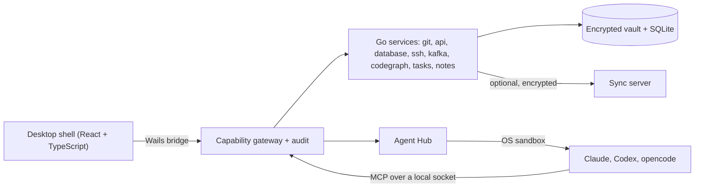

# DevKit

DevKit is a local-first desktop workbench for developers. It puts the things you reach for
every day in one window: coding agents (Claude, Codex, opencode), a code browser that
understands your services, Git and pull requests, an API client, notes, and clients for
databases, Kafka and SSH. Your credentials and notes live in an encrypted vault unlocked by a
Master Password, everything works offline, and sync is optional and zero-knowledge. It is built
with [Wails v3.0.0](https://wails.io): a Go backend and a React + TypeScript frontend.

DevKit is early and under active development. Parts of it are marked "not verified" below;
[`AGENTS.md`](AGENTS.md) records what has and has not been checked against real services.

## What you can do with it

**Work with several coding agents at once (Agent Hub).** Run Claude Code, Codex and opencode as
sessions side by side. Each session runs inside an OS sandbox (Seatbelt on macOS, bubblewrap on
Linux) and refuses to start without one. Pick the model and effort per session, and keep named
model profiles, which can also serve as subagents. A session can start child sessions, and
sessions can message each other. Attach files (text, images, PDF, `.docx`, `.xlsx`), give a
workspace shared instructions and memory, see each turn's file changes, restore them, or rewind
the conversation.

**Understand code across a workspace (CodeGraph).** A workspace is a set of folders. CodeGraph
indexes Java, TypeScript and Lua projects and shows entry points (HTTP, messages, schedules,
Kong plugin phases), call flows, the configuration a flow depends on, and the database tables it
touches. It also links services through the HTTP calls, Kafka topics and Redis keys they share.
Markdown and PDF files open in the same editor.

**Ship changes (Git, pull requests, accounts).** Stage by hunk, resolve conflicts in a
three-pane view, and commit as the identity of the account bound to the remote. Pushes are gated
by the remote's environment tag and there is no force push. DevKit tracks the pull request of a
branch (GitHub and GitLab) with its checks and review comments. Tokens and SSH keys live in
Accounts, and Git uses them without showing them to anyone.

**Call and inspect services.** The API client has collections, three scopes of variables,
environments, pasted cURL and Postman import/export. The database module browses schemas, runs
queries in consoles, edits table data and explains plans for PostgreSQL and MySQL/MariaDB. The
Kafka module browses topics and consumer groups, peeks at messages and publishes. The SSH module
manages host profiles with host-key checks, an interactive terminal and port forwards.

**Keep track of work.** Notes (rich-text editor, folders, tags, backlinks, history, trash) are
encrypted. Tasks live on boards that can run a verify command before a task may be closed. Small
developer tools (hashes, Base64, UUIDs, JSON, JWT decode) are one command away.

**Let agents use all of it, safely (MCP).** DevKit is an MCP server. An agent can read notes,
query a database, run a command over SSH, walk the CodeGraph, commit, open a pull request or
create a task, but only through tools that go through DevKit's permission checks. Tools that reach
a database, SSH host or Kafka cluster ask according to the environment's tag; pull-request writes
and pushes to protected branches always ask.

## Principles

- **Local-first.** The vault, notes and every module work offline. Data lives in a local
  SQLite database.
- **Encrypted at rest.** Secrets and note bodies are sealed with a key derived from your
  Master Password (Argon2id, XChaCha20-Poly1305). The vault is locked every time the app starts.
- **Zero-knowledge sync, optional.** The sync client encrypts before upload and resolves
  conflicts Git-style, with no automatic winner. The server only stores opaque encrypted envelopes.
- **Secrets stay out of agents.** No tool returns a credential to an agent. DevKit resolves
  tokens, keys and passwords itself at the moment of use.
- **Every action is gated and audited.** Calls pass one capability gateway that records an
  audit event. Environment tags (`dev`, `stg`, `prod`, your own) decide when you are asked, and
  on a tag that asks, every call asks.
- **Agents are sandboxed.** Agent processes write only where the session is allowed to, and
  `~/.ssh`, `~/.gnupg`, `~/.aws` and DevKit's own data directory stay hidden from them.

## How it fits together



The shell owns the sidebar, tabs and command palette; each module contributes views and
commands. Files, keys and network access live in Go; the frontend reaches them through the
bridge. Layering between Go packages is enforced by `go test ./internal/arch/`.

## Getting started

DevKit is developed macOS-first. Linux is supported (GTK 4 and WebKitGTK 6). The release
workflow builds macOS (arm64) and Linux (amd64) packages; Windows build tasks exist but are not
part of releases, and agent sandboxing is unavailable there. Agent Hub also needs the vendor's
runtime and an account (Claude, Codex or opencode); DevKit can install the runtimes itself.

Prerequisites: Go 1.26 or newer, [bun](https://bun.sh), [task](https://taskfile.dev) and the
`wails3` CLI pinned to the project version:
`go install github.com/wailsapp/wails/v3/cmd/wails3@v3.0.0`. On Linux add `libgtk-4-dev`
and `libwebkitgtk-6.0-dev`. CodeGraph for Java needs a
JDK; TypeScript and Lua need nothing extra at run time.

```bash
task dev            # native window with hot reload
task run:server     # no window: HTTP on loopback, without Agent Hub (see AGENTS.md)
task build          # production build of the desktop app
```

On first launch you create a Master Password; after that you unlock the vault each time. Sync
login needs an identity-provider config that DevKit fetches from its pinned API host or reads
from `DEVKIT_OIDC_*` variables; without it, everything else still works.

Checks used by CI:

```bash
go test ./internal/... ./cmd/...   # Go tests (the root package needs a GUI toolchain)
go test ./internal/arch/           # architecture layering
cd frontend && bun run test        # frontend tests
cd frontend && bun run build       # typecheck + build
```

To let an agent use DevKit's tools, run `task mcp:install AGENT=claude-code|codex SCOPE=global|project PROJECT=.`
or use Settings → Agents.

## Where to read more

- [`AGENTS.md`](AGENTS.md): developer and agent internals, run caveats, and what is verified.
- [`docs/dev-kit/`](docs/dev-kit/): product and architecture docs, written in Vietnamese.
  Start with [`implementation-status.mdx`](docs/dev-kit/implementation-status.mdx),
  [`security.mdx`](docs/dev-kit/security.mdx), [`agent-hub.mdx`](docs/dev-kit/agent-hub.mdx) and
  [`mcp-agent.mdx`](docs/dev-kit/mcp-agent.mdx).
- [`docs/design/`](docs/design/): design notes, including
  [module shell integration](docs/design/module-shell-integration.md) (read before adding a
  module) and [code organization](docs/design/code-organization.md).
- [`docs/design/running-and-configuration.md`](docs/design/running-and-configuration.md): every
  command, MCP setup, sync-login (`DEVKIT_OIDC_*`) settings and server-mode rules.
- [`docs/superpowers/`](docs/superpowers/): specs and plans for recent work.

## Status and license

- Not verified against real services: GitLab pull requests (tested against a fake host only),
  the full MCP path with a live Claude Code or Codex session in CI, and Windows.
- Not built yet: external plugins, a marketplace, team vaults. Gemini is not a supported agent.
- The sync server is a separate project and is not in this repository; `cmd/mocksyncserver` is
  an in-memory stand-in for development and tests.
- There is no `LICENSE` file yet, so no license has been chosen for DevKit itself. Bundled
  open-source notices are in [`THIRD_PARTY_LICENSES.md`](THIRD_PARTY_LICENSES.md) and in the app
  under Settings → Open source licenses.
