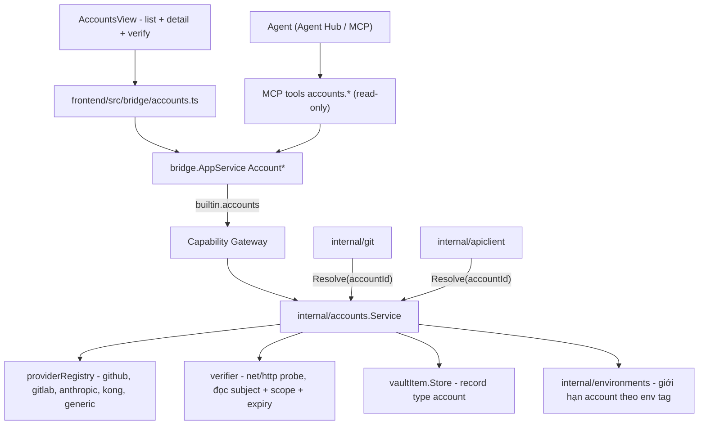
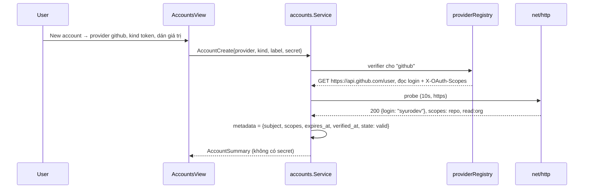

# Tài khoản

Accounts là built-in module giữ **danh tính** của người dùng trên các dịch vụ
bên ngoài (GitHub, GitLab, Kong Admin, một API nội bộ…), tách khỏi **kết nối**
mà từng module đã tự quản. Module khác không lưu token; nó lưu một `account_id`
và nhờ Go giải quyết secret **đúng lúc gọi**.

import { Callout } from 'fumadocs-ui/components/callout';

<Callout type="warn" title="Design only">
Chưa có runtime: chưa có `internal/accounts`, chưa có
`frontend/src/modules/accounts/`, chưa có record type `account` trong
`internal/vaultitem/schema.go`. Luật liên module (entity ref, intent) ở
[Liên module](/dev-kit/cross-module).
</Callout>



## Vì sao cần, khi đã có vault

Hôm nay credential nằm rải ở **năm** chỗ, mỗi chỗ đúng theo cách của nó:

| Ở đâu | Giữ cái gì |
|---|---|
| `db-profile` payload | password của một database cụ thể |
| `ssh-key-passphrase` | passphrase của một key cụ thể |
| `kafka-profile` payload | SASL credential của một cluster cụ thể |
| `internal/auth` + OS keychain | refresh token của DevKit Cloud |
| `internal/agenthub/auth.go` | **không giữ gì** — chỉ chạy lệnh login của vendor |

Chúng đều gắn với **một kết nối**. Đó là đúng: password của Postgres staging
không dùng lại ở đâu khác. Nhưng một **PAT GitHub** thì ngược lại — cùng một
token dùng cho `git push`, cho request tới `api.github.com` trong
[API Client](/dev-kit/api-client), và cho việc agent mở PR. Lưu theo kiểu cũ
là ba bản sao, ba lần xoay vòng, và không chỗ nào biết nó đã hết hạn.

Accounts sở hữu **chiều danh tính**; các module giữ nguyên **chiều kết nối**.
Không module nào bị viết lại.

<Callout type="info">
Đừng nhầm với `internal/identity` — package đó trả lời "**ai đang gọi
DevKit**" (`ui`, `agent:<id>`, `user-terminal`) để audit và gate. Accounts trả
lời "**tôi là ai trên dịch vụ ngoài**". Hai trục khác nhau; package mới tên
`internal/accounts`.
</Callout>

## BRD — Business requirement

### Vấn đề

Token sống trong `.env`, trong `~/.netrc`, trong clipboard, và trong ba module
khác nhau của DevKit. Không ai trả lời được "tôi đang đăng nhập những gì, cái
nào sắp hết hạn, cái nào có quyền `repo`". Khi agent cần push hay gọi API, cách
duy nhất là dán token vào prompt — nghĩa là token vào transcript, vào log, và
vào context của một model.

### Mục tiêu (goals)

- Một danh sách trả lời được "tôi đăng nhập những gì" — kể cả những thứ DevKit
  **không** giữ secret (Agent Hub vendor login, DevKit Cloud).
- Credential vào vault một lần, module khác tham chiếu bằng ID.
- Account được **verify**, không chỉ được lưu: biết subject, scope, hạn dùng.
- Agent chọn được account để dùng, **không bao giờ đọc được** giá trị.
- Token `prod` không dùng nhầm được cho `dev` và ngược lại.

### Actors

| Actor | Nhu cầu |
|---|---|
| Developer | Thêm/xoay/kiểm tra token; biết cái nào sắp hết hạn trước khi nó hỏng build |
| Module khác (Git, API Client) | Lấy credential đúng lúc gọi, không cache, không qua frontend |
| Agent trong Agent Hub | Chọn account cho `git.push` / `api.send` theo ID |

### Functional requirements

| ID | Requirement |
|---|---|
| FR-1 | Account có **kind**: `token` (PAT/API key), `basic` (user+password), `oauth` (access + refresh + expiry, DevKit tự refresh), `key` (trỏ tới SSH key đã có, **không** di chuyển key), `external` (DevKit không giữ secret). |
| FR-2 | Account có **provider** từ một registry: `github`, `gitlab`, `bitbucket`, `anthropic`, `openai`, `google`, `kong`, `generic`. Provider khai: kind nào nhận, verify bằng request nào, đọc subject/scope/expiry ở đâu. `generic` nhận URL verify do người dùng nhập. |
| FR-3 | **Verify là hành động chính**, không phải Save. Sau verify, account hiện `subject` (login/email thật), `scopes`, `expires_at`, `verified_at`. Verify thất bại ⇒ vẫn lưu được nhưng trạng thái `unverified`, hiện rõ. |
| FR-4 | Trạng thái dẫn xuất: `valid`, `expiring` (< 14 ngày), `expired`, `revoked` (verify trả 401), `unverified`. Badge trên nút module đếm số account **không** `valid`. |
| FR-5 | **Binding**: module khác lưu `account_id`, không lưu secret. Resolve chỉ xảy ra trong Go, ngay trước khi dùng, không cache quá vòng đời một call. |
| FR-6 | Account có thể **giới hạn theo env tag** (danh sách rỗng = dùng được mọi nơi). Binding tới một env ngoài danh sách bị từ chối ở service, không chỉ ẩn trong UI. |
| FR-7 | **Kind `external`**: DevKit ghi nhận danh tính tồn tại và cách đăng nhập lại, nhưng không giữ credential. Dùng cho Agent Hub vendor login (xem dưới) và DevKit Cloud. Không reveal được vì không có gì để reveal. |
| FR-8 | **Reveal** giá trị trong UI: qua `internal/interaction` + nhập lại Master Password, mỗi lần một account, có audit. Không có "đừng hỏi lại". |
| FR-9 | **Xoay vòng tại chỗ**: dán giá trị mới vào một account đang có ⇒ mọi binding tiếp tục chạy, không sửa module nào. Đây là lý do binding lưu ID chứ không lưu giá trị. |
| FR-10 | **Usage index**: account detail liệt kê ai đang dùng nó (remote git nào, request nào), lấy bằng cách hỏi ngược từng module — cùng cơ chế `ProfileEnvUsage` của env tag. Xoá account đang được dùng bị chặn, kèm danh sách. |
| FR-11 | Agent gọi được `accounts.list` / `accounts.get` / `accounts.status`. Cả ba **không bao giờ** trả giá trị credential. |
| FR-12 | Account là vault item ⇒ đồng bộ đa thiết bị như mọi vault item. `external` cũng sync (nó chỉ là ghi chú), `key` sync phần trỏ chứ không sync key. |

### Non-functional requirements

| ID | Requirement |
|---|---|
| NFR-1 | Mọi call qua `AppService.call` + Capability Gateway. `accounts:reveal` là capability riêng và **không nằm trong grant của MCP subject** — không phải "gate chặt hơn", mà là không tồn tại đường đó. |
| NFR-2 | Giá trị credential không bao giờ qua bridge theo chiều đi ra, trừ đúng luồng FR-8. `AccountSummary` không có field chứa nó. |
| NFR-3 | Audit ghi provider + subject + hành động (`verify`, `reveal`, `resolve`, `rotate`) và **tên module xin resolve**; không ghi giá trị. |
| NFR-4 | Verify dùng `net/http` trong Go với timeout 10s, chỉ `https` (trừ loopback), không theo redirect đổi host. |
| NFR-5 | Refresh OAuth chạy khi còn < 5 phút hạn và chỉ khi có người gọi resolve — không có job nền đánh thức mạng trên máy đang ngủ. |
| NFR-6 | Vault khoá ⇒ list vẫn chạy (metadata plaintext), resolve và reveal thất bại ngay với lỗi phân biệt được. |

### Out of scope (v1)

- Tự chạy OAuth authorization-code có trình duyệt cho provider bất kỳ. v1 nhận
  token có sẵn; `oauth` chỉ để **refresh** cặp token người dùng đã có.
- Chia sẻ account giữa nhiều người / team vault.
- Hardware key, YubiKey, passkey.
- Di chuyển credential đang nằm trong `db-profile` / `kafka-profile` sang
  Accounts. Chúng gắn với kết nối, đúng chỗ rồi — xem *Ranh giới* dưới.

### Acceptance criteria

- Thêm một PAT GitHub → Verify → list hiện `github · syurodev · repo, read:org · hết hạn 2026-12-01`.
- Token đó bị thu hồi trên GitHub → lần resolve kế tiếp báo `revoked` và
  `git.push` dừng với lỗi nêu tên account, không phải lỗi HTTP 403 trần.
- `accounts.get` từ agent trả subject và scope, **không** trả token; không có
  tham số nào bật được điều ngược lại.
- Account giới hạn `[prod]` → bind vào một API environment tag `dev` bị từ chối
  ở service (test gọi thẳng service, không qua UI).
- Dán giá trị mới vào account → request và git remote đang bind tiếp tục chạy,
  không sửa gì ở hai module đó.

## Ranh giới — cái gì **không** vào Accounts

Đây là phần dễ làm hỏng nhất, nên viết ra thành luật:

| Thứ | Ở đâu | Vì sao |
|---|---|---|
| Password của một DB profile | Ở `db-profile` | Nó là thuộc tính của **kết nối đó**, không dùng lại ở đâu khác. Đưa vào Accounts là thêm một lớp trỏ mà không ai được lợi. |
| SASL credential của Kafka cluster | Ở `kafka-profile` | Như trên. |
| SSH private key | Ở SSH module | Key là file trên đĩa với quyền của nó; Accounts chỉ **trỏ** tới profile (kind `key`) để danh sách "tôi đăng nhập gì" đầy đủ. |
| Credential đăng nhập Claude/Codex | **Không ở đâu trong DevKit** | `internal/agenthub/auth.go` cố ý không chạm tới: sign-in chạy bằng chính lệnh của vendor trong terminal người dùng nhìn thấy. Accounts ghi nó là `external` — có mặt trong danh sách, không giữ secret. |
| Refresh token của DevKit Cloud | OS keychain qua `internal/auth` | Keychain là chỗ đúng cho thứ mở được chính vault. Accounts ghi `external`. |

`external` là thứ khiến Accounts không phải một cuộc di cư: nó **mô tả** cái
đã có thay vì **lấy** cái đã có.

## Flow

### Thêm và verify



### Module khác dùng account

```mermaid
sequenceDiagram
  participant Git as internal/git
  participant Svc as accounts.Service
  participant GW as Capability Gateway

  Git->>GW: call(builtin.git, accounts:use, scope=account:<id>)
  GW->>Svc: Resolve(ctx, accountId, "git")
  Svc->>Svc: env của remote ∈ account.env? (FR-6)
  Svc->>Svc: oauth sắp hết hạn? → refresh (NFR-5)
  Svc-->>Git: Credential{Kind, User, Secret} — chỉ trong bộ nhớ Go
  Note over Git: dùng xong là hết; không cache, không qua bridge
```

Giá trị đi từ vault tới `net/http` hoặc tới `GIT_ASKPASS` **trong cùng một
process, không rời Go**. Frontend không bao giờ cầm nó; agent không bao giờ
thấy nó trong context.

## Technical design

### Components

- **`internal/accounts`** — `Service` (CRUD, verify, refresh, `Resolve`),
  `Provider` + `providerRegistry`, `verifier` bọc `net/http`.
- **`internal/bridge/accounts.go`** — `Account*` qua `AppService.call`, subject
  `builtin.accounts`.
- **`internal/mcp/tools_accounts.go`** — ba tool read-only.
- **`frontend/src/modules/accounts/`** — manifest, list + detail, dialog
  New/Verify; badge đếm account không `valid`.

### Provider là điểm mở rộng

Cùng hình dạng `Toolchain` trong [Code Graph](/dev-kit/codegraph): một **giá
trị** cho mỗi provider, không phải một nhánh `switch` rải khắp service.

```go
type Provider struct {
    ID      string            // "github"
    Name    string            // "GitHub"
    Kinds   []Kind            // kind nào provider này nhận
    Verify  VerifySpec        // request nào, đọc field nào
    Hosts   []string          // host để tự chọn account (API Client, git remote)
}
```

`Hosts` là thứ làm nên "nhanh": [API Client](/dev-kit/api-client) gửi request
tới `api.github.com` thì account GitHub đã verify được **chọn sẵn**, không phải
mở menu. Thêm provider = thêm một giá trị vào registry, không đụng service.

### Vaultitem contract

Một record type mới (thêm vào hai switch `IsSupportedItemType` và
`ValidateRecordSchema` trong `internal/vaultitem/schema.go`):

| Type | Metadata (plaintext) | Payload (mã hoá) |
|---|---|---|
| `account` | `provider`, `kind`, `label`, `subject`, `scopes`, `expires_at`, `verified_at`, `state`, `env` (list, optional), `ref` (kind `key`/`external`: trỏ tới profile hoặc mô tả cách login lại) | credential; với `external` là payload rỗng có dấu |

Metadata cố ý đủ để **liệt kê, lọc, và cảnh báo hết hạn mà không cần mở vault**
— đó là lý do list vẫn chạy khi vault khoá (NFR-6). Mẫu là `db-profile`.

`env` validate qua `EnvLookup.Exists`, và `DeleteTag` phải tính cả `account`
trong `ProfileEnvUsage` (`internal/app/envusage.go`).

### Bridge & capability

| Capability | Dùng cho | MCP có? |
|---|---|---|
| `accounts:read` | list/get (không giá trị) | có |
| `accounts:write` | tạo/sửa/xoá/verify/rotate | không |
| `accounts:use` | module khác resolve lúc gọi | không trực tiếp — agent chọn ID, module sở hữu mới resolve |
| `accounts:reveal` | hiện giá trị trong UI | **không, và không có cách bật** |

### MCP tool surface

| Tool | Capability | Ghi chú |
|---|---|---|
| `accounts.list` | `accounts:read` | summary: provider, subject, state, env |
| `accounts.get` | `accounts:read` | thêm scopes + expiry; **không** credential |
| `accounts.status` | `accounts:read` | tóm tắt "cái gì đang hỏng" để agent tự chẩn đoán lỗi 401 |

Agent muốn dùng một account thì truyền `accountId` cho tool của **module sở
hữu hành động** (`git.push`, `api.send`). Hai tool đó gate theo env của việc
đang làm. Không có đường nào từ MCP tới giá trị.

## Dùng nhanh từ Code Graph và Agent Hub

Account không phải thứ người ta chủ động mở. Nên mục tiêu là nó **biến mất**:

- **Chọn sẵn theo host.** `Try in API Client` trên một endpoint → account khớp
  `Provider.Hosts` (hoặc account dùng lần cuối cho env đó) đã được chọn. Không
  hỏi gì.
- **Chỉ hiện khi thiếu.** Không có account phù hợp, hoặc account `expired` ⇒
  một **peek** ngay trong module đang đứng (intent `accounts.pick`), không
  chuyển tab — luật 3 của [Liên module](/dev-kit/cross-module#nguyên-tắc).
- **Agent chẩn đoán được.** Agent gặp 401 khi gọi `api.send` → `accounts.status`
  trả `github: revoked`, agent nói được "token GitHub của bạn đã bị thu hồi"
  thay vì dán lại một stack trace.
- **Chip `account`.** `EntityRef` thêm kind `account`; chip hiện trong header
  request của API Client và trên dòng remote của [Git](/dev-kit/git).

## Known ceiling (v1)

- Một account một provider — không có "cùng token dùng cho hai host lạ nhau"
  ngoài `generic`.
- Không phát hiện được token bị thu hồi cho tới lần resolve/verify kế tiếp;
  không có webhook.
- `oauth` chỉ refresh, không tự chạy được luồng đăng nhập đầu tiên.
- Usage index (FR-10) chỉ thấy những module đã cắm vào — module mới quên cắm
  thì account của nó xoá được mà không cảnh báo.
