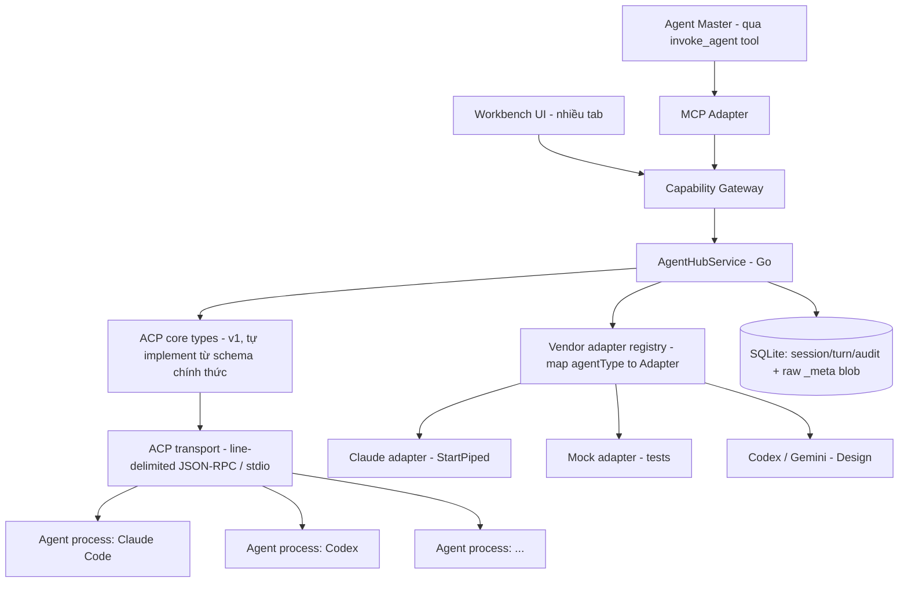
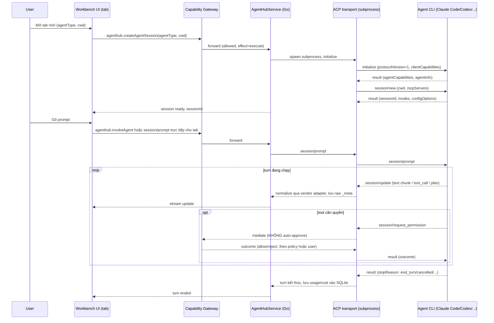
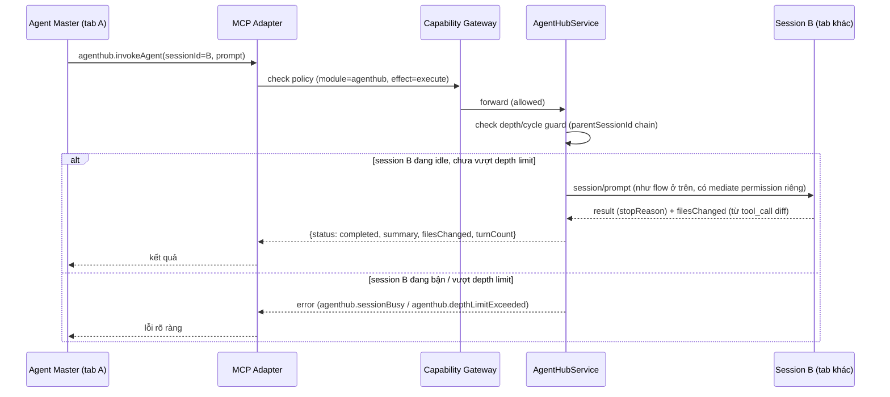

# Agent Hub (Multi-Agent Sessions)

Agent Hub là module built-in giúp DevKit tập trung chạy nhiều AI coding agent
(Claude Code, Codex, Gemini CLI, …) song song, mỗi session độc lập trong shell
rail và module content, quản lý qua Capability Gateway như mọi module khác. Trên nền đó, module mở thêm
khả năng **agent-gọi-agent**: chọn 1 agent làm "master", cấp cho nó 1 tool để
tự gọi sang agent khác lấy kết quả — không cần con người điều phối thủ công.

import { Callout } from 'fumadocs-ui/components/callout';

<Callout type="info" title="Implemented — Phase 4 v1 closed (Claude-only)">
Phase 4 đóng với runtime: `internal/acp`, `internal/agenthub` (Claude; mock chỉ là test double),
bridge/UI multi-tab, MCP `agenthub.*`, spawn qua
`sandbox.DefaultRunner().StartPiped(...)` (fail-closed). **Codex / Gemini
adapters vẫn Design** — thêm sau, không chặn đóng Phase 4. Chưa claim
production-verified vs Claude Code thật trong CI — smoke desktop. **Next:**
[Workbench UI (Phase 5)](/dev-kit/roadmap#phase-5--workbench-ui) theo
`dev-kit-app/DESIGN.md` (UI đủ flex cho vendor/tab). Sandbox:
[/dev-kit/sandbox](/dev-kit/sandbox). Status:
[Implementation status](/dev-kit/implementation-status).
</Callout>

Module đăng ký qua `ModuleManifest` như `vault`/`notes`/`db`/`ssh`/`tools`/`codegraph` hiện có — không tạo registry riêng. Đúng invariant #1 của `docs/architecture/devkit-architecture.md`: mọi call, từ UI lẫn từ agent master qua MCP, đi qua cùng `AppService.call` + Capability Gateway, không có đường tắt.

## Vì sao module riêng, không gộp vào Code Graph

Đã cân nhắc và quyết định tách: Code Graph là read-only index/query service (subprocess ngắn hạn, effect chủ yếu `read`). Agent Hub là orchestration layer cho tiến trình dài hạn (nhiều agent chạy song song, effect `execute` liên tục). Hai lifecycle và security surface khác nhau hoàn toàn. Agent Hub **tiêu thụ** Code Graph như một tool bình thường qua Capability Gateway (agent trong 1 tab có thể gọi `codegraph.getApiFlow`), không chia sẻ code nội bộ.

## BRD — Business requirement

### Vấn đề

Dev dùng nhiều agent CLI khác nhau (Claude Code, Codex, Gemini CLI...) nhưng phải tự mở nhiều terminal rời rạc, không nơi nào theo dõi tập trung trạng thái/chi phí/lịch sử các phiên đó. Khi cần chia một việc lớn cho nhiều agent làm song song, người dùng phải tự copy-paste kết quả qua lại — không có cơ chế để 1 agent tự gọi agent khác.

### Mục tiêu (goals)

- Chạy nhiều agent CLI song song, mỗi agent 1 tab, quản lý tập trung trong DevKit (mở/đóng/xem trạng thái/chi phí).
- Cho phép 1 agent (master) gọi 1 agent khác qua tool để giao subtask, nhận kết quả về, không cần con người chuyển tiếp thủ công.
- **Kiến trúc đủ "flex" để thêm agent vendor mới mà không sửa core**: đã xác nhận bằng thực nghiệm thật rằng dù cùng ACP wire format, mỗi vendor nhét dữ liệu khác nhau vào field mở rộng (`_meta`) — core logic không được giả định cấu trúc riêng của bất kỳ vendor nào.
- Tận dụng lại pattern Capability Gateway/MCP đã chốt cho Code Graph, không phát minh cơ chế permission/audit riêng cho agent-to-agent.

### Actors

| Actor | Nhu cầu |
|---|---|
| Developer dùng DevKit | Mở nhiều agent CLI trong nhiều tab, theo dõi trạng thái/chi phí, review kết quả từng phiên |
| Agent master (qua MCP) | Gọi 1 agent khác để thực hiện subtask, nhận kết quả (`summary`, `filesChanged`) về |
| Người triển khai module | Cần ranh giới rõ giữa core (vendor-agnostic) và adapter (vendor-specific) để thêm vendor mới không sửa lan ra toàn bộ codebase |

### Functional requirements

| ID | Requirement |
|---|---|
| FR-1 | User mở được 1 agent session mới (chọn `agentType` + working directory). *Hình thái "1 tab mỗi agent" đã được thay bằng swarm tree — xem [UI](#ui--ba-bề-mặt-design).* |
| FR-2 | Mỗi session là 1 tiến trình con ACP độc lập (agent CLI/adapter chạy qua stdio), không chia sẻ state với session khác. |
| FR-3 | UI hiển thị real-time các `session/update` (text chunk, tool call + status, plan) khi agent đang chạy turn. |
| FR-4 | Mọi `session/request_permission` từ agent con **phải** qua Capability Gateway để quyết định — không có chế độ auto-approve mặc định (khác hẳn dev tool tham khảo dùng khi research, vốn auto-approve mọi request). |
| FR-5 | Expose MCP tool `agenthub.invokeAgent` (+ `listAgents`/`createAgentSession`/`getSessionStatus`/`cancelAgent`) để 1 agent (đang chạy trong 1 tab) gọi sang agent khác. |
| FR-6 | `invokeAgent` có depth/cycle guard — chặn agent A gọi B gọi lại A vô hạn. |
| FR-7 | Mỗi agent vendor (Claude/Codex/Gemini...) có 1 adapter riêng implement chung 1 interface; core orchestration không đọc trực tiếp field riêng của vendor nào. |
| FR-8 | Field mở rộng (`_meta`) của mọi message luôn được lưu nguyên dạng raw JSON song song với field đã normalize — không silently drop dữ liệu vendor chưa được adapter xử lý. |
| FR-9 | Composer nối được available slash commands, context suggestions theo project (tối đa 100 file), file location mở trong Code Graph editor tới đúng dòng, và paste/drop ảnh giới hạn 3,75 MiB (tức 5 MiB base64 — giới hạn mỗi ảnh của Claude trên Bedrock/Vertex). |
| FR-10 | Composer đọc config/mode từ transcript và đổi model, effort, permission mode qua `session/set_config_option` / `session/set_mode`; bypass permissions luôn cần xác nhận rõ ràng. |
| FR-11 | Agent Hub dùng được bằng bàn phím và screen reader; trạng thái/hoàn tất được announce không theo từng token. Permission và lượt completed có notification OS khi cửa sổ không focus: một notification cho mỗi session (sự kiện sau thay notification trước), bấm vào mở đúng session; bật/tắt ở Settings → Agents → "Notify when an agent needs you or finishes" (mặc định bật). Gửi notification không bao giờ chặn permission, cancel hay kết thúc lượt: `agenthub.Notifier` chỉ xếp vào hàng đợi nền (tối đa 32, đầy thì bỏ) và gọi OS trên goroutine riêng. Quyền OS chỉ được xin khi cửa sổ nhận focus (lần đầu thường là lúc mở app) hoặc khi bật tuỳ chọn, không bao giờ khi đang có permission chờ — trước khi được cấp quyền thì không hiện gì. Service thông báo không đăng ký trực tiếp làm Wails service; một wrapper (`notificationStartup`) khởi động nó đúng chỗ Wails khởi động service — trong `app.Run`, trước run loop — để click vào notification mở/kích hoạt app trước lần focus đầu vẫn tới được delegate macOS và activation callback Windows, và wrapper luôn trả nil: không khởi động được (Linux không có session D-Bus — WSL, WM tối giản, container; macOS binary không có bundle identifier, như `go build` thường) thì notification tắt cho cả lần chạy, log một lần, app vẫn chạy. Caveat: macOS đã từ chối thì không hiện gì cho tới khi cho phép trong System Settings (lần focus sau tự nhận); Windows "update" là gửi toast mới (giới hạn wintoast); Shutdown của service được gọi khi thoát nếu nó đã khởi động được. |
| FR-12 | Prompt nhập trong lúc session bận được xếp hàng theo session. Mọi lượt (composer, companion, Retry, hàng đợi) đi qua một đường gửi (`sendAgentTurn`): session chuyển running trước khi invoke. Prompt rời hàng đợi ngay khi lượt của nó bắt đầu và không bao giờ bị gửi lại; chỉ khi backend từ chối trước khi lượt bắt đầu (busy, validation, chưa cài/chưa đăng nhập) nó mới về lại đầu hàng đợi. Backend kiểm tra toàn bộ input (prompt, attachment, ảnh) trước khi claim session, ghi/emit transcript hay đổi status, nên prompt bị từ chối không để lại dòng `user_message_chunk` nào và gửi lại không hiện trùng; status giữ nguyên. Hàng đợi tự gửi tiếp sau mỗi lượt completed, bất kể `agenthub:turnFinished` hay RPC về trước. Lượt lỗi/huỷ khi còn prompt chờ thì hàng đợi tạm dừng cho tới khi người dùng bấm Resume; gửi tay không tự resume. Hàng đợi không gửi vào session đã xoá, đã đóng, đang chạy hoặc đang chờ permission (gửi tay vào session đã đóng thì mở lại nó). Gửi tay bị backend báo busy thì prompt vào hàng đợi, không mất text. Plan sống cập nhật tại chỗ; session đóng vẫn đọc, đổi tên và mở lại được. Đổi tên, đổi status và title agent tự đặt mỗi thứ chỉ ghi cột của mình, nên đổi tên giữa lượt không ghi đè status và kết thúc lượt không ghi đè tên. |
| FR-13 | Agent đặt được câu hỏi cho người dùng qua ACP form elicitation (`elicitation/create`). DevKit khai `clientCapabilities.elicitation.form` — thiếu nó `claude-agent-acp` (0.74 lẫn 0.78) đưa `AskUserQuestion` vào `disallowedTools` và model chỉ viết câu hỏi thành văn xuôi; `url` cố ý không khai. Cùng một method phục vụ `AskUserQuestion`, elicitation của MCP server và lời nhắc refusal-fallback. `acp.Conn` chạy riêng method này ngoài read loop (mọi thứ khác vẫn đồng bộ, để `tool_call` luôn tới trước thẻ) và nhận `$/cancel_request`. `agenthub.ElicitationWaiter` xếp hàng nhiều câu hỏi mỗi session, **không có hạn giờ** và không đổi status session (lượt vẫn đang chạy); câu trả lời chỉ giữ key có trong schema với đúng kiểu, hỏng thì thành `decline`. Bridge: `AgentHubRespondElicitation` (`agenthub:execute`/`elicitation:respond`), `AgentHubPendingElicitations` (`agenthub:read`/`elicitation:list`); event `agenthub:elicitation`, `agenthub:elicitationClosed`. UI: thẻ `AgentQuestionCard` trong hội thoại (≤2 câu hiện cùng lúc, ≥3 câu và ở rail thì từng bước), toast `AgentQuestionToast` chỉ có Answer/Skip, dùng chung một góc với permission toast và permission được ưu tiên. Submit → `accept` (chỉ key đã trả lời; lựa chọn gửi ở `question_N`, text "Other" không rỗng gửi ở `question_N_custom` — từ 0.78 agent giữ lựa chọn làm câu trả lời và coi text là ghi chú, multi-select thì nối thêm), Skip → `decline` (tool chạy với câu trả lời rỗng), Stop → `cancel` (huỷ tool call). Field không render được vẫn bỏ qua được, nên câu hỏi không bao giờ thành ngõ cụt. Chưa làm: `elicitation.url`/`elicitation/complete`; elicitation của MCP không để lại dấu trong transcript. |
| FR-14 | **Checkpoint file mỗi lượt.** Jail chỉ cho agent ghi vào `project_path`, nên chụp cả cây ở ranh giới lượt bắt được **mọi** thay đổi — kể cả file sửa bằng Bash hay MCP, thứ checkpoint native của Claude không thấy. DevKit tự chụp bằng **shadow git** riêng: git dir ở `<dataDir>/checkpoints/<sha256(EvalSymlinks(project))[:16]>` (0700, có file `devkit-project` ghi đường dẫn gốc), project chỉ là work tree — `.git`, index và HEAD của người dùng **không bao giờ** bị đụng. `$GIT_DIR/info/attributes` đặt `* -text -eol -filter -ident -working-tree-encoding` (thắng `.gitattributes` của project) để khôi phục đúng từng byte; cố ý **không** có `-diff`, vì nó làm `diff-tree --numstat` coi mọi file là binary và mất số +/-. Env sạch: bỏ mọi `GIT_*` kế thừa, `GIT_CONFIG_GLOBAL/SYSTEM=/dev/null`, `GIT_ATTR_NOSYSTEM=1`, `GIT_TERMINAL_PROMPT=0`, `LC_ALL=C`. **Luôn bỏ qua** thư mục phụ thuộc (`node_modules`, `bower_components`, `.pnpm-store`, `.venv`, `venv`, `__pycache__`, `.gradle`, `.next`, `.nuxt`, `.turbo`, `.cache`, `.DS_Store`, repo con) — truyền cho `ls-files -x` **và** lọc lại trong Go; `-x` là thứ khiến git không đi vào thư mục đó, đó mới là chỗ 0,04s đến từ. Cố ý **không** chặn `dist/build/target/vendor` (vendor của Go là mã nguồn). Bỏ qua thêm: file > `maxFileSizeMiB` (file đang theo dõi lớn dần bị **ép** khỏi index, không chỉ không thêm), repo con, `extraExcludes` từ Settings. Trần 50k file/lần chụp → "project quá lớn". Đo trên repo này (955 MB, 1262 file): lần đầu 0,86s, các lần sau 0,04s, diff 27ms, shadow repo 9,2 MB. Retention: 30 ngày / 200 checkpoint mỗi session / trần mềm 1 GiB mỗi project / safety row 7 ngày; chạy nền lúc khởi động, xoá ref mồ côi, `pack-refs`, `gc --prune=now` khi ≥5000 loose object, xoá hẳn thư mục shadow của project không còn dòng nào. |
| FR-15 | **Thứ tự chụp quanh một lượt.** Chụp **before** bắt đầu ngay sau khi claim session, chạy song song với `runtimeFor` (tức trong khoảng thời gian resume process vốn đã tốn), join ngay trước `rt.Prompt` với ngân sách 5s — quá hạn thì **giết** và lượt chạy không có checkpoint: checkpoint không bao giờ được là lý do người dùng phải chờ agent. Khoá project là semaphore theo context, không phải `sync.Mutex`, vì một `Mutex` không bỏ được sẽ giữ quá ngân sách khi session khác đang chụp. Chụp **after** ngay sau khi `rt.Prompt` trả về, ở **một** chỗ duy nhất trước mọi nhánh đổi status, ngân sách 10s — idle là tín hiệu UI được gửi prompt tiếp, nên cây chụp sau điểm đó sẽ mang thay đổi của lượt sau mà đổ cho lượt này. **Không** đặt trong `defer`: defer chạy sau khi status đã đổi mà vẫn trông đúng từ phía caller. Diff + gán nguồn chạy nền sau đó. |
| FR-16 | **Nguồn của mỗi file đã đổi** — `agent` (report của vendor **hoặc** `tool_call.locations`, đường tuyệt đối đổi sang tương đối), `child:<session>` (nằm trong checkpoint của session con chạy lồng trong lượt), `unattributed` (không gì giải thích được). `unattributed` là câu trả lời thật chứ không phải nhãn thất bại: script Bash, MCP server, async task và session khác cùng thư mục đều vô hình với mọi tool call, nên `overlap` ghi kèm các session đang chạy cùng lúc để người dùng tự phán đoán, DevKit thì không đoán. Report của vendor lấy qua `_meta.jetbrains.air.agentFileChangeReportRequest{version:1,requestId:<checkpointID>}` trên prompt; nó tới trên `session_info_update` **cùng lúc** prompt response (đo ở spike S7) nên report tới **sau** khi dòng đã ghi vẫn phải quay lại sửa dòng đó. Khai `agentFileChangeReport` **chỉ khi** checkpoint đang bật: khai nó bật luôn checkpoint native của Claude cho mọi session trong process, ghi file history dưới `~/.claude` — người dùng đã tắt thì không được có file history từ bên nào. |
| FR-17 | **Khôi phục code.** `PlanRestore(mode undo\|toBefore\|undoRestore)` → `RestorePreview{token}` (chỉ đọc) → `ApplyRestore(token, overwrite[])`. "Hoàn tác lượt này" và "về trước lượt N" là **cùng một câu hỏi hỏi hai lần**: cùng cây đích (before tree của lượt N), cùng "hiện tại mong đợi", chỉ khác tập path — nên engine chỉ thêm bộ lọc `only`, không phải nhánh code thứ hai. "Hiện tại mong đợi" là after tree của checkpoint **mới nhất**: snapshot là cây đầy đủ chứ không phải delta, nên cây mới nhất đã mang nội dung cuối cùng đã biết của mọi path. Path lệch khỏi cây đó là xung đột — mặc định bỏ qua, người dùng tick mới ghi đè. **Từ chối** ba thứ, không bao giờ đoán: path không cây nào giữ nội dung (quá lớn/repo con/bị deny), lượt không có snapshot đầu (xấp xỉ bằng cây khác sẽ xoá file lượt đó chưa từng tạo), và **caller là agent** — chặn ở cả `PlanRestore` lẫn `ApplyRestore` chứ không chỉ "không đưa vào MCP tool", vì agent hoàn tác được lượt của chính nó là agent giấu được việc mình làm. Luôn chụp safety trước khi ghi và **thất bại nếu không chụp được**; token opaque, giữ ở backend, **dùng một lần**, TTL 15 phút; từ chối khi session đang chạy/chờ permission/giữ claim; cảnh báo khi session khác đang chạy cùng project. |
| FR-18 | **Rewind: hội thoại + code.** Vendor fork được session tại một message của chính nó, nên rewind = fork + cắt. Hai câu hỏi khác nhau: **fork point** là messageId *vendor* biết (message **mới nhất** của luồng chính trước lượt N — bỏ qua subagent theo `origin`, vì vendor giữ message đó trong session riêng của subagent, cha chưa từng có), **cut** là số dòng *DevKit* biết (prompt đầu tiên **sau** fork point — có thể sớm hơn lượt người dùng chỉ, vì lượt lỗi/huỷ để lại prompt không có gì để branch vào; nó bị cắt theo và `extraTurnsDropped` nói rõ trước). Adapter `Fork` làm cả hai call trong **một** process: initialize → `session/fork{sessionId,cwd,mcpServers,_meta.jetbrains.air.fork{version:1,messageId}}` → `session/load(newId)`; `_meta` **gộp** với `claudeCode.options.settingSources: []` vì fork tạo session vendor mới nên cũng cần cắt khỏi `~/.claude/settings.json`; vendor trả về chính id nguồn → từ chối. Thứ tự 10 bước có ý nghĩa: đóng runtime cũ **trước** khi ghi gì (runtime còn sống vẫn ghi transcript — async task, subagent — vào đúng chỗ đang bị cắt), safety row `pending` **trước** fork (từ đó crash để lại file ở trạng thái không biết, và dòng đó là thứ duy nhất nói lên điều ấy), rồi fork → khôi phục code → **một transaction** (acp_session_id mới, cắt transcript giữ mode/config/commands **và đánh số lại từ cut**, xoá usage, xoá turns/checkpoints của prompt bị cắt, safety → done) → publish + **áp lại mode/model** (đo ở spike S2: session fork ra về mode mặc định của vendor) → event → best-effort `session/delete(oldId)`. Hai nửa luôn tách rời được: vendor không fork được vẫn khôi phục file được, và người chỉ muốn lấy lại file không phải mất hội thoại để có. Bất đối xứng nói rõ trước khi bấm: file lấy lại được từ safety tree, hội thoại thì **không** (session vendor cũ bị xoá). Rewind dở dang (safety row còn `pending` lúc khởi động) → banner, **không** tự động revert. |
| FR-19 | **Settings → Agents → File checkpoints**: công tắc + `maxFileSizeMiB` + `retentionDays` + `extraExcludes` (một pattern mỗi dòng), lưu thành một giá trị JSON dưới key `agent_checkpoints` (đọc được cả giá trị boolean thuần của bản trước), số nằm ngoài biên bị **kẹp** chứ không bị từ chối. Dòng trạng thái luôn tách hai sự thật: máy **làm được không** (git ở đâu, phiên bản nào / "cần Command Line Tools — `xcode-select --install`" / "git quá cũ") và người dùng **có bật không** — "off" trơ trọi đọc như hỏng, "on" trên máy không có git là nói dối. Project không chụp được (quá lớn…) được liệt kê kèm lý do, vì không có nó thì "project quá lớn" trông y hệt "tính năng im lặng không chạy". Đổi số áp dụng **ngay** (engine giữ nguyên shadow repo đã warm), không đợi khởi động lại. |

### Non-functional requirements

| ID | Requirement |
|---|---|
| NFR-1 | Target ACP **protocol version 1** cho v1 của module (bản các agent CLI thật đang implement, có `fs`/`terminal` client-side surface để Gateway mediate). Protocol version 2 (draft, breaking redesign — bỏ hẳn `fs`/`terminal`, đổi hoàn toàn prompt lifecycle) để sau, gate qua feature flag khi ổn định, không target ngay từ đầu. |
| NFR-2 | Transport layer (line-delimited JSON-RPC/stdio) tách khỏi type layer (struct theo protocol version) — thêm version mới chỉ thêm bộ struct + dispatcher, không viết lại transport. |
| NFR-3 | Mọi call — UI lẫn agent master qua MCP — đi qua cùng `AppService.call` + Capability Gateway, không có đường tắt riêng cho agent-to-agent. |
| NFR-4 | Subprocess phải cancel/timeout được. Thực nghiệm cho thấy agent không luôn tự thoát khi đóng stdin (`agent did not exit on stdin EOF`) — bắt buộc có timeout kill sau `session/cancel`, fallback SIGTERM rồi SIGKILL nếu vẫn không thoát. |
| NFR-5 | Session data (transcript, cost, usage) lưu local mặc định, không sync ra ngoài — derived/cache data có thể chứa nội dung proprietary của project đang mở, giống nguyên tắc đã áp cho index Code Graph. |
| NFR-6 | `session/request_permission` phải có timeout riêng ở tầng Gateway — nếu không có quyết định kịp thời (UI không phản hồi, policy không khớp rule nào), mặc định **reject** (fail closed), không phải allow. |

### Out of scope (v1)

- Router thông minh tự động chọn agent theo intent — v1 chỉ có `invokeAgent` tường minh theo `sessionId`, không có "agent nào phù hợp nhất cho việc này".
- Nhiều client cùng đồng bộ xem 1 session (kiểu AHP mutex-over-ACP cho collaboration) — v1 chỉ 1 UI điều khiển 1 session.
- Target ACP protocol version 2.
- Tự động phát hiện/cài đặt agent CLI mới trên máy user — v1 chỉ hỗ trợ agent đã có adapter được viết sẵn trong DevKit. (DevKit **có** tự cài package ACP của agent đã có adapter, đúng phiên bản đã khoá — xem [Runtime do DevKit quản lý](#runtime-do-devkit-quản-lý-implemented) — nhưng không dò hay cài agent lạ.)

### Acceptance criteria

- Mở 2 tab với 2 `agentType` khác nhau, chạy song song không tranh chấp resource, không rò state giữa 2 session.
- Agent master gọi `agenthub.invokeAgent` tới 1 session khác đang idle → nhận lại `summary` + `filesChanged` đúng shape thiết kế, session đó không bị 2 turn chạy chồng.
- Permission request từ agent con hiển thị thật trên UI (hoặc match policy rule đã lưu) — không có request nào bị tự động allow ngầm.
- Kill cứng 1 agent subprocess (giả lập crash) → session chuyển `status: error` rõ ràng trong vài giây, UI không treo, các tab khác không bị ảnh hưởng.
- Thêm 1 vendor mới (giả lập, ví dụ mock agent) chỉ cần viết 1 file adapter mới implement `VendorAdapter`, đăng ký vào registry — không phải sửa `AgentHubService` hay bất kỳ struct core nào.

## Flow

### Tab lifecycle — dựa trên trace thật (initialize → session/new → prompt turn → permission)

### `invokeAgent` — agent master gọi agent khác

## Technical design

### Components

- **ACP transport (Go, tự implement)** — line-delimited JSON-RPC 2.0 qua stdio, quản lý lifecycle subprocess (spawn, `session/cancel`, SIGTERM→SIGKILL timeout). Không phụ thuộc package community bên ngoài — lý do: đây là core dependency chạm tới execute-permission, rủi ro bus-factor của 1 package chưa ai official-support không chấp nhận được cho phần này.

  > **Nguyên tắc này hiện chỉ giữ được ở nửa phía client.** ACP client là code Go của DevKit, không phụ thuộc code nào của Zed. Phía agent với vendor Claude thì runtime dependency là package `@agentclientprotocol/claude-agent-acp`, nằm ngay trong đường execute-permission — `claude` CLI tự nó không nói ACP. ACP registry ghi tác giả package là Anthropic, Zed Industries và JetBrains. License không thống nhất: `package.json` ghi Apache-2.0, registry ghi `proprietary`, vì Claude Agent SDK đi kèm bên trong là proprietary. DevKit khoá phiên bản package này thay vì chạy bản máy tình cờ có — xem [Runtime do DevKit quản lý](#runtime-do-devkit-quản-lý-implemented).
  >
  > Phụ thuộc còn sâu hơn "spawn binary của họ": cách ly permission của DevKit đi qua `session/new` `_meta.claudeCode.options` — **extension riêng của package đó, không thuộc spec ACP**. Hai thứ bám vào đó: `settingSources: []` (chặn `~/.claude/settings.json` của người dùng cấp allow rule vượt cổng) và `settings.hooks.PreToolUse` (chặn tool đọc credential mà jail buộc phải bind RW). Package đổi đường là cả hai lặng lẽ mất, agent vẫn chạy bình thường.
  >
  > Chốt lại bằng test, không bằng niềm tin: `TestClaudeACPMetaChannelStillWorks` chạy agent thật và assert hook thực sự chặn. Hook được cài qua đúng kênh với `settingSources`, nên một assert phủ cả hai. Đã verify chiều ngược lại — đổi tên option làm test đỏ.
- **ACP core types (protocol v1)** — `internal/acp/types_v1.go`: struct Go cho request/response/notification theo schema v1 chính thức (`initialize`, `session/new`, `session/load`, `session/delete`, `session/prompt`, `session/cancel`, `session/update`, `session/request_permission`, `fs/*`, `terminal/*`, content block). Mọi field `_meta` trên các struct này khai báo kiểu `json.RawMessage` — **core không bao giờ parse cứng nội dung `_meta`**.

  **Ranh giới: `internal/acp` giữ hình dạng dây, `internal/agenthub` giữ hình dạng DevKit đọc.** `session/update` là polymorphic — transport để nguyên nó là blob (`acp.SessionUpdateParams.Update`), và struct tool call, plan, session mode, subagent, usage nằm ở `internal/agenthub/update.go` vì chúng là dạng **đã chuẩn hoá**: chúng có tag JSON được ghi thẳng vào SQLite và được `frontend/src/modules/agenthub/types.ts` soi gương từng field. Đưa chúng xuống `internal/acp` là bắt tầng protocol gánh luôn schema lưu trữ và hợp đồng UI của DevKit.

  **Ngoại lệ có chủ đích: content block chỉ có một.** Nó là hình dạng dây, không phải bản dịch của hình dạng dây — cùng object cho cả prompt gửi đi lẫn chunk nhận về. `agenthub.ContentBlock` vì thế là alias tới `acp.ContentBlock`, không phải bản sao. Trước đó nó là bản sao, và bản sao đã lệch thật: `acp.ContentBlock` mọc thêm `resource` khi prompt biết mang nội dung file, bản sao thì không — một embedded resource agent gửi về sẽ mất phần thân trên đường ra UI. `TestParseSessionUpdateKeepsAnEmbeddedResource` là cái đỏ lên nếu bản sao quay lại.
- **Vendor adapter registry** — `map[AgentType]VendorAdapter`. Mỗi adapter chịu trách nhiệm:
  1. Biết cách spawn agent tương ứng qua `sandbox.DefaultRunner().StartPiped`
     (node + entry tuyệt đối từ [runtime DevKit cài](#runtime-do-devkit-quản-lý-implemented),
     biến môi trường auth cần thiết) — **không**
     dùng unsandboxed `exec` / `acp.StartProcess` cho vendor thật.
  2. Normalize `_meta` thành model chung DevKit dùng nội bộ (`NormalizedUsage{cost, rateLimit}`, `NormalizedToolResult{stdout, stderr, ...}`) — ví dụ vendor Claude đã quan sát thật: `_meta.claudeCode.toolResponse`, `_meta._claude/rateLimit`, `_meta._claude/origin`, `_meta.permission.changes`. Codex/Gemini gần như chắc chắn có shape khác — mỗi vendor tự viết adapter riêng, core không đụng tới.
  3. Khai báo custom extension method vendor hỗ trợ (ví dụ Claude có `_session/steering`, `_session/goal` — không phải core spec) để UI biết bật/tắt tính năng theo từng tab.
- **AgentHubService (Go)** — orchestrate session lifecycle, gọi Capability Gateway cho **mọi** `session/request_permission` (không có nhánh auto-approve nào trong service này), quản lý depth/cycle guard cho `invokeAgent`, ghi SQLite (session, turn, usage/cost đã normalize, và raw `_meta` blob để audit/debug không mất dữ liệu).
- **Storage** — SQLite riêng cho session/turn/audit log (không qua vault/crypto envelope, cùng lý do như Code Graph: đây là derived/operational data, không phải secret cần mã hóa — nhưng vẫn không sync ra ngoài mặc định vì có thể chứa nội dung proprietary).
- **Bridge + MCP adapter** — cùng gọi `AgentHubService`, cùng đi qua Capability Gateway, đúng pattern đã dùng cho Code Graph.

### Vì sao cần lớp "flex" này — bằng chứng thực nghiệm

Khi test `@agentclientprotocol/claude-agent-acp` thật (không phải suy luận từ docs), quan sát được:

- Field chuẩn ACP (`content`, `rawOutput`) cho tool result thường chỉ có tóm tắt sơ sài (`"(Bash completed with no output)"`).
- Dữ liệu chi tiết thật (stdout/stderr đầy đủ, cost theo USD, rate limit status, cấu trúc policy khi user chọn "allow always") **chỉ nằm trong `_meta`, theo namespace riêng của Claude** (`claudeCode`, `_claude/*`).
- Docs chính thức phần `error.mdx` hiện là placeholder rỗng — không có danh sách error code chuẩn để dựa vào, hành vi lỗi thực tế phải quan sát per-vendor.

Kết luận thiết kế: **core layer chỉ nên cam kết với phần schema đã chuẩn hóa chính thức**; mọi thứ nằm trong `_meta` hoặc ngoài spec (error cụ thể, custom method) phải đi qua vendor adapter. Đây không phải phỏng đoán trước mà là quan sát trực tiếp từ 1 vendor thật — nên thiết kế interface `VendorAdapter` ngay từ v1, không để "thêm sau".

### MCP tool surface

| Tool | Effect | Mô tả |
|---|---|---|
| `agenthub.listAgents` | `read` | Liệt kê session đang mở (tab), kèm `status` |
| `agenthub.createAgentSession` | `execute` | Spawn 1 agent CLI mới (`agentType`, `cwd`); nếu gọi từ trong 1 session khác, `depth = parent.depth + 1`. Parent lấy từ identity của caller, không từ tham số; `cwd` phải nằm trong `projectPath` của cha (xem [Agent identity](#agent-identity--ranh-giới-giữa-các-session-implemented)) |
| `agenthub.invokeAgent` | `execute` | Gửi prompt vào 1 session, chờ turn xong hoặc timeout (blocking ở v1), trả kết quả |
| `agenthub.getSessionStatus` | `read` | Poll trạng thái 1 session |
| `agenthub.cancelAgent` | `execute` | `session/cancel` cho turn đang chạy trong 1 session. **Design:** chỉ với tới cây con của caller |

`invokeAgent` là **blocking/sync ở v1** (giữ đúng semantics mà agent CLI vốn đã quen khi tự gọi subagent nội bộ, không bơm thêm concept job/polling mới); chuyển sang async job pattern là việc mở sau nếu blocking call thực sự gây nghẽn, không phải build sẵn.

### Data model tối thiểu

`AgentSession` giữ: `id`, `agentType` (`claude` | `codex` | `gemini` | …),
`projectPath`, `status` (`idle` | `running` | `awaiting_permission` | `error` |
`done`), `parentSessionId` (ai đã spawn session này, null nếu là gốc), `depth`
(0 khi không có parent), `title` (lấy từ `session_info_update` nếu vendor hỗ
trợ), `createdAt`.

`TurnRecord` giữ: `sessionId`, `stopReason`, `usage` đã normalize (cost, token —
do vendor adapter quy đổi), và `rawMeta` — toàn bộ `_meta` chưa parse, giữ
nguyên cho audit.

### Error handling

- ACP core spec **chưa định nghĩa error code chuẩn** (`error.mdx` là placeholder) — thiết kế không dựa vào bộ mã lỗi ACP-specific không tồn tại. Mọi lỗi transport/subprocess (pipe đóng bất thường, timeout, crash) map về error code riêng của DevKit (`agenthub.*`), không cố suy đoán mã ACP.
- Agent không tự thoát khi đóng stdin (quan sát thật) → sau `session/cancel`, có timeout chờ thoát tự nhiên, hết hạn thì SIGTERM, vẫn không thoát thì SIGKILL.
- `session/request_permission` không có phản hồi kịp thời → mặc định **reject** (fail closed), không phải allow — khác hẳn hành vi auto-approve của dev tool dùng lúc research.
- Query `invokeAgent` vào session không tồn tại / đã đóng → `agenthub.sessionNotFound`, không trả kết quả rỗng ngầm định.
- Vượt depth limit → `agenthub.depthLimitExceeded`, chặn trước khi spawn thêm session.
- **Design:** target ngoài cây con của caller → `ErrNotDescendant` (bridge map
  permission denied); `cwd` ngoài `projectPath` cha → `ErrCwdOutsideParent`;
  `callerSessionId` khác identity thật → `ErrCallerMismatch` (cả hai map
  validation_failed); không tìm thấy proxy `devkit-mcp` → `ErrProxyNotFound`
  (unavailable). Mọi lỗi này xảy ra **trước khi spawn** — không để lại process
  hay socket mồ côi.

### Agent identity & ranh giới giữa các session (Implemented)

Đã triển khai trong `internal/identity`, `internal/mcp/session_host.go` và kiểm chứng qua `internal/agenthub/service_identity_test.go`, `internal/mcp/identity_test.go`. Cơ chế này giải quyết lỗ hổng được chỉ ra trong đợt review 2026-09-05 (xem [Security controls](/dev-kit/security-controls)): trước đây runtime không phân biệt agent nào đang gọi, 56 MCP handler bỏ qua session, `PermissionWaiter` và `interaction.Hub` chỉ giữ một pending cho cả app, và `createAgentSession` không kiểm soát `cwd`. Hệ thống đóng toàn bộ nhóm vấn đề này bằng một cơ chế thống nhất.

**Identity = socket.** Mỗi hub session được một unix socket riêng
`<UserConfigDir>/DevKit/agents/<16 hex đầu session id>.sock` (rút gọn vì
`sun_path` macOS giới hạn 104 byte; vượt là lỗi rõ, không cắt ngầm). DevKit
gắn `Caller{agent, sessionID}` ngay lúc `Accept`, không có bước xác thực nào,
vì **chỉ sandbox của đúng agent đó** được nối vào socket đó
(`Policy.AllowUnixSockets`, xem [Sandbox](/dev-kit/sandbox)). Kẻ giả mạo phải
thắng kernel, không phải thắng code. Socket chung `mcp.sock` giữ nguyên cho
terminal của người dùng với identity `user-terminal`. Chi tiết phía MCP:
[MCP / Agent § Caller identity](/dev-kit/mcp-agent#caller-identity--socket-riêng-cho-từng-agent-hub-session-implemented).

**Thứ tự tạo session đảo lại.** `CreateSession` hiện `adapter.Open` trước rồi
mới sinh UUID (`service.go:70-110`); phải sinh id trước → mở socket cho id đó
→ `Open` với `cwd` + socket được phép + `mcpServers` → persist. `agenthub`
không import được `mcp` (chiều ngược đã có) nên khai báo một interface nhỏ
"mở endpoint MCP cho session id, trả cấu hình `mcpServers` + đường dẫn socket
+ hàm đóng"; `mcp` cung cấp implementation, nối ở `main.go` — cùng pattern
`EnvLookup`. `VendorAdapter.Open(ctx, cwd)` thành `Open(ctx, spec)` với
`cwd`, socket được phép, `mcpServers`; Codex/Gemini sau này nhận cùng spec.

**Quy tắc hậu duệ.** Service đọc caller từ `ctx`:
- Caller **agent**: `CreateSession` ép parent = caller (tham số
  `callerSessionId` lệch → `ErrCallerMismatch`); depth luôn tính từ row của
  caller nên `CheckDepth` không còn đường né; `Invoke` / `Cancel` / `Get` /
  `List` chỉ với tới **cây con** của caller (`ancestorContains` đã có). Session
  người tạo từ UI không thuộc cây con của agent nào.
- Caller **ui / user-terminal**: như hôm nay; `CheckCycle` giữ cho đường này.

**`cwd`.** Caller agent: rỗng → kế thừa `projectPath` cha; có giá trị →
`EvalSymlinks` rồi phải là subpath của `projectPath` cha. Mọi caller: từ chối
`/` và đúng thư mục home — không cái nào là project, và đây là tiền đề của
chuỗi tấn công trong review. Khi có Workspace registry, nới thành "path đã
đăng ký trong workspace của cha".

**Pending không còn single-slot.** `PermissionWaiter` giữ map theo pending id,
một pending mỗi caller; `Complete(id, …)` giữ hợp đồng. `PendingPermission`
mang caller; bridge làm giàu title + depth để dialog hiện *"Agent «…» (depth
2) xin: …"*. Session đóng → hook `OnSessionClosed(id)` (set ở `main.go`) để
`interaction.Hub` quên `allow_always` của session đó.

**Không đổi trong spec này:** `invokeAgent` vẫn blocking; `MaxDepth = 3`;
`codegraph.*` vẫn `project:active` (cần [Workspace](/dev-kit/workspace)).

**Đã kiểm chứng end-to-end (2026-09-05).** Một session Claude thật, spawn
trong sandbox, gọi được `env.listTags` của DevKit: dòng audit
`caller = agent:<uuid>` / `env:read` / `tag:list` / `allowed` join đúng vào
`agent_sessions`. Đó là bằng chứng cho cả chuỗi — socket riêng theo session,
middleware đóng dấu caller, gateway kiểm capability, SQLite lưu kèm caller và
timestamp.

### Vendor agent cần gì để xác thực (Implemented)

Jail giấu `$HOME`, và thiết kế ban đầu **giả định agent dùng API key**. Đăng
nhập bằng subscription thì không: agent bắt tay ACP xong rồi chết ở lượt prompt
đầu tiên với `-32000 Authentication required` (đo được: ~70ms, session sang
`error`, không turn nào). Bốn thứ phải có, mỗi thứ tìm ra bằng cách đo lỗi kế
tiếp — không cái nào suy ra được từ đọc code:

| Cần | Vì sao | Biểu hiện khi thiếu |
|---|---|---|
| `~/.claude` + `~/.claude.json` read-write | config và session state của Claude Code | không đọc được settings |
| Keychain | OAuth token thật nằm ở đó — xem [Sandbox § AllowKeychain](/dev-kit/sandbox#allowkeychain-implemented) | `Authentication required` |
| `USER` (+ `LOGNAME`) trong env allowlist | auth subscription resolve tài khoản qua đây | `Authentication required` **dù keychain đọc được** |
| `mcpServers` luôn có mặt trong `session/new` | schema v1 bắt buộc, `omitempty` làm nó biến mất | `-32602 Invalid params` |

Grant là **đúng hai path**, không bao giờ cả `$HOME` — có test khoá điều đó.
Đây là nhượng bộ có chủ ý: bất cứ thứ gì chạy trong jail đó đọc được credential
của agent. Đổi lại, agent do DevKit spawn mới hoạt động được với tài khoản
subscription.

### Runtime do DevKit quản lý (Implemented)

Adapter Claude không còn lấy từ PATH hay `npx`. Trước đây `main.go` chọn **một
lần lúc khởi động**: `claude-agent-acp` trên PATH, không có thì `npx -y`. Cả hai
đều hỏng theo cách riêng: app mở từ Dock/Finder kế thừa PATH tối thiểu của
launchd nên không thấy bản cài qua nvm/Homebrew; `npx` cần `~/.npm` ghi được và
chết `EPERM` trong jail trước khi tải được gì (đo được); và phiên bản chạy là bản
máy tình cờ có, trong khi cách ly permission phụ thuộc vào kênh `_meta` riêng của
package. Giờ DevKit tự cài một bản đã khoá vào thư mục của nó. Code:
`internal/agentruntime`, `ClaudeOptions.Runtime` + `ClaudeAdapter.Probe` trong
`internal/agenthub/adapter_claude.go`, `internal/bridge/agentruntime.go`. Spec:
`docs/superpowers/specs/2026-09-13-agent-runtime-install-design.md`.

**Nơi cài và phiên bản.** `<UserConfigDir>/DevKit/runtimes/claude-acp/<version>/`
(cây `npm --prefix` + `install.json`), cạnh `current.json` (`version`,
`previous`) và `settings.json` (file chạy Claude). Mặc định là `TestedVersion`
khoá trong `internal/agentruntime/agentruntime.go` — hiện **0.78.0** (nâng từ 0.74.0 ngày 2026-09-17). Bản mới
nhất đọc từ ACP registry (cache `runtimes/registry.json` kèm ETag, chỉ tải khi
gọi `AgentRuntimeCheckLatest`, mất mạng thì dùng cache) và chỉ được đề nghị như
một bản cập nhật chưa kiểm thử, người dùng tự chọn cài.

**Yêu cầu máy.** Node ≥ 22 (engines floor của adapter) có `npm` cạnh bên. Thứ tự
dò: nvm, `$NVM_DIR`, Volta, fnm, Homebrew, `/usr/local`, rồi PATH; chọn bản mới
nhất, lấy `process.execPath` của chính nó nên shim và symlink Cellar được
resolve. Thiếu thì báo requirement kèm lệnh cài — **DevKit không bao giờ tải
Node**.

**Luồng cài** — trong backend, ngoài sandbox (cần mạng và quyền ghi),
single-flight theo agent:

1. **Staging**: `npm install --prefix <agent>/.staging-<ver>-* <package>@<ver>
   --ignore-scripts --no-audit --no-fund --omit=dev --no-update-notifier`. Env là
   env của host với thư mục node đứng đầu PATH và `npm_config_cache` riêng ở
   `runtimes/.npm-cache` (không đụng `~/.npm`); `HOME` giữ nguyên để npm đọc
   `.npmrc`. `--ignore-scripts` bắt buộc vì bộ cài chạy ngoài jail — không code
   nào của package chạy trước bước probe trong sandbox. Mỗi dòng output (đã lọc
   credential) phát ra event `agenthub:runtimeInstallOutput` `{agent, line}`.
2. **Xác minh tĩnh**: entry có mặt, `package.json` đúng phiên bản yêu cầu,
   `package-lock.json` có mặt, binary Claude đi kèm đúng nền tảng tồn tại và thực
   thi được (trừ khi đang chọn bản trên máy).
3. **Xác minh chạy**: `ClaudeAdapter.Probe` (nối làm `Manager.Verify` ở
   `main.go`) khởi động bản staging **trong sandbox với đúng policy của phiên
   thật** (`sandboxFor`, chung cho Open/Load/Probe), gửi `initialize` giới hạn 20s
   rồi dừng. Không tạo session, nên không đụng credential hay model.
4. **Kích hoạt nguyên tử**: rename staging → `<version>/`, ghi `current.json` qua
   tệp tạm + rename; bản đang dùng trước đó thành `previous`. Lỗi ở bất kỳ bước
   nào: xoá staging, `current.json` giữ nguyên. Hủy bridge call thì kill npm và
   xoá staging.
5. **GC lúc khởi động**: `main.go` gọi `GCOnStartup` đồng bộ, trước khi phiên nào
   mở được — luôn xoá `.staging-*`/`.trash-*`, còn phiên bản ngoài
   `current`/`previous` chỉ bị xoá khi `current.json` đọc được.

`AgentRuntimeActivate` là rollback (bản cũ thành `previous`); `AgentRuntimeRemove`
từ chối gỡ bản đang dùng.

**Khởi chạy phiên.** `ClaudeOptions.Runtime` được gọi ở **mỗi** `Open`/`Load`,
nên cài, cập nhật hay rollback áp dụng cho phiên kế tiếp mà không cần khởi động
lại; phiên đang chạy giữ process của nó. Thứ tự:

1. `DEVKIT_CLAUDE_ACP_COMMAND` — đường dẫn tuyệt đối (tương đối bị bỏ qua kèm
   log), chỉ cho dev/CI, bỏ qua runtime hoàn toàn.
2. `current.json` → `agentruntime.Resolved{Command: node tuyệt đối, Args: [entry
   tuyệt đối], ReadOnlyPaths, Env}`.
3. Không có → `ErrAgentNotInstalled` (`agenthub.notInstalled`). **Không có nhánh
   PATH hay `npx`.**

Node dùng là node ghi trong `install.json` lúc cài nếu nó còn chạy được; mất (nvm
uninstall, brew upgrade) mới dò lại. Env của runtime merge đè lên allowlist:
`PATH` = thư mục node + PATH của host. Grant đọc tường minh — thư mục phiên bản,
prefix node, root Homebrew khi cần, thư mục Claude trên máy — ghi ở
[Sandbox § Grant khi Agent Hub khởi chạy agent](/dev-kit/sandbox#grant-khi-agent-hub-khởi-chạy-agent-implemented).

**File chạy Claude Code.** `bundled` (mặc định) là binary trong platform package
của SDK (`@anthropic-ai/claude-agent-sdk-<os>-<cpu>`), khớp SDK. `machine` đặt
`CLAUDE_CODE_EXECUTABLE` = `claude` trên máy (`~/.local/bin`, `~/.claude/local`,
Homebrew, `/usr/local`, PATH) đã resolve symlink, và cấp đọc thư mục chứa nó; có
thể lệch phiên bản với SDK. Lựa chọn lưu ở `runtimes/claude-acp/settings.json`.

**Bridge.** Qua gateway là `builtin.agenthub` trên resource `runtime:<agent>`;
đọc cần `agenthub:read`, thay đổi cần `agenthub:execute`. Mọi method trả
`agentruntime.Status` của agent để UI render lại từ một reply.

| Method | Capability | Việc |
|---|---|---|
| `AgentRuntimeStatus(agent)` | `agenthub:read` | Không gọi mạng; latest lấy từ cache |
| `AgentRuntimeCheckLatest(agent)` | `agenthub:read` | Tải lại registry (ETag, timeout 15s; offline không phải lỗi) |
| `AgentRuntimeInstall(agent, version)` | `agenthub:execute` | `version` rỗng = `TestedVersion`; hủy được; stream output |
| `AgentRuntimeActivate(agent, version)` | `agenthub:execute` | Đổi bản đang dùng / rollback |
| `AgentRuntimeRemove(agent, version)` | `agenthub:execute` | Từ chối gỡ bản đang dùng |
| `AgentRuntimeSetClaudeBinary(source)` | `agenthub:execute` | `"bundled"` \| `"machine"` |

Ba code lỗi mới, mỗi cái ứng với một hành động riêng ở UI. Bridge xét chúng
**trước** "Agent process failed." — phiên không mở được vì thiếu Node cũng mang
`ErrProcessFailed`, và thông điệp chung sẽ giấu mất thứ duy nhất người dùng sửa
được:

| Code | Nguồn | Thông điệp |
|---|---|---|
| `agent_not_installed` | `agenthub.ErrAgentNotInstalled` | "Claude Agent is not installed. Install it in Settings → Agents." |
| `runtime_requirement` | `agentruntime.ErrRequirementNotMet` | kèm Node thiếu gì |
| `install_failed` | `agentruntime.ErrInstallFailed` | kèm lý do: dòng `npm error` có nghĩa đầu tiên (bỏ dòng `code …` và dòng trỏ log), đã lọc token, tối đa 300 ký tự |

UI (tab Settings → Agents, empty state "chưa cài" trong Agent Hub) đang làm.

#### Nâng `TestedVersion`

Là thay đổi code kèm phép đo, không phải cấu hình:

1. Sửa `TestedVersion` của `claude-acp` trong `internal/agentruntime/agentruntime.go`.
2. Cài thật và probe trong sandbox:
   `DEVKIT_AGENT_INSTALL_TEST=1 go test ./internal/agenthub/ -run TestAgentRuntimeLiveInstall -v -timeout 15m`
   (cần mạng + Node; 0.78.0 nặng ~246 MB kể cả binary Claude đi kèm).
3. Chạy guard của kênh `_meta` trên đúng bản mới: cài nó, rồi
   `DEVKIT_CLAUDE_ACP=1 DEVKIT_CLAUDE_ACP_BIN=<runtimes>/claude-acp/<version>/node_modules/.bin/claude-agent-acp go test ./internal/agenthub/ -run TestClaudeACPMetaChannelStillWorks -v -timeout 10m`.
   Đỏ thì không nâng — cách ly permission đã mất. (Qua `DEVKIT_CLAUDE_ACP_BIN`
   node do shebang tìm trên PATH phải đọc được trong jail.)
4. `TestClaudeACPAuthMethodsLive` đọc runtime của app; `DEVKIT_RUNTIMES_ROOT=<root>` trỏ nó sang
   một root khác để đo bản mới trước khi app dùng.
5. Đo lại mọi thứ doc này ghi là đo trên 0.74.0 —
   [Kế hoạch ACP](#kế-hoạch-acp--phần-surface-còn-thiếu) T0/T1/T2 — rồi cập nhật
   số hoặc ghi rõ phiên bản đã đo.

#### Nâng 0.74.0 → 0.78.0 (2026-09-17)

SDK 0.3.257 → 0.3.270, Claude Code 2.1.257 → 2.1.270. Không package nào có install script
(adapter, SDK, platform package, `zod`, `@agentclientprotocol/sdk`). Chạy trên 0.78.0 và qua:
`TestAgentRuntimeLiveInstall` (246 MB, probe trong sandbox), `TestClaudeACPMetaChannelStillWorks`,
`TestClaudeACPIntegration`, `TestClaudeACPResumeAcrossProcesses`, `TestClaudeACPAuthMethodsLive`,
`TestClaudeACPCapture` (không kind lạ; tiêu đề tool call cùng dạng; chunk vẫn mang `messageId`).

Thay đổi phải xử lý:

- **AskUserQuestion**: lựa chọn + text "Other" nay đi cùng nhau (xem FR-13); builder gửi cả hai key.
- **Compaction** thành `tool_call` "Compact conversation" kind `think` — trùng kind với Task/Agent.
  `ToolCall.Name` (top-level `name` từ 0.77, hoặc `_meta.claudeCode.toolName`) phân biệt: turn tóm
  tắt "compacted the conversation", icon riêng. `compaction_update` chỉ gửi khi client khai
  `session.compaction`; DevKit không khai.
- **`_auth/status_update`** (notification mới): nhận im lặng, không log là method lạ.
- 0.77 bỏ config option `agent` — DevKit không dùng.

Spike cho rewind (`TestClaudeACPForkSpike`, env-gated, chạy adapter ngoài jail, 2026-09-17 trên 0.78.0):

| # | Câu hỏi | Kết quả |
|---|---|---|
| S1 | Fork tại `msg_…` từ process chưa load session nguồn, rồi `session/load` id mới | Chạy. Session fork chỉ nhớ tới message đó (APPLE, không BANANA); session gốc vẫn dùng được và nhớ đủ. Response chỉ `{sessionId}`; load trả `modes` + `configOptions` |
| S2 | Mode sau fork | **Mất**: `acceptEdits` của nguồn thành `default` → DevKit phải áp lại mode/model/effort |
| S3 | Fork tại message cuối của lượt bị kill giữa `sleep 30` | Chạy, prompt tiếp không lỗi, nhớ đúng |
| S4 | messageId của subagent | Chunk subagent tới với `params.sessionId` = id **của subagent** và `msg_…` riêng; luồng chính không có marker. DevKit hiện bỏ `params.sessionId` nên ghi lẫn vào transcript cha → phải lưu nguồn để fork point không trúng subagent |
| S5 | Fork tới message trước `/compact` | Chạy, nhớ đúng phần trước |
| S6 | `session/delete` session chưa load | Chạy (`{}`); load sau đó `-32002 Resource not found` |
| S7 | `agentFileChangeReport` | Trong `update._meta.jetbrains.air.agentFileChangeReport` của `session_info_update` không title, tới trước/cùng lúc prompt response. Chỉ liệt kê file sửa bằng tool của Claude (a.txt), **không** có file tạo bằng Bash (b.txt). Lượt huỷ → `unavailable/cancelled` |

### Transcript: ghi theo nhịp, phân trang, retention (Implemented 2026-09-14)

Ba quyết định về `agent_transcript`, mỗi cái sửa một chiều của cùng một vấn đề
— transcript là workload dài sống duy nhất của module:

**Ghi theo nhịp.** Recorder giữ phần đuôi mỗi session trong bộ nhớ
(strings.Builder của tin đang stream + trạng thái tool call đã gộp) và ghi
SQLite theo nhịp 250 ms, khi tin đổi (kind/messageId), khi lượt kết thúc
(`Invoke` flush bằng `context.WithoutCancel`), khi đóng session (rồi quên state
của session đó) và khi thoát app (`Service.Shutdown` trong `OnShutdown`, trước
khi DB đóng — sau đó recorder không ghi gì nữa). Ghi lỗi không làm mất dữ
liệu: đuôi vẫn "dirty" và lần flush sau thử lại; tin mới vẫn được ghi dù flush
đuôi cũ lỗi. Việc ghi
từng token là SELECT-cả-dòng-cuối + UPDATE-toàn-bộ-text mỗi token — O(len) mỗi
token, O(len²) mỗi tin; 10.000 token mất 21,17 s, sau batching 7,39 ms kể cả
flush cuối (số đo: [Performance / Baseline — backend
transcript](/dev-kit/frontend-performance)). Row được INSERT ngay khi tin bắt
đầu nên thứ tự seq vẫn là thứ tự đến; một crash giữa lượt mất tối đa ~250 ms
đuôi cuối. Emit tới UI đi TRƯỚC ghi — màn hình không chờ SQLite.

**Phân trang.** `ListTranscriptPage(sessionID, beforeSeq, limit)` trả cửa sổ
mới nhất (mặc định 200, trần 500) + `hasMore`. Trang mới nhất (`beforeSeq<=0`)
flush recorder trước khi đọc — mở session đang stream không bị hụt đuôi — và
mang thêm `state`: các dòng mode / config options / commands / usage nằm phía
trên cửa sổ (chúng upsert tại chỗ nên giữ seq cũ; thiếu chúng thì session dài
mở lại mất mode/model picker và menu lệnh). Frontend nạp `state` cùng trang,
lấy state từ trang cũ hơn chỉ khi model chưa có (giá trị đang giữ luôn mới hơn),
và bỏ các chunk live đệm trong lúc tải mà trang đã chứa (so khớp đuôi text theo
messageId). UI mở ở trang cuối và cuộn lên
tải trang trước, giữ vị trí đọc (bù scrollTop đúng chiều cao chèn thêm, trong
layout effect trước paint) và nói rõ khi còn lịch sử phía trên. Trang bắt đầu
giữa turn được snap về `user_message_chunk` mở turn đó để đường nối trang
không cắt giữa một chunk-run (hai bubble khỏi một tin); snap có giới hạn một
trang nữa — vượt thì giữ nguyên chỗ cắt thay vì tạo gap với tới không được.
`agenthub:sessionUpdate` chỉ mang `parsed` (một nguồn); Raw bị bỏ cho kind
chunk/tool vì dạng chuẩn hoá đã mang đủ từng byte — unknown kind vẫn giữ Raw
(nội dung duy nhất của nó, Meta Inspector đọc đó). Ở mức trang, mỗi tool call
bị giới hạn 8 KiB cho từng rawInput/rawOutput (cắt ở ranh giới UTF-8, mã hoá
bằng `encoding/json` — cả dấu nháy và escape nằm trong giới hạn), từng text
content, và bỏ hẳn Raw (dòng cũ vẫn còn giữ nó); diff quá lớn không bao giờ
bị cắt giữa chừng — chỉ giữ path + `truncated` và UI ghi "too large to
preview". Có cắt thì call mang cờ `truncated`; `AgentHubToolCallDetail` trả
nguyên bản theo id và "Show full output" thay preview bằng bản đầy đủ đó.

**Retention theo session đã đóng, không theo row.** `PruneClosedSessions` xoá
hẳn những session đã **đóng** quá 90 ngày — dòng session, turns và transcript
cùng lúc; session đóng mà còn session con đang được giữ thì cũng được giữ.
Session idle không bao giờ bị prune: quy tắc trước xoá transcript của session
"im lặng" theo `updated_at`, mà mở/đọc session không chạm cột này, nên sau 90
ngày một session vẫn resume được lại mở ra trống trơn. Chọn "chỉ prune session
đã đóng" thay vì ghi last-opened mỗi lần mở vì đơn giản hơn (không thêm cột,
không ghi khi đọc) và không bao giờ để lại một session trông còn sống mà rỗng.
Quy tắc cũ hơn nữa cắt theo `created_at` của từng row — cưa mất PHẦN ĐẦU của
session dùng lâu ngày. Trần tăng trưởng của session đang dùng là việc của phân
trang + virtualize phía UI, không phải của retention.

### UI — ba bề mặt (Implemented)

Thiết kế: [Figma page 17 · Agent Hub](https://www.figma.com/design/3dOzSZBYY7QtzANFTCfEe8/DevKit?node-id=904-2).

**Thay cho mô hình "mỗi agent một tab".** Tab hợp lý khi có hai ba agent và bạn
ngồi trong module Agent Hub. Nó hỏng ở hai điểm khi swarm lớn: tab strip không
diễn tả được quan hệ cha→con mà `authorizeTarget` cưỡng chế, và tab **giam agent
bên trong module** — trong khi cả điểm của swarm là chúng chạy tiếp lúc bạn làm
việc ở Notes hay CodeGraph. Per-session tab chưa từng được implement (xem
[Implementation status](/dev-kit/implementation-status)), nên đây là thay một kế
hoạch, không phải thay một thứ đang chạy.

Ba bề mặt, mỗi cái phủ một thời điểm khác nhau:

| Bề mặt | Kích thước | Lúc nào | Việc |
|---|---|---|---|
| `Agent / Rail` | 320×856, khớp `panel-surface` | panel mở, ở bất kỳ module nào | Hội thoại với agent đang chọn + strip chuyển bầy; permission hiện **inline** |
| `Agent / Permission Toast` | 420, nổi góc dưới-phải | panel đóng, hoặc đang ở module khác | Xin quyền kèm đủ danh tính |
| `Agent / Dock Badge` | 16 (count) / 8 (dot) | không có gì khác trên màn hình | Tồn đọng: có N agent đang chờ bạn |

Toast là **sự kiện**, badge là **trạng thái**. Thiếu badge thì một request đến
lúc bạn rời máy sẽ không để lại dấu vết nào — mà gate fail-closed sau 60 giây,
nên "không dấu vết" nghĩa là lượt của agent đã bị từ chối và không ai biết vì sao.

**Thẻ permission vào ra có animation, dùng chung một `PermissionPresence`**
(`frontend/src/modules/agenthub/surfaces/permissionCard.tsx`), key theo id của
request nên trả lời cái này trong khi cái khác đang chờ sẽ thấy một cú đổi thẻ,
không phải thẻ tự đổi nội dung giữa chừng. Thẻ inline (rail và cột composer của
module) animate cả chiều cao vì nó nằm trong luồng phía trên ô nhập; toast ở góc
màn hình thì trượt lên và mờ dần, không có gì để đẩy. Mở trong `--motion-slow`,
đóng trong `--motion-base` — câu hỏi đến thì đáng chú ý, câu đã trả lời thì nên
biến đi nhanh. Reduce Motion thì cả hai snap, giống `AnimatedCollapse`.
`AgentPermissionToastHost` giữ lại request vừa được trả lời cho tới khi
`onExitComplete`: không giữ thì host trả `null` ngay trong khung hình câu trả lời
landing, kéo `AnimatePresence` xuống theo và thẻ tắt ngóm giữa động tác.

**Permission không bao giờ là modal.** Request chặn *agent*, không chặn *người*.
Modal cướp mất module đang làm dở, đúng thứ swarm sinh ra để tránh. Thẻ nằm
inline trong rail; khi rail đóng thì thành toast.

**Mọi thẻ permission nêu agent nào đang xin**, kèm depth và working directory.
Với một agent đó là trang trí; với N agent nó là khác biệt giữa duyệt có cơ sở và
duyệt mù. Đây chính là dữ liệu mà [caller identity](#agent-identity--ranh-giới-giữa-các-session-implemented)
mới bắt đầu cung cấp.

**Toast cố ý không có "Allow always".** Đó là bề mặt ít ngữ cảnh nhất — bạn đang
ở module khác, không thấy transcript. Một grant sống lâu hơn cả lượt phải được
cấp từ rail, nơi nhìn được đủ. Toast có nút "Open rail" cho đúng việc đó.

**Toast hiện deadline chứ không giấu.** `interaction.DefaultTimeout` là 60 giây và
fail-closed; một toast tự tắt sẽ từ chối lượt của agent trong im lặng.

Trong module Agent Hub: `Agent Hub / Sidebar Content` (264×836) là bầy dưới dạng
**cây** — thụt lề chính là chuỗi cha→con, cũng là ranh giới một agent được phép
với tới; `Agent Hub / Content` (1136×804 — bằng `content-slot`, tức
`content-surface` 852 trừ 48 của tab strip) là bản đọc rộng: header có chuỗi
cha, transcript đầy đủ, composer ở đáy. Cả hai không tự tô nền — slot của shell
sở hữu surface, xem [Shell primitives](/dev-kit/shell-primitives).

**Chi phí hiện ngay trên ô nhập, không ở sidebar.** `Agent / Composer`
(1096×172 ở content, 280×144 ở rail) là **một khung viền bao đúng ô nhập** —
không bao transcript — và dải meta nằm bên trong khung đó, ngay trên field:
số lượt + chi phí luỹ kế bên trái, vendor + phiên bản agent bên phải. Đó là dữ
liệu **agent tự báo** (`usage_update` và `_meta._claude/rateLimit` của lượt),
nên nó thuộc về chỗ sinh ra nó — cái lượt bạn đang sắp gửi — chứ không phải một
cột tiền trong danh sách agent, nơi nó sẽ bị đọc thành bảng xếp hạng. Không có
đường phân cách giữa composer và transcript: viền của composer **chính là** ranh
giới đó.

Composer **biến mất** ở `State=Error` và `State=Empty` của cả hai bề mặt: phiên
chết hoặc chưa có phiên thì không có gì để gửi tới, và một ô nhập vô hiệu vẫn
mời người ta gõ vào.

**Chat dùng anatomy của shadcn `Message`.** Tên layer trong Figma trùng tên slot
để map 1:1: `MessageAvatar`, `MessageContent`, `MessageHeader`, `Bubble` →
`BubbleContent`, `MessageFooter`; `align` start cho agent, end cho người dùng.

Một lưu ý chỉ đúng cho Figma, **không** mang sang code: bubble ở đó phải có
variant `Width` (Rail / Wide) vì Figma không cho override `maxWidth` lẫn chiều
rộng text bên trong instance. Trong React thì `max-w-[…]` là đủ — đừng sinh hai
biến thể component chỉ vì hạn chế của công cụ thiết kế.

**Transcript render đúng những gì ACP phát ra, không hơn.** Một `ToolCall` mang
`content` ở **ba dạng** (`content` với content block, `diff` với `path`/`oldText`/
`newText`, `terminal` với `terminalId`), thêm `kind` (9 giá trị, từ `read` tới
`execute`) và `locations` (`path` + `line`) mà spec nói client nên render để làm
follow-along. Content block thì có `text`, `image`, `audio`, `resource_link`,
`resource`. Mỗi khối dưới đây tồn tại vì một trong những thứ đó, không phải vì
chat nào cũng có.

Component có sẵn trên page 17 (số trong ngoặc là số variant):

| Component | Kích thước | Phủ việc gì |
|---|---|---|
| `Agent / State` (5) | 34–61×16 | `Status` Idle / Running / Awaiting / Error / Closed |
| `Agent / Row` (3) | 264×56 | một agent trong cây bầy — `State` Rest / Hover / Selected |
| `Agent / Message` (4) | 272–720×72–136 | bubble chat, `Align` Start/End × `Width` Rail/Wide |
| `Agent / Message Rich` (1) | 720×436 | mẫu chốt ngôn ngữ markdown của câu trả lời — xem dưới |
| `Agent / Image` (1) | 400×257 | thiết kế content block `image`; runtime dùng preview paste/drop trong composer |
| `Agent / Code Block` (2) | 536×136 | code trong câu trả lời — `State` Default / Collapsed |
| `Agent / File Chip` (1) | 178×24 | `resource_link` và `locations` — `path` + `:line` |
| `Agent / Thinking` (2) | 536×32–88 | khối reasoning — `State` Collapsed / Expanded |
| `Agent / Tool Call` (5) | 536×72–96 | `State` Pending / Running / Awaiting / Done / Failed, kèm icon `kind` và hàng `locations` |
| `Agent / Tool Diff` (1) | 536×168 | `ToolCallContent` `diff` — dùng lại `Diff / Line` của page 08 |
| `Agent / Tool Terminal` (3) | 536×96–112 | `ToolCallContent` `terminal` — `State` Running / Exited / Failed |
| `Agent / Plan` (1) | 536×180 | `session/update` kind `plan` |
| `Agent / Invoke Result` (1) | 536×220 | kết quả `invokeAgent` (`summary`, `filesChanged`) |
| `Agent / Rate Limit` (2) | 536×40 | `_meta._claude/rateLimit` — `Level` Warning / Exhausted |
| `Agent / Session Error` (2) | 536×124 | `Cause` Crashed / Denied — banner kèm mã lỗi DevKit |
| `Agent / Permission Request` (2) | 272×180–208 | thẻ inline trong rail — `Env` Open / Locked |
| `Agent / Permission Toast` (2) | 420×220–248 | `Env` Open / Locked, khi rail đóng hoặc ở module khác |
| `Agent / Dock Badge` (2) | 16 / 8 | `State` Waiting (count) / Running (dot) |
| `Agent / New Session` (2) | 440×304–352 | tạo phiên — `State` Default / Error |
| `Agent / Meta Inspector` (1) | 544×444 | `_meta` thô của một `session/update` |
| `Agent / Menu` (2) | 320×168 | popover của composer — `Mode` Commands (`available_commands_update`) / Context |
| `Agent / Jump To Latest` (1) | 128×24 | pill nổi khi transcript đã cuộn lên |
| `Agent / Composer` (6) | 1096×164–200 / 280×146–182 | `Size` Wide/Rail × `State` Idle / Streaming / Attached |
| `Agent / Rail` (2) | 320×856 | bề mặt panel — `State` Conversation / Empty |
| `Agent Hub / Sidebar Content` (1) | 264×836 | cây bầy trong module |
| `Agent Hub / Content` (3) | 1136×804 | bản đọc rộng — `State` Conversation / Empty / Error |

**Composer có ba trạng thái, không phải bốn.** `Idle` gửi, `Streaming` biến nút
gửi thành **stop** (`session/cancel`), `Attached` hiện hàng file đính kèm bên
trong khung nhập. "Streaming + có đính kèm" không phải trạng thái có thật —
đính kèm biến mất khi gửi — nên đây là **một trục ba giá trị**, không phải hai
trục nhân nhau.

**Markdown của agent nói cùng ngôn ngữ với phần còn lại của app.** `Agent /
Message Rich` là **một** mẫu chốt toàn bộ các dạng thay vì tách component cho
từng loại: heading dùng `Title/16` (thang không có 14/15, bậc trên 13 là 16),
đoạn văn `Body/13`, list có marker `text/tertiary` thụt treo, inline code là chip
`surface/base` chữ `Code/12` (mono nhỏ hơn sans 1px), link `status/info` gạch
chân, blockquote có vạch trái 2px, bảng header `Label/12` trên `surface/base`.
Đoạn chứa inline code dùng auto-layout **WRAP** giống `para-with-links` của
[Notes](/dev-kit/notes) — cùng một cách giải, không phát minh lại.

**Code không bao giờ xuống dòng.** Ở rail 288px, mono 12 mà wrap thì không đọc
được; `Agent / Code Block` và `Agent / Tool Terminal` để phần thân hug chiều
rộng tự nhiên và cho khung cắt — tức là một vùng **cuộn ngang**. Đường dẫn trong
header thì truncate một dòng, không wrap.

Bốn màn hình lắp sẵn trong `App Shell` để đọc cùng lúc: **A** trong module Agent
Hub (rail đóng), **B** rail mở đè lên module khác, **C** rail đóng và permission
đến bằng toast, **D** một phiên crash. Toàn bộ page 17 đã bind 100% text style,
spacing và radius theo [Design system](/dev-kit/design-system).

<Callout type="info" title="Chưa vẽ, có chủ đích">
Con trỏ đang stream trong bubble (là override nội dung, không phải component),
vạch phân cách lượt và timestamp trong transcript.
Không cái nào bị protocol bắt buộc; thêm khi có nhu cầu thật.
</Callout>

### Known ceiling (v1)

- Chỉ target ACP protocol version 1; agent nào chỉ hỗ trợ v2 chưa dùng được.
- Adapter shipped **trong Agent Hub** (spawn, ACP, `VendorAdapter`): **Claude**
  (qua `sandbox.StartPiped`). Mock adapter chỉ là test double cho test
  `agenthub`/`bridge` — không đăng ký trong app, không có trong bộ chọn agent.
  Gemini vẫn Design — thêm theo cùng `VendorAdapter`, không rework core.
- **Codex — hai lớp tách rời, không phải một adapter còn thiếu.** DevKit không
  spawn Codex và không cần `VendorAdapter` để *thấy* nó:

  - **Lớp 1 (quan sát) — Implemented.** Codex chạy trong terminal của người
    dùng, ngoài DevKit hoàn toàn. `internal/codexhook` là hợp đồng đọc thẳng
    từ nguồn `codex-rs/hooks/` (12 lifecycle hook Codex có, DevKit đăng ký 6:
    `SessionStart`/`UserPromptSubmit`/`PreToolUse`/`PostToolUse`/`Stop`/`SessionEnd`).
    `task mcp:install AGENT=codex` ghi một `mcp_tool` handler cho mỗi event vào
    `[hooks]` trong `config.toml`, trỏ về tool `codex.hookEvent` mà DevKit tự host
    — đúng server MCP mà install đã ghi vào `mcp_servers` từ trước. Codex gọi lại
    tool đó ở mỗi lifecycle event; DevKit ghi vào `internal/codexsessions`
    (bảng `codex_hook_events`, local, không sync) và luôn trả lời "tiếp tục" —
    không có build nào chặn được một turn của Codex.
    **Cố ý không đăng ký `PermissionRequest`**: trả lời câu hỏi permission là
    thay cửa duyệt của Codex bằng của DevKit, và DevKit chưa có UI để quyết —
    mọi câu trả lời tự động sẽ là "allow". Xem package doc của `codexhook` cho
    lý do đầy đủ. Prompt text và tool input/output **seal bằng DEK** trước khi
    lưu — đúng lý do `api_request_history` seal URL: DevKit không viết ra
    chúng, cả hai đều có thể mang secret. UI: Settings → Agents → "Codex
    (observed)", chỉ xem transcript, không gửi được prompt từ đó.
  - **Lớp 2 (chạy trong Agent Hub) — Design, Phase 0 đã đo một phần
    (2026-09-20).** Cần một `VendorAdapter` thật, và đường vào giờ nghiêng hẳn
    về app-server JSON-RPC của chính Codex thay vì `@zed-industries/codex-acp`
    — package đó không release gì từ 2026-06-08 trong khi `@openai/codex` vẫn
    ship hằng ngày, và giờ có thêm lý do kỹ thuật, không chỉ lý do bus-factor.

    **Đo được, không cần login** — `npm install @openai/codex`, spawn
    `codex app-server` thật (cả ngoài jail lẫn trong `sandbox.DefaultRunner().StartPiped`
    y hệt `adapter_claude.go` dùng cho Claude), gửi JSON-RPC tay qua stdio:

    - **Không phải ACP.** `v1` chỉ có đúng một method: `initialize` — không
      có `agentCapabilities` trả về như ACP, chỉ có `codexHome`/`platformOs`/
      `userAgent`. Toàn bộ bề mặt thật nằm ở `v2`: 90+ request method
      (`thread/start`, `thread/resume`, `thread/fork`, `turn/start`,
      `turn/interrupt`, `hooks/list`, `mcpServer/toolCall`, `fs/*`, …) và 70+
      notification (`thread/started`, `turn/started`, `item/started`,
      `item/completed`, `agentMessage/delta`, `turn/completed`, …). Framing
      là newline-delimited JSON như ACP, nhưng **không có field `"jsonrpc"`**
      trên dây — không phải JSON-RPC 2.0 chuẩn dù hình dạng giống.
    - **`initialize` và `thread/start` không cần auth** — đo trên máy hoàn
      toàn chưa `codex login` (`codex doctor` báo `auth ✗`), cả hai vẫn trả
      kết quả đầy đủ. `thread/start` trả về sandbox mặc định
      `{"type":"readOnly","networkAccess":false}`, `approvalPolicy:"on-request"`.
      `turn/start` cũng không chặn đồng bộ theo auth — trả `status:"inProgress"`
      ngay, việc thật chảy qua notification sau đó.
    - **Chỗ dừng thật của Phase 0**: `turn/start` gọi tới
      `wss://api.openai.com/v1/responses` bị proxy của chính môi trường build
      này chặn (`HTTP CONNECT 403` — allowlist không có domain OpenAI), nên
      **chưa đo được một turn hoàn chỉnh, chưa thấy hình dạng lỗi auth thật,
      chưa đi hết một vòng approval**. Quan sát được trước khi treo:
      `error` notification có `willRetry:true` + đếm lần retry, rồi
      `warning` báo fallback WebSocket→HTTPS, rồi tiếp tục retry vô thời hạn
      — một `VendorAdapter` thật phải coi `error{willRetry:true}` là tạm
      thời, không phải lỗi cuối cùng của turn.
    - **Tìm được đúng cái ADR-009 cần**: `SandboxPolicy` (dùng trong cả
      `thread/start` lẫn `turn/start`) có biến thể `"externalSandbox"` bên
      cạnh `readOnly`/`workspaceWrite`/`dangerFullAccess` — chính là cách nói
      với Codex "đã có tiến trình ngoài cô lập bạn rồi, đừng tự sandbox nữa".
      Đây là chỗ Codex làm tốt hơn `claude-agent-acp`: Claude không có field
      nào tương đương, DevKit phải tắt `/sandbox` của Claude qua kênh riêng
      `_meta.claudeCode.options.settings.hooks.PreToolUse` không thuộc spec.
    - **Chạy được trong đúng jail DevKit dùng cho Claude, không cần sửa
      gì**: `sandbox.DefaultRunner().StartPiped` với private tmpfs home,
      node + entry tuyệt đối (giống `agentruntime.Resolved`) — `codexHome`
      trong response resolve đúng vào home riêng của jail, không rò ra
      `~/.codex` thật. `platformOs` báo `"unknown"` thay vì `"linux"` khi ở
      trong jail — vô hại, chỉ là Codex tự dò platform kém chính xác hơn khi
      môi trường bị hạn chế.
    - **Trùng lặp cần thiết kế tránh**: app-server tự phát `hookPrompt`
      ThreadItem và `hook/started`/`hook/completed` notification cho cùng hệ
      thống hook mà Lớp 1 đã nghe qua `mcp_tool`. Một `VendorAdapter` thật
      chạy Codex qua app-server sẽ thấy hoạt động hook **hai lần** — một lần
      qua notification app-server, một lần qua chính `codex.hookEvent` Lớp 1
      đăng ký — nên khi Lớp 2 build phải chọn một nguồn, tắt đường kia cho
      session do Agent Hub tự mở (`hooks/list` đã cho danh sách hook đang có,
      dùng để phát hiện đè lẫn nhau nếu cần).
    - Approval là hai RPC tách biệt, không phải một: `ApplyPatchApprovalParams`
      (đổi file, có `fileChanges`/`grantRoot`) và
      `PermissionsRequestApprovalParams` (permission chung, có `itemId`/
      `permissions`) — ánh xạ tới đúng việc `PermissionWaiter` đã làm cho
      Claude qua `session/request_permission`.
    - `InitializeCapabilities.experimentalApi` mô tả là "opt vào method/field
      thử nghiệm", nhưng `thread/start`/`turn/start`/`hooks/list` chạy được
      **không cần bật cờ này** trong lần đo — nghĩa là cờ đó gate hẹp hơn
      toàn bộ `v2`, chưa rõ đúng phần nào. Chưa chốt được vì chưa cần đến
      method nào đòi cờ.

    **Còn thiếu để chốt hẳn**: một turn chạy trọn vẹn với auth thật (cần máy
    có `codex login`, môi trường build này không cho phép — proxy chặn domain
    OpenAI), hình dạng lỗi auth thật khi không có credential nhưng network
    thông, và một vòng approval thật (chưa kích hoạt được vì chưa có turn nào
    chạy tới bước cần duyệt). Việc còn lại này giao cho máy có login Codex.
- Router tự động chọn agent theo intent chưa có — v1 chỉ gọi tường minh theo `sessionId`.
- Chưa có multi-client đồng bộ xem 1 session (kiểu AHP) — ngoài scope v1.
- Claude adapter chưa được claim production-verified trong CI với Claude Code thật.
- Runtime Claude chỉ cài được khi máy đã có Node ≥ 22 — DevKit không tải Node. Mới
  có một agent cài được (`claude-acp`); Codex/Gemini dùng lại `agentruntime` khi có
  adapter. UI Settings → Agents cho runtime đang làm.
- UI runtime đã có `Agent / Rail`, permission toast, dock badge và companion;
  subscriber shell giữ transcript chạy khi đổi module. **Đóng là cất đi, không
  phải khoá:** session đóng vẫn đọc và đổi tên được, và prompt gửi tay mở lại nó
  qua `session/load` (hàng đợi thì không tự mở — đánh thức một tiến trình là
  quyết định của người dùng). Đổi settings trên session đóng trả
  `agenthub.sessionClosed`, nói rõ là gửi tin sẽ mở lại. Thẻ lỗi không còn nút
  Close cạnh Retry: đó là cách một session người ta định thử lại bị đóng nhầm.
  Prompt mới khi agent bận vào queue, chỉ drain sau lượt completed; lượt lỗi/huỷ
  tạm dừng queue tới khi bấm Resume (FR-12). Session lỗi giữ nguyên ô nhập (thẻ
  lỗi nằm trên ô nhập như thẻ permission) — Retry không còn là lối đi duy nhất.
  Việc chạy nền (`async_task_*`) và subagent hiện thành một dòng mỗi thứ trong
  phần work của lượt, và sống sót qua reload. Cây swarm có nút ẩn session đã
  đóng (giữ session đang chọn và cha của nhánh còn sống) và dòng "N agents
  waiting on you" bấm được để nhảy tới session đang chờ. Menu ⋯ có "Copy
  transcript as Markdown" — kéo toàn bộ trang, không chỉ cửa sổ đang xem.
- Composer hỗ trợ file picker/context bounded và paste/drop PNG, JPEG, GIF, WebP
  tối đa 3,75 MiB (5 MiB khi base64: giới hạn mỗi ảnh của Claude trên Bedrock/Vertex; API trực tiếp cho 10 MB, DevKit không biết agent đăng nhập qua đâu nên theo mức thấp). Ảnh được gửi transient như ACP image block, không lưu transcript.
- **Sandbox vendor phải tắt khi spawn qua DevKit.** Trên macOS sandbox không
  lồng được (`sandbox_apply: Operation not permitted`, đo 2026-09-05); Claude
  Code `/sandbox` / Codex sandbox bật bên trong jail DevKit làm mọi lệnh bash
  của agent fail ngầm. Adapter chịu trách nhiệm đảm bảo điều này — xem
  [Sandbox](/dev-kit/sandbox) và ADR-009.

## Kế hoạch ACP — phần surface còn thiếu

Đo ngày 2026-09-06 trên `claude-agent-acp` 0.74.0. Ba con số định hình toàn bộ phần dưới:

- `initialize` của DevKit (`internal/agenthub/adapter_claude.go`) gửi **duy nhất `clientInfo`** — không khai báo `clientCapabilities` nào. Agent vì thế không biết DevKit hỗ trợ gì, và mặc định coi như không hỗ trợ gì cả.
- Doc này (§ Technical design) đặc tả 13 mục cho ACP core types; `internal/acp/types_v1.go` hiện có **6**. Thiếu: `session/load`, `fs/*`, `terminal/*`. (Tool call / plan / session mode cũng đếm là thiếu ở phép đo này — sai: chúng nằm ở `internal/agenthub/update.go` theo đúng thiết kế. T3 sửa lại doc chứ không dời code.)
- Agent phát **15** `sessionUpdate` kind; `internal/agenthub/update.go` parse **6**. Chín kind còn lại rơi vào `UpdateUnknown` (nay đã có `OnUnknownUpdate` báo mỗi kind một lần/session — chính nó tìm ra `session_info_update` mang title).

Agent tự khai (`agentCapabilities`) những thứ DevKit chưa dùng: `loadSession`, `promptCapabilities.image`, `promptCapabilities.embeddedContext`, `mcpCapabilities.http`/`sse`, `auth.logout`, và `sessionCapabilities` gồm `close`, `delete`, `fork`, `list`, `resume`, `subagents`, `additionalDirectories`.

### T0 — Đo trước, đừng xây (Đã đo 2026-09-06)

Kết quả, trên `claude-agent-acp` 0.74.0. Cách đo: dựng client ACP tối thiểu, khai capability, chạy turn thật, đếm method agent gọi ngược.

- **`fs/*` và `terminal/*`: agent không dùng.** Khai đủ `fs.readTextFile`, `fs.writeTextFile`, `terminal: true`, rồi chạy ba ca — đọc file trong cwd, ghi file **ngoài** cwd, chạy lệnh Bash. Agent gọi ngược đúng `session/request_permission` (2 lần) và **không một lần** `fs/*` hay `terminal/*`; nó tự đọc/ghi trong process của mình. Kết luận: **Capability Gateway không mediate được file access của agent qua ACP với vendor này** — cửa duy nhất là `session/request_permission` (đã có) và `PreToolUse` hook (đã có). Bỏ mục `fs/*` khỏi T2; giữ log ở `UnknownMethod` để biết nếu điều này đổi.
- **`clientCapabilities` rỗng đang làm mất dữ liệu.** Cùng một prompt spawn hai subagent, chỉ khác một field: khai `subagents: {}` làm `agent_message_chunk` nhảy từ **2 lên 13**. Đó là `forwardSubagentText` trong adapter bật lên. Nghĩa là **hôm nay DevKit đang mất toàn bộ text của subagent**, không phải vì chưa render mà vì chưa hỏi. Đây là bug, không phải tính năng thiếu.
- **Kind `subagent_*` cần thêm gì đó nữa.** Khai `subagents: {}` mở được text nhưng vẫn chưa thấy `subagent_spawned` / `subagent_state_update`. Đường còn lại trong adapter là "air extension": `clientCapabilities._meta` phải mang version + danh sách capability, với `nativeSubagentSessions` (hoặc `_meta["subagent-transcript"] = true` cho bản transcript). Chưa xác minh — **đừng implement theo suy đoán**, đo tiếp trước.

### T0 — công cụ để đo lại

Kết luận ở trên đúng với một version của một vendor, nên hai công cụ dưới ở lại trong repo để đo lại khi nghi ngờ, thay vì phải dựng client tạm lần nữa.

- `ClaudeOptions.OnUnknownMethod` (`internal/agenthub/adapter_claude.go`) báo mỗi method agent→client chưa implement, một lần mỗi process; `main.go` ghi ra log kèm 300 ký tự params. Trước đó `UnknownMethod` trả lỗi cho agent và **không ghi gì** — comment của `internal/acp/handler.go` lấy đúng `fs/*` làm ví dụ, nên một `fs/read_text_file` gọi vào mỗi turn từ Phase 4 tới giờ cũng sẽ không để lại dấu vết nào. Đây là thứ sẽ báo nếu kết luận "agent không dùng `fs/*`" hết đúng.
- `DEVKIT_CLAUDE_CAPTURE_PROMPT` mở khoá prompt của `TestClaudeACPCapture`, vốn hardcode một kịch bản read/edit/shell. Kind chưa model chỉ xuất hiện khi turn làm việc khác, và sửa test mỗi lần đổi câu hỏi thì câu hỏi sau lại phải sửa nữa.

### T1 — Đã đặc tả, agent hỗ trợ, vá bug đang tồn tại (Implemented 2026-09-06)

- **Composer controls (Implemented 2026-09-14).** Slash commands đi qua cả
  Agent Hub và rail: command có `input` được chèn vào composer, command không
  có input được gửi ngay. Context suggestions được backend walk bounded theo
  project (100 file, bỏ `.git`, dependency/build output); Browse vẫn dùng native
  picker. Location chip chỉ là button khi có handler và mở file qua Code Graph
  editor, cuộn tới line được agent gửi.
- **Model / mode / effort (Implemented 2026-09-14).** Runtime Claude gọi
  `session/set_mode` và `session/set_config_option` qua Capability Gateway;
  adapter không hỗ trợ trả lỗi `agenthub.unsupported`. UI đọc snapshot
  `current_mode_update` / `config_option_update`, cập nhật lạc quan rồi rollback
  nếu bridge lỗi. `bypass` luôn có xác nhận trước khi gọi backend. DevKit không
  có và không cần form đăng nhập Claude.

  **Tên field của `set_config_option` là `configId`, không phải `optionId`** —
  và đây là bất đối xứng của chính vendor: `config_option_update` liệt kê option
  dưới `id`, còn request đổi nó đọc `params.configId`
  (`claude-agent-acp` 0.74, `acp-agent.js`), trả
  `Unknown config option: undefined` cho mọi tên khác. DevKit gửi `optionId` từ
  đầu nên **đổi model/effort chưa bao giờ chạy**, và không ai thấy: picker nhảy
  theo cập nhật lạc quan, call bị từ chối, rollback trả lại giá trị cũ trong
  cùng một khung hình. Mọi test trước đó dừng ở `SessionRuntime` giả — ranh giới
  sai là ranh giới không test nào đi qua. `TestSessionSettingsUseTheFieldNamesTheAgentReads`
  giờ chạy đúng dây (`net.Pipe` + `acp.Conn`) và khoá cả `configId` lẫn `modeId`.

- **`clientCapabilities`** — `devkitClientCapabilities()` trong `internal/agenthub/adapter_claude.go`. Khai `subagents`; **không** khai `fs`/`terminal` vì `ClientHandler` không implement chúng và `UnknownMethod` từ chối — khai thứ mình từ chối phục vụ là mời một request để trả lỗi. Đo qua chính adapter, cùng prompt spawn hai subagent: `agent_message_chunk` **7 → 20**. Cơ chế là `forwardSubagentText` trong adapter của vendor, gate đúng vào field này; số lượng dao động theo lượt, chiều thì không.
- **`session/load`** — `acp.SessionLoadRequest`/`SessionLoadResult`, `SessionLoader` (optional interface, vì `loadSession` là sự thật về từng vendor chứ không phải mọi vendor), `ClaudeAdapter.Load`, và `Service.resumeRuntime` gọi khi `Invoke` gặp session không còn runtime. Vendor replay lịch sử trong lúc load; DevKit **bỏ** phần replay đó vì handler còn `nil` cho tới khi Service cài — transcript đã nằm trong SQLite, resume mà ghi lại là mỗi lần khởi động cuộc hội thoại dài thêm một lần.

  Vendor không có `SessionLoader` vẫn trả `ErrUnavailable` y như cũ: hành vi cũ là sàn, không phải thứ bị thay. Bằng chứng end-to-end ở `TestClaudeACPResumeAcrossProcesses` — giết process, load lại, agent nhớ được codeword đặt trước đó.

### T2 — Mở rộng theo đúng thứ agent quảng cáo (một phần, 2026-09-06)

- **Subagent (Implemented).** Cần **hai** cổng, không phải một: `subagents` chuyển tiếp *lời* của subagent, còn extension khai dưới `clientCapabilities._meta.jetbrains.air` (`version: 1`, `capabilities: [nativeSubagentSessions, asyncTasks, sessionFailure]`) mới khiến vendor nói *có tồn tại* subagent. Với cả hai, cùng prompt phát thêm `subagent_spawned` (id + name + task) và `subagent_state_update` (id + state). Model ở `internal/agenthub/update.go`; frontend ghép hai update thành một card theo id, như cách nó ghép tool call.

  **Không vẽ trong cây swarm** — và đây là quyết định đáng ghi. Subagent của vendor **không phải session của DevKit**: không do đây tạo, composer không gọi tới được, đóng nó không phải việc của mình. Đặt cạnh session thật là để sidebar mời người dùng bấm vào thứ không tồn tại. Nó nhận card yên tĩnh nhất trong transcript. Figma không có node nào cho việc này (thiết kế Agent Hub chỉ phủ session của DevKit), nên card được dựng tối thiểu thay vì bịa ra.
- **Prompt không chỉ có text.** `SessionRuntime.Prompt` nhận `[]ContentBlock`; file
  và ảnh đi qua `InvokeInput` rồi `buildPrompt`. UI paste/drop dựng preview transient;
  `AgentImage` cũ đã xoá vì transcript wire không lưu prompt image payload.
- **`fs/*` và `terminal/*` — bỏ, T0 đã đo là vendor không gọi.** NFR-1 gọi đây là client-side surface để Gateway mediate — tức mọi file access của agent lẽ ra đi qua Capability Gateway. Hiện agent dùng tool Read/Write riêng, ghi thẳng vào đĩa trong sandbox, Gateway không thấy gì; cùng loại điểm mù với cổng permission. **Nhưng chưa chứng minh được agent sẽ dùng**: trong bundle có plumbing (`readTextFile`/`writeTextFile` proxy qua `methods.client.fs.*`) mà không tìm ra call site. Gate mục này sau kết quả T0.
- **`delete` (Implemented).** Hai bên **không** cùng một thứ: `Service.DeleteSession` xoá row của DevKit, còn vendor giữ session của nó thành file trong store riêng — nên một cuộc hội thoại xoá "for good" (chữ trong hộp xác nhận) vẫn đọc được ở đó. `session/delete` giờ được gọi qua `RuntimeDeleter` **trước** khi đóng connection, best-effort: hỏng phần dọn của vendor mà làm hỏng cả thao tác thì còn để lại row, tệ hơn. **Trần đã biết:** chỉ với tới được khi runtime còn sống; session mà process đã chết vẫn để lại bản của vendor — `resumeRuntime` khiến việc dọn nốt là khả thi nếu về sau đống thừa đó đáng giá hơn chi phí.
- **`resume`** — đã làm ở T1 qua `session/load`.
- **`fork` / `list`** — chưa làm, chưa có nhu cầu từ UI.
- **Prompt không chỉ có text (Implemented).** Cả lát dọc: picker file native (`AgentHubChooseFiles`) → "Browse files…" đầu menu context → attachment state theo session → `InvokeInput.Attachments` hoặc `Images` → `buildPrompt` → `[]acp.ContentBlock`. Paste/drop dùng PNG, JPEG, GIF, WebP ≤3,75 MiB (5 MiB base64; backend kiểm độ dài base64 trước khi decode); dữ liệu ảnh chỉ sống trong request.

  **Nội dung đi kèm prompt, không phải đường dẫn.** Agent khai `promptCapabilities.embeddedContext`, và một path chỉ hữu ích với agent nếu file nằm trong jail của nó — đính kèm từ chỗ khác trên máy đúng là ca mà path không phục vụ được. Ảnh đi bằng `image` block vì vendor khai `promptCapabilities.image`; binary không phải ảnh bị từ chối thay vì gửi thành nhiễu.

  **Chốt an toàn, và đây là phần đáng đọc kỹ.** `Invoke` cũng là đường một agent gọi agent khác (`invokeAgent`), nên ở đó đường dẫn đến từ model. DevKit đọc file bằng quyền của **chính nó**, ngoài sandbox vốn sinh ra để chặn đúng việc này — nên attachment do agent cung cấp bị giới hạn trong project của session, so sánh sau khi `EvalSymlinks` để symlink cắm trong project không trỏ ra ngoài được. Người dùng chọn file qua composer thì không bị giới hạn đó: họ là một actor khác. Trần 8 MiB mỗi file; file ảnh thì theo độ dài base64 ≤5 MiB như ảnh dán. Prompt rỗng hay attachment/ảnh bị từ chối trả `ErrInvalidPrompt` (trước bị bọc thành `ErrInvalidCwd`, nên UI báo nhầm "cwd không hợp lệ").

### T3 — Dọn tầng (Đã làm 2026-09-07)

Doc sai, không phải code. Doc liệt kê struct tool call / plan / session mode dưới ACP core types ở `internal/acp`; code để chúng ở `internal/agenthub/update.go`, và chỗ đó mới đúng: chúng là dạng đã chuẩn hoá, có tag JSON ghi vào SQLite và được `frontend/src/modules/agenthub/types.ts` soi gương. Dời xuống `internal/acp` là bắt tầng protocol gánh schema lưu trữ và hợp đồng UI. § Technical design đã viết lại ranh giới đó.

Một thứ thì đúng là code sai, và nó không phải chuyện xếp chỗ: `agenthub.ContentBlock` là **bản sao** của `acp.ContentBlock`. Bản sao đã lệch — `acp.ContentBlock` mọc thêm `resource` ở lát prompt, bản sao thì không, nên một embedded resource agent gửi về mất phần thân trước khi tới UI. Nay là alias, một hình dạng một chỗ nới. Kiểm chứng hai chiều: `TestParseSessionUpdateKeepsAnEmbeddedResource` xanh với alias, và dựng lại bản sao thì nó **không compile được** chứ không chỉ đỏ.

### Hoãn có chủ đích

Protocol v2 (đã ghi out-of-scope ở [roadmap](/dev-kit/roadmap) Phase 4). Codegen struct từ `schema/v1` — vẫn là câu hỏi mở bên dưới, và T1 không đợi nó.

### Thứ tự đề nghị

T0 trước vì nó rẻ và nó quyết định `fs/*` có đáng làm không. Rồi `clientCapabilities` + `session/load` (T1) vì cả hai đã có căn cứ và không phụ thuộc phép đo nào. Subagent và prompt content block sau đó, theo thứ tự capture về trước.

## Open questions

- Chuẩn hóa Go struct bằng codegen từ JSON schema chính thức (`schema/v1`) hay viết tay? Codegen giảm rủi ro lệch field khi upstream cập nhật, nhưng thêm bước build phụ thuộc vào việc theo dõi release của `agentclientprotocol` org.
- Session data (transcript, cost) có nên cho phép opt-in sync không, hay tuyệt đối local-only như NFR-5 đề ra? (liên quan tới câu hỏi sync đã có ở [Open questions](/dev-kit/open-questions))
- ~~Vendor thứ 2 nên ưu tiên viết adapter là Codex hay Gemini CLI — cần biết
  cả hai có ACP-compatible adapter chính thức/community ở mức trưởng thành
  tương đương `claude-agent-acp` không trước khi cam kết.~~ **Đã trả lời phần
  Lớp 1 (2026-09-06), Lớp 2 nghiêng hẳn về app-server sau Phase 0
  (2026-09-20):** Codex đi trước Gemini. Lớp 1 (quan sát qua hooks) không cần
  adapter nào cả và đã xong. Lớp 2 (spawn trong Agent Hub) không còn cân nhắc
  `codex-acp` nghiêm túc nữa — ngoài việc im lặng ba tháng, tự viết
  `VendorAdapter` cho app-server còn được một chỗ `codex-acp` không có:
  `SandboxPolicy.externalSandbox`, đúng thứ ADR-009 cần mà `claude-agent-acp`
  phải lách qua kênh riêng. Phase 0 đo được `initialize`/`thread/start`/
  `hooks/list` thật không cần login, và chạy được trong đúng
  `sandbox.StartPiped` jail — xem mục Lớp 2 dưới **Known ceiling (v1)** ở
  trên. Còn thiếu: một turn hoàn chỉnh với auth thật và một vòng approval
  thật, chặn bởi domain OpenAI không nằm trong allowlist proxy của môi
  trường build này — cần máy có `codex login`.
- `fs/*` và `terminal/*` có thực sự được `claude-agent-acp` gọi không, hay chỉ là plumbing chưa dùng? Quyết định cả việc Capability Gateway có mediate được file access của agent hay không — đo bằng T0 trước khi cam kết.
- ~~Ai chịu trách nhiệm theo dõi version bump từ `agentclientprotocol` org theo thời gian?~~ **Đã chốt (2026-09-13):** DevKit khoá `TestedVersion`; bản mới nhất của registry chỉ hiện như cập nhật chưa kiểm thử, và nâng mặc định theo [quy trình Nâng `TestedVersion`](#nâng-testedversion). Guard CI (`agent-acp-guard.yml`) vẫn chạy latest để báo trước release làm hỏng kênh `_meta`.

import { Cards, Card } from 'fumadocs-ui/components/card';

<Cards>
  <Card title="Tasks" href="/dev-kit/tasks" description="Design — board kiểu Jira; agent claim task, kết quả turn tự đẩy task sang review" />
  <Card title="Code Graph (Java)" href="/dev-kit/codegraph" description="Module liên quan mật thiết — Agent Hub tiêu thụ Code Graph như 1 tool bình thường qua Gateway" />
  <Card title="MCP / Agent" href="/dev-kit/mcp-agent" description="Model chung cho mọi MCP tool, bao gồm agenthub" />
  <Card title="Plugins" href="/dev-kit/plugins" description="Pattern ModuleManifest mà agenthub sẽ theo" />
  <Card title="Technical contracts" href="/dev-kit/technical-contracts" description="Bridge/Capability Gateway boundary hiện có" />
</Cards>
