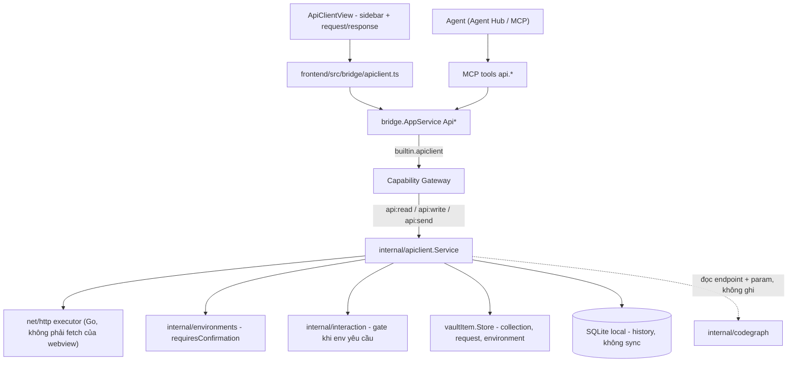
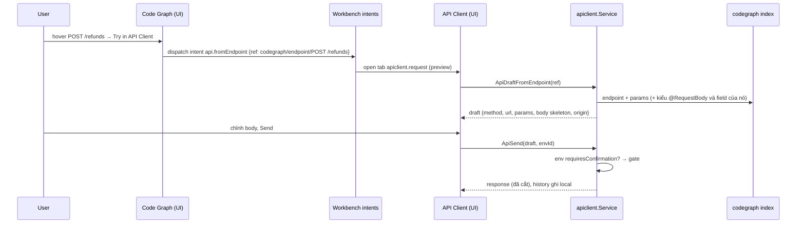

# API Client

API Client là built-in module để **soạn, gửi và lưu HTTP request** (kiểu
Postman/Insomnia thu gọn). Khác biệt với một Postman nhúng: request **không
phải gõ tay từ đầu** — endpoint mà [Code Graph](/dev-kit/codegraph) đã index
trở thành request dựng sẵn (method, path, path param, body skeleton từ kiểu
`@RequestBody`), environment dùng chung [env tag](/dev-kit/environments) với
Database/SSH/Kafka, secret nằm trong vault, và agent trong
[Agent Hub](/dev-kit/agent-hub) gọi được API qua MCP với cùng luật xác nhận
như query database trên `prod`.

import { Callout } from 'fumadocs-ui/components/callout';

<Callout type="warn" title="Design only">
Chưa có runtime: chưa có `internal/apiclient`, chưa có module
`frontend/src/modules/apiclient/`, chưa có record type `api-*` trong
`internal/vaultitem/schema.go`. Thiết kế UI:
[Figma page 20 · API Client](https://www.figma.com/design/3dOzSZBYY7QtzANFTCfEe8/DevKit?node-id=1197-2).
Luật liên module (entity ref, intent) ở [Liên module](/dev-kit/cross-module).
</Callout>

## BRD — Business requirement

### Vấn đề

Dev đọc flow của `POST /refunds` trong Code Graph xong thì muốn **gọi thử
ngay**, nhưng phải mở Postman, gõ lại method/path, đoán body theo DTO, copy
token từ đâu đó — mất mạch, và secret nằm rải rác ngoài vault. Agent cũng
không có cách an toàn để gọi API: tự `curl` trong terminal thì bỏ qua mọi
gate, và không phân biệt được đang bắn vào `dev` hay `prod`.

### Mục tiêu (goals)

- Từ một endpoint trong Code Graph tới một request gửi được: **một cú click**
  (`Try in API Client`), không gõ lại gì đã biết từ code.
- Environment và secret **dùng chung hạ tầng hiện có**: env tag cho
  dev/stg/prod, vault cho token — không thêm registry thứ hai.
- Agent gọi API qua MCP với **cùng luật** như `db.query`: env `prod` luôn hỏi.
- Request, collection, environment đồng bộ đa thiết bị như mọi vault item;
  history thì không (có thể chứa PII của response).

### Actors

| Actor | Nhu cầu |
|---|---|
| Developer | Gọi thử endpoint vừa đọc trong Code Graph; lưu thành collection; đổi env nhanh |
| Agent trong Agent Hub | Tự gọi API để kiểm chứng thay đổi (vd sau khi sửa `RefundService`), đọc response làm ngữ cảnh |
| Agent ngoài (Claude Code/Codex qua MCP) | Như trên, cùng gate |

### Functional requirements

| ID | Requirement |
|---|---|
| FR-1 | Soạn request: method, URL (có biến `{{name}}`), query params, headers, body (JSON / form / raw / none), auth (Bearer, Basic, API key header). |
| FR-2 | Gửi request từ **Go** (`net/http`), không từ `fetch` của webview: không vướng CORS, cùng proxy/TLS của hệ thống, timeout + cancel được. |
| FR-3 | Response: status, thời gian, kích thước, headers, body pretty-print (JSON/XML/text), cắt ở giới hạn kích thước (NFR-4). |
| FR-4 | **Environment**: mỗi environment gắn **một env tag** (bắt buộc, validate qua `EnvLookup.Exists` như DB profile) và một bảng biến; biến đánh dấu *secret* nằm trong payload mã hoá. |
| FR-5 | Đổi environment đổi toàn bộ `{{biến}}`; env tag có `requiresConfirmation` ⇒ **mỗi lần** Send đều hỏi, cho cả người lẫn agent — không có "don't ask again" (env thắng, giống [MCP confirmation](/dev-kit/mcp-agent)). |
| FR-6 | **Collection từ Code Graph**: project đang mở trong Code Graph hiện thành một collection *derived* ở sidebar (nhóm service → controller → endpoint). Không lưu — dựng lại từ index mỗi lần index đổi. |
| FR-7 | `Try in API Client` trên một endpoint ⇒ tạo **request nháp** đã điền method, path (`{id}` → `{{id}}`), query param, body skeleton từ kiểu `@RequestBody`. Nháp chỉ thành request thật khi user Save. |
| FR-8 | Request sinh từ Code Graph mang **origin ref** tới endpoint; header request hiện chip nguồn + `View flow` quay lại đúng flow. Endpoint biến mất sau re-index ⇒ chip báo *stale*, request không bị xoá. |
| FR-9 | Collection + request người dùng lưu là `vault_items`, sync được; sắp xếp thành folder. |
| FR-10 | History các lần gửi (request đã resolve biến, response đã cắt) lưu **local**, không sync; secret đã resolve bị **che** trong history. |
| FR-11 | Response có hành động liên module: *Attach to agent* (gửi request + response dạng ref vào composer), *Add to task* (comment vào task đang link), *Save as example*. |
| FR-12 | Agent gọi được qua MCP: `api.listRequests`, `api.getRequest`, `api.send`, `api.sendAdhoc`, `api.fromEndpoint`. `api.send` luôn đi qua gate env (FR-5). |
| FR-13 | Copy / import **cURL**. |

### Non-functional requirements

| ID | Requirement |
|---|---|
| NFR-1 | Mọi call — UI lẫn MCP — qua `AppService.call` + Capability Gateway. `api:send` là capability riêng, tách khỏi `api:read`/`api:write`. |
| NFR-2 | Secret không bao giờ nằm trong metadata plaintext, log, audit hay history. Audit ghi method + host + path + status, **không** ghi header/body. |
| NFR-3 | Gate fail closed: headless / không ai trả lời trong 60s ⇒ không gửi (`interaction.DefaultTimeout`, như Agent Hub). |
| NFR-4 | Body response cắt ở 5 MB khi hiển thị và 256 KB khi trả cho agent (kèm `truncated: true`); không treo UI với response lớn. |
| NFR-5 | Timeout mặc định 30s, cancel được từ UI và từ ctx của MCP call. |
| NFR-6 | Chỉ `http`/`https`. Không theo redirect sang host khác mà không báo (đổi host ⇒ dừng, hiện response 3xx). |

### Out of scope (v1)

- WebSocket, gRPC, GraphQL introspection, SSE streaming.
- Script trước/sau request (pre-request / test script chạy JS) — v1 chỉ có
  assertion khai báo đơn giản trong tab Tests.
- Mock server, load test, chạy cả collection theo lịch.
- Import OpenAPI/Postman collection — để sau; Code Graph đã là nguồn endpoint.
- OAuth2 flow tương tác (authorization code) — v1 chỉ nhận token có sẵn.

### Acceptance criteria

- Chọn `POST /refunds` trong Code Graph → `Try in API Client` → tab API Client
  mở với `POST {{baseUrl}}/refunds`, body có đúng các field của `RefundRequest`.
- Đổi environment sang một env tag `prod` → Send luôn hiện dialog, cả sau khi
  user đã Allow always cho một tool khác; Cancel ⇒ không có request nào rời máy.
- Agent gọi `api.send` trên environment `prod` khi DevKit chạy headless → lỗi
  ngay, không gửi.
- Biến secret `{{token}}` → không xuất hiện plaintext trong history, audit,
  hay kết quả `api.getRequest`.
- Endpoint bị xoá khỏi code → sau re-index, request đã lưu vẫn còn, chip nguồn
  hiện *stale*.

## Flow

### Từ endpoint tới request

### Agent gọi API

Agent trong Agent Hub sửa `RefundService` xong muốn kiểm chứng: gọi
`api.fromEndpoint` lấy nháp, rồi `api.send` với `environmentId`. Trên `dev`
chạy thẳng; trên env `requiresConfirmation` user thấy **đúng dialog** như
[DB / Agent Query Confirm](/dev-kit/database) — khác nội dung, cùng luật.
Response trả về cho agent đã cắt theo NFR-4 và đã che secret.

## Technical design

### Components

- **`internal/apiclient`** — `Service` (CRUD collection/request/environment,
  resolve biến, gửi request, history), `executor` bọc `net/http` (timeout,
  cancel qua ctx, giới hạn body, không redirect khác host).
- **`internal/bridge/apiclient.go`** — `Api*` qua `AppService.call`, subject
  `builtin.apiclient`.
- **`internal/mcp/tools_apiclient.go`** — tool surface bên dưới.
- **`frontend/src/modules/apiclient/`** — manifest, sidebar, `RequestView`,
  `ResponseView`; editor body dùng [Code editor](/dev-kit/code-editor) primitive.

### Vaultitem contract

Ba record type mới (thêm vào hai switch `IsSupportedItemType` và
`ValidateRecordSchema` trong `internal/vaultitem/schema.go`, như Tasks):

| Type | Metadata (plaintext) | Payload (mã hoá) |
|---|---|---|
| `api-collection` | `name`, `parent_id` (folder), `order` | — |
| `api-request` | `collection_id`, `name`, `method`, `url_template`, `origin_ref` (optional) | headers, query, body, auth |
| `api-environment` | `name`, `env` (env tag, bắt buộc), tên các biến không secret + giá trị | giá trị biến secret |

Mẫu là `db-profile`: metadata đủ để liệt kê/lọc mà không cần giải mã; thứ nhạy
cảm nằm trong payload. `env` validate qua `EnvLookup.Exists`, và `DeleteTag`
phải tính cả `api-environment` trong `ProfileEnvUsage`.

History **không** là vault item: bảng `api_history` trong SQLite local
(derived/operational, như session của Agent Hub), giữ N bản ghi gần nhất.

### Bridge & capability

| Capability | Dùng cho |
|---|---|
| `api:read` | list/get collection, request, environment (không kèm giá trị secret) |
| `api:write` | tạo/sửa/xoá collection, request, environment |
| `api:send` | gửi request — luôn qua gate env |

### MCP tool surface

| Tool | Capability | Ghi chú |
|---|---|---|
| `api.listRequests` | `api:read` | bounded, trả summary |
| `api.getRequest` | `api:read` | secret đã che |
| `api.fromEndpoint` | `api:read` | nhận ref endpoint Code Graph, trả nháp |
| `api.send` | `api:send` | request đã lưu + `environmentId`; gate env |
| `api.sendAdhoc` | `api:send` | request tự do; bắt buộc `environmentId` để gate có env mà đọc |

Không expose MCP cho sửa/xoá environment — thứ đó quyết định agent được bắn vào đâu.

### Phụ thuộc: analyzer phải hiểu tham số của handler

Hôm nay `Param` của Code Graph chỉ có `name` + `type`; analyzer **chưa** đọc
`@RequestBody`, `@PathVariable`, `@RequestParam`, `@RequestHeader`, và chưa có
field của DTO. FR-7 cần:

- `Param.source` ∈ `body` \| `path` \| `query` \| `header` \| `other` (+ tên thật
  nếu annotation đổi tên, vd `@RequestParam("page_size")`).
- Field của kiểu `@RequestBody` (tên, kiểu, `@JsonProperty`), một cấp, để dựng
  body skeleton.

Chưa có hai thứ đó thì `Try in API Client` vẫn chạy, chỉ là body rỗng và query
param phải điền tay.

## Known ceiling (v1)

- Body skeleton chỉ một cấp field; DTO lồng nhau hiện `{}`.
- Không chạy cả collection; không có runner/lịch.
- Collection từ Code Graph chỉ có khi project đang mở trong Code Graph.
