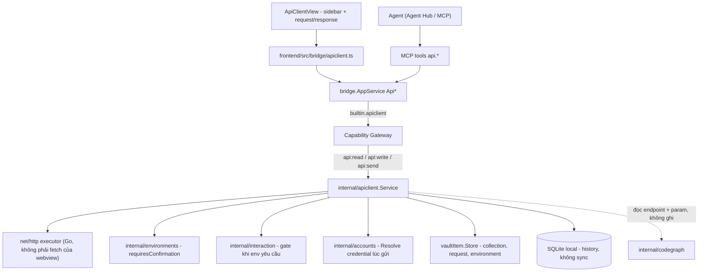
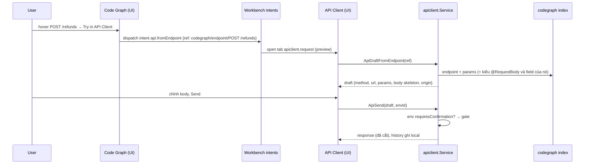

# API Client

API Client là built-in module để **soạn, gửi và lưu HTTP request** (kiểu
Postman/Insomnia thu gọn). Khác biệt với một Postman nhúng: request **không
phải gõ tay từ đầu** — endpoint mà [Code Graph](/dev-kit/codegraph) đã index
trở thành request dựng sẵn (method, path, path param, body skeleton từ kiểu
`@RequestBody`), environment dùng chung [env tag](/dev-kit/environments) với
Database/SSH/Kafka, credential lấy từ [Tài khoản](/dev-kit/accounts) thay vì
dán tay, và agent trong
[Agent Hub](/dev-kit/agent-hub) gọi được API qua MCP với cùng luật xác nhận
như query database trên `prod`.

import { Callout } from 'fumadocs-ui/components/callout';

<Callout type="info" title="Đã có runtime">
`internal/apiclient` + `frontend/src/modules/apiclient/` chạy được để dùng hằng ngày thay
Postman: collection/folder/request, biến Globals/collection/environment, editor đầy đủ, import
cURL và Postman. Phần chưa làm ở [Implementation status](/dev-kit/implementation-status) và
mục [Dùng hằng ngày](#dùng-hằng-ngày-thay-postman) bên dưới. Thiết kế UI gốc:
[Figma page 20 · API Client](https://www.figma.com/design/3dOzSZBYY7QtzANFTCfEe8/DevKit?node-id=1197-2).
Luật liên module (entity ref, intent) ở [Liên module](/dev-kit/cross-module).
</Callout>

## Luồng giao diện hiện tại

API Client dùng sidebar và document tabs của workbench, cùng cách mở/giữ tab
với các module khác. Chọn request trong rail là preview; mở lại cùng request
focus đúng document. Sidebar và phím tắt lấy request từ **group đang focus**
khi split; đổi tên giữ identity, vị trí và trạng thái pin của tab.

- **Request:** tên và collection ở hàng đầu; environment gửi nằm riêng ngay
  trên thanh method/URL và Send. Nút chỉnh environment mở document variables
  tương ứng. Save là thao tác phụ; Send là hành động chính.
- **Environment:** mở một dòng để sửa variables; chỉ “Use for sending” hoặc
  picker trên request đổi đích gửi. Double-click không âm thầm đổi target.
  Form tách chi tiết environment, bảng variables và thứ tự ưu tiên giá trị.
- **Accounts:** Auth có “Manage accounts” qua navigation của shell và nút
  refresh. Khi view hiện lại, danh sách được đọc lại; không cần đóng request.
- **Import/export:** chọn nguồn trước, tuỳ chọn theo nguồn, rồi nội dung.
  cURL và file có draft riêng; lỗi import và hành động footer luôn thấy được
  khi body cuộn. Secret values bị loại khỏi export theo backend hiện có.
- **Response:** giữ kết quả cũ khi gửi lại/lỗi và ghi “Previous response”.
  Thời gian dùng NumberFlow; status HTTP là text. Các bảng có nhãn cột và
  focus bàn phím rõ, cùng surfaces/theme tokens ở cả light và dark.
- **Liên module:** Code Graph/agent tiếp tục mở request bằng intent và ID;
  `api.reveal` cho environment/collection cũng tôn trọng placement `beside`.
  Dialog thuộc API Client ẩn khi chuyển module, giữ draft để quay lại.

## BRD — Business requirement

### Vấn đề

Dev đọc flow của `POST /refunds` trong Code Graph xong thì muốn **gọi thử
ngay**, nhưng phải mở Postman, gõ lại method/path, đoán body theo DTO, copy
token từ đâu đó — mất mạch, và secret nằm rải rác ngoài vault. Agent cũng
không có cách an toàn để gọi API: tự `curl` trong terminal thì bỏ qua mọi
gate, và không phân biệt được đang bắn vào `dev` hay `prod`.

### Mục tiêu (goals)

- Từ một endpoint trong Code Graph tới một request gửi được: **một cú click**
  (`Try in API Client`), không gõ lại gì đã biết từ code.
- Environment và secret **dùng chung hạ tầng hiện có**: env tag cho
  dev/stg/prod, vault cho token — không thêm registry thứ hai.
- Agent gọi API qua MCP với **cùng luật** như `db.query`: env `prod` luôn hỏi.
- Request, collection, environment đồng bộ đa thiết bị như mọi vault item;
  history thì không (có thể chứa PII của response).

### Actors

| Actor | Nhu cầu |
|---|---|
| Developer | Gọi thử endpoint vừa đọc trong Code Graph; lưu thành collection; đổi env nhanh |
| Agent trong Agent Hub | Tự gọi API để kiểm chứng thay đổi (vd sau khi sửa `RefundService`), đọc response làm ngữ cảnh |
| Agent ngoài (Claude Code/Codex qua MCP) | Như trên, cùng gate |

### Functional requirements

| ID | Requirement |
|---|---|
| FR-1 | Soạn request: method, URL (có biến `{{name}}`), query params, headers, body (JSON / form / raw / none). |
| FR-2 | Gửi request từ **Go** (`net/http`), không từ `fetch` của webview: không vướng CORS, cùng proxy/TLS của hệ thống, timeout + cancel được. |
| FR-3 | Response: status, thời gian, kích thước, headers, body pretty-print (JSON/XML/text), cắt ở giới hạn kích thước (NFR-4). |
| FR-4 | **Environment**: mỗi environment gắn **một env tag** (bắt buộc, validate qua `EnvLookup.Exists` như DB profile) và một bảng biến (`baseUrl`, `tenantId`…). Biến đánh dấu *secret* nằm trong payload mã hoá — nhưng thứ dùng lại ở nhiều nơi (token, API key) thuộc về [Tài khoản](/dev-kit/accounts), xem FR-14. |
| FR-5 | Đổi environment đổi toàn bộ `{{biến}}`; env tag có `requiresConfirmation` ⇒ **mỗi lần** Send đều hỏi, cho cả người lẫn agent — không có "don't ask again" (env thắng, giống [MCP confirmation](/dev-kit/mcp-agent)). |
| FR-6 | **Collection từ Code Graph**: project đang mở trong Code Graph hiện thành một collection *derived* ở sidebar (nhóm service → controller → endpoint). Không lưu — dựng lại từ index mỗi lần index đổi. |
| FR-7 | `Try in API Client` trên một endpoint ⇒ tạo **request nháp** đã điền method, path (`{id}` → `{{id}}`), query param, body skeleton từ kiểu `@RequestBody`. Nháp chỉ thành request thật khi user Save. |
| FR-8 | Request sinh từ Code Graph mang **origin ref** tới endpoint; header request hiện chip nguồn + `View flow` quay lại đúng flow. Endpoint biến mất sau re-index ⇒ chip báo *stale*, request không bị xoá. |
| FR-9 | Collection + request người dùng lưu là `vault_items`, sync được; sắp xếp thành folder. |
| FR-10 | History các lần gửi (request đã resolve biến, response đã cắt) lưu **local**, không sync; secret đã resolve bị **che** trong history. |
| FR-11 | Response có hành động liên module: *Attach to agent* (gửi request + response dạng ref vào composer), *Add to task* (comment vào task đang link), *Save as example*. |
| FR-12 | Agent gọi được qua MCP: `api.listRequests`, `api.getRequest`, `api.send`, `api.sendAdhoc`, `api.fromEndpoint`, và dựng collection/request/environment (`api.create*`/`api.update*`/`api.saveRequest`/`api.delete*`, luôn hỏi người dùng — xem MCP tool surface). `api.send` luôn đi qua gate env (FR-5). |
| FR-13 | Copy / import **cURL**. |
| FR-14 | **Auth là binding tới một account**, không phải một chuỗi dán vào request: request lưu `account_id`, `apiclient.Service` gọi `accounts.Resolve` ngay trước khi gửi và dựng header (Bearer / Basic / API key) trong Go. Giá trị không bao giờ nằm trong request đã lưu, trong export cURL, hay qua bridge. Vẫn cho phép header tự do cho trường hợp lạ. |
| FR-15 | **Chọn account sẵn theo host**: account đã verify có `Provider.Hosts` khớp host của URL (hoặc account dùng lần cuối cho env đó) được chọn mặc định. Không có account phù hợp / account hết hạn ⇒ peek `accounts.pick` ngay trong tab request, không chuyển module. |
| FR-16 | Account giới hạn env (Accounts FR-6) không bind được vào environment khác tag — từ chối ở service, không chỉ ẩn trong UI. |

### Non-functional requirements

| ID | Requirement |
|---|---|
| NFR-1 | Mọi call — UI lẫn MCP — qua `AppService.call` + Capability Gateway. `api:send` là capability riêng, tách khỏi `api:read`/`api:write`. |
| NFR-2 | Secret không bao giờ nằm trong metadata plaintext, log, audit hay history. Audit ghi method + host + path + status + **account đã dùng (theo ID)**, không ghi header/body. Copy as cURL xuất ra placeholder cho phần auth, không xuất giá trị. |
| NFR-3 | Gate fail closed: headless / bị từ chối / session bị dừng ⇒ không gửi. Popup xác nhận không có deadline (`interaction.Hub.Timeout` = 0), như Agent Hub: chờ người dùng trả lời. |
| NFR-4 | Body response cắt ở 5 MB khi hiển thị và 256 KB khi trả cho agent (kèm `truncated: true`); không treo UI với response lớn. |
| NFR-5 | Timeout mặc định 30s, cancel được từ UI và từ ctx của MCP call. |
| NFR-6 | Chỉ `http`/`https`. `http://` tới loopback luôn được; tới máy khác chỉ khi request **không** bind account và env tag **không** hỏi trước (`ErrPlainHTTP`) — dev server trong LAN/container là chuyện thường ngày, credential hay env cần xác nhận thì không đi plaintext. Không theo redirect sang origin khác (scheme + host + port): dừng và trả chính response 3xx, `redirectBlocked` nêu nơi nó trỏ tới. |

### Out of scope (v1)

- WebSocket, gRPC, GraphQL introspection, SSE streaming.
- Script trước/sau request (pre-request / test script chạy JS) — v1 chỉ có
  assertion khai báo đơn giản trong tab Tests.
- Mock server, load test, chạy cả collection theo lịch.
- Định dạng OpenAPI/Insomnia/Bruno/HAR — để sau; chỗ cắm đã có (`formats`). Postman
  v2.1 (đọc + ghi) và cURL script (ghi) đã có.
- OAuth2 flow tương tác (authorization code) — v1 chỉ nhận token có sẵn.

### Acceptance criteria

- Chọn `POST /refunds` trong Code Graph → `Try in API Client` → tab API Client
  mở với `POST {{baseUrl}}/refunds`, body có đúng các field của `RefundRequest`.
- Đổi environment sang một env tag `prod` → Send luôn hiện dialog, cả sau khi
  user đã Allow always cho một tool khác; Cancel ⇒ không có request nào rời máy.
- Agent gọi `api.send` trên environment `prod` khi DevKit chạy headless → lỗi
  ngay, không gửi.
- Biến secret `{{token}}` → không xuất hiện plaintext trong history, audit,
  hay kết quả `api.getRequest`.
- Request bind tới account GitHub → Copy as cURL cho ra `-H "Authorization:
  Bearer $GITHUB_TOKEN"`, không phải giá trị thật.
- Token của account bị thu hồi → Send báo lỗi nêu tên account và mời xoay vòng,
  không phải một 401 trần.
- Endpoint bị xoá khỏi code → sau re-index, request đã lưu vẫn còn, chip nguồn
  hiện *stale*.

## Flow

### Từ endpoint tới request

### Agent gọi API

Agent trong Agent Hub sửa `RefundService` xong muốn kiểm chứng: gọi
`api.fromEndpoint` lấy nháp, rồi `api.send` với `environmentId`. Trên `dev`
chạy thẳng; trên env `requiresConfirmation` user thấy **đúng dialog** như
[DB / Agent Query Confirm](/dev-kit/database) — khác nội dung, cùng luật.
Response trả về cho agent đã cắt theo NFR-4 và đã che secret.

## Technical design

### Components

- **`internal/apiclient`** — `Service` (CRUD collection/request/environment,
  resolve biến, gửi request, history), `executor` bọc `net/http` (timeout,
  cancel qua ctx, giới hạn body, không redirect khác host).
- **`internal/bridge/apiclient.go`** — `Api*` qua `AppService.call`, subject
  `builtin.apiclient`.
- **`internal/mcp/tools_apiclient.go`** — tool surface bên dưới.
- **`frontend/src/modules/apiclient/`** — manifest, sidebar, `RequestView`,
  `ResponseView`; editor body dùng [Code editor](/dev-kit/code-editor) primitive.

### Vaultitem contract

Ba record type mới (thêm vào hai switch `IsSupportedItemType` và
`ValidateRecordSchema` trong `internal/vaultitem/schema.go`, như Tasks):

| Type | Metadata (plaintext) | Payload (mã hoá) |
|---|---|---|
| `api-collection` | `name`, `parent_id` (folder), `order` — không đổi | `{vars, secrets}`: biến của collection, **cả hai nửa** trong payload. Metadata giữ nguyên hình dạng vì bản DevKit cũ kiểm metadata từng field và sẽ từ chối cả lượt pull; payload cũ rỗng đọc thành "không có biến" |
| `api-request` | `collection_id`, `name`, `method`, `url_template`, `account_id` (optional), `origin_ref` (optional) | `query`, `headers`, `path_vars`, `form` (danh sách `{key, value, disabled}` có thứ tự — payload cũ dạng map vẫn đọc được), `body_mode`, `body`, `auth` |
| `api-environment` | `name`, `env` (env tag, bắt buộc), tên các biến không secret + giá trị | giá trị biến secret |
| `api-globals` | `vars` | biến secret. Một item; hai máy cùng tạo trước lần sync đầu thì được gộp khi đọc và gộp lại thành một ở lần sửa kế tiếp |

Mẫu là `db-profile`: metadata đủ để liệt kê/lọc mà không cần giải mã; thứ nhạy
cảm nằm trong payload. `env` validate qua `EnvLookup.Exists`, và `DeleteTag`
phải tính cả `api-environment` trong `ProfileEnvUsage`.

`account_id` là metadata plaintext vì nó là một **ID, không phải secret** — đó
là điểm mấu chốt: xoay vòng token trong [Tài khoản](/dev-kit/accounts) thì mọi
request đang bind chạy tiếp mà không sửa gì ở đây. Đổi lại, Accounts phải tính
`api-request` trong usage index của nó (Accounts FR-10) để không xoá mất một
account đang được dùng.

History **không** là vault item: bảng `api_history` trong SQLite local
(derived/operational, như session của Agent Hub), giữ N bản ghi gần nhất.

### Bridge & capability

| Capability | Dùng cho |
|---|---|
| `api:read` | list/get collection, request, environment (không kèm giá trị secret) |
| `api:write` | tạo/sửa/xoá collection, request, environment |
| `api:send` | gửi request — luôn qua gate env; resolve account bên trong Go |

### MCP tool surface

| Tool | Capability | Ghi chú |
|---|---|---|
| `api.listRequests` | `api:read` | bounded, trả summary |
| `api.getRequest` | `api:read` | secret đã che |
| `api.fromEndpoint` | `api:read` | nhận ref endpoint Code Graph, trả nháp |
| `api.send` | `api:send` | request đã lưu + `environmentId`; gate env |
| `api.sendAdhoc` | `api:send` | request tự do; bắt buộc `environmentId` để gate có env mà đọc |
| `api.listCollections` | `api:read` | collection + folder, biến thường; secret chỉ ra tên |
| `api.createCollection` | `api:write` | hỏi người dùng, cho phép "luôn cho phép" trong phiên |
| `api.updateCollection` | `api:write` | đổi tên: hỏi một lần/phiên; di chuyển hoặc sửa biến: **hỏi mỗi lần** |
| `api.deleteCollection` | `api:write` | chỉ folder rỗng; **hỏi mỗi lần** |
| `api.saveRequest` | `api:write` | tạo/thay request; mang credential ⇒ **hỏi mỗi lần**, không thì một lần/phiên |
| `api.deleteRequest` | `api:write` | **hỏi mỗi lần** |
| `api.createEnvironment` | `api:write` | **hỏi mỗi lần**, prompt nói tag có hỏi trước khi gửi hay không |
| `api.updateEnvironment` | `api:write` | **hỏi mỗi lần** (đổi tên, đổi tag, sửa biến) |

**Agent dựng được nội dung module, nhưng mọi lần ghi đều qua người dùng**
(`confirmAPIWrite`, kind `api`, nằm *sau* kiểm tra capability). Ghi nào quyết định
credential đi đâu thì hỏi **mỗi lần**, không có "luôn cho phép":

- **Environment** — nó đặt host và, qua tag, quyết định gửi có hỏi trước hay không.
  Agent ghi được environment mà không ai hỏi thì tự trỏ được vào production.
- **Request mang credential** (`Service.Carries`): account đã bind, biến secret mà
  request dùng dưới *bất kỳ* environment nào, hoặc giá trị gõ thẳng vào dòng có tên
  kiểu credential. `api.send` bắn request đã lưu theo luật của tag mà thôi (không có
  kiểm tra Adhoc), nên lưu một request như vậy chính là chọn host cho credential.
- **Biến hoặc parent của collection** — mọi request bên trong đọc chúng.
- **Xoá** — vault item không có undo.

Biến được sửa theo kiểu `setVars`/`removeVars`/`setSecrets`/`removeSecrets`: cái không
nêu tên thì giữ nguyên (`VarsUpdate` thay cả tầng, đúng cho editor đang giữ hết, sai cho
agent chỉ nêu một biến). Request agent đọc bằng `api.getRequest` có dòng bị che
(`Masked`); gửi lại nguyên thì `Service.RestoreMasked` giữ giá trị đã lưu cùng tên, còn
giá trị bị che mà không có gì để giữ (request mới, dòng đổi tên) thì bị từ chối. Một id
không phải request (vd. id environment) bị từ chối trước khi ghi. Xoá environment và
sửa Globals vẫn chỉ trong UI. Agent **chọn** account bằng `accountId` nhưng không đọc
được giá trị: `api.getRequest` trả `account_id` và nhãn, không trả credential.

Mọi lần ghi (của người hay agent) bắn `apiclient:changed` (`Service.OnChanged`, bọc
item store nên không bỏ sót method nào), sidebar tự refresh.

### Phụ thuộc: analyzer phải hiểu tham số của handler

Code Graph nay có **ba** analyzer, và FR-7 rơi vào ba mức khác nhau. Cái chung
cần thêm vào model là:

- `Param.source` ∈ `body` \| `path` \| `query` \| `header` \| `other` (+ tên thật
  khi khai báo đổi tên, vd `@RequestParam("page_size")`).
- Field của kiểu body (tên, kiểu), một cấp, để dựng skeleton.

Mức sẵn sàng của từng analyzer:

| Analyzer | Hôm nay | Cần thêm cho FR-7 |
|---|---|---|
| **Java** | `Param` chỉ có `name` + `type`; `ProjectAnalyzer` chưa đọc `@RequestBody` / `@PathVariable` / `@RequestParam` | Đọc annotation vào `Param.source`; giải kiểu `@RequestBody` ra field (JavaSymbolSolver đã có sẵn type solver) |
| **TypeScript** | Gần nhất. `analyzer_ts_model.go` đã mang decorator kèm argument, và `analyzer_ts_read.go` đã đọc danh sách tham số từ source | `@Body()` / `@Param()` / `@Query()` của NestJS đúng hình dạng `@RequestBody` của Spring — map sang `Param.source` là một lượt đọc decorator. Field của DTO cần một câu hỏi LSP nữa (`textDocument/definition` trên kiểu tham số) |
| **Lua** | Endpoint là Kong phase, Kong Admin route table, hoặc Lapis route — **không có kiểu, không có body khai báo** | Không có gì để đọc. `Try in API Client` cho method + path và dừng ở đó |

Điều đó nghĩa là FR-7 **không đồng đều theo ngôn ngữ, và phải nói ra trong
UI**: request nháp sinh từ endpoint Lua hiện rõ "không suy được body từ code",
chứ không hiện một `{}` trống khiến người dùng tưởng DTO rỗng. Với cả ba, phần
method + path + path param luôn có, nên `Try in API Client` vẫn có giá trị
ngay từ v1.

## Dùng hằng ngày thay Postman

**Biến — ba tầng, gần nhất thắng**: Globals < collection (từ folder gốc xuống folder
chứa request) < environment. Đúng thứ tự người dùng Postman đã quen. Mỗi tầng có biến
thường và biến **secret**: secret nằm trong payload mã hoá, chỉ được *đặt* hoặc *giữ
nguyên* (`VarsUpdate.keepSecrets`), không có method nào trả giá trị về — kể cả cho UI.
`ApiVariables(collectionId, environmentId)` cho UI biết mỗi `{{name}}` đến từ đâu và cái
nào không có giá trị ở đâu cả. Send **vẫn bắt buộc environment**: tag của nó là cổng
xác nhận, kể cả khi mọi biến đến từ Globals hay collection.

**Request là thứ để sửa**: một tab một request, sửa bản làm việc, `⌘S` mới ghi.
URL bar và bảng Params là hai mặt của một dữ liệu (`url` không chứa query; query là các
dòng). `:id` trong path là **path variable** của chính request — giá trị của *lần gọi
này*, không phải của environment — nên draft từ Code Graph giờ sinh `/refunds/:id`.
`bodyMode` quyết định cách encode và `Content-Type` (trừ khi có dòng header tự đặt;
multipart luôn tự đặt vì boundary). `⌘↵` gửi **bản chưa lưu** (`ApiSendRequest`), có
Cancel tới tận socket (`ApiCancelSend`).

**Import / export theo định dạng, không gắn với một tool** (`interchange.go`): mọi định
dạng chỉ chuyển qua lại với một mô hình trung gian (`Bundle`) và không bao giờ chạm vault;
luật nằm một chỗ cho mọi định dạng — **không giá trị secret nào ra ngoài** (tên thì có,
giá trị rỗng), **account đã bind ra ngoài thành biến giữ chỗ** (`{{github_work_token}}`),
environment nhập vào **phải có tag** (người dùng chọn, hoặc tag ghi trong file mà máy này
có; không thì từ chối trước khi ghi gì). Thêm một định dạng (Insomnia, Bruno, OpenAPI,
HAR…) = một file `format_*.go` cài `Decoder` và/hoặc `Encoder` + một dòng trong
`formats`; UI đọc danh sách định dạng từ Go nên không cần sửa. Hiện có: **Postman v2.1**
(đọc + ghi collection, environment, globals; tag của environment đi trong tên
`Tên [tag]` vì Postman không có chỗ khác) và **cURL script** (ghi collection thành file
bash, mỗi request một hàm, chạy `./file.sh ten_request`; chạy file trống không gửi gì).
Export ghi file từ Go (quyền 0600) qua hộp thoại lưu, hoặc Copy.

**Dán cURL**: vào URL bar (hoặc Import → cURL) — đọc `-X/-H/-d/--data-*/-F/-u/-b/-G`,
cả `$'…'` mà "Copy as cURL" của trình duyệt sinh ra; mở thành request nháp, không lưu.
Postman v2.0/v2.1 collection → collection + folder + request + biến collection; auth của Postman
(token nằm trên request) thành **header nó lẽ ra gửi** (`Authorization: Bearer {{token}}`),
bind account là một click sau. Script pre-request/test không chạy, được đếm và báo.
Environment/globals export của Postman → environment (người dùng chọn tag, vì Postman
không có) hoặc gộp vào Globals.

**Agent**: thêm `api.sendAdhoc` (gửi request chưa lưu, cùng luật gate với `api.send`).
Khác một điểm: request do agent tự viết mà mang account đã bind hoặc biến secret thì
**luôn hỏi người dùng**, trên mọi env tag — agent chọn host, nên tag không thể đã trả lời
câu "gửi token này tới đó". Headless ⇒ từ chối.
Mọi request/response trả cho agent che giá trị các dòng có tên kiểu credential
(`Authorization`, `Cookie`, `*token*`, `*key*`…) trừ khi giá trị chỉ là `{{biến}}`.

## Known ceiling (v1)

- Body skeleton chỉ một cấp field; DTO lồng nhau hiện `{}`.
- Body skeleton chỉ có với Java và TypeScript; endpoint Lua cho method + path.
- Kiểu body phải nằm trong source của chính project **và** tên phải duy nhất:
  hai class trùng tên, hay một DTO của thư viện, cho body rỗng kèm câu giải
  thích thay vì một skeleton đoán bừa.
- `@RequestParam("x")` với hằng số thay vì string literal không đọc được tên
  trên dây — tên sai còn tệ hơn không có tên.
- TypeScript chỉ đọc field của DTO khai bằng `class`; `interface` và `type`
  alias chưa nằm trong index dưới dạng class.
- Không chạy cả collection; không có runner/lịch.
- Collection từ Code Graph chỉ có khi project đang mở trong Code Graph.
- Auth chỉ các dạng account hỗ trợ (Bearer, Basic, API key header). Chữ ký
  request kiểu AWS SigV4 hay HMAC theo body chưa nằm trong phạm vi.
