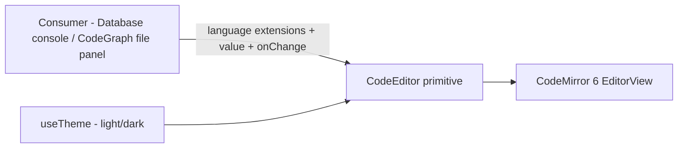

# Code editor

Primitive editor dùng chung dựng trên **CodeMirror 6**, sống ở
`frontend/src/components/code-editor/` (song song `components/editor/` của
Plate — khác thư viện, khác mục đích, tách thư mục riêng). Bản thân primitive
**không biết ngôn ngữ nào cả** — consumer tự mang extension
(`@codemirror/lang-sql`, `@codemirror/lang-json`, ...) vào, giữ primitive nhẹ
và không phình theo số consumer.

import { Callout } from 'fumadocs-ui/components/callout';
import { Cards, Card } from 'fumadocs-ui/components/card';

<Callout type="warn" title="Design only">
Chưa có runtime. Consumer đầu tiên:
[Database § Query console](/dev-kit/database#query-console-gợi-ý-cú-pháp--bảng--cột);
consumer thứ 2: [Code Graph § File editing](/dev-kit/codegraph#file-editing-add-on-v1).
</Callout>

## API — không biết ngôn ngữ, không biết schema

Props chỉ có 4: `value` + `onChange` (controlled), `readOnly`, và `extensions`
— mảng `Extension` của CodeMirror do **consumer tự mang** (`sql(...)`,
`java()`, `json()`, `yaml()`, `markdown()`). Primitive không import bất kỳ
language package nào.

- **Consumer mang `extensions` riêng** — Database console truyền
  `sql({ dialect, schema })` (`@codemirror/lang-sql`; dialect theo `engine`,
  schema từ `db_schema_cache`, xem
  [Database](/dev-kit/database#query-console-gợi-ý-cú-pháp--bảng--cột));
  CodeGraph truyền `java()`/`json()`/`yaml()`/`markdown()` (mỗi hàm từ
  package riêng — `@codemirror/lang-java`, `-json`, `-yaml`, `-markdown`,
  không cần config, gọi thẳng) tuỳ đuôi file đang mở. Primitive **không** có
  logic if/else theo consumer — chỉ nhận mảng extension và truyền vào
  `EditorState.create`.
- **`readOnly`** — dùng `EditorState.readOnly.of(true)` (facet của
  `@codemirror/state`), **không phải** `EditorView.editable` — 2 facet khác
  nhau: `readOnly` chặn lệnh sửa (commands/extension edit tự tắt), `editable`
  chỉ kiểm soát DOM có `contentEditable`/focus được hay không. Primitive chỉ
  cần cái đầu cho use case "xem không cho sửa" (vd version cũ của
  note/query) — chưa có consumer dùng ngay nhưng chừa sẵn đúng API, không
  đoán nhầm 2 facet với nhau lúc implement.

## Reconfigure động: `Compartment`, không remount editor

Khi consumer đổi `extensions` giữa lúc editor đang mở — Database console đổi
profile (dialect/schema khác), CodeGraph mở file khác (ngôn ngữ khác) — primitive
**không** được unmount/remount cả `EditorView` (mất undo history, giật con
trỏ). Dùng
[`Compartment`](https://codemirror.net/docs/ref/#state.Compartment)
(`@codemirror/state`) — bọc phần "language extension" trong 1 compartment lúc
khởi tạo, đổi qua `view.dispatch({ effects: compartment.reconfigure(newExt) })`
khi prop đổi:

Cụ thể: tạo 1 `Compartment` cho phần language, bọc `extensions` ban đầu bằng
`compartment.of(...)` lúc dựng `EditorView`, rồi mỗi lần prop `extensions` đổi
thì effect trong React wrapper dispatch `compartment.reconfigure(...)` — không
dựng lại `EditorView`.

Đây là pattern chính thức của CodeMirror cho "dynamic configuration" — không
phải giải pháp riêng của DevKit, primitive chỉ áp dụng đúng cách thư viện đã
thiết kế sẵn.

## Syntax và YAML

`components/code/languages.ts` là registry dùng chung cho file editor, diff và
code block của Agent Hub. Grammar tải lazy theo tên hoặc đuôi file. Makefile,
GNUmakefile, BSDmakefile, `.mk`, `.mak` và `.make` dùng grammar Make riêng
(target, biến, directive và shell recipe); `.env.*`, Containerfile biến thể và
`gradlew` cũng được nhận diện.

YAML giữ nguyên source và số dòng, thêm guide thụt lề, khoảng cách dòng dễ đọc
và SQL highlight trong block scalar có key `sql` hoặc tên kết thúc bằng `.sql`.
Các block `description`, `query`, `script` không bị đoán thành SQL. Những thay
đổi này chỉ ảnh hưởng hiển thị, không format lại nội dung.

Trong CodeGraph, YAML mặc định xuống dòng dài. Toolbar có Wrap, Collapse all và
Expand all; ⌥Z đổi Wrap và cập nhật nút trên toolbar. `onWrapChange` là chế độ
controlled của CodeEditor; các consumer không truyền callback vẫn giữ cơ chế
wrap tự động và override cục bộ hiện có. Một scroller của CodeMirror sở hữu
cuộn, tránh outer wrapper cuộn ngang cả gutter.

YAML editing (`components/yaml/`) thêm các hỗ trợ chỉ chạy trên máy:

- Một Web Worker parse YAML, báo lỗi cú pháp/trùng key và kiểm tra schema. Kiểm tra debounce theo văn bản/con trỏ; kết quả cũ bị loại theo generation, schema và nội dung nguồn. File trên 512 KiB nhận thông báo tạm dừng assistance, không hiện kết quả kiểm tra giả.
- Schema đóng gói offline: Liquibase từ SchemaStore (kèm dạng map `preConditions`), Compose Specification và Kubernetes 1.35.0 OpenAPI. Auto nhận theo filename hoặc root key; footer cho chọn thủ công và Syntax only. CRD/kind ngoài snapshot có thông báo rõ. Không tải modeline/schema URL và không gửi nội dung YAML ra mạng.
- Gợi ý key/value/mô tả theo vị trí, local `$ref`, `allOf`/`anyOf`/`oneOf`; không lặp key có sẵn. Enter/Tab nhận gợi ý đang mở; còn lại Enter giữ indent, Tab/Shift+Tab dùng dấu cách. SQL trong scalar vẫn dùng completion SQL riêng.
- Footer hiện đường dẫn key, đánh dấu khối hiện tại và danh sách lỗi có thể nhảy tới dòng.
- Format document/selection là thao tác chủ động (⌥⇧F cho cả document), một bước undo. Selection phải bao gồm field hoàn chỉnh. Formatter giữ comment/anchor và đối chiếu lại giá trị, gồm SQL/folded scalar; không áp dụng nếu giá trị đổi.
- Nút SQL mở scalar tại con trỏ trong pane bên dưới, resize được. Apply thay đúng scalar, giữ phần còn lại của file và đi qua cùng transaction/onChange/undo của editor chính; Save vẫn là Save hiện có. Dạng chomp có thể đổi để giữ đúng SQL mới. Bản nháp SQL giữ theo document key khi đóng pane hoặc đổi tab; chỉ Apply/Discard xóa bản nháp. Apply kiểm tra raw scalar theo document + key path: đổi chỗ khác vẫn áp dụng được, đổi chính scalar thì từ chối và giữ nháp.

Schema/provenance: `frontend/src/components/yaml/schemas/README.md`; bản quyền cũng nằm trong `public/licenses/yaml-schemas.txt`. Worker và các schema là chunk lazy, không vào JS khởi động.

Gallery kiểm tra: `?gallery#file-syntax` dùng **YamlEditor thật**, với YAML/Makefile và pane 320/640/1000 px.

## Theme — theo palette của app

`devkitHighlight` và `devkitSyntax` dùng các token `--syntax-*` chung cho editor
và code block. Đổi palette hoặc light/dark cập nhật màu qua CSS, không remount
editor hoặc mất undo/caret.

## Vì sao tách khỏi `components/editor/` (Plate)

Plate là rich-text editor cho Notes (WYSIWYG, block-based). CodeMirror là
plain-text/code editor (line-based, syntax highlight qua tokenizer, không
phải block schema). Hai thư viện, hai mục đích, hai bộ dependency hoàn toàn
khác nhau — gộp chung thư mục chỉ vì cùng là "editor" sẽ gây nhầm lẫn, tách
riêng `components/code-editor/` rõ ràng hơn.

## Consumers

- **Database § Query console** — SQL dialect theo `engine`, schema-aware
  completion từ `db_schema_cache`. Xem
  [Database](/dev-kit/database#query-console-gợi-ý-cú-pháp--bảng--cột).
- **Code Graph § File editing** — browse + edit file trong project đang mở,
  Ctrl+S ghi xuống disk qua kiểm tra revision; highlight theo registry chung. Xem
  [Code Graph](/dev-kit/codegraph#file-editing-add-on-v1).

## Non-goals

- LSP (go-to-definition, rename, diagnostics) — chỉ syntax highlight + basic
  editing, không phải ngôn ngữ server thật.
- Collaborative editing / multi-cursor nhiều user.
- Format-on-save, lint tự động — thuộc phạm vi consumer nếu cần, không phải
  trách nhiệm của primitive.

<Cards>
  <Card title="Database" href="/dev-kit/database#query-console-gợi-ý-cú-pháp--bảng--cột" description="Consumer đầu tiên — SQL + schema completion" />
  <Card title="Code Graph" href="/dev-kit/codegraph#file-editing-add-on-v1" description="Consumer thứ 2 — browse + edit file trong project" />
  <Card title="Notes" href="/dev-kit/notes" description="components/editor/ (Plate) — rich-text, khác mục đích với CodeMirror" />
  <Card title="Frontend performance" href="/dev-kit/frontend-performance" description="Virtualize file tree lớn cho CodeGraph" />
</Cards>
