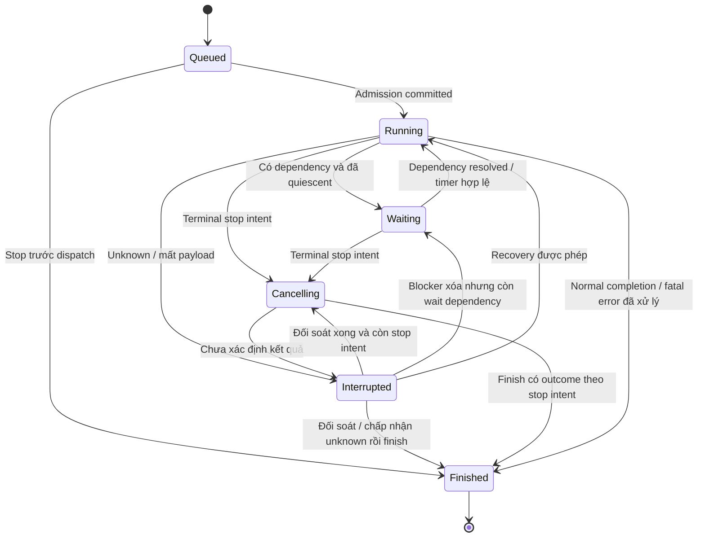
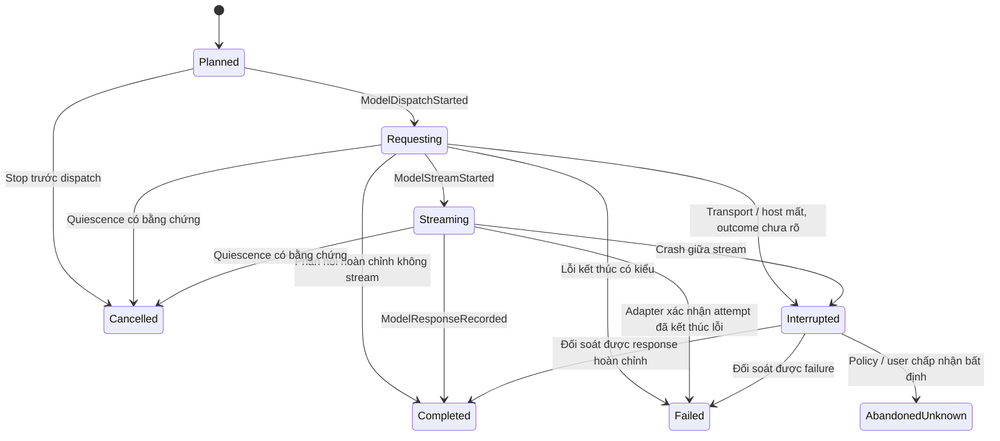
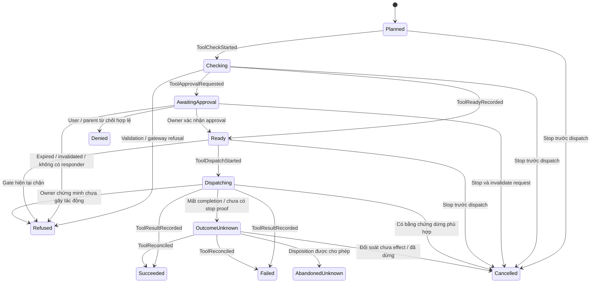

# State machine thực thi

Trạng thái: foundation semantics v0.2, chưa phải enum/API đã phát hành. Tên có thể đổi khi review; transition, invariant và recovery policy phải được giữ hoặc có quyết định thay thế. Danh mục event và chuỗi ví dụ ở [event catalog](event-catalog.mdx).

## 1. Đơn vị và facts có thẩm quyền

| Đơn vị | Định nghĩa |
| --- | --- |
| Session | Identity và lịch sử qua nhiều run; admission chỉ cho một active run |
| Run | Lần thực thi có input được nhận, cấu hình ghim, budget và outcome |
| Step | Một logical model invocation, bao gồm các retry attempts của nó, và batch tool calls/results từ phản hồi hoàn chỉnh được chọn |
| Invocation | Logical operation model/tool có ID riêng; retry không tạo logical operation mới |
| Attempt | Một lần dispatch của invocation, có ID/fence, output và usage riêng |
| Task | Công việc thuộc task domain với ownership/acceptance độc lập run |

Kernel giữ facts: run accepted/admitted/finished, stop intent, blockers, step cursor, invocation attempts, interaction references, timers và budget observations. `lifecycle`, `phase`, `waitReasons` là **projection suy ra** bằng một hàm duy nhất sau mỗi event batch, không có command tự đặt chúng. Projection có thể lưu để query nhưng phải rebuild từ facts cho cùng kết quả.

Mỗi batch chỉ có một tool ở execution frontier v1. Các tool khác có thể `Planned`, nhưng không cùng kiểm tra approval hoặc dispatch. Model output vẫn là untrusted data; chỉ phản hồi hoàn chỉnh, được validate và ghi nhận mới có thể tạo tool candidates.

## 2. Lifecycle run suy ra

Áp dụng thứ tự sau; đây cũng là precedence khi nhiều facts cùng tồn tại:

| Thứ tự | Điều kiện | Lifecycle |
| --- | --- | --- |
| 1 | Có `RunFinished` hợp lệ | `Finished` với outcome đã commit |
| 2 | Có blocker yêu cầu can thiệp/đối soát, ví dụ effect unknown chưa có disposition hoặc payload thật sự mất | `Interrupted` với danh sách lý do |
| 3 | Có terminal stop intent chưa được hoàn tất | `Cancelling`; giữ nguyên stop intent dù không còn worker và đang chờ finalization |
| 4 | Chưa có `RunAdmitted` | `Queued` |
| 5 | Còn model `Requesting/Streaming`, tool `Dispatching`, hoặc công việc quiesce đang được theo dõi | `Running`; có thể hiển thị `quiescing` |
| 6 | Có unresolved wait dependency và không có active attempt | `Waiting` cùng tập `waitReasons` |
| 7 | Run đã admitted, không thuộc các trường hợp trên | `Running`; thực hiện local transition/step tiếp theo |

Không có `RunWaitEntered/Exited` event độc lập. `ToolApprovalRequested`, timer, vault/host blocker và các resolution events làm thay đổi facts; lifecycle được suy ra từ chúng. `phase` cũng suy ra từ current step/cursor: preparing, calling_model, processing_tools hoặc finalizing. Không tự gán phase từ UI hay worker.

`waitReasons` là tập dependency có kiểu, không chỉ một chuỗi: `approval`, `user_input`, `dependency`, `retry_timer`, `vault_locked`, `host_paused`, `recovery_admission`. Từng reason có token/reference và điều kiện resolve. Read model chọn một primary reason theo thứ tự cố định để hiển thị, vẫn giữ toàn bộ tập; không mất approval chỉ vì đang pause.

Sơ đồ mô tả lifecycle quan sát được; không thay transition guards. Restart không tự chuyển `Queued` thành `Interrupted`: nếu chưa có dispatch thì không có ambiguous effect. Schema không đọc được là lỗi availability của host, không phải một domain state tự ghi vào stream mà host không hiểu.

## 3. Invariant giữa các máy

Kiểm tra sau từng **transaction event batch**, không yêu cầu mọi prefix bên trong một batch đều là trạng thái có thể dispatch.

| ID | Invariant kiểm được |
| --- | --- |
| SM-01 | V1 có tối đa một attempt model/tool tại execution frontier đang dispatch hoặc stream; timer/interaction không chiếm slot worker. |
| SM-02 | Một tool `AwaitingApproval` tương ứng đúng một unresolved approval dependency tham chiếu cùng invocation/args/request revision. Ngược lại mọi dependency loại này có đúng tool đang chờ. |
| SM-03 | Khi không có stop/interruption và không active attempt, có approval dependency thì run là `Waiting` với `approval` trong `waitReasons`. Pause/vault reasons không tạo lifecycle cạnh tranh. |
| SM-04 | `phase=calling_model` chỉ khi current step ở model frontier; `phase=processing_tools` chỉ khi phản hồi model đã `Completed` và cursor ở tool batch. |
| SM-05 | `RunFinished` chỉ hợp lệ khi mọi invocation có terminal control disposition, không còn dispatch/stream đã biết đang hoạt động, và các timers/dependencies không còn quyền kích hoạt execution. |
| SM-06 | `Cancelling` chuyển sang `Finished` chỉ sau xử lý active attempts; có `OutcomeUnknown` chưa xử lý thì lifecycle là `Interrupted`, vẫn giữ stop intent. |
| SM-07 | Model request kế tiếp không dispatch trước khi step trước đã đóng và mỗi tool call có đúng một canonical result/disposition trong transcript projection. |
| SM-08 | Retry tạo attempt ID mới, giữ logical invocation ID, không ghi đè partial output/usage của attempt trước. |
| SM-09 | Completion chỉ được nhận cho đúng session admission token, executor incarnation và attempt fence; duplicate cùng kết quả không tạo event/result lần hai. |
| SM-10 | Không có dispatch mới sau terminal stop intent hoặc khi có wait/blocker chưa resolve. Gate hiện tại vẫn bắt buộc sau admission. |
| SM-11 | `Finished(abandoned_unknown)` không xóa unresolved exposure, không chứng minh process đã dừng và không release managed writer. |
| SM-12 | Run chưa admitted và chưa dispatch vẫn `Queued` sau restart; không phát sinh model/tool effect chỉ do rebuild. |

Authority và process-stop proof thuộc owning services. Không suy ra chúng từ lifecycle hoặc từ effect class của tool.

## 4. Model invocation và attempt

Logical model invocation thuộc một step; mỗi attempt có state riêng. Chỉ một attempt có thể được chọn làm response chính của invocation.

`Failed` có `failureClass`, `retryDisposition` và usage status; `Interrupted` giữ uncertainty về response/usage. Một attempt đã `Failed` không chuyển ngược về `Planned`: `ModelRetryScheduled` liên kết timer, rồi `ModelAttemptPlanned` tạo attempt mới sau timer/revalidation. `Planned` còn có thể bị admission/gateway từ chối trước request; ghi `ModelRequestFailed` với stage `pre_dispatch` và mã lý do có kiểu.

| Tình huống | Đường xử lý v1 |
| --- | --- |
| Rate limit/429 có phản hồi lỗi kết thúc rõ | `Failed(retryable)` nếu adapter/policy cho phép; honor Retry-After khi hợp lệ, kết hợp backoff hữu hạn và budget; đặt durable retry timer |
| 5xx có phản hồi lỗi kết thúc rõ | `Failed(retryable)` theo adapter classification và retry budget; không retry vô hạn |
| Auth/config/unsupported request | `Failed(fatal)`; không retry bằng timer, cần cấu hình/authority mới hoặc kết thúc run |
| Mất kết nối/crash sau dispatch, không có terminal evidence | `Interrupted`; không đoán request chưa tới provider hoặc chi phí bằng zero |
| Stream kết thúc thiếu final protocol record | `Interrupted`, trừ adapter chứng minh được một terminal failure rõ ràng |
| Retry policy cạn hoặc failure fatal | Đóng invocation bằng failure; `RunStopRequested(fatal_error)` và `RunFinished(failed)` khi mọi effect đã được xử lý |
| Có terminal stop intent trước completion | Có thể lưu response/usage hợp lệ, nhưng không tạo tool dispatch mới; outcome cuối theo stop intent |

429/5xx là input để adapter phân loại, không phải bằng chứng usage bằng zero. Model retry có thể tốn phí; reservation của attempt usage chưa rõ vẫn được giữ. Một policy riêng có thể abandon model attempt bị gián đoạn và cho attempt mới vì model adapter không tự chạy tool; cần budget dự trù cả chi phí cũ và mới, provenance và giới hạn hữu hạn. Không suy rộng policy này sang tool side effects.

Mọi partial output gắn `invocationID/attemptID/chunkSequence`; không trộn chunks của hai attempts. Deltas thường là ephemeral; phần cần giữ được lưu dưới protected partial-output ref. Partial text hiển thị là interrupted draft, không là canonical assistant response và không tạo executable tool call. Chỉ `ModelResponseRecorded` đưa phản hồi hoàn chỉnh được chọn vào transcript projection.

## 5. Tool invocation và effect class

`Denied` là quyết định từ chối của approver có thẩm quyền; `Refused` là validation/gateway/owner không cho thực thi, bao gồm request hết hạn hoặc bị invalidated. Cả hai có result có kiểu cho model và không giả làm lỗi executor. `Failed` là attempt kết thúc lỗi; không dùng nó để che một outcome còn unknown. `Cancelled` cần nêu pre-dispatch hoặc evidence dừng, không do timeout đơn thuần.

Sơ đồ trên áp dụng cho tool attempt. Invocation đóng theo selected terminal disposition; retry tạo attempt mới, không chuyển ngược hoặc ghi đè state của attempt cũ.

Tool descriptor có `effectClass` do host registry sở hữu, được ghim theo version; model/client không được tự khai báo class để nới recovery. Default cho tool chưa phân loại là `side_effecting`.

| Class | Hợp đồng | Recovery unknown |
| --- | --- | --- |
| `pure_read` | Không ghi external/domain state theo contract đã review; vẫn có scope, secrets, I/O, resource/cost limits | Host policy có thể ghi `ToolAttemptAbandoned` và tạo attempt mới nếu cần; giữ evidence unknown cũ, kiểm tra scope/pause/budget hiện tại |
| `idempotent` | Có contract lặp lại cùng logical operation, cùng input và idempotency key/window thật sự được owner hỗ trợ | Đối soát trước; retry chỉ nếu contract và window còn hiệu lực. Hết window hoặc đổi input thì xử lý như side_effecting |
| `side_effecting` | Có thể gây thay đổi không chứng minh lặp an toàn | Không tự retry unknown; đối soát hoặc explicit `AcceptUnknown` |

Class không xác nhận process đã dừng, không thay gateway và không bảo đảm read lại cùng dữ liệu. Tool shell/script không được gắn `pure_read` chỉ vì arguments trông như lệnh đọc. Policy abandon không được giải phóng write/resource ownership mà owner chưa cho phép.

Terminal control dispositions của invocation là success, known failure, denied/refused, cancelled, hoặc `AbandonedUnknown` có disposition event. Unknown exposure vẫn được lưu trên original invocation projection để đối soát sau đó; không tạo effect ledger cạnh tranh.

## 6. Stop intent và outcome

`RunStopRequested` chứa `stopReason`, `mode`, actor/origin, source/reference và request time. `stopReason` đề xuất: `user_cancel`, `parent_cancel`, `budget`, `fatal_error`, `shutdown`. Các reason đầu là `mode=terminal`; `shutdown` là `mode=suspend`, đi cùng blocker `host_paused` và yêu cầu quiesce. Terminal request được chấp nhận đầu tiên là primary reason; các trigger terminal sau là secondary facts. Suspension không chiếm primary terminal reason, nên user vẫn có thể cancel một run đang chờ sau shutdown. Budget/gate cấm thực thi vẫn thắng dù primary là user cancel.

| Primary reason / disposition | Kết quả khi đã xử lý effects |
| --- | --- |
| `user_cancel`, `parent_cancel` | `cancelled`, giữ actor và reason |
| `budget` | `budget_exceeded` |
| `fatal_error` | `failed` với typed failure reference |
| `shutdown` (suspension, không primary terminal) | Không tự `RunFinished`; khi quiescent vào `Waiting(host_paused)`, hoặc interrupted nếu unknown; resume hợp lệ clear blocker và suspension liên kết |
| Chấp nhận unknown để đóng | `abandoned_unknown`, giữ nguyên stop intent trước đó nếu có; không giả làm cancelled |
| Không có stop, continuation kết thúc bình thường | `completed` |

Completion và stop race được quyết định bởi thứ tự commit: nếu đã `RunFinished`, stop mới bị từ chối/no-op có receipt; nếu stop commit trước, response đến sau không tự mở tool loop. Stop cho run đang `Queued` có thể finish trong cùng event batch mà không dispatch.

`Cancelling` không ngăn mọi external call tức thì. `DispatchStarted` commit trước stop nghĩa attempt có thể đã ra ngoài dù worker chưa được giao; host gửi cancellation hoặc ghi evidence pre-handoff chưa dispatch nếu chứng minh được trong cùng incarnation. Sau restart, mất bằng chứng handoff thì phải coi là unknown.

`AcceptUnknown` là command riêng của user qua trusted UI/host, target đúng run/invocation/attempt và revision; phải liệt kê uncertainty được chấp nhận. Event `UnknownAccepted` ghi actor và disposition. V1 không cho model/parent tự chấp nhận unknown của thao tác ghi. Chấp nhận để **đóng** run khác với cho phép retry một thao tác ghi; lần chạy mới vẫn phải qua approval và ownership hiện tại.

Run có thể `Finished(abandoned_unknown)` trong khi external exposure còn chưa rõ. Admission fence có thể ngăn old callback ghi transcript, nhưng managed writer/resource owner vẫn giữ quyền chặn công việc xung đột cho đến khi có stop/reconciliation proof. Một pure read không tạo writer ownership chỉ vì bị unknown.

## 7. Timer là facts bền vững

`TimerScheduled` chứa timer ID, generation, purpose, target invocation/request, absolute UTC deadline và policy version. `TimerFired` là **command của host**, không phải event tự xuất hiện; khi được nhận hợp lệ, coordinator ghi `TimerElapsed`. Timer bị thay/hủy có `TimerCancelled` và generation mới.

Host clock/scheduler nằm ngoài kernel. Command mang `observedNow` từ trusted clock port; kernel kiểm tra deadline/generation/fence dựa trên input này. Command đến sớm bị từ chối; trùng hoặc timer đã hủy không gây bước mới. Replay không chạy scheduler hoặc callback.

Sau restart, host re-arm các timer projection chưa resolved; timer quá hạn được gửi command ngay khi host có thể xử lý. Timer elapsed chỉ resolve time dependency: pause, vault, current scope và budget vẫn có thể ngăn dispatch. Approval expiry do interaction owner xác nhận bằng lifetime hiện tại; timer không kéo dài hoặc khôi phục request cũ.

Retry backoff/jitter được host tính và ghi thành deadline đã chọn; replay không random lại. Cancellation, finish và unknown disposition phải cancel các timer có thể làm sống lại execution.

## 8. Vault lock, pause và recovery blockers

Vault lock tạo `RunBlockAdded(vault_locked)` từ observation của vault owner, ngăn dispatch mới ngay khi host xử lý; owning service vẫn kiểm tra lock ở boundary thực thi. Host yêu cầu quiesce/cancel effects cần secrets qua `InvocationQuiesceRequested(reason=vault_lock)`; đây là suspension, không phải terminal user cancel.

Khi còn request/stream/tool đang dừng, lifecycle vẫn `Running(quiescing)`; khi đã quiescent và không có unknown thì `Waiting(vault_locked)`. Nếu quiesce không xác định được kết quả, `Interrupted(effect_unknown)` giữ cả vault blocker. Không ép state `Waiting` trong khi worker vẫn chạy chỉ để hiển thị khóa vault.

Vault unlock không tự tiếp tục: owner cung cấp observation, host đọc lại payload/credentials và revalidate scope/queue; `RunBlockCleared` chỉ gỡ blocker nếu hợp lệ. Secret bị mất thật sự khác với tạm không đọc được do vault khóa: missing/deleted payload tạo interruption; restored payload cần validation mới clear.

| Tình huống restart / mất khả dụng | Đường xử lý |
| --- | --- |
| Run `Queued`, chưa dispatch | Giữ `Queued`; đợi admission và queue policy hiện tại |
| Run admitted, chỉ có intents `Planned/Ready` chưa dispatch | Reacquire admission fence; `Waiting(recovery_admission)` nếu chưa có resume authorization; không invent unknown |
| Đang chờ approval | Owner invalidates request cũ; ghi resolution/refusal; muốn hỏi lại cần request mới và authority hiện tại |
| Model `Requesting/Streaming` hoặc tool `Dispatching` không có completion | Attempt interrupted/unknown theo class/policy, không replay side effect |
| Chỉ vault khóa | `Waiting(vault_locked)` khi quiescent; không gán corruption hoặc payload lost |
| Payload đã mất/corrupt | `Interrupted(payload_unavailable)`; phục hồi reference hợp lệ hoặc explicit close disposition |
| Schema/protocol không hỗ trợ | Host báo stream unavailable/read-only diagnostic; không append state event mà decoder không hiểu |

Hủy run cha không tự hủy mọi child hoặc release task. Team cascade cancellation tiếp tục thuộc owner và authority hiện hữu. Task acceptance, push/merge và writer release không suy ra từ lifecycle, lease expiry hoặc `UnknownAccepted`.

## 9. Budgets và transcript ordering

Budget theo model attempts/steps, tokens/cost, tool calls, retries, time và concurrency. Kiểm tra trước dispatch, reserve phần đang hoạt động, đối soát usage khi có. Unknown usage không được ghi zero; accounting reconciliation có thể bổ sung evidence sau khi run đóng mà không khởi động lại loop.

Transcript native là projection cùng event transaction; chỉ canonical model responses và tool results/dispositions được dùng làm provider context. Partial drafts thuộc attempt view. Tool calls không còn chạy do stop cần synthetic disposition có kiểu trước `StepCompleted`, không bịa tool success.

V1 chỉ một execution frontier. Khi thêm parallelism, cần review lại SM-01/SM-03, approval dependencies và resource guards; journal có completion order, transcript vẫn có tool source order. Child completion claim không tự biến thành acceptance của task.
