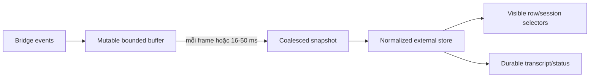

# Frontend performance architecture

Tài liệu này là chuẩn thiết kế và review hiệu năng cho React frontend của
DevKit. Nó không thay thế profiling, cũng không khuyến khích rải `memo`,
`useMemo` hoặc `useCallback` khắp code. Mục tiêu là giữ Workbench phản hồi tốt
khi các module hiện tại và tương lai cùng trưởng thành: nhiều tab, editor nặng,
bảng dữ liệu lớn, graph, stream realtime và background process chạy song song.

import { Callout } from 'fumadocs-ui/components/callout';
import { Cards, Card } from 'fumadocs-ui/components/card';

<Callout type="info" title="Living architecture guide">
Mọi con số là budget để phát hiện regression, không phải lời hứa benchmark cho
mọi máy. Khi code hoặc nghiệp vụ thay đổi, đo lại trên **Wails/WebKit thật** rồi
cập nhật tài liệu cùng evidence. Không suy từ Vite browser dev mode sang desktop
production.
</Callout>

## Phạm vi và nguồn sự thật

Ba lớp hiệu năng phải được đo riêng:

1. **Startup/loading** — JavaScript/CSS/font nào phải parse trước khi shell dùng
   được; module nào được tải theo nhu cầu.
2. **Render/interaction** — lượng React work, DOM, layout, paint và scripting
   phát sinh khi gõ, kéo tab, lọc, scroll hoặc nhận dữ liệu mới.
3. **Background/runtime** — polling, stream, subprocess progress, sync và state
   của tab ẩn có còn tiêu CPU/memory hoặc làm mất dữ liệu hay không.

Kiến trúc hiện tại cần đọc cùng:

- [Runtime & process](/dev-kit/runtime) — shell, bridge, activation.
- [Module tabs](/dev-kit/module-tabs) — tab store và quy tắc giữ view.
- [Shell primitives](/dev-kit/shell-primitives) — title-bar action và split panel.
- [Repo structure](/dev-kit/repo-structure) — dependency/review gate.
- [Implementation status](/dev-kit/implementation-status) — phân biệt runtime
  đã có với thiết kế tương lai.

## Baseline đã có trong checkout frontend

| Control | Trạng thái | Ý nghĩa |
|---|---|---|
| React Compiler | Implemented | Giảm một phần re-render do identity/derived value; không thay virtualization hoặc state design. |
| Lazy module view | Implemented | `lazyModuleView()` + `React.lazy` giữ metadata nhẹ, mỗi module/view thành chunk theo nhu cầu. |
| Suspense + preload | Implemented | View có fallback riêng; Dock/Notes có thể preload trước click mà không kéo module vào startup. |
| Startup budget | Implemented | Production build chạy `scripts/check-performance-budget.mjs`; fail khi initial JS/CSS vượt ngưỡng. |
| Workbench render isolation | Implemented | `WorkbenchViews` tách khỏi high-frequency tab drag; reorder chỉ commit store một lần lúc drop. |
| Notes search coalescing | Implemented | Debounce bridge search, bỏ response cũ và tránh refresh trùng. |
| Offscreen paint hint | Implemented | Notes card/Agent transcript có `content-visibility`; đây chưa phải virtualization. |
| Collection virtualization | Một phần (rà lại 2026-10-21) | Đã có: transcript Agent Hub (theo section), `useVirtualRows` cho bảng kết quả SQL / peek Kafka / Live activity, `tree-view.tsx`, `SearchTab` của Code Graph — tổng cộng 4 chỗ gọi `useVirtualizer`. Chưa có: Notes grid (đang dùng `content-visibility` trên từng thẻ, xem mục "Kỹ thuật cực hạn" 3.1) và các bảng nhỏ còn lại. |
| Per-view activity policy | Chưa implement | Tab hiện giữ mounted; chưa có contract suspend/keep-alive/unmount theo nghiệp vụ. |
| Realtime batching | Implemented cho Agent Hub | Stream có buffer ngoài React theo session, flush tối đa một lần/frame; permission/control đi đường trực tiếp. |

Baseline production đo ngày **2026-08-15** sau khi lazy module. Đây là số lịch
sử: ngân sách hiện hành do `frontend/scripts/check-performance-budget.mjs` giữ
là **2 MiB JS và 320 KiB CSS, đều tính raw, không có budget gzip** (lý do nằm
trong chú thích của script; số đo gần nhất theo `smoothness.mdx` mục 11 là 691.6
KiB JS ban đầu). Bảng dưới giữ lại để thấy xu hướng:

| Asset ban đầu | Số đo | Build ceiling |
|---|---:|---:|
| Initial JavaScript raw | khoảng 548 KiB | 700 KiB |
| Initial JavaScript gzip | khoảng 177 KiB | 225 KiB |
| Initial CSS gzip | khoảng 33 KiB | 45 KiB |

Số đo này chỉ cover asset được `index.html` load/preload. Chunk Notes editor
(Plate) vẫn lớn nhưng không còn nằm trên startup path. Không được tăng ceiling
chỉ để build xanh; phải giải thích dependency mới, đo impact và có quyết định
review rõ ràng.

## Mô hình workload theo nghiệp vụ

Một module phải khai nó thuộc workload nào trước khi chọn kỹ thuật tối ưu.

| Workload | Module/flow | Đặc điểm | Rủi ro chính |
|---|---|---|---|
| Shell lâu sống | Workbench, tabs, Dock, command palette, interaction host | Luôn mounted, nhận state toàn app | Một subscription rộng làm re-render mọi module; polling chạy suốt đời app. |
| Form/control | Vault, Settings, SSH/DB/Kafka profile, publisher | Keystroke thường xuyên, dữ liệu nhỏ | State đặt ở module root làm cây không liên quan render theo từng phím. |
| Collection lớn | Notes grid, DB rows, Kafka messages/groups, Sync conflicts | Dữ liệu tăng theo user/project | DOM tuyến tính, layout/paint dài, memory tăng không giới hạn. |
| Editor stateful | Notes Plate editor, Sync merge result, SQL/payload editor | Draft không được mất khi đổi tab | Unmount/suspend sai làm mất draft hoặc chạy cleanup ngoài ý muốn. |
| Realtime stream | Agent Hub, future terminal/log, indexing progress | Event burst, tiến trình vẫn chạy khi tab ẩn | Update theo từng token/chunk, transcript DOM và memory phình vô hạn. |
| Graph/analysis | Code Graph | Index rất lớn, node/edge/search/layout | Copy payload lớn qua bridge, DOM/SVG quá tải, layout graph block main thread. |
| Background state machine | Sync, SSH forward, Kafka connection, Agent session | Trạng thái nghiệp vụ độc lập với view | Gắn lifecycle process vào component khiến đổi tab làm mất/nhân đôi listener. |

## Contract hiệu năng chung

### 1. Chia component theo tần suất cập nhật

Component boundary phải phản ánh **update frequency**, không chỉ phản ánh bố
cục. Ví dụ `KafkaView` không được là một khối render duy nhất khi user gõ
payload:

```text
KafkaView
├── ConnectionProfileForm     keystroke-local
├── ConnectionStatus          event/status-local
├── TopicExplorer             refresh/query-local
├── VirtualMessageTable       collection/scroll-local
└── PublisherForm             keystroke-local
```

Quy tắc:

- Controlled input giữ state gần input nhất có thể.
- Một keystroke trong editor/publisher không được làm table, graph hoặc sidebar
  không liên quan render lại.
- Tách component trước; chỉ thêm memoization sau khi profiler chứng minh props
  ổn định và subtree thực sự đắt.
- Không chuyển mọi state lên Zustand để né prop; global store sai phạm vi còn
  tạo blast radius lớn hơn local state.

### 2. Phân tầng state ownership

| Loại state | Owner đúng | Ví dụ |
|---|---|---|
| Ephemeral UI | Component gần nhất | dialog open, hover, input draft chưa submit |
| Cross-component trong một module | Store/module provider | selected topic, active Code Graph node |
| Cross-shell | Store chuẩn hóa | tab metadata, session status, module actions |
| Durable business state | Go service/SQLite | notes, profiles, sync conflict, agent transcript đã persist |
| High-frequency transient | Buffer ngoài render + batched snapshot | agent token chunks, indexing progress, terminal bytes |

Store chứa collection phải ưu tiên normalized shape:

Cụ thể: giữ `ids` (mảng thứ tự) tách khỏi `byId` (map id → entity), thay vì
một mảng object duy nhất.

Row/tab subscribe đúng entity theo ID. Không subscribe cả `sessions[]`,
`nodes[]` hoặc `rows[]` nếu consumer chỉ cần một record. Selector không được
tạo array/object mới mỗi lần nếu không có equality strategy rõ ràng.

Secret và plaintext nhạy cảm không được đưa vào global store chỉ để tối ưu
render. Security/data-lifetime rule của Vault/Notes luôn thắng micro-optimization.

### 3. Collection phải có chiến lược scale

`content-visibility` chỉ giảm layout/paint cho phần ngoài viewport; React
element và DOM node vẫn tồn tại. Collection có thể lớn phải dùng một trong:

- pagination/cursor ở service/bridge;
- virtualization/windowing ở UI;
- progressive disclosure (chỉ mở neighborhood/child khi user yêu cầu);
- bounded result kèm hành động “load more”.

Ngưỡng review mặc định:

| Collection | Khi phải virtualize hoặc page |
|---|---:|
| Card/list đơn giản | trên 200 item hoặc profiler cho thấy commit > 16 ms |
| Table nhiều cột/cell | trên 100 row |
| Transcript/log biến chiều cao | trên 300 rendered block |
| Tree | trên 500 visible flattened node |
| Graph | không render toàn index; luôn viewport/level-of-detail |

Shared virtualization primitive phải giữ được keyboard navigation, focus,
selection, sticky header, scroll restoration theo tab và variable-height item.
Không chấp nhận tối ưu làm mất accessibility hoặc khiến selection nhảy khi row
ra/vào viewport.

### 4. Bridge response cũng là performance boundary

Wails bridge serialize/deserialize dữ liệu giữa Go và JavaScript. Virtualize UI
không đủ nếu backend vẫn trả một JSON payload khổng lồ.

- API list/query cần `limit`, cursor và byte/row ceiling.
- Không trả toàn bộ Code Graph index, transcript hoặc database result qua một call.
- Kết quả cần shape dành cho view hiện tại: summary trước, detail theo ID sau.
- Cancel request cũ khi query/filter đổi; nếu bridge chưa hỗ trợ cancel, ít nhất
  response cũ không được ghi đè query mới.
- Dữ liệu lớn cần đo cả thời gian Go query, serialization, bridge transfer,
  JavaScript parse và React commit.

### 5. Realtime phải batch trước khi vào React

Agent update, terminal/log và progress không được `setState` cho từng token hoặc
byte. Luồng chuẩn:



- Tối đa một React publish mỗi animation frame cho cùng stream.
- Batch boundary không được trì hoãn permission/security prompt; permission là
  control-plane event ưu tiên cao, tách khỏi token stream.
- Transcript/log history phải persist hoặc page; DOM chỉ giữ viewport/window.
- Có retention/buffer ceiling. Khi truncate UI phải hiển thị rõ, không silently
  mất dữ liệu nghiệp vụ cần audit.
- `startTransition` chỉ dùng cho update không khẩn cấp; không bọc controlled
  input hoặc permission decision vào transition.

### 6. Công việc nặng không chạy trong render

Không đặt các việc sau trong JSX, selector thường chạy lại, hoặc synchronous
event handler trên main thread:

- parse/serialize Markdown lớn;
- syntax highlight nhiều block;
- Mermaid render;
- graph layout, clustering, path search;
- JSON pretty-print/diff payload lớn;
- Sync three-way merge preview;
- sort/filter hàng chục nghìn symbol/row.

Ưu tiên Go service nếu computation thuộc domain/index và cần dùng chung với MCP;
ưu tiên Web Worker nếu đó là transform/presentation riêng của UI. Worker output
vẫn phải bounded/incremental, không copy toàn graph qua lại mỗi interaction.

## Tab lifecycle và background work

Hiện tại Workbench mount mọi open tab rồi toggle `contents`/`hidden` để draft
SQL/note và công việc đang chạy không mất. Cách này đúng về behavior hiện tại
nhưng sẽ tăng memory/effect khi số tab và module tăng.

Contract đích cần ba policy:

| Policy | Dùng khi | Ví dụ |
|---|---|---|
| `unmount-when-hidden` | View stateless, mở lại rẻ | Tools, read-only detail nhỏ |
| `suspend-when-hidden` | Giữ state React nhưng dừng effect/render nền | Settings, explorer không chạy job |
| `keep-alive` | Draft/stream đang hoạt động phải sống | note dirty, agent turn running, active terminal |

`React.Activity` có thể là implementation mechanism cho suspend, không phải
business contract. Hidden Activity cleanup Effect; vì vậy **không áp dụng trực
tiếp** cho Notes/Agent Hub hiện tại:

- Notes cleanup đang flush autosave; hide/show có thể save/reload ngoài ý muốn.
- Agent Hub view đang sở hữu listener transcript; cleanup khi ẩn có thể bỏ event.

Trước khi thêm activity policy phải:

1. đưa process/subscription lâu sống ra service hoặc shell-level subscriber;
2. đưa durable draft/transcript khỏi component lifecycle;
3. test đổi tab đúng lúc autosave, permission, stream và reconnect;
4. chỉ sau đó mới cho view suspend/unmount.

Background process không được phụ thuộc vào việc component có đang visible:
SSH forward, Kafka connection, Sync, Code Graph indexing và Agent subprocess đều
thuộc Go/service state machine. UI chỉ subscribe snapshot/progress.

## Quy tắc riêng theo module

### Workbench shell

- Shell luôn mounted nên mọi polling/listener phải có owner và cleanup rõ.
- Tab drag giữ state visual cục bộ; không publish reorder theo từng pointer frame.
- `WorkbenchViews` không được subscribe hover/drag state của Dock/TabStrip.
- Module actions phải register ổn định; keystroke trong module không được gây
  unregister/register title-bar action liên tục.
- Interaction polling hiện tại là debt: ưu tiên bridge event; nếu chưa có thì
  adaptive polling, giảm nhịp khi app hidden và không tạo state object mới khi
  pending không đổi.

### Notes

Nghiệp vụ cần giữ đồng thời dashboard, nhiều note tab, Plate editor và autosave
1.5 giây.

- Search debounce/cancel stale response; không bridge call mỗi keystroke.
- Dashboard virtual grid khi số note vượt ngưỡng; folder/tag count tính một
  lần theo dataset, không lặp join cho mỗi card render.
- Note card chỉ dùng summary; không decrypt/load body cho grid.
- Editor chunk lazy; preload theo intent (hover/focus/open), không startup.
- Editor draft phải sống qua đổi tab. Không suspend/unmount trước khi autosave
  state machine tách khỏi Effect lifecycle và có test mất điện/close-tab.
- Mermaid/syntax highlight chỉ load/render khi block tương ứng visible.
- Plaintext body không được cache global hoặc giữ lâu chỉ vì performance.

### Database

Query result có thể lớn hơn mọi giới hạn render thông thường.

- Bridge phải có row/byte ceiling và cancellation/timeout; UI không nhận toàn
  bộ result vô hạn.
- Table phải virtualize cả row; cân nhắc horizontal column virtualization khi
  schema/result rất rộng.
- Cell formatter không parse JSON/date lại trên mọi render; detail/pretty view
  mở theo yêu cầu.
- SQL draft local theo tab/profile. Gõ SQL không render profile form/result cũ.
- WHERE có draft riêng; chỉ Enter/Apply mới đổi applied filter và phát query/count. Gõ filter không subscribe/render lại grid.
- Staged cells giữ identity row chưa sửa; không map toàn bộ cells để overlay vài edits.
- Evidence native fixture của phase 7: [Database forms/table](../design/database-ui-performance.md), kèm giới hạn trace/bridge còn pending.
- Multi-engine tương lai không được làm UI load driver-specific editor/tooling
  của mọi engine ngay startup.

### SSH

- Profile form, active forwards và command output là ba update domain riêng.
- Forward lifecycle nằm ở Go; ẩn/unmount SSH view không được stop hoặc duplicate
  listener.
- Command/terminal output tương lai dùng batched append + virtual log, không
  nối một string khổng lồ mỗi chunk.
- Passphrase/secret state giữ cục bộ, clear theo lifecycle nghiệp vụ; không đưa
  vào store chung để tránh render.

### Kafka

Nghiệp vụ chỉ giữ một live cluster connection nhưng topic/message/group có thể
rất lớn.

- Topics và consumer groups dùng cursor/search; không render toàn cluster.
- Peek đang bounded (UI tối đa 500) vẫn phải virtualize table vì cell payload
  có thể dài.
- Message payload preview truncate; full value mở detail theo intent.
- Poll/refresh lag phải batch và chỉ update group/partition thay đổi.
- Publisher keystroke không render message table/topic explorer.
- Connection process sống ở Go; view ẩn không disconnect.

### Sync conflict UI

- Conflict list page/cursor; detail chỉ load khi chọn.
- Three-pane merge tương lai virtualize line, đồng bộ scroll có throttle và
  chạy diff/merge ngoài render/main-thread khi input lớn.
- Không giữ decrypted payload của mọi conflict trong list state.
- Sync engine tiếp tục chạy độc lập với view; UI chỉ render status/count/detail.

### Agent Hub

Agent Hub là workload realtime lâu sống, nhiều session song song và permission
fail-closed.

- Chuẩn hóa `sessionsById`, `sessionIds`, transcript metadata theo session.
- Event update theo session chỉ làm subscriber của session đó thay đổi.
- Token/tool-call chunks batch; permission request bypass batch và hiển thị ngay.
- Transcript persist/page; visible DOM virtualize. Không copy toàn bộ transcript
  record cho mỗi token.
- Tab ẩn vẫn nhận status/permission qua shell subscriber; view presentation có
  thể suspend sau khi ownership được tách.
- Trạng thái hoàn tất được giữ thành unread badge theo session; notification nền
  native gộp theo session và không thay thế permission event/control-plane.
- Có ring/buffer ceiling cho live output, nhưng không làm mất durable history
  hoặc audit cần thiết.
- Thêm vendor mới không được kéo UI/runtime SDK của mọi vendor vào initial chunk.

#### Baseline — transcript stream (2026-09-14)

Đo bằng `cd frontend && bun test src/modules/agenthub/transcriptPerformance.test.ts`
trên macOS 27.0 arm64, Bun 1.4.0. Fixture được sinh deterministic trong
`transcriptPerformance.fixture.ts`: 5.000 turn, 50.000 persisted row, gồm text,
thought, plan và tool call có `rawOutput` dài. Mỗi số là median của 3 lượt trong
cùng một process; thời gian máy local chỉ là evidence để bắt regression, không
phải budget cho mọi máy.

| Metric | Trước thay đổi | Sau thay đổi | Evidence |
|---|---:|---:|---|
| Store publish cho một burst 1.000 token | 1 publish/token mỗi consumer (ước tính, không đo) | 1 store publish/frame | `transcriptRuntime.test.ts`: đếm publish qua store thật và listener live-update của shell |
| Reducer work cho 1.000 token | 1,35 ms tuần tự | 0,23 ms cho một batch/frame | benchmark test median |
| `initTranscript` trên 50.000 row | 1.293,39 ms | 16,47 ms | cùng fixture, Map tool-call index |
| Identity thay đổi của `AgentTurn` cho 20 token / 5.000 turn | 100.000 | 20 | benchmark đếm từng token: `agentTurnIdentityChanges` |
| Vòng `groupTurns` cho một token / 5.000 turn | 0,89 ms | 0,87 ms | trung bình 20 token; `groupTurnsOneTokenMs` |
| Parse markdown 20.000 byte theo 1.000 prefix chunk | 49,99 ms | 3,07 ms | cùng fixture, một pass; `markdownMs`, quét ranh giới tiếp từ prefix đã khép |
| Section transcript trong DOM / 5.000 turn | 5.000 | 11 | `TranscriptStream.performance.test.tsx`: SSR virtual window, budget kiểm thử 32 |
| Flush reducer cho 1.000 token | 1.24 ms × 1.000 lần | 0.81 ms × 1 batch | `transcriptPerformance.test.ts`: `batchedApplyMsMedian` |
| Plan cards for N updates in one turn | N cards | 1 live card | `transcript.test.ts`: `updates one live plan in place` |
| Queued prompt after a busy turn | 0 accepted / 0 retained | 1 store item, 1 drain after `outcome=completed` | `agentPromptQueue.test.ts`: success/error paths |
| Scroll long task trên Wails/WKWebView | Chưa có trace | Chưa có trace | cần chạy production build trên desktop; Bun không cung cấp layout/paint trace |

Con số identity, `groupTurns` và markdown đo lại ngày 2026-09-15 trong cùng
một lần chạy: trước là `agentTurnIdentityChanges=100000`,
`groupTurnsOneTokenMs=0.89`, `markdownMs=49.99`; sau là
`agentTurnIdentityChanges=20`, `groupTurnsOneTokenMs=0.87`, `markdownMs=3.07`.
Identity được đếm thật qua 20 token (trước đây một token nhân với 1.000, là
số học chứ không phải đo). Markdown là một pass đầy đủ để không làm scheduler
của full suite bị đói; fixture và chunk size cố định nên lặp lại được độc lập.
`transcriptRuntime.test.ts` kiểm tra qua store thật rằng token của session B
không đổi identity model của A. Chưa
đo được React Profiler trên Wails/WKWebView thật trong lượt này; benchmark cũng
không thay thế kiểm tra long task, paint hoặc memory của transcript lớn. Đợt
viewport chọn virtualization vì `content-visibility` chỉ giảm paint nhưng vẫn
giữ 5.000 section trong DOM; cùng fixture hiện chỉ render 11 section ở SSR
(overscan 6, budget kiểm thử 32). Auto-scroll và scroll handler đều đi qua một
frame gate; chỉ thao tác cuộn lên của người đọc (wheel, touch, phím, kéo thanh
cuộn) mới tắt việc bám đáy, nội dung lớn lên thì không. Tick active dùng
IntersectionObserver trên các section đang mount, chỉ dựng lại khi tập section
mount đổi. Virtualizer giữ `getItemKey` ổn định giữa các flush và nhận
padding đầu viewport làm `scrollMargin`. Runtime transcript giữ tối đa 8
session mở gần nhất (`TRANSCRIPT_CACHE_LIMIT`) và bị quên khi session rời store.

#### Baseline — backend transcript (2026-09-14)

Đo trên cùng máy (macOS 27.0 arm64), Go bench
`go test ./internal/agenthub/ -bench BenchmarkRecordTenThousandTokens -benchtime=1x`
và các test đếm statement trong `recorder_batch_test.go` / `payload_diet_test.go`.
SQLite thật trong thư mục tạm, một tin nhắn 10.000 token (cùng messageId).

| Metric | Trước | Sau | Evidence |
|---|---:|---:|---|
| Ghi 10.000 token vào SQLite (cả flush cuối) | 21.170 ms | 7,39 ms | bench trước/sau cùng lệnh; O(len²) → O(len) |
| Câu lệnh SQLite cho 100 token của một tin | 100 SELECT + 100 UPDATE | 1 INSERT + 1 UPDATE mỗi flush | `countingStore` trong `TestRecorderBatchesChunkWritesUntilFlush` |
| Bản copy rawOutput mỗi `tool_call_update` qua bridge | ~3 (event `update` + `parsed.raw` + `parsed.toolCall`) | 1 (`parsed.toolCall`) | `TestParseSessionUpdateDropsRedundantRawForStreamedKinds`; golden fixture −141 dòng |
| Trả transcript lúc mở session | toàn bộ row của session | cửa sổ mới nhất ≤ 200 entry (mặc định) + `hasMore` | `ListTranscriptPage`; snap về đầu turn, có giới hạn |
| rawOutput lớn trong trang | nguyên bản | preview ≤ 8 KiB + cờ `truncated`; detail theo id đủ | `TestTranscriptPagePreviewsOversizedToolRaw` |

Điều kiện đo của hàng đầu: trước là write-through mỗi token (SELECT cả dòng
cuối + UPDATE toàn bộ text tích lũy), sau là tail in-memory với flush 250 ms /
đổi tin / hết lượt / đóng session. Một crash giữa lượt mất tối đa ~250 ms tail
cuối — Status: [Agent Hub](/dev-kit/agent-hub) mục Transcript.

### Code Graph

Code Graph hiện **Design only** trong checkout app: chưa có
`internal/codegraph` hoặc frontend module. V1 được thiết kế là endpoint list +
flow text/tree, chưa phải node-link canvas. Dù vậy index Java thực tế có thể có
hàng chục nghìn symbol/call edge; phải thiết kế scale ngay từ API đầu tiên để
không khóa đường cho graph UI tương lai.

#### Service/bridge contract

- Analyzer/index nằm ở subprocess + Go/SQLite; frontend không giữ toàn bộ
  `index.json`.
- `listEndpoints`, `searchSymbol`, `getNeighbors`, `getFlow` phải bounded,
  cursor-based và trả summary/detail tách biệt.
- Index progress là throttled event (ví dụ 100-250 ms), không event theo từng
  file/symbol.
- Re-index có cancel, project/version token; progress/result của job cũ không
  được overwrite active project mới.
- Graph query trả subgraph theo root/depth/filter và hard ceiling node/edge.
  Nếu vượt ceiling, trả `truncated` + continuation/expand action rõ ràng.
- Layout position có thể cache theo index version/filter; không gửi lại toàn bộ
  topology mỗi lần pan/select.

#### UI v1: list/tree/text

- Endpoint/symbol list virtualize và search deferred; keyboard navigation vẫn
  phải hoạt động.
- Flow tree flatten theo expanded state; chỉ query/render children khi expand.
- Code preview load file slice theo `file:line`, không load cả project source.
- Index progress/status tách khỏi result pane để progress event không render
  lại tree/code preview.

#### Graph UI tương lai

- Không dùng hàng nghìn DOM/SVG node. Graph vừa/lớn cần Canvas/WebGL renderer,
  viewport culling và level-of-detail/clustering.
- Pan/zoom/hover là state cục bộ của renderer; không publish Zustand/React theo
  từng frame. React quản toolbar, selection summary và panels, không quản từng
  pixel/node transform.
- Graph layout/path/clustering chạy ở Go hoặc Worker. Main thread chỉ nhận
  incremental visible geometry.
- Mặc định mở neighborhood nhỏ quanh endpoint/symbol; user chủ động expand.
  Không có hành động “render toàn project graph” không giới hạn.
- Selection subscribe theo node ID; chọn một node không làm mọi node component
  render lại.
- Có visible node/edge ceiling theo renderer/device profile và fallback tree
  cho máy yếu/accessibility.

### Settings, Environments và Tools

- Dataset nhỏ, ưu tiên code đơn giản; không thêm virtualization/worker vô cớ.
- Form state local; lưu xong mới refresh store liên quan.
- Tool computation lớn (hash file, future encode/compress) chạy Go/Worker, không
  block input thread.

### External plugins tương lai

- Plugin/view phải lazy theo manifest và có per-plugin chunk/resource budget.
- Plugin không được subscribe raw app store hoặc render vào shell high-frequency
  path; chỉ dùng versioned contribution API.
- Host áp ceiling cho event frequency, payload size, background timer và số
  contribution visible.
- Plugin lỗi/chậm phải cô lập, không kéo toàn Workbench xuống cùng.

## Render budgets và scenario gates

Budget ban đầu để review/CI/profiling:

| Scenario | Budget mục tiêu |
|---|---|
| Keystroke trong form/editor thường | không có React commit/main-thread task > 16 ms ở dataset chuẩn |
| Tab switch đã warm | phản hồi thị giác < 50 ms; không restart process nền |
| Module activation lần đầu local chunk | fallback xuất hiện ngay; usable target < 150 ms trên máy chuẩn |
| Scroll collection lớn | không Long Task > 50 ms; giữ frame ổn định, DOM bounded |
| Realtime stream | tối đa 1 React publish/frame/stream; permission không bị batch delay |
| Search/filter | input cập nhật ngay; result có thể deferred/cancel stale |
| Hidden tabs | không render/poll nền trừ behavior nghiệp vụ được khai rõ |
| Code Graph pan/zoom tương lai | renderer-local 60 Hz target; không React state update/frame |

Dataset chuẩn cần có fixture thay vì profile dữ liệu toy:

- Notes: 10.000 summaries, 1.000 folder/tag combinations, note body lớn có
  code/Mermaid.
- Database: 10.000 row × 30 column, cell JSON/text dài.
- Kafka: 500 message payload hỗn hợp + hàng nghìn topic/group summary.
- Agent Hub: 8 session, 2 session stream song song, transcript 50.000 block,
  permission xuất hiện khi tab khác active.
- Sync: 1.000 conflict summary, detail text lớn, future three-pane diff.
- Code Graph: 100.000 symbol, 500.000 edge, endpoint flow sâu và unresolved
  node; UI chỉ nhận/window subgraph bounded.

## Kỹ thuật cực hạn từ các chuyên gia (khảo sát 2026-10-21)

<Callout type="info" title="Cách đọc mục này">
Tổng hợp từ bốn đợt khảo sát (render và state của React; pipeline trình duyệt và
WebKit; virtualization, editor, luồng stream; đo lường, khởi động, bộ nhớ) đọc
nguồn gốc, không dựa vào trí nhớ. Mỗi quy tắc mang một nhãn bằng chứng:
**Đo** = chạy trên máy này, **Đọc** = đã đọc nguồn gốc (liên kết ở cuối mục),
**Suy luận** = rút từ nguồn và mã DevKit, chưa kiểm chứng. Lời khuyên viết trước
React Compiler 1.0 (2025-10) và React 19 bị đánh dấu lỗi thời nếu có. Các con
số của nhà cung cấp tự báo (Meta, Sanity, Million.js, Legend-State) được ghi là
tự báo. Phần riêng của WebKitGTK nằm ở [Smoothness mục 13](/dev-kit/smoothness).
Ghi chú chi tiết từng nguồn (tác giả, ngày, mức tin cậy, đã đọc hay chỉ thấy
đoạn trích) lưu ở `docs/superpowers/research/2026-10-21-perf-*.md`.
</Callout>

### 1. Baseline đo trên máy thật: Chrome và WebKitGTK (2026-10-21)

Trang benchmark dựng trên production build với transcript thật (1000 turn, 9000
dòng, qua `TranscriptEventBuffer` và `applySessionUpdates`) cạnh một lưới DB
10k × 30, cửa sổ 1440×900, Ubuntu 26.04 / Wayland / Iris Xe, WebKitGTK 2.52.6
với DMABUF bật, Chrome 155 có GPU. Mỗi cấu hình 5 lượt, bỏ lượt đầu, trung vị
của lượt 2–5. Số dưới đây là lượt **cùng DPR 2 và cùng bố cục** (pane 700×490),
vì lượt đầu để WebKit vẽ gấp ~2,5 lần pixel của Chrome (màn hình scale 1,25).

| Kịch bản | Chrome | WebKitGTK |
|---|---:|---:|
| Cuộn từng bước + pane DB hoạt động, frame >20 ms | 0% | 12,7% |
| Stream agent, frame >20 ms | 0% | 12% |
| Stream + pane DB hoạt động, frame >20 ms | 0% | 29% (59% ở lượt DPR chưa khớp) |
| Kéo hết chiều dài transcript, p50 | 16,7 ms | 35,5 ms (~2,1×) |
| Kéo hết chiều dài, tổng thời gian 400 frame (lý tưởng 6,7 s) | 6,8 s | 14,4 s |
| Mount transcript, frame đầu / ổn định | 153 / 257 ms | 268 / 370 ms |
| Bật/tắt pane transcript, tới frame thứ hai | 62 ms | 104 ms |

Điều rút ra (nhãn **Đo**, trừ khi ghi khác):

- Chrome phẳng ở mọi kịch bản; WebKitGTK **không** về 0 ở kịch bản nào dù đã
  khớp DPR. Khớp DPR làm khoảng cách ở kịch bản stream và pane DB hoạt động
  giảm khoảng một nửa (frame >20 ms: 59% → 29% khi stream cùng pane DB), nên
  phần ấy một phần do WebKit vẽ nhiều pixel hơn. Phần còn lại (kéo thanh cuộn,
  mount, bật/tắt pane) gần như không đổi dù WebKit vẽ ít pixel hơn ~2,7 lần,
  tức không phải do raster.
- Trên Chrome main thread bận **96%** ở kịch bản kéo hết chiều dài (JS 5,5 s
  trong 7,4 s). Chi phí chính là JS và style của chính ứng dụng, không phải
  paint hay composite (raster và composite chỉ ~0,2–1 s). Một engine chậm hơn
  chỉ phơi ra khoảng trống này.
- Điểm nóng lớn nhất theo self time (~5%): `getComputedStyle(...)` trong
  `TranscriptStream.tsx`. Có **ba** chỗ đọc computed style: dòng 383 (`paddingTop`
  trong ResizeObserver), dòng 490 (`scrollMarginTop`), dòng 517
  (`getPropertyValue("--header-inset")` trong effect dựng lại
  `IntersectionObserver` mỗi khi `mountedTurnKey` đổi). Mỗi lần đọc ép một lần
  tính lại style đồng bộ khi style đang bẩn. Là **Suy luận** rằng chuyển sang
  số lưu trong JS sẽ lấy lại phần lớn khoản này; cần đo.
- Trên WebKit timer 10 ms trễ hơn 16 ms ở 397/399 frame của lượt kéo hết chiều
  dài (Chrome ~50–90): main thread luôn bận. **Suy luận**: chưa có profile phía
  WebKit để tách JS, style, layout, paint.
- Hạn chế: cuộn bằng code (không phải lăn chuột/compositor), host WebKit là
  cửa sổ Python/Gtk chứ không phải binary Wails, không có Go bridge, một lượt
  Chrome trace. Đây là cận dưới của app thật (chưa có animation, các module khác).

### 2. React: render và state

| # | Quy tắc | Bằng chứng | Hiện trạng DevKit / cách kiểm |
|---|---|---|---|
| 2.1 | **Cấu trúc trước memo.** "Move state down" và "lift content up" làm đa số render chậm biến mất mà không cần `memo`; chúng cũng giảm việc của compiler. | Đọc: Abramov, Dodds (state colocation) | Smell: gốc module giữ draft/hover/drag cạnh grid hoặc transcript. Rà từng module. |
| 2.2 | **Sửa render chậm trước render nhiều.** Một re-render không đổi DOM thường rẻ; xếp hạng theo self time của hàm render và style/layout cùng task, không đếm render. | Đọc: Dodds, Erikson, Comeau | Khớp quy trình profiling bên dưới; `frameStall` tách JS khỏi compositor. |
| 2.3 | **React Compiler: không gỡ memo cũ, và xác minh theo từng component nóng.** Compiler chỉ memo component và hook, không chia sẻ memo giữa chúng, không chặn re-render do Context, và bỏ qua âm thầm code vi phạm Rules of React. Trong một app thật 15k dòng, trong 9 ca re-render có 2 ca sửa hẳn, 5 sửa một phần, 2 không. | Đọc: react.dev (introduction, 1.0), Makarevich (độc lập). Tự báo: Meta (đến 12% tải, 2,5× một số tương tác, một app), Sanity (20–30%, chỉ thấy đoạn trích) | Kiểm huy hiệu compiled cho 10–20 component nóng (turn, hàng rail, hàng/ô grid, mục tab); `babel-plugin-react-compiler` đang `^1.0.0`; giữ `useMemo`/`useCallback` khi giá trị là dependency của effect. |
| 2.4 | **Context chỉ cho giá trị tần suất thấp** (theme, id workspace, handle service). Memo giá trị context chỉ chặn re-render từ tổ tiên, không chặn consumer khi giá trị đổi. React chưa có context selector (RFC #119 vẫn mở; 2025: "never found a viable API design"). | Đọc: Erikson (context), Nadia, RFC #119, Kato (2025) | Cái đổi theo token/tick/phím nằm trong store ngoài + selector. 17 file có `createContext` (grep thô). |
| 2.5 | **Subscribe theo thực thể, selector trả primitive hoặc `useShallow`.** Selector chạy lại ở mọi thay đổi store, nên giữ O(1); tập dẫn xuất tính trong store; hàng nhận `id` và tự chọn bản ghi của nó. | Đọc: Redux docs (selectors), Zustand `useShallow`, Kato | Ratchet `storeSubscriptionRatchet.test.ts` đã giữ 0 destructure; thêm kiểm "stream session A không render hàng rail của session B". |
| 2.6 | **Cập nhật từ store ngoài luôn khẩn cấp.** `useSyncExternalStore` không thể là transition; `useDeferredValue` chỉ có tác dụng khi con nặng được memo và giá trị là primitive. Để làm view nặng chịu thua, đưa cho nó bản `useDeferredValue` của giá trị đã chọn. | Đọc: react.dev (uSES, `useDeferredValue`, `useTransition`), Kato (Jotai không dùng uSES) | `startTransition` mới dùng 1 chỗ, `useDeferredValue` 3 file. Ứng viên: mở module nặng, set bảng lớn, lọc rail. |
| 2.7 | **View ẩn phải không làm việc.** `<Activity>` ẩn giữ state và DOM, huỷ Effects, nhưng con vẫn re-render ở ưu tiên thấp khi props đổi. | Đọc: react.dev (Activity, 19.2) | **DevKit hiện không dùng `<Activity>`** (rà `frontend/src` 2026-10-21: chỉ có icon `Activity` của lucide); `smoothness.mdx` mục 11 từng ghi ngược lại, đã sửa. Chỉ dùng nơi huỷ Effect khi ẩn là an toàn (không phải autosave Notes, listener Agent Hub). |
| 2.8 | **Không dùng effect cho state dẫn xuất hay chuyển tiếp sự kiện.** Chuỗi effect thêm một lượt render mỗi mắt xích. Dùng `useEffectEvent` cho listener stream/IPC cần đọc props mới nhất. Tránh `flushSync` trong mã app. | Đọc: react.dev (You Might Not Need an Effect, `useEffectEvent`, `flushSync`) | `tree-view.tsx` có 1 `flushSync`. 20 file dùng `useLayoutEffect` (xem mục 6, D4). |
| 2.9 | **TanStack Virtual: `useFlushSync` mặc định `true`**, nên mỗi thay đổi range do cuộn gọi `flushSync(rerender)` (React docs: "can significantly hurt performance"). Thử `useFlushSync: false`; `directDomUpdates` chỉ khi item `position:absolute` (không hợp spacer `<tr>` của `virtual-rows.tsx`). | Đọc: TanStack adapter docs, source `@tanstack/react-virtual` 3.14.9. **Suy luận**: lợi ích đo được | Cả 4 chỗ gọi dùng mặc định. A/B trong cửa sổ WebKitGTK thật: số commit trên 1000 px cuộn, không hàng trống, không nhảy vị trí. |
| 2.10 | **Lá nóng ra ngoài React**: nút thay đổi mỗi frame và không có ngữ nghĩa React (con trỏ đuôi stream, bộ đếm token, offset gắn cuộn) cập nhật bằng ref và ghi DOM trực tiếp; React vẫn giữ cấu trúc. | Đọc: Motion values, TanStack `directDomUpdates`, Preact Signals (text binding), Lexical | Rủi ro: chọn/sao chép/tìm trong trang, StrictMode; giữ nội dung gốc trong store để remount vẽ lại; chỉ cho phần chưa chốt. |
| 2.11 | **TanStack Query: giữ mặc định, tắt `structuralSharing` cho kết quả rất lớn** (nó chạy trên `queryFn` và trên `select`, "can become a bottleneck with very large datasets"). | Đọc: TkDodo, TanStack docs | Áp cho kết quả grid DB; `select` ổn định. |
| 2.12 | **Không nhập thư viện signals cho cả app.** Binding signals trong React chỉ một phần (text-node bỏ qua component, phần còn lại vẫn render lại), cần Babel transform hoặc hook mỗi component, và vài thư viện (Legend `use$`) từng không tương thích compiler. Mượn cơ chế (2.5, 2.10), không mượn thư viện. | Đọc: Preact signals, Carniato, Hevery, Kato | Quyết định chốt: không thêm. |

Các lời khuyên cũ **sai hoặc lỗi thời** với React 19 và Compiler (đã ghi để khỏi quay lại):
"bọc mọi thứ trong `memo`/`useCallback`"; "memo giá trị Context là đủ"; "re-render
là lỗi"; "props đổi gây re-render" (state đổi gây, con render theo cha); "`useDeferredValue`
làm render nhanh hơn/thay debounce"; "transition sửa lag của input kiểm soát hoặc
cập nhật từ store"; "`createWithEqualityFn` cho shallow compare" (v5 dùng `useShallow`);
"số của Profiler ở dev đáng tin"; "dùng index làm key". "Virtual DOM là overhead
thuần" là bài 2018 của Rich Harris, không có benchmark, và chính tác giả kết luận
vdom "thường đủ nhanh".

**Chất lượng bằng chứng của công cụ.** `react-scan` (README không có số),
`why-did-you-render` (tác giả nói "hoàn toàn không tương thích" với compiler),
Million.js và Legend-State (benchmark tổng hợp hoặc của nhà cung cấp): coi là
tiện ích gợi ý, không phải bằng chứng. Số đo độc lập duy nhất về compiler trên
app thật là của Makarevich.

### 3. Virtualization, luồng stream, editor, terminal

| # | Quy tắc | Bằng chứng | Hiện trạng DevKit / cách kiểm |
|---|---|---|---|
| 3.1 | **Không dựa vào scroll anchoring của engine trên WebKitGTK 2.52.** `overflow-anchor` **không có** ở 2.52.6 (Đo); WebKit bug 298514 chỉ được sửa ở trunk 2026-03-27 và Safari 27 mới thêm. Giữ đúng một bộ sửa vị trí bằng JS; khi engine có anchoring, đặt `overflow-anchor: none` trên scroller để không bù hai lần. | Đo + Đọc: WebKit bug 298514, BCD, WebKit blog Safari 27.0, virtua, use-stick-to-bottom | `TranscriptStream` tự giữ `PrependAnchor`. Kiểm: prepend và đổi cỡ phía trên viewport, so `scrollTop` với độ đổi cỡ, trên cả hai engine. |
| 3.2 | **Dùng hợp đồng chat của TanStack hoặc sao chép nó.** `anchorTo: 'end'`, `followOnAppend: true`, `scrollEndThreshold: 80`, `getItemKey` ổn định, `measureElement`; không `column-reverse`, không `scrollTop += delta` tay. `virtual-core` 3.17.7 đã cài có các tuỳ chọn này. | Đọc: TanStack chat guide, API reference, issue #1250 | Spike sau cờ trên transcript; giữ cổng frame và quy tắc "chỉ cuộn lên của người đọc mới nhả bám đáy". |
| 3.3 | **Ước lượng chiều cao theo nội dung, học từ phép đo, cache theo (id, độ rộng).** Nguồn gốc nhảy khi kéo thanh cuộn là ước lượng sai ở vùng chưa đo. CodeMirror 6 làm đúng vậy (`HeightOracle`); TanStack có `takeSnapshot()` và `initialMeasurementsCache`. | Đọc: CodeMirror system guide + source, Vaughn (react-window #6), TanStack | Trung bình chạy theo loại turn; log sai số ước lượng theo loại ở dev; khôi phục khi đổi tab thay vì ước lượng lại. |
| 3.4 | **Mọi nội dung đổi cỡ muộn phải được giữ chỗ**: ảnh (`aspect-ratio`), sơ đồ (min-height), highlight lười, thẻ tool thu gọn có chiều cao cố định cho tới khi mở. Đây là nguồn chính của bù vị trí phía trên viewport. | Đọc: virtua README | Đếm sự kiện đổi cỡ trên mỗi turn sau lần vẽ đầu. |
| 3.5 | **Opt-out compiler cho mọi nơi gọi `useVirtualizer`.** Issue #743: compiler memo `getVirtualItems()` và trả 0 item; maintainer chấp nhận `"use no memo"`. DevKit có 4 chỗ gọi, 0 chỉ thị. | Đọc: TanStack issue #743. **Chưa kiểm chứng**: compiler 1.0 tự bỏ qua các file này hay không | Thêm chỉ thị hoặc test render-cuộn-khẳng định hàng đổi, trước khi tin. |
| 3.6 | **Stream markdown: đóng băng khối đã chốt, chỉ render lại đuôi, tối đa mỗi frame (hoặc 50 ms).** Ranh giới = dòng trống ngoài code/math fence; không bao giờ đóng băng một khối trước dòng trống kết thúc. PR Hermes #67236 (tự báo): 1024 khối 333,5 s → 21,6 s, và chi phí còn lại là layout của đuôi đang lớn, không phải parse. | Đọc: Hermes PR, AI SDK (throttle 50 ms), Streamdown | DevKit đã làm phía parse (3,07 ms cho 20 kB / 1000 chunk). Còn kiểm phía React: khối đã chốt giữ nguyên identity, code block không highlight lại; Profiler "why did this render" trên câu trả lời 300 khối. |
| 3.7 | **Highlight lười, không bao giờ theo token.** Code block ở đuôi để thuần cho tới khi fence đóng; khối đã chốt highlight một lần, cache theo (ngôn ngữ, băm nội dung); trong trình duyệt ưu tiên engine regex JS của Shiki. | Đọc: Shiki regex engines, Lezer guide, VS Code (syntax highlighting) | Kiểm: số lần highlight mỗi khối trong lượt stream. |
| 3.8 | **Giảm component và DOM mỗi hàng, uỷ quyền sự kiện.** GitHub diff v2: 8 → 2 component mỗi dòng và một handler gốc dùng `data-*` đưa INP ~450 → ~100 ms; virtualization giảm heap và nút DOM ~10× và INP 275–700 → 40–80 ms ở PR lớn nhất. DevKit có ~340 nút DOM mỗi turn đang mount. | Đọc: GitHub engineering (2026-04-03) | Kiểm kê component và listener theo loại turn (thẻ tool, diff, bảng). |
| 3.9 | **Một pha đo mỗi frame.** CodeMirror 6: transaction chỉ ghi, đọc nằm trong callback `requestMeasure` lên lịch bằng rAF, cùng `key` thì thay request trước. Không đọc `scrollHeight`/`getComputedStyle` trong handler hay callback ResizeObserver; listener wheel/touch phải passive. | Đọc: CodeMirror source, Irish (what forces layout), MDN ResizeObserver, Chrome (passive listeners) | `TranscriptStream` đọc computed style trong ResizeObserver (dòng 383): gộp vào pha đo. |
| 3.10 | **`content-visibility: auto` chỉ ở đơn vị thô** (một ranh giới mỗi turn), kèm `contain-intrinsic-size: auto <ước lượng>`; **không bao giờ trên hàng trăm phần tử anh em trên WebKitGTK 2.52** (Đo: 4000 anh em → layout cưỡng bức 377–508 ms và quét cuộn 414–516 ms/frame, so với 1–2 ms và 16,7 ms trên Chrome). Slate: trên Safari, áp mỗi phần tử "thường chậm hơn không dùng". | Đo + Đọc: Slate perf walkthrough, web.dev content-visibility | **`NoteCard` dùng nó cho từng thẻ.** Cần đo Notes grid với fixture 10.000 note; virtualize thay vì dựa vào hint. Chi tiết: Smoothness 13.2. |
| 3.11 | **Plate/Slate tài liệu lớn**: dưới ~1000 khối không cần xử lý đặc biệt; trên đó bật chunking (`editor.getChunkSize` 1000), `content-visibility` chỉ ở chunk thấp nhất, giữ `decorate/renderElement/renderLeaf/renderChunk` ổn định về tham chiếu, selector trả primitive. DevKit dùng Plate 53.3.3 (53.0.7 có "improve large document editing"). | Đọc: Slate walkthrough, Plate docs và changelog | Kiểm với note rất lớn trước khi tin vào ngưỡng 1000. |
| 3.12 | **xterm 6.0.0 đã bỏ renderer canvas**; chỉ còn DOM và WebGL. DevKit dùng DOM (không import addon). Giữ DOM tới khi benchmark output stream trên WebKitGTK cho thấy rớt frame; nếu bật addon WebGL phải phát hiện WebGL2, xử lý `onContextLoss` và quay về DOM. | Đọc: xterm 6.0.0 notes, addon-webgl README, VS Code terminal post | Không dựa vào WebGL phần mềm. WebGL không có trong worker trên WebKitGTK 2.52 (Đo, Smoothness 13.3). |
| 3.13 | **Spike đo chữ không qua DOM cho ước lượng chiều cao** (`@chenglou/pretext`, chỉ văn xuôi): `prepare` một lần, `layout` trả `{height, lineCount}` không đọc DOM. Thư viện còn trẻ, README cảnh báo `system-ui`, `text-wrap: balance/pretty`, `hyphens:auto`, bidi; độ chính xác với font Linux chưa ai đo. | Đọc: README, OpenReplay. **Suy luận**: lợi ích | Chỉ trong `estimateTurnSize` cho turn thuần chữ, sau cờ; phép đo thật vẫn là nguồn sự thật. |

**Canvas hay DOM tối ưu?** Bằng chứng đã đọc cho thấy canvas/GPU thắng ở nơi ô
đồng đều, nội dung do máy sinh và tương tác có giới hạn: terminal của VS Code
(5–45× so với DOM khi output nặng), Glide Data Grid ("hàng trăm nút DOM mỗi
frame" là bức tường), Zed (framework riêng), Figma (WebGL rồi WebGPU, lợi ích
"trên một số lớp thiết bị"). Chi phí chính các nguồn tự nói: phải làm lại chọn
văn bản, tìm trong trang, accessibility (Google Docs giữ lớp DOM ẩn), đường
fallback khi mất context, và hai renderer để bảo trì. Các đội ở lại DOM ở quy mô
lớn vẫn có kết quả lớn nhờ kỷ luật DOM (GitHub, VS Code editor, CodeMirror 6,
Monaco). Kết luận cho DevKit (**Suy luận**, có gắn nhãn):

- **Transcript: giữ DOM.** Là văn xuôi giàu định dạng, chọn được, tìm được, có
  link và thẻ tương tác; canvas làm mất chúng. Lợi ích đến từ ít nút hơn, neo
  vị trí ổn định, khối đã chốt đóng băng (3.1–3.8).
- **Grid 10k × 30: windowing DOM tối ưu trước** (đệm hàng nhỏ, ảo hoá cột, chiều
  cao hàng cố định, tránh một component React mỗi ô). Chỉ sang canvas nếu kéo
  hết chiều dài vẫn rớt frame trên WebKitGTK **và** ô không giàu nội dung.
- **Terminal:** quyết định bằng đo (3.12).
- **Editor code:** DOM của CodeMirror 6 là lựa chọn có bằng chứng; VS Code coi
  GPU là lớp tuỳ chọn trên DOM.
- Điều kiện chung để chuyển sang canvas: (a) vẫn còn hàng trăm nút DOM mỗi frame
  sau khi virtualize và containment, (b) nội dung đồng đều, không giàu, (c) bạn
  chịu làm lại chọn, tìm, a11y, (d) đo được trên engine yếu nhất (WebKitGTK).

### 4. Đo lường: giao thức và mẫu bằng chứng

| # | Quy tắc | Bằng chứng |
|---|---|---|
| 4.1 | **Bộ đếm xác định trước, thời gian sau.** Cổng CI theo số lần render, số nút DOM, cân bằng thêm/gỡ listener, byte trong đồ thị khởi động; thời gian chỉ là lưới an toàn với biên rộng (Figma dùng 20%). Nethercote: ngoại lệ thời gian ±9% cho một thay đổi rỗng, trong khi số lệnh nằm trong ±1,3%. | Đọc: Figma, Nethercote |
| 4.2 | **Không bao giờ tin một lần đo.** Fixture cố định, ≥10 lượt sau ≥1 lượt khởi động bị bỏ, trung vị cộng độ rộng (p90 hoặc min-max), chạy so sánh BASE với BASE (cùng mã hai lần phải ra ~0%: dưới 5% là bình thường, từ 10% là không dùng được, theo Reassure). | Đọc: Reassure, Mozilla perf docs |
| 4.3 | **Đo trên engine thật; Chromium chỉ là proxy.** WebKit không có `longtask` lẫn Long Animation Frames; Safari không có `scheduler.yield`. Ghi log `PerformanceObserver.supportedEntryTypes` trên WebKitGTK 2.52 trước khi tin bất kỳ observer nào. | Đọc + Đo: MDN, BCD, thăm dò 2.52.6 |
| 4.4 | **Ghi chế độ render cùng mỗi con số.** Chromium headless mặc định render phần mềm (SwiftShader); WebKitGTK có đường phần mềm bệnh lý riêng. Một con số thiếu chế độ compositing là không so sánh được. | Đọc: Snider (CI GPU), WebKit bug 240865 |
| 4.5 | **Trace để giải thích, không để so sánh.** Chrome nói overhead của DevTools "không bao giờ bằng không"; timeline nặng của WebKit tắt mặc định. Dùng `performance.mark/measure` và bộ đếm cho con số chính, đo lại bản sửa không bật trace. | Đọc: Chrome (faster stack traces), WebKit Timelines |
| 4.6 | **Build giống production, không phải dev.** Dev, StrictMode và Profiler dev làm lệch số; để trace React dùng alias `react-dom/profiling` trên build giống production, hoặc Chromium với React Performance Tracks. Throttle CPU là tương đối so với máy, ghi hệ số và tên máy. | Đọc: react.dev (Profiler, tracks), Chrome docs |
| 4.7 | **Một kiểm tra CI không được vượt 10 phút** (Figma), nên bộ đếm và test frame đầu của DevKit đúng tinh thần; kiểm thời gian chạy tay hoặc job riêng. | Đọc: Figma |

Mọi PR hiệu năng mang khối bằng chứng này (suy ra từ Figma, Reassure, Mozilla,
Nethercote, Akulov, Chrome docs):

```text
## Perf evidence
Claim:          <một câu: "<tương tác> trên <fixture> nay làm X thay vì Y">
Metric:         chính = <bộ đếm hoặc thời gian>; phụ = <...>; vì sao nó trả lời được claim
Scenario:       <các bước có kịch bản> + đường dẫn script
Fixture:        <tên + generator + kích thước>, seed xác định, đã commit
Build:          production? commit BASE và HEAD; cùng lockfile
Engine(s):      WebKitGTK x.y (đường GPU? DMABUF, chế độ compositing) | WKWebView | WebView2 | Chromium (proxy)
Machine:        CPU, RAM, GPU/driver, nguồn điện, scale màn hình, kích thước cửa sổ; tải khác đã tắt
Instrumentation: công cụ bật (DEVKIT_PERF=1, Profiler, trace...) — GIỐNG NHAU cho BASE và HEAD
Held constant:  fixture, cửa sổ, dữ liệu, cờ build, engine, chế độ render, throttle, nóng/lạnh
Runs:           N = __ mỗi biến thể (≥10 cho thời gian; bộ đếm: 1–3), warm-up bỏ = __, xen kẽ A/B?
Results:        BASE vs HEAD: trung vị, độ rộng, N, delta %, bộ đếm (render, nút DOM, frame dài, listener)
Stability:      BASE vs BASE delta = __ % (phải < 5 %)
Not measured:   <không chứng minh điều gì: engine khác, khởi động lạnh, bộ nhớ, phiên dài>
Regression guard: <ratchet/test đã thêm hoặc lý do không>
```

Kèm quy tắc: một kết luận thời gian dưới ~5–10% mà thiếu kiểm tra ổn định bị
từ chối; số từ Vite dev bị từ chối (đã có ở trên); tăng budget cần nêu tên
dependency và quyết định (đã có ở trên).

**Công cụ phía WebKitGTK.** Có: Event Timing (`event`, `first-input`),
`performance.mark/measure`, rAF và timer (đã có trong `frameStall.ts`). Không có:
`longtask`, Long Animation Frames, `scheduler.*`, `isInputPending`,
`requestIdleCallback` (Đo trên 2.52.6). Inspector từ xa: biến môi trường
`WEBKIT_INSPECTOR_HTTP_SERVER=127.0.0.1:<cổng>` cộng developer extras; Wails
v3.0.0-beta.32 có `DevToolsEnabled` nhưng DevKit hiện không đặt (Đọc mã trong
module cache). Dùng Timelines (Layout & Rendering, JavaScript & Events, CPU) và
**Frames view** (tô màu JS / Layout / Paint / Other, vạch 30 và 60 fps) cùng tab
Layers (số layer, bộ nhớ, lý do tạo). Phía GPU/compositor trên Linux chỉ Sysprof
thấy; chưa biết gói WebKitGTK của Ubuntu có build kèm Sysprof marks hay không.

### 5. Khởi động, bộ nhớ, phiên dài

- **Khởi động là ngân sách theo từng dependency, không chỉ tổng.** Khẳng định
  Mermaid, Shiki, Plate, các gói ngôn ngữ CodeMirror, React Flow, xterm không nằm
  trong đồ thị khởi động (manifest Vite: `imports` so với `dynamicImports`).
  Notion (case study 2020): 39% JS vendor và 61% JS app không dùng sau lần vẽ đầu.
  Shiki bản đầy đủ 6,4 MB min (~1,2 MB gzip). Motion: component `motion` ≥43 kB so
  với ~5 kB khi dùng `LazyMotion` + `m`; DevKit có 19 file import `framer-motion`
  nhưng chỉ 2 dùng `LazyMotion` (Đọc: Motion docs; grep thô của khảo sát).
- **Barrel file tốn thời gian dev và test, không tốn production bundle.** Dưới
  `bun test --isolate` đồ thị module nạp lại cho mỗi file test. Tree-shaking
  production nên phủ `lucide-react` (**chưa kiểm chứng** với build DevKit).
- **Đồ thị preload phẳng.** `modulepreload` cho phép engine phân tích và biên
  dịch trước khi thực thi; import động lồng nhau tuần tự hoá các vòng tải. Số
  của V8 (parse và compile không còn là chi phí chính) không suy sang
  JavaScriptCore; **chưa kiểm chứng** JSC có code cache bền vững hay không.
- **Phiên dài: chặn mọi cache, ghép đôi mọi listener, test vòng mount/unmount.**
  Lawson: rò rỉ lớn dần theo tương tác (đến 186 MB mỗi tương tác ở một số SPA);
  nguồn thường gặp: listener trên `window`/`document`, interval, mảng lớn dần,
  DOM tách rời. Test: mount rồi unmount các view lớn N lần và khẳng định số
  listener và kích thước store/cache về mức nền. Không dùng `WeakRef` để làm
  cache tự dọn (MDN: nên tránh; thời điểm thu gom không xác định, mà DevKit chạy
  trên ba engine). Luôn gỡ listener `abort` trong `finally`.
- **Heap snapshot** (ba snapshot, lặp lại rồi đảo) làm tay trước mỗi bản phát hành.

### 6. Bộ dò (detector) đề xuất cho ratchet

Theo kiểu sẵn có ("số chỉ được giảm, và test cũng đỏ khi thấp hơn baseline").
Số đếm là grep thô tại thời điểm khảo sát, chỉ để định cỡ.

| # | Bộ dò | Anti-pattern | Cách làm |
|---|---|---|---|
| D1 | Số component compiler bỏ qua | Code vi phạm Rules of React bị bỏ qua âm thầm | Chạy transform trong test và đếm; **API logger của compiler chưa kiểm chứng**, đọc README trước |
| D3 | Số commit theo kịch bản (`<Profiler onRender>`, đếm không đo thời gian) | Bão re-render, state quá cao | Mỗi tương tác ≤ K commit và số render theo id |
| D4 | Danh sách cho phép `useLayoutEffect`, mỗi mục kèm "đo trước khi vẽ" (20 file) | Hai lượt render chặn paint | Đếm regex + chú thích bắt buộc |
| D5 | Đọc layout cưỡng bức: `getBoundingClientRect`, `offset*`, `scrollHeight`, `getComputedStyle`… trong effect/ref callback (12 + 20 + 9 file) | Layout thrash | Ratchet grep + danh sách cho phép; trên Chromium thêm LoAF `forcedStyleAndLayoutDuration` |
| D6 | Kiểm kê `new ResizeObserver` (19 file); callback ghi cỡ phải qua `settledRunner`/rAF; lỗi "loop completed with undelivered notifications" làm đỏ harness | Vòng phản hồi | Đếm tĩnh + `window.onerror` trong harness |
| D7 | Hợp đồng snapshot `useSyncExternalStore` (`getSnapshot()` gọi hai lần phải `Object.is`; `subscribe` ổn định) (3 file) | Vòng render, subscribe lại mỗi lần | Test hàm thuần |
| D8 | `key={i/index}` hoặc `Math.random()` (32 file) | Mất state, dựng lại DOM | Ratchet + danh sách cho phép cho list tĩnh |
| D10 | Selector CSS: cấm `*:has(`, `:has(` không neo `>`/`+`, `:has(:hover)`, `+`/`~` trên `body`/`html` (5 file `:has(`) | Vô hiệu hoá rộng | Test parse CSS bằng postcss |
| D11 | Chi phí paint: `filter: blur`, `box-shadow` bán kính lớn trên bề mặt lớn, `backdrop-filter` (có sẵn), `will-change` thường trực | Blur, layer bùng nổ | Ratchet grep |
| D14 | Danh sách cấm trong đồ thị khởi động (Mermaid, Shiki, `@codemirror/lang-*`, Plate, `@xyflow`, xterm…) + trần kích thước riêng cho chunk shell và từng chunk lười | Dependency nặng rò vào khởi động | Script sau build cạnh `check-performance-budget.mjs` |
| D16 | `motion.` đầy đủ so với `m` trong đồ thị khởi động (19 file import, 2 dùng `LazyMotion`) | 43 kB không tree-shake được | Ratchet hoặc `LazyMotion strict` |
| D17 | Cân bằng listener/timer: bọc `add/removeEventListener`, `setInterval`, rAF trên `window`/`document`, mount và unmount mỗi view cấp cao 20 lần, khẳng định 0 ròng | Rò rỉ trong phiên dài | Spy trong happy-dom |
| D20 | Trần số nút DOM theo kịch bản (tổng quát hoá test cửa sổ SSR của transcript) | Collection không virtualize | Đếm nút SSR/happy-dom |
| D21 | Frame-stall e2e (Chromium và MiniBrowser WebKitGTK nếu được): kịch bản có script, N ≥ 10, khẳng định p90 khoảng cách frame và số frame >50 ms; so BASE/HEAD với biên rộng | Giật khi cuộn/đổi | Mở rộng harness chạy tay thành script CI in JSON theo mẫu bằng chứng |

### 7. Chưa kiểm chứng, và thí nghiệm cần chạy

Những điều dưới đây nguồn không trả lời được, hoặc chỉ có suy luận:

1. Compiler 1.0 có tự bỏ qua các file gọi `useVirtualizer` không (3.5): test render-cuộn.
2. `useFlushSync: false` (2.9) và `anchorTo: 'end'` (3.2): A/B trong cửa sổ WebKitGTK thật.
3. Hình dạng chi phí khi kéo thanh cuộn (thế "khung rỗng khi `isScrolling`" là **Suy luận** không nguồn nào kiểm): kịch bản kéo hết chiều dài với `frameStall`.
4. Notes grid ở 1000 và 10.000 note có chạm bệnh lý `content-visibility` (3.10) không.
5. `SharedArrayBuffer` dưới COOP/COEP qua asset handler của Wails (chưa thử); `GDK_SCALE`/scale màn hình có đổi frame time không (chưa thử).
6. Biến môi trường `WEBKIT_SKIA_*` (Smoothness 13.6) trên Iris Xe: chưa đo.
7. Các sửa lỗi của Safari 27 (containment anh em, `IntersectionObserver`, `ResizeObserver`) có được backport vào 2.52.6 không: chưa xác minh từng mục.
8. WebKitGTK 2.54 (compositor Skia mới) khi có gói Ubuntu: chạy lại toàn bộ harness và ghi phiên bản vào mỗi báo cáo.
9. WebKitGTK 2.52 có hỗ trợ Event Timing như mong đợi, và bản gói có hỗ trợ Sysprof marks không.
10. Pretext (3.13): histogram sai số ước lượng so với heuristic hiện tại, trên font Linux của DevKit.

### Nguồn

React và state:
[Abramov, Before You memo()](https://overreacted.io/before-you-memo/) ·
[Abramov, React as a UI Runtime](https://overreacted.io/react-as-a-ui-runtime/) ·
[Erikson, A (Mostly) Complete Guide to React Rendering Behavior](https://blog.isquaredsoftware.com/2020/05/blogged-answers-a-mostly-complete-guide-to-react-rendering-behavior/) ·
[Erikson, Why React Context is Not a State Management Tool](https://blog.isquaredsoftware.com/2021/01/context-redux-differences/) ·
[Redux, Deriving Data with Selectors](https://redux.js.org/usage/deriving-data-selectors) ·
[Dodds, Fix the slow render before you fix the re-render](https://kentcdodds.com/blog/fix-the-slow-render-before-you-fix-the-re-render) ·
[Dodds, State Colocation](https://kentcdodds.com/blog/state-colocation-will-make-your-react-app-faster) ·
[Comeau, Why React Re-Renders](https://www.joshwcomeau.com/react/why-react-re-renders/) ·
[react.dev, React Compiler introduction](https://react.dev/learn/react-compiler/introduction) ·
[React Compiler 1.0](https://react.dev/blog/2025/10/07/react-compiler-1) ·
[React 19.2](https://react.dev/blog/2025/10/01/react-19-2) ·
[Activity](https://react.dev/reference/react/Activity) ·
[useSyncExternalStore](https://react.dev/reference/react/useSyncExternalStore) ·
[useDeferredValue](https://react.dev/reference/react/useDeferredValue) ·
[useTransition](https://react.dev/reference/react/useTransition) ·
[flushSync](https://react.dev/reference/react-dom/flushSync) ·
[You Might Not Need an Effect](https://react.dev/learn/you-might-not-need-an-effect) ·
[useEffectEvent](https://react.dev/reference/react/useEffectEvent) ·
[Profiler](https://react.dev/reference/react/Profiler) ·
[React Performance Tracks](https://react.dev/reference/dev-tools/react-performance-tracks) ·
[Zustand useShallow](https://zustand.docs.pmnd.rs/learn/guides/prevent-rerenders-with-use-shallow) ·
[Kato, Thoughts on State Management Libraries in the React Compiler Era](https://blog.axlight.com/posts/thoughts-on-state-management-libraries-in-the-react-compiler-era/) ·
[Kato, Why useSyncExternalStore Is Not Used in Jotai](https://dev.to/dai_shi/why-usesyncexternalstore-is-not-used-in-jotai-23h9) ·
[RFC #119, Context selectors](https://github.com/reactjs/rfcs/pull/119) ·
[Makarevich, How React Compiler Performs on Real Code](https://developerway.com/posts/how-react-compiler-performs-on-real-code) ·
[TkDodo, TanStack Query render optimisations](https://tkdodo.eu/blog/react-query-render-optimizations) ·
[Harris, Virtual DOM is pure overhead](https://svelte.dev/blog/virtual-dom-is-pure-overhead) ·
[Preact, Introducing Signals](https://preactjs.com/blog/introducing-signals/) ·
[Carniato, Thinking Locally with Signals](https://dev.to/this-is-learning/thinking-locally-with-signals-3b7h) ·
[Motion values](https://motion.dev/docs/react-motion-value) ·
[react-scan](https://raw.githubusercontent.com/aidenybai/react-scan/main/README.md) ·
[why-did-you-render](https://github.com/welldone-software/why-did-you-render).

Virtualization, stream, editor:
[TanStack Virtual API](https://tanstack.com/virtual/latest/docs/api/virtualizer) ·
[TanStack Virtual chat guide](https://tanstack.com/virtual/latest/docs/chat) ·
[TanStack Virtual faster, iOS](https://old.tanstack.com/blog/tanstack-virtual-perf-and-ios) ·
[TanStack issue #1250](https://github.com/TanStack/virtual/issues/1250) ·
[TanStack issue #743](https://github.com/TanStack/virtual/issues/743) ·
[WebKit bug 298514](https://bugs.webkit.org/show_bug.cgi?id=298514) ·
[virtua](https://github.com/inokawa/virtua) ·
[react-window](https://github.com/bvaughn/react-window) ·
[react-window issue #6](https://github.com/bvaughn/react-window/issues/6) ·
[web.dev, Virtualize large lists](https://web.dev/articles/virtualize-long-lists-react-window) ·
[use-stick-to-bottom](https://cdn.jsdelivr.net/npm/use-stick-to-bottom@1.1.6/README.md) ·
[Streamdown memoization](https://streamdown.ai/docs/memoization) ·
[Hermes PR #67236](https://github.com/NousResearch/hermes-agent/pull/67236) ·
[CodeMirror 6 system guide](https://codemirror.net/docs/guide/) ·
[Lezer guide](https://lezer.codemirror.net/docs/guide/) ·
[VS Code, Text Buffer Reimplementation](https://code.visualstudio.com/blogs/2018/03/23/text-buffer-reimplementation) ·
[VS Code, terminal renderer](https://code.visualstudio.com/blogs/2017/10/03/terminal-renderer) ·
[Slate, Improving Performance](https://docs.slatejs.org/walkthroughs/09-performance) ·
[Shiki, regex engines](https://shiki.style/guide/regex-engines) ·
[Glide Data Grid](https://github.com/glideapps/glide-data-grid) ·
[AG Grid, DOM virtualisation](https://www.ag-grid.com/javascript-data-grid/dom-virtualisation/) ·
[Google Docs, canvas-based rendering](https://workspaceupdates.googleblog.com/2021/05/Google-Docs-Canvas-Based-Rendering-Update.html) ·
[Figma, rendering powered by WebGPU](https://www.figma.com/blog/figma-rendering-powered-by-webgpu/) ·
[GitHub, diff lines performant](https://github.blog/engineering/architecture-optimization/the-uphill-climb-of-making-diff-lines-performant/) ·
[Zed, Rust and the GPU at 120 FPS](https://zed.dev/blog/videogame) ·
[Pretext](https://github.com/chenglou/pretext).

Đo lường, khởi động, bộ nhớ:
[Keeping Figma Fast](https://www.figma.com/blog/keeping-figma-fast/) ·
[Nethercote, instructions:u as default](https://internals.rust-lang.org/t/what-is-perf-rust-lang-org-measuring-and-why-is-instructions-u-the-default/9815) ·
[Reassure](https://oss.callstack.com/reassure/docs/introduction) ·
[Mozilla, Performance sheriffing FAQ](https://wiki.mozilla.org/Performance_sheriffing/Alert_FAQ) ·
[Akulov, Chrome throttling is not accurate](https://3perf.com/blog/chrome-throttling/) ·
[Akulov, Notion case study](https://3perf.com/blog/notion/) ·
[Akulov, Causal case study](https://3perf.com/blog/causal/) ·
[Snider, CI GPU tests](https://davesnider.com/posts/gputests) ·
[WebKit bug 240865](https://www2.webkit.org/show_bug.cgi?id=240865) ·
[Chrome, faster stack traces](https://developer.chrome.com/blog/faster-stack-traces/) ·
[Lawson, Memory leaks: the forgotten side of web performance](https://nolanlawson.com/2022/01/05/memory-leaks-the-forgotten-side-of-web-performance/) ·
[MDN, WeakRef](https://developer.mozilla.org/en-US/docs/Web/JavaScript/Reference/Global_Objects/WeakRef) ·
[Hagemeister, the barrel file debacle](https://marvinh.dev/blog/speeding-up-javascript-ecosystem-part-7/) ·
[Vite, Performance guide](https://vite.dev/guide/performance) ·
[Shiki, bundles](https://shiki.style/guide/bundles) ·
[Motion, Reduce bundle size](https://motion.dev/docs/react-reduce-bundle-size) ·
[web.dev, modulepreload](https://web.dev/articles/modulepreload) ·
[JavaScriptCore bytecode format](https://webkit.org/blog/9329/a-new-bytecode-format-for-javascriptcore/).

Pipeline trình duyệt (xem thêm nguồn trong Smoothness mục 13):
[Irish, What forces layout/reflow](https://gist.github.com/paulirish/5d52fb081b3570c81e3a) ·
[web.dev, Avoid layout thrashing](https://web.dev/articles/avoid-large-complex-layouts-and-layout-thrashing) ·
[Chrome, passive event listeners](https://developer.chrome.com/blog/passive-event-listeners) ·
[MDN, ResizeObserver](https://developer.mozilla.org/en-US/docs/Web/API/ResizeObserver) ·
[web.dev, content-visibility](https://web.dev/articles/content-visibility).

## Quy trình profiling bắt buộc

Giao thức thống kê (số lượt, khởi động, trung vị và độ rộng, BASE so với BASE) và
mẫu bằng chứng ở mục 4 của phần "Kỹ thuật cực hạn" là phần bắt buộc của các
bước dưới đây.

1. Chọn scenario + fixture đại diện nghiệp vụ ở trên.
2. Chạy production build trong Wails/WebKit; browser Vite chỉ dùng để khoanh
   vùng nhanh.
3. Ghi React Profiler commit duration/reason và browser/WebKit Performance
   trace (scripting, style, layout, paint, memory).
4. Đo bridge riêng: Go query → serialize → transfer → JS parse → React commit.
5. Sửa một bottleneck có evidence; chạy lại cùng scenario.
6. Lưu before/after và hardware/runtime version trong PR hoặc status doc.
7. Chạy production build budget để chặn regression startup độc lập với render.

Không dùng render count một mình làm kết luận: một render 1 ms có thể rẻ hơn một
render “được memo” nhưng phải compare sâu 20 ms. Đo commit/main-thread/DOM và
memory cùng nhau.

## Checklist cho người viết module

### Trước khi code

- [ ] Xác định workload class và dữ liệu cực đại hợp lý.
- [ ] Xác định state nào local, module, shell, durable và stream buffer.
- [ ] Thiết kế list/query bridge có limit/cursor/byte ceiling.
- [ ] Chọn lifecycle tab: stateless, draft, hay background-running.
- [ ] Xác định computation nào phải ở Go/Worker.
- [ ] Xác định dữ liệu nhạy cảm không được cache/globalize.

### Khi code

- [ ] View đăng ký qua lazy manifest; không static-import module nặng vào shell.
- [ ] Tách component theo update frequency.
- [ ] Selector subscribe đúng entity/field, không cả collection nếu không cần.
- [ ] Collection vượt ngưỡng dùng virtualization/paging/progressive disclosure.
- [ ] Stream batch và bounded; permission/control event có priority riêng.
- [ ] Effect idempotent dưới StrictMode, cleanup không phá nghiệp vụ khi hide.
- [ ] Loading/error/empty/truncated/cancelled states đều rõ ràng.

### Trước merge

- [ ] PR hiệu năng mang khối "Perf evidence" (mục 4) đã điền, kể cả BASE so với
  BASE và engine dùng.
- [ ] Ít nhất một bộ đếm xác định (render, nút DOM, listener, byte đồ thị khởi
  động) đi cùng mỗi kết luận về thời gian.
- [ ] Không có đọc layout mới (`getBoundingClientRect`, `offset*`, `scrollHeight`,
  `getComputedStyle`) trong effect hoặc callback ResizeObserver nếu chưa gộp
  vào pha đo.

- [ ] Production build + startup performance budget pass.
- [ ] Profile fixture chuẩn trên Wails/WebKit.
- [ ] Không có stale response overwrite query/project/session mới.
- [ ] Đổi tab trong lúc autosave/stream/index/sync không mất state hoặc nhân đôi job.
- [ ] Close tab/process cleanup đúng; hidden tab không poll/render vô cớ.
- [ ] Keyboard/focus/accessibility vẫn đúng với virtualization/canvas fallback.
- [ ] PR ghi evidence before/after; không chỉ ghi “đã thêm memo”.

## Những cách tối ưu bị cấm mặc định

- Blanket `React.memo`/`useMemo`/`useCallback` không có profiler evidence.
- Dùng index làm React key cho collection có insert/reorder.
- Render toàn result/index/graph rồi chỉ CSS `display:none` phần ngoài viewport.
- Đưa toàn domain data/secret vào Zustand vì “tránh prop drilling”.
- Debounce controlled input khiến ký tự hiển thị chậm; chỉ defer công việc phụ.
- Tăng bundle budget để hợp thức hóa regression.
- Poll nhanh toàn app khi bridge có thể phát event.
- Gắn subprocess/connection/sync lifecycle vào mount/unmount của view.
- Dùng DOM/SVG cho graph không bounded.
- Ghi một thuộc tính kế thừa (biến CSS, `inert`, `visibility`, `pointer-events`)
  lên `:root` hoặc tổ tiên lớn trong effect hoặc theo frame, và đọc ngược bằng
  `getComputedStyle(...).getPropertyValue(...)` (Smoothness 13.1).
- `contain: layout|paint|content`, `overflow: hidden`, `content-visibility: auto`
  trên hàng trăm phần tử anh em (Smoothness 13.2); virtualize thay vì dựa vào
  hint.
- Dựa vào `overflow-anchor` hoặc `scheduler.yield`/`requestIdleCallback`/
  Long Animation Frames mà không dò tính năng: WebKitGTK 2.52 không có chúng.
- Gọi `useVirtualizer` trong component được compiler biên dịch mà không có chỉ
  thị `"use no memo"` hoặc test cuộn chứng minh nó vẫn render lại (3.5).
- Ghép `useDeferredValue` với con không được memo, hoặc kỳ vọng cập nhật từ
  store ngoài là transition (2.6).
- Dùng `WeakRef`/`FinalizationRegistry` để làm cache tự dọn (mục 5).
- Một con số hiệu năng không kèm engine, chế độ render, số lượt chạy và độ rộng
  (mẫu bằng chứng ở mục 4).

## Trình tự triển khai đề xuất

1. Shared `VirtualList`/`VirtualTable` + fixture/performance harness.
2. Agent Hub normalized store, batched stream và virtual transcript.
3. Database/Kafka bounded bridge response + virtual table.
4. Notes virtual grid và tách autosave state machine khỏi view lifecycle.
5. Shell interaction event/adaptive polling và per-view activity policy.
6. Sync three-pane diff architecture ngoài main thread.
7. Code Graph API bounded/cursor ngay từ v1; virtual tree/list trước, graph
   Canvas/WebGL + worker/Go layout ở phase graph visualization.
8. Plugin resource budget và isolation trước external plugin runtime.

<Cards>
  <Card title="Module tabs" href="/dev-kit/module-tabs" description="Tab lifecycle hiện tại và state-preservation constraints" />
  <Card title="Code Graph" href="/dev-kit/codegraph" description="BRD/index/flow design của workload graph nặng" />
  <Card title="Agent Hub" href="/dev-kit/agent-hub" description="Realtime multi-session workload" />
  <Card title="Runtime" href="/dev-kit/runtime" description="Shell, bridge và lazy activation" />
</Cards>
