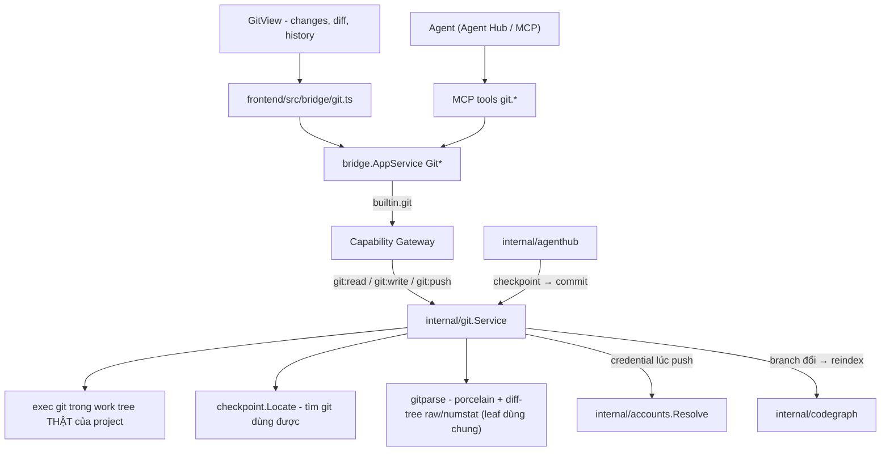
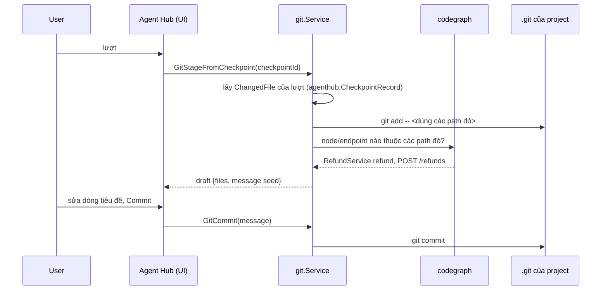
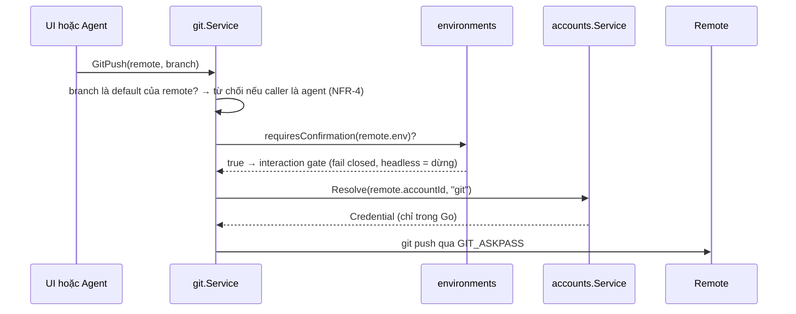

# Git

Git là built-in module cho **ba việc** người ta làm giữa lúc đọc code trong
[Code Graph](/dev-kit/codegraph) và lúc nhờ agent trong
[Agent Hub](/dev-kit/agent-hub) sửa: nhìn cái gì đã đổi, biến nó thành commit,
và đẩy đi. Không nhiều hơn. Mọi thứ ngoài ba việc đó, terminal đã làm tốt hơn.

import { Callout } from 'fumadocs-ui/components/callout';

<Callout type="warn" title="Design only">
Chưa có runtime: chưa có `internal/git`, chưa có
`frontend/src/modules/git/`. Đã có sẵn và sẽ dùng lại:
`internal/checkpoint` (`Locate`, parser của `Diff`),
`Service.GitStatus` + `parsePorcelain` trong `internal/codegraph/indexinfo.go`,
`agenthub.FileDiff` và checkpoint mỗi lượt.
</Callout>

## Vì sao không phải là VS Code thu nhỏ

Một git client rời thì thừa. Thứ DevKit có mà client khác không có là **index
của Code Graph** và **checkpoint của Agent Hub**. Cả hai đổi nghĩa của việc
commit:

- Code Graph biết file đã đổi ánh xạ ra **node, layer, endpoint** nào ⇒ message
  commit có phần mở đầu là *dữ kiện*, không phải văn do model bịa.
- Agent Hub đã chụp **mỗi lượt** vào shadow repo ⇒ có sẵn ranh giới "lượt này
  đã sửa đúng những file này", tức là một commit đã được phân nhóm sẵn.

Không có hai thứ đó, module này không đáng tồn tại.

## BRD — Business requirement

### Vấn đề

Agent sửa mười file trong bốn lượt. Người dùng muốn commit lượt thứ hai và thứ
tư, bỏ lượt ba. Hôm nay: mở terminal, `git status`, đoán file nào thuộc lượt
nào, `git add` từng cái, viết message từ trí nhớ. Đồng thời có **hai lịch sử**
cùng một work tree — checkpoint của agent và commit của người — mà không chỗ
nào nói chúng liên quan thế nào, nên `Restore checkpoint` là một thao tác đáng
sợ: không ai biết mình có mất việc đã commit không.

### Mục tiêu (goals)

- Từ một lượt của agent tới một commit: **một hành động**, file đã chọn sẵn,
  message đã có phần dữ kiện.
- Một chỗ duy nhất đọc trạng thái git của project — Code Graph thôi tự `exec`.
- Push an toàn theo cùng luật env như mọi thứ khác; force-push agent không
  chạm tới được.
- Nói rõ checkpoint ≠ commit, và làm cho `Restore` biết cái gì đã an toàn.

### Actors

| Actor | Nhu cầu |
|---|---|
| Developer | Stage theo hunk, commit, đổi branch, push; xem diff cạnh code đang đọc |
| Agent trong Agent Hub | Tự commit việc mình vừa làm, tạo branch, push lên branch của mình |
| Code Graph | Biết branch đã đổi để re-index; biết file nào `M`/`A` để vẽ marker |

### Functional requirements

| ID | Requirement |
|---|---|
| FR-1 | **Trạng thái**: danh sách file đổi của project đang mở, phân staged / unstaged / untracked, đường dẫn tương đối, forward slash. Đây là **nguồn duy nhất**; `codegraph.GitStatus` chuyển thành đọc từ đây. |
| FR-2 | **Diff**: theo file và theo hunk, dùng **đúng component** đang vẽ diff của checkpoint trong Agent Hub — một diff viewer, không phải hai. |
| FR-3 | **Stage**: theo file và theo hunk (`git apply --cached` với patch dựng từ hunk đã chọn). Unstage, discard (có xác nhận). |
| FR-4 | **Commit**: message nhiều dòng, amend lượt cuối (chỉ khi chưa push), author lấy từ config repo. |
| FR-5 | **Seed message từ Code Graph**: file đã stage → node → layer/endpoint, dựng phần thân dạng dữ kiện (`RefundService.refund`, `POST /refunds`). Người dùng sửa tự do; **không** tự sinh dòng tiêu đề bằng model. |
| FR-6 | **Commit lượt này**: từ một checkpoint của Agent Hub, stage đúng `ChangedFile` của lượt đó và seed message từ prompt của lượt + FR-5. |
| FR-7 | **Branch**: list, checkout, tạo mới từ ref, xoá branch local. Checkout báo cho Code Graph để re-index (`IndexInfo.Branch` hiện đã có, chưa ai theo dõi). |
| FR-8 | **Stash**: push/pop/list. Đây là lối thoát cho "đổi branch khi đang dở". |
| FR-9 | **Remote**: fetch, pull (`--ff-only` mặc định), push. Credential từ [Accounts](/dev-kit/accounts) qua `account_id` gắn trên remote. |
| FR-10 | **History**: log tuyến tính của branch hiện tại, mỗi dòng mở được diff của commit. Không có canvas đồ thị nhánh ở v1. |
| FR-11 | **Blast radius của một commit**: file đổi của commit → phạm vi ảnh hưởng trong index Code Graph. Git hỏi, Code Graph trả lời. |
| FR-12 | Agent gọi được `git.*` qua MCP với giới hạn ở bảng dưới. |
| FR-13 | Project không phải git work tree, hoặc máy không có git dùng được ⇒ module hiện panel "chưa có gì để hiện" nêu đúng lý do (`checkpoint.Availability` đã phân biệt được), không phải lỗi. |

### Non-functional requirements

| ID | Requirement |
|---|---|
| NFR-1 | Mọi call qua `AppService.call` + Capability Gateway. `git:push` tách khỏi `git:write`. |
| NFR-2 | **Push là hành động bị gate, commit thì không.** Commit là local và đảo được; push là ra ngoài và không đảo được. Remote gắn env tag `requiresConfirmation` ⇒ **mỗi lần** push đều hỏi, cả người lẫn agent, không có "đừng hỏi lại" (env thắng). |
| NFR-3 | `git:push:force` là capability riêng và **không có trong grant của MCP subject**. Agent không force-push được, bằng cách không tồn tại đường đó. |
| NFR-4 | Agent không push được lên branch mặc định của remote (`origin/HEAD`), và không push được lên branch nó không tạo trong phiên đó. |
| NFR-5 | Mọi lệnh chạy với `--no-optional-locks`, không hook tương tác, `GIT_TERMINAL_PROMPT=0`, timeout, huỷ được bằng ctx. Credential đưa qua `GIT_ASKPASS` chứ không nằm trong URL hay argv. |
| NFR-6 | Diff cắt ở giới hạn kích thước (hiển thị 5 MB, trả cho agent 256 KB kèm `truncated: true`) — cùng con số [API Client](/dev-kit/api-client) dùng. |
| NFR-7 | Audit ghi lệnh + remote + branch + số file; không ghi nội dung diff. |

### Out of scope (v1)

- **Giải quyết merge conflict trong UI.** Three-way merge là một sản phẩm
  riêng; `internal/syncconflict` là cho vault item, không phải cho file. Conflict
  ⇒ nói rõ và mời mở terminal (DevKit đã có sẵn terminal).
- `rebase -i`, cherry-pick, submodule, LFS, worktree, blame heatmap, đồ thị nhánh.
- Tích hợp GitHub/GitLab (PR, issue, review). Đó là
  [API Client](/dev-kit/api-client) cộng account, không phải git.
- Sign commit bằng GPG/SSH — đọc và tôn trọng config, không tự ký.

### Acceptance criteria

- Agent sửa file trong một lượt → **Commit lượt này** → đúng các file lượt đó
  được stage, message có sẵn phần node/endpoint, không file nào của lượt khác lọt vào.
- Checkout branch khác → Code Graph re-index, không phải bấm Reindex tay.
- Push tới remote gắn env `prod` → hỏi mọi lần, kể cả sau khi đã Allow always ở tool khác.
- Agent gọi `git.push --force` → không có tool đó; gọi `git.push` lên `main` → từ chối.
- Project không phải repo → module hiện panel giải thích, Code Graph vẫn chạy bình thường.

## Checkpoint ≠ commit

Hai lịch sử, một work tree. Viết luật ra để `Restore` thôi đáng sợ:

| | Checkpoint (Agent Hub) | Commit (Git) |
|---|---|---|
| Ở đâu | shadow repo dưới `<dataDir>/checkpoints`, **không bao giờ đụng `.git`** | `.git` của project |
| Vì sao có | mỗi lượt, tự động | người quyết định |
| Sống bao lâu | hết hạn theo `checkpoint.Limits` | vĩnh viễn |
| Đi ra ngoài | không bao giờ | push |
| Ai xem | chỉ máy này | cả team |

Cầu nối chỉ có **một chiều và một hành động**: FR-6, biến một checkpoint thành
một commit. Chiều ngược lại không có — commit không sinh ra checkpoint.

Và một luật an toàn mới: `agenthub.RestorePreview` hiện đã báo conflict; Git
thêm **một dòng** vào preview đó — *những path này có việc chưa commit sẽ mất*
so với *những path này đã commit, lấy lại được*. Chỉ git biết sự khác nhau, và
đó chính là điều người dùng cần biết trước khi bấm Restore.

## Dùng lại cái gì, và tuyệt đối không dùng lại cái gì

### Dùng lại

- **`checkpoint.Locate()` / `Availability`** — tìm một `git` đủ mới trên máy
  không có nó trong `PATH`; nó đã xử lý đúng cái bẫy shim của macOS Command
  Line Tools. Đây là leaf, dùng chung được ngay.
- **Parser của diff** — `parseRaw` + `applyNumstat` + `Change` đọc output
  `diff-tree --raw/--numstat`, không phụ thuộc git dir nào. Tách phần **parse**
  ra một leaf dùng chung (`internal/gitparse`); phần **shadow repo** ở lại
  `internal/checkpoint`.
- **`parsePorcelain`** trong `internal/codegraph/indexinfo.go` — đã đọc
  `--porcelain=v1 -z` và đã quy đường dẫn về gốc project. Chuyển sang leaf
  dùng chung; `Service.GitStatus` gọi module Git thay vì tự `exec`.
- **Diff viewer của Agent Hub checkpoint** — cùng component, cùng
  `FileDiff` shape.

### Tuyệt đối không

**Không commit việc thật của người dùng qua `checkpoint.Repo`.** Nó là một
GIT_DIR bare riêng, cấu hình `core.autocrlf=false` và ghi đè
`$GIT_DIR/info/attributes` thành `* -text -eol -filter -ident` — cố ý vô hiệu
hoá `.gitattributes` của project để byte vào ra nguyên vẹn. Điều đó đúng cho
một bản chụp, và **sai** cho một commit: repo khai `* text=auto` hay
`*.bin filter=lfs` sẽ bị ghi sai byte và không ai phát hiện cho tới lúc người
khác checkout. `internal/git` chạy git trong work tree thật, với config thật
của repo.

## Flow

### Từ lượt của agent tới commit

### Push

## Technical design

### Components

- **`internal/gitparse`** — leaf mới: `parsePorcelain`, `parseRaw`,
  `applyNumstat`, `Change`. Không import gì trong `devkit/internal`. Hôm nay
  code này nằm ở hai chỗ (`checkpoint/diff.go`, `codegraph/indexinfo.go`); ba
  bản là quá nhiều.
- **`internal/git`** — `Service` trên work tree thật: status, diff, stage theo
  hunk, commit, branch, stash, fetch/pull/push. Phụ thuộc `accounts` (resolve)
  và `environments` (gate).
- **`internal/bridge/git.go`** — `Git*` qua `AppService.call`, subject `builtin.git`.
- **`internal/mcp/tools_git.go`** — tool surface dưới.
- **`frontend/src/modules/git/`** — manifest, rail (changes / branches /
  history), document diff dùng lại viewer của checkpoint.

### Cái gì được lưu

Không có vault item cho trạng thái git — trạng thái git nằm trong repo. Chỉ hai
thứ được lưu:

| Thứ | Ở đâu | Vì sao |
|---|---|---|
| `git-remote` binding (`remote`, `env` tag, `account_id`) | vault item, sync được | Nó đặt tên một credential và một môi trường; cùng hình dạng `db-profile` |
| Draft message, hunk đang chọn, branch cuối theo project | SQLite local (derived) | Thuộc về máy này, mất cũng không sao |

### Bridge & capability

| Capability | Dùng cho | MCP có? |
|---|---|---|
| `git:read` | status, diff, log, branch list | có |
| `git:write` | stage, commit, branch create/checkout, stash | có, với NFR-4 |
| `git:push` | fetch, pull, push | có, luôn qua gate env |
| `git:push:force` | force-push | **không, và không có cách bật** |

### MCP tool surface

| Tool | Capability | Ghi chú |
|---|---|---|
| `git.status` | `git:read` | file đổi, branch, ahead/behind |
| `git.diff` | `git:read` | theo path hoặc theo commit; cắt theo NFR-6 |
| `git.log` | `git:read` | bounded |
| `git.branch.list` / `git.branch.create` | `git:read` / `git:write` | create ghi lại "agent tạo branch này" cho NFR-4 |
| `git.checkout` | `git:write` | từ chối khi có thay đổi chưa commit, trừ khi stash trước |
| `git.stage` / `git.commit` | `git:write` | commit là local, không gate env |
| `git.stash` | `git:write` | |
| `git.push` | `git:push` | gate env; chặn default branch; không có `--force` |

Không có `git.reset --hard`, không có `git.remote.set`, không có
`git.config`. Ba thứ đó là cách một agent làm mất việc của người khác mà lịch
sử không giữ lại được gì.

## Dùng nhanh từ Code Graph và Agent Hub

| Từ → Tới | Điểm chạm | Ghi chú |
|---|---|---|
| Code Graph → Git | Marker `M`/`A` trên tab Files (đã có) giờ đọc từ `git.status`; click mở diff `beside` | Một nguồn trạng thái, không phải hai lần `exec` |
| Code Graph → Git | Tab file: gutter thay đổi + *View diff* | Cùng viewer |
| Git → Code Graph | Dòng commit: *Blast radius* | Git hỏi, index trả lời (FR-11) |
| Git → Code Graph | Checkout branch ⇒ re-index | `IndexInfo.Branch` hiện chưa ai theo dõi (FR-7) |
| Agent Hub → Git | Lượt bất kỳ: *Commit lượt này* | FR-6 — lý do module này tồn tại |
| Git → Agent Hub | Diff / commit: *Attach to agent* | Chip `EntityRef` kind `commit`, `diff` |
| Git → Accounts | Dòng remote hiện chip account; hết hạn ⇒ peek ngay tại chỗ | Không chuyển tab |

## Known ceiling (v1)

- Conflict không giải quyết được trong UI — chỉ báo và mời dùng terminal.
- Log tuyến tính một branch; không thấy hình dạng nhánh.
- Stage theo hunk dựa trên `git apply --cached`; hunk đè nhau sau khi file đổi
  trên đĩa sẽ bị từ chối và phải chọn lại.
- Một project đang mở tại một thời điểm, giống Code Graph — submodule và
  monorepo nhiều repo con chưa nằm trong phạm vi.
