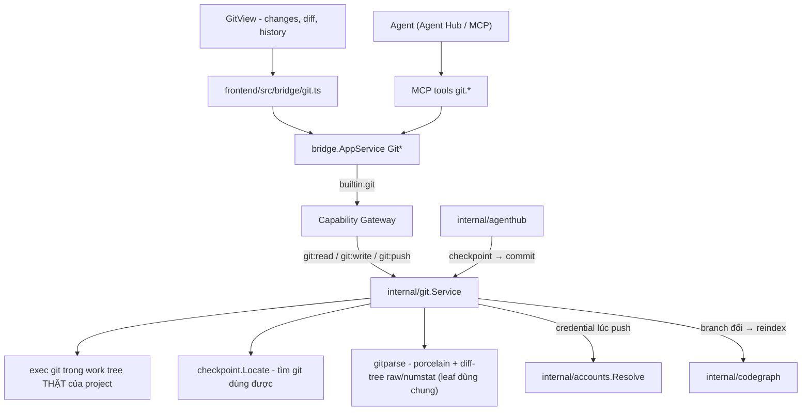
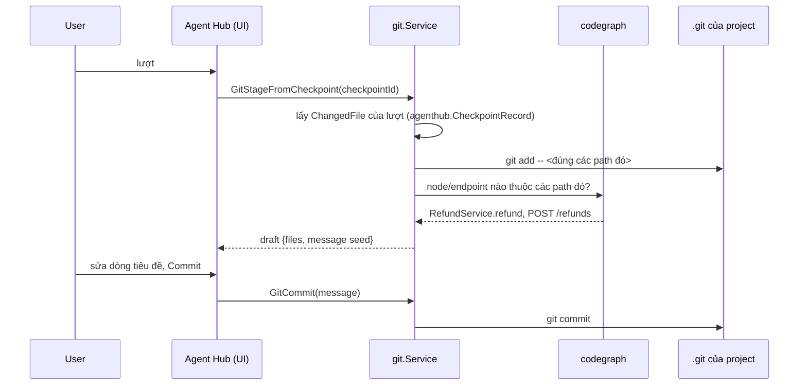
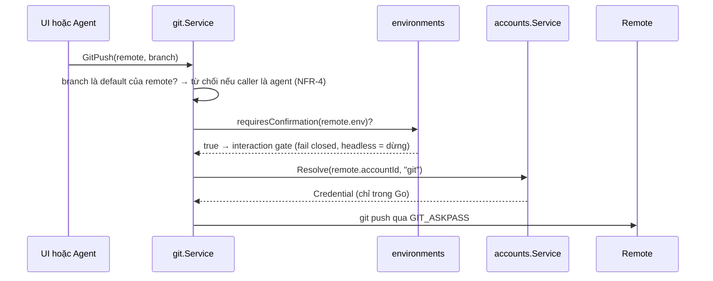

# Git

Git là built-in module cho **ba việc** người ta làm giữa lúc đọc code trong
[Code Graph](/dev-kit/codegraph) và lúc nhờ agent trong
[Agent Hub](/dev-kit/agent-hub) sửa: nhìn cái gì đã đổi, biến nó thành commit,
và đẩy đi. Không nhiều hơn. Mọi thứ ngoài ba việc đó, terminal đã làm tốt hơn.

import { Callout } from 'fumadocs-ui/components/callout';

<Callout type="info" title="Runtime hiện tại">
Đã có `internal/git` và UI Git. Changes, History, commit/file diff, stage theo file/hunk,
branch, stash/restore và remotes chạy qua bridge. Tab commit dùng workbench strip;
file diff đọc first parent (root dùng empty tree), staged review đọc index.
Phần BRD dưới đây là thiết kế ban đầu, gồm cả yêu cầu chưa triển khai; phạm vi và
kết quả kiểm tra hiện tại được ghi trong `docs/design/devkit-ui-rebuild-progress.md`.
</Callout>

## Vì sao không phải là VS Code thu nhỏ

Một git client rời thì thừa. Thứ DevKit có mà client khác không có là **index
của Code Graph** và **checkpoint của Agent Hub**. Cả hai đổi nghĩa của việc
commit:

- Code Graph biết file đã đổi ánh xạ ra **node, layer, endpoint** nào ⇒ message
  commit có phần mở đầu là *dữ kiện*, không phải văn do model bịa.
- Agent Hub đã chụp **mỗi lượt** vào shadow repo ⇒ có sẵn ranh giới "lượt này
  đã sửa đúng những file này", tức là một commit đã được phân nhóm sẵn.

Không có hai thứ đó, module này không đáng tồn tại.

## BRD — Business requirement

### Vấn đề

Agent sửa mười file trong bốn lượt. Người dùng muốn commit lượt thứ hai và thứ
tư, bỏ lượt ba. Hôm nay: mở terminal, `git status`, đoán file nào thuộc lượt
nào, `git add` từng cái, viết message từ trí nhớ. Đồng thời có **hai lịch sử**
cùng một work tree — checkpoint của agent và commit của người — mà không chỗ
nào nói chúng liên quan thế nào, nên `Restore checkpoint` là một thao tác đáng
sợ: không ai biết mình có mất việc đã commit không.

### Mục tiêu (goals)

- Từ một lượt của agent tới một commit: **một hành động**, file đã chọn sẵn,
  message đã có phần dữ kiện.
- Một chỗ duy nhất đọc trạng thái git của project — Code Graph thôi tự `exec`.
- Push an toàn theo cùng luật env như mọi thứ khác; force-push agent không
  chạm tới được.
- Nói rõ checkpoint ≠ commit, và làm cho `Restore` biết cái gì đã an toàn.

### Actors

| Actor | Nhu cầu |
|---|---|
| Developer | Stage theo hunk, commit, đổi branch, push; xem diff cạnh code đang đọc |
| Agent trong Agent Hub | Tự commit việc mình vừa làm, tạo branch, push lên branch của mình |
| Code Graph | Biết branch đã đổi để re-index; biết file nào `M`/`A` để vẽ marker |

### Functional requirements

| ID | Requirement |
|---|---|
| FR-1 | **Trạng thái**: danh sách file đổi của project đang mở, phân staged / unstaged / untracked, đường dẫn tương đối, forward slash. Đây là **nguồn duy nhất**; `codegraph.GitStatus` chuyển thành đọc từ đây. |
| FR-2 | **Diff**: theo file và theo hunk, dùng **đúng component** đang vẽ diff của checkpoint trong Agent Hub — một diff viewer, không phải hai. |
| FR-3 | **Stage**: theo file và theo hunk (`git apply --cached` với patch dựng từ hunk đã chọn). Unstage, discard (có xác nhận). |
| FR-4 | **Commit**: message nhiều dòng, amend lượt cuối (chỉ khi chưa push). Author là **identity của account** gắn với remote của repo (tên + email khai trong Accounts, lưu local, không sync) nếu có; `user.email` đặt trong **config của chính repo** thắng account (đó là lựa chọn cố ý cho repo này) và UI báo khi hai bên khác nhau; account không có identity (hoặc chỉ một nửa) thì để git tự quyết, không trộn tên chỗ này với email chỗ khác. Remote lấy theo upstream của branch, rồi `origin`, rồi remote duy nhất; nhiều remote mà không cái nào như vậy thì *chưa biết*, không đoán. Commit không bao giờ hiện hộp thoại chọn account — câu hỏi chờ tới lần push đầu. Amend giữ nguyên author cũ, chỉ committer là người amend. |
| FR-5 | **Seed message từ Code Graph**: file đã stage → node → layer/endpoint, dựng phần thân dạng dữ kiện (`RefundService.refund`, `POST /refunds`). Người dùng sửa tự do; **không** tự sinh dòng tiêu đề bằng model. |
| FR-6 | **Commit lượt này**: từ một checkpoint của Agent Hub, stage đúng `ChangedFile` của lượt đó và seed message từ prompt của lượt + FR-5. |
| FR-6b | Phiên agent đang giữ một task ([Tasks](/dev-kit/tasks)) ⇒ message seed thêm trailer `Task: <key>`. Đó là **toàn bộ** liên kết task ↔ commit: Tasks không lưu SHA, chỉ `git log --grep` theo `key` khi cần hiển thị. |
| FR-7 | **Branch**: list, checkout, tạo mới từ ref, xoá branch local. Checkout báo cho Code Graph để re-index (`IndexInfo.Branch` hiện đã có, chưa ai theo dõi). |
| FR-8 | **Stash**: push/pop/list. Đây là lối thoát cho "đổi branch khi đang dở". |
| FR-9 | **Remote**: fetch, pull (`--ff-only` mặc định), push. Credential từ [Accounts](/dev-kit/accounts) qua `account_id` gắn trên remote — HTTPS qua `GIT_ASKPASS`, SSH bằng **account loại `ssh-key`** (xem dưới). Binding token trên remote SSH không áp dụng: DevKit không resolve credential cho nó, và `Remote.transport` cho UI biết điều đó. **Remote chưa gắn account** (HTTPS lẫn SSH) được ghép theo `(host, owner, transport)`: `accounts.ForRemote` chọn khi chỉ một account khớp host (GitLab của bạn), còn nhiều account (hai GitHub) thì hiện hộp thoại chọn qua interaction hub — chỉ người trả lời được, agent không truyền được account — và nhớ theo `(host, owner)` (bảng local `account_remote_choices`, không sync) nên mỗi organisation chỉ hỏi một lần. Hub headless / server mode thì dừng ngay (`ErrSelectionRequired`), không đoán. Binding tường minh luôn thắng. Khi remote từ chối danh tính (`AuthError`), lỗi nêu tên remote và account (HTTPS) hoặc nói rõ là key SSH của git (SSH), không để lộ câu `Permission denied` trần. |
| FR-10 | **History**: log tuyến tính của branch hiện tại, mỗi dòng mở được diff của commit. Không có canvas đồ thị nhánh ở v1. |
| FR-11 | **Blast radius của một commit**: file đổi của commit → phạm vi ảnh hưởng trong index Code Graph. Git hỏi, Code Graph trả lời. |
| FR-12 | Agent gọi được `git.*` qua MCP với giới hạn ở bảng dưới. |
| FR-13 | Project không phải git work tree, hoặc máy không có git dùng được ⇒ module hiện panel "chưa có gì để hiện" nêu đúng lý do (`checkpoint.Availability` đã phân biệt được), không phải lỗi. |
| FR-14 | **Conflict có UI riêng**: danh sách file conflict, và mỗi file mở trong panel ba cột *Ours · Merged (sửa được) · Theirs* — **cùng hình dạng `ResolvePanel` của [Sync](/dev-kit/data-sync)** đã chạy. Đánh dấu resolved = `git add`; huỷ cả lượt = `git merge --abort`. |
| FR-15 | **Env gate theo branch**: một `git-guard` gắn env tag cho một mẫu tên branch (`main`, `release/*`). Branch khớp ⇒ commit **và** push trên đó đi qua `requiresConfirmation` của env đó. Không gắn ⇒ không chặn gì — mặc định là không có guard nào. |

### Non-functional requirements

| ID | Requirement |
|---|---|
| NFR-1 | Mọi call qua `AppService.call` + Capability Gateway. `git:push` tách khỏi `git:write`. |
| NFR-2 | **Push bị gate theo mặc định; commit chỉ khi được khai.** Push là ra ngoài và không đảo được, nên remote gắn env tag `requiresConfirmation` ⇒ **mỗi lần** push đều hỏi. Commit là local và đảo được nên mặc định không hỏi — trừ khi branch khớp một `git-guard` (FR-15), vì một repo chứa manifest deploy thì chính commit mới là thứ đáng sợ. Cả hai đều không có "đừng hỏi lại" (env thắng). |
| NFR-3 | `git:push:force` là capability riêng và **không có trong grant của MCP subject**. Agent không force-push được, bằng cách không tồn tại đường đó. |
| NFR-4 | Agent không push được lên branch mặc định của remote (`origin/HEAD`), và chỉ push được lên branch **ghi trên một task nó đang giữ** (`task.branch`). `git.branch.create` trả tên branch để agent ghi ngay vào task bằng `tasks.setFields` — nên quyền đó **sống qua restart phiên**, khác với một danh sách nằm trong bộ nhớ của phiên. Không có task nào ⇒ agent chỉ commit, không push. |
| NFR-5 | Mọi lệnh chạy với `--no-optional-locks`, không hook tương tác, `GIT_TERMINAL_PROMPT=0`, timeout, huỷ được bằng ctx. Credential đưa qua `GIT_ASKPASS` chứ không nằm trong URL hay argv. |
| NFR-6 | Diff cắt ở giới hạn kích thước (hiển thị 5 MB, trả cho agent 256 KB kèm `truncated: true`) — cùng con số [API Client](/dev-kit/api-client) dùng. |
| NFR-7 | Audit ghi lệnh + remote + branch + số file; không ghi nội dung diff. |

### Out of scope (v1)

- **Merge tự động thông minh.** Conflict được giải bằng tay trong UI (FR-14);
  DevKit không thử đoán kết quả hợp nhất hộ người dùng.
- `rebase -i`, cherry-pick, submodule, LFS, worktree, blame heatmap, đồ thị nhánh.
- Tích hợp GitHub/GitLab (PR, issue, review). Đó là
  [API Client](/dev-kit/api-client) cộng account, không phải git.
- Sign commit bằng GPG/SSH — đọc và tôn trọng config, không tự ký.

### Acceptance criteria

- Agent sửa file trong một lượt → **Commit lượt này** → đúng các file lượt đó
  được stage, message có sẵn phần node/endpoint, không file nào của lượt khác lọt vào.
- Checkout branch khác → Code Graph re-index, không phải bấm Reindex tay.
- Push tới remote gắn env `prod` → hỏi mọi lần, kể cả sau khi đã Allow always ở tool khác.
- Agent gọi `git.push --force` → không có tool đó; gọi `git.push` lên `main` → từ chối.
- Project không phải repo → module hiện panel giải thích, Code Graph vẫn chạy bình thường.

## Checkpoint ≠ commit

Hai lịch sử, một work tree. Viết luật ra để `Restore` thôi đáng sợ:

| | Checkpoint (Agent Hub) | Commit (Git) |
|---|---|---|
| Ở đâu | shadow repo dưới `<dataDir>/checkpoints`, **không bao giờ đụng `.git`** | `.git` của project |
| Vì sao có | mỗi lượt, tự động | người quyết định |
| Sống bao lâu | hết hạn theo `checkpoint.Limits` | vĩnh viễn |
| Đi ra ngoài | không bao giờ | push |
| Ai xem | chỉ máy này | cả team |

Cầu nối chỉ có **một chiều và một hành động**: FR-6, biến một checkpoint thành
một commit. Chiều ngược lại không có — commit không sinh ra checkpoint.

Và một luật an toàn mới: `agenthub.RestorePreview` hiện đã báo conflict; Git
thêm **một dòng** vào preview đó — *những path này có việc chưa commit sẽ mất*
so với *những path này đã commit, lấy lại được*. Chỉ git biết sự khác nhau, và
đó chính là điều người dùng cần biết trước khi bấm Restore.

## Dùng lại cái gì, và tuyệt đối không dùng lại cái gì

### Dùng lại

- **`checkpoint.Locate()` / `Availability`** — tìm một `git` đủ mới trên máy
  không có nó trong `PATH`; nó đã xử lý đúng cái bẫy shim của macOS Command
  Line Tools. Đây là leaf, dùng chung được ngay.
- **Parser của diff** — `parseRaw` + `applyNumstat` + `Change` đọc output
  `diff-tree --raw/--numstat`, không phụ thuộc git dir nào. Tách phần **parse**
  ra một leaf dùng chung (`internal/gitparse`); phần **shadow repo** ở lại
  `internal/checkpoint`.
- **`parsePorcelain`** trong `internal/codegraph/indexinfo.go` — đã đọc
  `--porcelain=v1 -z` và đã quy đường dẫn về gốc project. Chuyển sang leaf
  dùng chung; `Service.GitStatus` gọi module Git thay vì tự `exec`.
- **Diff viewer của Agent Hub checkpoint** — cùng component, cùng
  `FileDiff` shape.

### Tuyệt đối không

**Không commit việc thật của người dùng qua `checkpoint.Repo`.** Nó là một
GIT_DIR bare riêng, cấu hình `core.autocrlf=false` và ghi đè
`$GIT_DIR/info/attributes` thành `* -text -eol -filter -ident` — cố ý vô hiệu
hoá `.gitattributes` của project để byte vào ra nguyên vẹn. Điều đó đúng cho
một bản chụp, và **sai** cho một commit: repo khai `* text=auto` hay
`*.bin filter=lfs` sẽ bị ghi sai byte và không ai phát hiện cho tới lúc người
khác checkout. `internal/git` chạy git trong work tree thật, với config thật
của repo.

## Flow

### Từ lượt của agent tới commit

### Push

## Technical design

### Components

- **`internal/gitparse`** — leaf mới: `parsePorcelain`, `parseRaw`,
  `applyNumstat`, `Change`. Không import gì trong `devkit/internal`. Hôm nay
  code này nằm ở hai chỗ (`checkpoint/diff.go`, `codegraph/indexinfo.go`); ba
  bản là quá nhiều.
- **`internal/git`** — `Service` trên work tree thật: status, diff, stage theo
  hunk, commit, branch, stash, fetch/pull/push. Phụ thuộc `accounts` (resolve)
  và `environments` (gate).
- **`internal/bridge/git.go`** — `Git*` qua `AppService.call`, subject `builtin.git`.
- **`internal/mcp/tools_git.go`** — tool surface dưới.
- **`frontend/src/modules/git/`** — manifest, rail (changes / branches /
  history), document diff dùng lại viewer của checkpoint.

### Cái gì được lưu

Không có vault item cho trạng thái git — trạng thái git nằm trong repo. Chỉ hai
thứ được lưu:

| Thứ | Ở đâu | Vì sao |
|---|---|---|
| `git-remote` binding (`remote`, `env` tag, `account_id`) | vault item, sync được | Nó đặt tên một credential và một môi trường; cùng hình dạng `db-profile` |
| `git-guard` (`project_key`, `pattern`, `env`) | vault item, sync được | FR-15. Mẫu tên branch, không phải tên branch cụ thể, nên nó vẫn đúng với branch chưa tồn tại. Không có record nào = không chặn gì |
| Draft message, hunk đang chọn, branch cuối theo project | SQLite local (derived) | Thuộc về máy này, mất cũng không sao |

### Bridge & capability

| Capability | Dùng cho | MCP có? |
|---|---|---|
| `git:read` | status, diff, log, branch list | có |
| `git:write` | stage, commit, branch create/checkout, stash, resolve conflict | có, với NFR-4; commit trên branch khớp `git-guard` đi qua gate env |
| `git:push` | fetch, pull, push | có, luôn qua gate env |
| `git:push:force` | force-push | **không, và không có cách bật** |

### MCP tool surface

| Tool | Capability | Ghi chú |
|---|---|---|
| `git.status` | `git:read` | file đổi, branch, ahead/behind |
| `git.diff` | `git:read` | theo path hoặc theo commit; cắt theo NFR-6 |
| `git.log` | `git:read` | bounded |
| `git.branch.list` / `git.branch.create` | `git:read` / `git:write` | create ghi lại "agent tạo branch này" cho NFR-4 |
| `git.checkout` | `git:write` | từ chối khi có thay đổi chưa commit, trừ khi stash trước |
| `git.stage` / `git.commit` | `git:write` | Commit không gate env, **trừ** branch khớp `git-guard` (FR-15) |
| `git.stash` | `git:write` | |
| `git.conflicts` | `git:read` | Danh sách file conflict + ba phiên bản của một file (FR-14) |
| `git.resolve` | `git:write` | Ghi nội dung đã hợp nhất cho một file rồi `git add`. Không có `--abort` qua MCP: huỷ cả lượt merge là việc của người |
| `git.push` | `git:push` | gate env; chặn default branch; không có `--force` |

Không có `git.reset --hard`, không có `git.remote.set`, không có
`git.config`. Ba thứ đó là cách một agent làm mất việc của người khác mà lịch
sử không giữ lại được gì.

## Dùng nhanh từ Code Graph và Agent Hub

| Từ → Tới | Điểm chạm | Ghi chú |
|---|---|---|
| Code Graph → Git | Marker `M`/`A` trên tab Files (đã có) giờ đọc từ `git.status`; click mở diff `beside` | Một nguồn trạng thái, không phải hai lần `exec` |
| Code Graph → Git | Tab file: gutter thay đổi + *View diff* | Cùng viewer |
| Git → Code Graph | Dòng commit: *Blast radius* | Git hỏi, index trả lời (FR-11) |
| Git → Code Graph | Checkout branch ⇒ re-index | `IndexInfo.Branch` hiện chưa ai theo dõi (FR-7) |
| Agent Hub → Git | Lượt bất kỳ: *Commit lượt này* | FR-6 — lý do module này tồn tại |
| Git → Agent Hub | Diff / commit: *Attach to agent* | Chip `EntityRef` kind `commit`, `diff` |
| Git → Tasks | Trailer `Task: <key>` trong message | Git ghi; Tasks đọc bằng `--grep`, không lưu lại gì |
| Tasks → Git | Task detail: danh sách commit, nút tạo branch `<key>-…` | Hỏi lúc hiển thị; `tasks.claim` **không** đụng work tree |
| Tasks → Git | Cửa duyệt đóng task hỏi: còn thay đổi chưa commit? đã push? đã merge? | Hiển thị, **không chặn** — xem [Tasks FR-20](/dev-kit/tasks) |
| Tasks → Git | `task.branch` quyết định agent được push lên branch nào | NFR-4; sống qua restart phiên, khác một danh sách trong bộ nhớ |
| Sync → Git | Panel ba cột của conflict | Cùng hình dạng `ResolvePanel` đã chạy cho vault item (FR-14) |
| Git → Accounts | Dòng remote hiện chip account; hết hạn ⇒ peek ngay tại chỗ | Không chuyển tab |

## Quyết định đã chốt

| Câu hỏi | Chốt |
|---|---|
| Conflict có UI không, hay đẩy ra terminal? | **Có UI** — ba cột Ours/Merged/Theirs, dùng lại hình dạng `ResolvePanel` của Sync (FR-14) |
| Commit có bị gate env không? | **Có, nhưng opt-in theo branch.** `git-guard` gắn env cho một mẫu tên branch; không khai gì thì không chặn gì (FR-15) |
| Agent được push lên branch nào sau khi phiên restart? | Branch **ghi trên task nó đang giữ** (`task.branch`), không phải một danh sách trong bộ nhớ phiên (NFR-4) |

## Open questions

- `git-guard` là vault item nên **sync**: một guard khai trên máy này áp lên
  mọi máy. Đúng ý (luật của repo, không của máy) — hay có trường hợp người
  dùng muốn siết chỉ trên một máy?
- Conflict panel sửa được ô Merged. Với file nhị phân thì không có gì để sửa:
  chỉ cho chọn Ours/Theirs, hay ẩn hẳn khỏi danh sách?

## Known ceiling (v1)

- Conflict giải bằng tay ba cột; không có merge tool tự động, không có gợi ý
  hợp nhất, không có diff theo từ. Ô giữa seed bằng bản merge của chính git
  (kèm marker), không phải bằng một bên. Lấy nguyên một bên là git tự copy
  stage, nên file nhị phân cũng chọn được bên.
- `git-guard` khớp theo mẫu tên branch, không theo đường dẫn file: không khai
  được "chặn khi đụng `deploy/`".
- Log tuyến tính một branch; không thấy hình dạng nhánh.
- Stage theo hunk dựa trên `git apply --cached`; hunk đè nhau sau khi file đổi
  trên đĩa sẽ bị từ chối và phải chọn lại. Chiều ngược lại — unstage theo hunk —
  chưa có: bỏ stage vẫn là cả file. File nhị phân không có hunk để chọn.
- **Remote SSH dùng key của account, không phải key của máy.** Key nằm trong một ssh-agent riêng chạy trong process Go (`internal/gitssh`), socket trong thư mục 0700, chỉ chứa đúng key đó và biến mất khi lệnh git xong; private key không bao giờ ghi ra đĩa (chỉ file public key để ssh biết key nào của agent cần chào). Alias trong `~/.ssh/config` (`git@github-work:…`) được giải qua `ssh -G` ra host thật trước khi ghép account. Account `ssh-key` mặc định **chỉ ở máy này** (bảng local, không sync) và lưu passphrase cùng key; đồng bộ là công tắc người dùng bật. Key không bao giờ hiện lại — chỉ có fingerprint và public key.
- **Giới hạn của việc ép key**: `~/.ssh/config` có thể khai `IdentityFile` riêng cho host, và ssh sẽ thử chúng *sau* key của account nếu key đó bị từ chối (một option dòng lệnh không gỡ được dòng trong config). Account được verify bằng `ssh -T` khi lưu nên key bị từ chối nghĩa là nó đã bị gỡ khỏi account trên provider; khi đó push thất bại hoặc đi bằng danh tính mà `~/.ssh/config` khai. Test `TestSSHFallsBackToConfigIdentityOnlyAfterTheAccountKeyIsRefused` ghi đúng hành vi này.
- Chưa hỗ trợ Windows cho remote SSH có account (OpenSSH trên Windows nối agent qua named pipe, không phải unix socket): lệnh dừng, không rơi về key của máy. Chưa hỗ trợ key `sk-`/FIDO, file `.ppk` của PuTTY hay key chỉ nằm trong agent hệ thống (Keychain, 1Password). Key có sẵn trên máy được **import** từ Accounts → *Import from ~/.ssh*: DevKit liệt kê key trong `~/.ssh` (một cấp, bỏ qua symlink, file > 64 KB và `known_hosts`/`config`/`*.pub`), hiện fingerprint, alias trong `~/.ssh/config` đang dùng key đó và key đã lưu chưa; file gốc không bị sửa hay xoá. Key mã hoá OpenSSH đọc được fingerprint không cần passphrase (public key nằm sẵn trong container). *Detect* kết nối GitHub/GitLab/Bitbucket để biết key đã thuộc account nào. Alias được gán cho account thì remote `git@<alias>:…` dùng đúng key đó mà không hỏi (alias thắng owner).
- Một project đang mở tại một thời điểm, giống Code Graph — submodule và
  monorepo nhiều repo con chưa nằm trong phạm vi.
