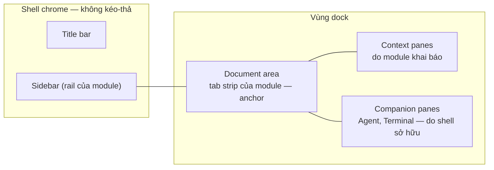

# Layout & panes

Trang này định nghĩa cách DevKit thay bố cục cố định hiện tại (sidebar, content,
split panel, companion, bottom slot) bằng **pane kéo-thả được**, và — quan
trọng hơn thư viện dùng để vẽ — **luật** để việc tự do sắp xếp đó vẫn liền mạch
khi người dùng đi qua Code Graph, Database, Notes, Kafka, Agent Hub, API Client.

import { Callout } from 'fumadocs-ui/components/callout';

<Callout type="info" title="Đã chốt: bố cục vị trí (slot layout)">
Sau spike, DevKit **không** dùng thư viện docking. Pane di chuyển giữa một số
**vị trí cố định** quanh document — xem [Bố cục vị trí](#bố-cục-vị-trí-slot-layout).
Float, chia lồng tuỳ ý và kéo vào giữa document là ngoài phạm vi. Các mục về
dockview bên dưới giữ lại làm lịch sử quyết định. Thiết kế UI:
[Figma · Shell / Slot layout — option B](https://www.figma.com/design/3dOzSZBYY7QtzANFTCfEe8/DevKit?node-id=1220-23683).
</Callout>

## DevKit không phải Claude Desktop

Claude Desktop cho kéo-thả pane tự do, và đó là nguồn cảm hứng. Nhưng **trung
tâm** của hai app khác nhau, nên không thể chép luật của họ:

| | Claude Desktop | DevKit |
|---|---|---|
| Trung tâm | **Một cuộc hội thoại** | **Document của module**: canvas Code Graph, một note, SQL console, topic Kafka, một request API |
| Pane xung quanh phục vụ | Cuộc hội thoại đó (diff, terminal, preview của chính session) | Document đang mở (inspector, code, data flow, kết quả query) — **và** thứ đi xuyên module (agent, terminal) |
| Đổi "trung tâm" | Chọn hội thoại khác ⇒ cả bộ pane đổi theo | Đổi **module** ⇒ pane của module đổi, pane xuyên module **đứng yên** |
| Agent | Là trung tâm | Là **một pane**, cạnh document — không bao giờ chiếm chỗ document |

Hệ quả thiết kế: DevKit cần **hai tầng layout** (một tầng đi theo module, một
tầng đi theo người dùng), còn Claude chỉ cần một. Mọi luật bên dưới xuất phát từ
chỗ này.

## Mô hình: document ở giữa, context quanh nó, companion bên cạnh



### Ba loại vùng

| Vùng | Là gì | Ai sở hữu | Kéo-thả? |
|---|---|---|---|
| **Chrome** | Title bar, sidebar | Shell (sidebar: nội dung của module) | Không. Sidebar chỉ đóng/mở/resize như hôm nay |
| **Document area** | Một hoặc nhiều **document group**, mỗi group một tab strip (`openTab`) — xem [Document group](#document-group--nhiều-document-cạnh-nhau) | Module của từng group | **Anchor**: không đóng, không float, không gộp làm tab của pane. Luôn có bề rộng tối thiểu |
| **Pane** | Mọi bề mặt phụ còn lại | Module *hoặc* shell (bên dưới) | Có |

Sidebar **không** là pane: nó là điều hướng, và điều hướng phải luôn ở một chỗ.
Đây là điểm DevKit giữ lại từ bố cục cố định — người dùng tự do với thứ mình
*đọc*, không phải với thứ mình dùng để *đi lại*.

### Hai loại pane

| | **Context pane** | **Companion pane** |
|---|---|---|
| Ví dụ | Code Graph: Code, Data flow, Inspector, Plan comments · Database: Results, Cell inspector · Notes: Metadata, History · Kafka: Message · API Client: Response | Agent, Terminal |
| Khai báo bởi | Module (manifest) | Shell |
| Sống bao lâu | Khi module **đang hiện**. Rời module ⇒ pane được **cất** (không phá), quay lại ⇒ về đúng chỗ | Xuyên mọi module, suốt phiên |
| Vị trí nhớ theo | **Từng module** | **Toàn cục** |
| Thay cho hôm nay | `openPanel` (slot `panel`), `useBottomContent` | `openCompanion`, bottom slot (terminal) |

### Context pane là gì

Context pane là **bề mặt phụ thuộc về một document**: nó cho xem hoặc sửa thứ
*xung quanh* document, không phải chính document.

| Document | Context pane của nó |
|---|---|
| Canvas flow `POST /refunds` | Code của node đang chọn, Data flow, Plan comments |
| Một note | Metadata (tag, folder), History |
| SQL console | Results, Cell inspector |
| Topic Kafka | Message đang chọn |
| Request API | Response |

Ba dấu hiệu nhận ra một context pane, và cũng là ba luật của nó:

1. **Nội dung đi theo document** — chọn node khác thì Code đổi; focus sang note
   khác thì Metadata đổi. Mặc định nó phục vụ **document đang focus** của module
   nó thuộc về.
2. **Không có document thì vô nghĩa** — Metadata không đứng một mình được. Agent
   và Terminal thì có ích ở bất kỳ đâu; đó là lý do chúng là companion.
3. **Module khai báo** — chỉ Notes biết note có History, chỉ Code Graph biết node
   có Data flow.

**Ghim.** Header của context pane có nút ghim: pane đã ghim khoá vào document
hiện tại và không đổi theo focus nữa (vd sửa note B trong khi xem History của
note A). Pane đã ghim hiện tên document trong title ("History · Refund notes").

Hôm nay chúng chính là những gì module mở qua `openPanel`: inspector của Code
Graph, Message của Kafka, Metadata/History của Notes.

### Vị trí nhớ

Luật vị trí nhớ là thứ làm trải nghiệm liền mạch:

- Đổi từ Code Graph sang Database: Code/Data flow biến mất, Results của Database
  hiện ở chỗ bạn đã đặt nó **lần trước ở Database**. Agent và Terminal **không
  nhúc nhích một pixel**.
- Bạn kéo Agent sang trái ở Notes ⇒ ở mọi module Agent đều ở bên trái.

Đây cũng là lời giải cho lỗi đang có hôm nay: panel của module đã rời vẫn có thể
còn trên màn hình vì view module vẫn mount (`MAX_MOUNTED_MODULES`) còn effect
`openPanel` không nhìn visibility. Trong mô hình mới, việc cất context pane là
của **layout**, không phải của cleanup effect trong từng module.

## Hai tầng layout

```
LayoutState
├── global                      ← companion panes: vị trí, kích thước, float, ẩn/hiện
├── documents                   ← cây document group, mỗi group một moduleId + tab của nó
└── perModule[moduleId]         ← context panes của module đó + vị trí tương đối với group của nó
```

Cái người dùng thấy = **ghép** tầng global, cây document group, và tầng
`perModule` của **mọi module đang có ít nhất một group trên màn hình** (không
chỉ module đang focus — xem [Document group](#document-group--nhiều-document-cạnh-nhau)).
Đổi module trong một group chỉ thay tầng của module đó. Hệ quả cần giữ khi
implement:

- **Nguồn sự thật là `LayoutState` của DevKit**, không phải JSON của renderer.
  dockview có `toJSON`/`fromJSON` cho *toàn bộ* layout, nhưng không có khái niệm
  "hai tầng"; DevKit tự dựng layout cho renderer từ hai tầng, và đọc ngược thay
  đổi của người dùng vào đúng tầng.
- Một pane companion được thả vào **giữa** hai context pane của Code Graph: vị trí
  của nó tính theo cột/nhóm, và khi sang module khác không có hai pane đó, nó rơi
  về cột gần nhất còn tồn tại — **không** biến mất, **không** tự float.

## Document group — nhiều document cạnh nhau

Document area chia được thành nhiều **document group**, mỗi group có tab strip
riêng — hai note song song, console `dev` cạnh console `prod`, hay một note cạnh
canvas Code Graph.

```
┌ Sidebar ┬─ Code Graph ────┬─ Notes ──────────┬─ Context ───┐
│ (theo   │ [POST /refunds] │ [Refund notes]   │ Code        │
│  group  │                 │                  │ (Code Graph)│
│  focus) │   canvas        │   editor         ├─────────────┤
│         │                 │                  │ Metadata    │
│         │                 │                  │ (Notes)     │
└─────────┴─────────────────┴──────────────────┴─────────────┘
```

### Luật

| Luật | Vì sao |
|---|---|
| **Mỗi group gắn với đúng một module.** Tab chỉ đi giữa các group *cùng module*; kéo tab note vào group Code Graph bị từ chối | Tab vẫn là của module như [Module tabs](/dev-kit/module-tabs) — không có tab strip trộn nhiều module |
| **Module active = module của group đang focus.** Sidebar, title-bar actions, preset `⌃1`–`⌃4` đi theo group đó | Giữ nguyên giả định "một module active" mà mọi phần khác đang dựa vào |
| **Focus chỉ đổi khi click hoặc dùng phím vào group**, không theo hover. Rail của module đã mount sẵn nên sidebar đổi trong cùng frame ([Smoothness](/dev-kit/smoothness)) | Sidebar không được nhảy khi chuột lướt qua |
| **Context pane của mọi module đang hiện đều ở lại.** Chỉ header đổi trạng thái Focused/Idle | Nếu chỉ hiện pane của module focus, click qua lại hai group sẽ làm pane nhảy liên tục |
| **Mỗi document chỉ ở một group.** Mở document đã mở ở group khác ⇒ focus group đó; *Split right* trên tab ⇒ **chuyển** tab sang group mới | Hai editor Plate cùng sửa một note là nguồn xung đột; view thứ hai trên cùng model để sau |
| **Tối đa 3 group**, mỗi group rộng ≥ 360px | Đủ cho so sánh; hơn nữa thì document nào cũng hẹp tới mức không đọc được |
| Group trống ⇒ tự đóng; group cuối cùng không bao giờ đóng | Document area là anchor |

Không thêm nhãn module ở đầu group — nó tốn chỗ và lặp lại thứ đã có. Module
của group đọc được từ **icon trên tab** (tab Code Graph mang icon Code Graph, tab
note mang icon note), còn group đang focus — thứ quyết định sidebar — là group
có **viền focus**.

### Nhóm module trên titlebar

Module switcher không có một nút cho mỗi module: các module hay đi cùng nhau
dùng chung một nút (`frontend/src/modules/groups.ts`).

| Nhóm | Module | Mặc định mở |
|---|---|---|
| Infra | Database, Kafka, SSH | Database |
| Plan | Notes, Tasks | Notes |
| Utilities | API Client, Accounts, Tools | API Client |

- Nút nhóm hiện icon của module đang mở, hoặc module dùng gần nhất (nhớ qua các
  lần mở app). **Click** mở đúng module đó; **hover** 250 ms hiện danh sách các
  thành viên kèm số tab đang mở; ⌥-click và chuột phải tác động lên module đó
  như trên nút riêng.
- Nhóm chỉ là cách vẽ: mỗi thành viên vẫn là một module đầy đủ — tab, sidebar,
  pin work folder và palette theo id của chính nó. Backend không biết nhóm tồn tại.
- Một nhóm là **một slot**: `⌘1`–`⌘9` đếm slot, và nhấn lại phím của nhóm khi
  đang ở trong nó thì chuyển sang thành viên kế tiếp. Vị trí của nhóm theo id của
  nhóm (`infra` nằm giữa `git` và `plan`); `utilities` cuối cùng vì ít dùng nhất.
- Một module vào nhóm bằng cách khai `group` trong manifest.
- **Bàn phím:** `⌘⌥1`–`⌘⌥9` (`Ctrl+Alt+1`–`9` ngoài macOS) mở peek của slot đó,
  cho cả module thường (danh sách tab đang mở) lẫn nhóm (danh sách thành viên).
  Focus vào hàng hiện tại, `↑` `↓` `Home` `End` di chuyển, `Enter` chọn, `Esc`
  đóng và trả focus về chỗ cũ. Phím đọc từ phím vật lý (`event.code`) vì `⌥` đổi
  ký tự của hàng số trên macOS. Chord **nhường** khi con trỏ ở trong editor của
  Notes (nơi `⌘⌥1`–`⌘⌥6` là heading), và — với `Ctrl+Alt`, vốn là AltGr trên
  Windows/Linux — khi đang gõ trong ô nhập hoặc khi hệ điều hành báo AltGraph.
- **Tất cả phím tắt** nằm ở *Settings ▸ Keyboard* (mở nhanh bằng `⌘/`, trừ khi
  con trỏ đang ở trong ô nhập: CodeMirror dùng `⌘/` để comment). Danh sách dựng từ
  `modules/settings/keyboard.ts`: phím của shell khai ở đó cùng handler, còn
  command có `shortcut` trong manifest thì đọc thẳng từ manifest nên không lệch
  với menu bar và palette. Module đang mở luôn ở đầu danh sách.

### Mở một group

- `⌘\` hoặc *Split right* trên tab: group mới cùng module, tab chuyển sang đó.
- `⌘`-click một mục trong sidebar: mở "bên cạnh" (group khác cùng module, tạo nếu chưa có).
- Kéo tab ra mép document area: group mới ở mép đó.
- *Open beside* trên module switcher: mở module khác thành group mới cạnh group đang focus.
- **Intent liên module** ([Liên module](/dev-kit/cross-module)) có tham số
  `placement: "replace" | "beside"`. Ví dụ *Try in API Client* từ Code Graph mở
  request **bên cạnh** canvas mặc định — bạn thấy flow và response cùng lúc thay
  vì bị đưa sang module khác.

`openTab({ moduleId, viewId, params, side?: boolean })`: không có `side` ⇒ mở vào
group đang focus của module đó (hoặc group đang focus nếu cùng module); `side` ⇒
group bên cạnh.

### Đã làm (v1)

- Store: `frontend/src/stores/documentGroups.ts` (luật thuần, có test) trên
  partition tab sẵn có — tab nhớ group của nó qua `WorkbenchTab.group`;
  `activeTabId` của module luôn là tab của **group đang focus**, nên code module
  (Database `useIsActiveDocument`, Notes…) không phải đổi gì. Lưu qua restart.
- Vẽ: `frontend/src/workbench/DocumentGroups.tsx` — mỗi group một card, tab
  strip riêng, sash kéo chia độ rộng (trọng số, không phải px), group focus có
  viền `border-focus`. View của tab render một lần vào host riêng
  (`workbench/tabHosts.ts`); chuyển tab giữa group không remount.
- Mở group: *Split Right* trên tab / `⌘\`, *Move to Other Group*, `⌥`-click
  module trên switcher để mở bên cạnh. Group rỗng tự đóng (trừ group cuối), có
  nút đóng group khi có hơn một.

Sau đó đã làm thêm:

- **Kéo tab** ra khỏi strip: thả lên group khác cùng module thì chuyển sang
  đó, thả vào mép phải group của nó thì tách thành group mới.
- **Context pane của mọi module đang hiện**: `openPanel` thuộc về module gọi nó
  (qua `SidebarModuleIdContext`), mỗi module có vị trí riêng; pane của module
  đang focus thắng khi tranh chỗ và hiện trạng thái Focused, các pane khác Idle.
- **`⌘`-click trong sidebar** mở bên cạnh (`armBeside`, không module nào phải
  sửa); `openTab({ beside: true })` là chỗ intent liên module sẽ gọi với
  `placement: "beside"`.
- **Khi cửa sổ nhỏ lại** và **preset** — xem hai mục dưới.
- Tay nắm kéo pane là một vạch ngắn giữa mép trên header, hiện khi hover
  (tooltip *Move*), thay cho icon chấm.

### Agent Hub

Agent Hub là một module có document là **phiên agent**. Nếu một group Agent Hub
đang hiện đúng phiên mà companion *Agent* đang hiện, companion tự ẩn — cùng một
hội thoại không vẽ hai lần. Phiên khác nhau thì cả hai cùng hiện.

## Pane: một primitive, một cái header

Mọi pane dùng chung `Shell / Pane Header` (Figma):

| Phần tử | Hành vi |
|---|---|
| Grip | Kéo pane. Cả header kéo được; grip là gợi ý nhìn thấy |
| Icon + title | Title do pane cung cấp, có thể động ("Data flow · amount") |
| Hành động riêng của pane | Module thêm vào bên trái nhóm nút chuẩn (vd Code: *Open in editor*) |
| Split | Tách pane hiện tại, mở một pane cùng loại bên cạnh |
| Float | Chuyển sang nổi (xem [Float](#float-là-một-chế-độ-không-phải-mặc-định)) |
| Maximize | Phóng pane chiếm cả vùng dock; `Esc` hoặc bấm lại để trả |
| More | Move to…, Reset position, và menu riêng của pane |
| Close | Đóng. Companion đóng = ẩn (mở lại bằng phím tắt), không huỷ phiên agent/terminal |

Trạng thái **Focused / Idle** của header là tín hiệu duy nhất cho biết phím tắt
và `⌘C` đang tác động lên pane nào.

## Kéo-thả có cấu trúc

> Bản đang chạy: [bố cục vị trí](#bố-cục-vị-trí-slot-layout) — đích thả là các vị trí cố định, không chia tuỳ ý.

Không có vị trí tự do theo toạ độ. Khi kéo, vùng thả dưới con trỏ nói trước điều
sẽ xảy ra (`Shell / Drop Target`):

| Thả vào | Kết quả |
|---|---|
| Nửa trên / dưới của một pane | Chia pane đó theo chiều dọc |
| Nửa trái / phải của một pane | Chia theo chiều ngang (tạo cột) |
| Mép ngoài vùng dock | Cột mới ở mép đó |
| Giữa một pane | Gộp làm **tab** trong cùng nhóm |
| Document area (kéo một **pane**) | **Chỉ** chia cạnh document. Không bao giờ thành tab trong tab strip của document |
| Mép document area (kéo một **tab**) | Document group mới ở mép đó |
| Group của module khác (kéo một **tab**) | Từ chối — overlay không hiện |
| Vùng pane (kéo một **tab**) | Từ chối — document không trở thành pane |

Luật cuối giữ ranh giới "document vs pane": tab strip là của document (note,
console, request…), pane không lẫn vào đó. Trong dockview đây là `locked` trên
nhóm document và một handler `onWillShowOverlay` chặn vùng center.

**Kéo không bắt buộc.** Mọi thao tác kéo có đường tương đương bằng bàn phím và
menu: *More → Move to → Right / Below / New column / Float / Into group…*.

## Float là một chế độ, không phải mặc định

> **Bỏ** trong [bố cục vị trí](#bố-cục-vị-trí-slot-layout): không có pane nổi.

- Pane chỉ nổi khi người dùng chọn Float (hoặc kéo ra ngoài mọi vùng thả).
- Pane nổi bị giữ trong viewport (`floatingGroupBounds: 'boundedWithinViewport'`),
  có bóng đổ, luôn dưới dialog và shell float (toast permission ở z-60).
- Bấm *Dock* trên header đưa pane về **chỗ nó rời đi**, không phải chỗ mặc định.

**Pop-out ra cửa sổ riêng: chưa làm.** dockview mở popout bằng `window.open`,
thứ WKWebView của Wails không cho như trình duyệt; DevKit hôm nay chỉ có đúng một
cửa sổ (`main.go`). Pop-out cần Wails multi-window + đồng bộ state giữa hai
webview — một dự án riêng.

## Preset thay cho luật tự thu gọn

Thay vì DevKit đoán nên đóng pane nào khi thiếu chỗ, người dùng chọn bố cục cho
việc đang làm:

- **4 preset** cho module đang focus, gọi bằng `⌃⇧1`–`⌃⇧4` (menu *Layouts* trên
  title bar): *Focus*, *Side panel*, *Pair with agent*, *Terminal below*
  (`frontend/src/workbench/slots/layoutPresets.ts`). Không phải `⌃1`–`⌃4`:
  `⌃`+số đã là chuyển module ở đây, và là chuyển desktop của Mission Control.
  Tên theo từng module (bảng dưới) để sau.
- Preset chỉ sắp **tầng module** + bật/tắt companion; không đụng vị trí companion
  mà người dùng đã chỉnh, trừ khi preset nói rõ (vd *Focus* ẩn mọi thứ).
- *Save current layout…* lưu thành preset của người dùng cho module đó.
  *Reset to default* về preset số 1 của module.

| Module | Preset gợi ý |
|---|---|
| Code Graph | Focus · Review code (Code trên Data flow, bên phải) · Pair with agent · Terminal below |
| Database | Console + Results below · Results right · Focus |
| Notes | Focus · With metadata · With history |
| Kafka | Topic + Message right · Focus |
| API Client | Request/Response stacked · Side by side · Focus |
| Agent Hub | Session (companion Agent tự ẩn — module đã là agent) |

## Khi cửa sổ nhỏ lại

Preset là lựa chọn chủ động; resize cửa sổ thì không. Luật khi không đủ chỗ, theo
thứ tự:

1. Mọi pane co về `minimumWidth` của nó, document co về sàn **480px**
   (`CONTENT_MIN_WIDTH` hiện có). Kích thước lưu là số tuyệt đối, clamp lúc render
   — một lần mở ở cửa sổ nhỏ không làm teo vĩnh viễn layout ở cửa sổ lớn (luật đã
   có ở [Shell primitives](/dev-kit/shell-primitives)).
2. Vẫn thiếu: **sidebar nhường chỗ** — trạng thái mở không đổi, rộng ra là nó
   quay lại.
3. Vẫn thiếu: cột thứ hai **xếp chồng vào cột thứ nhất** (bản đang chạy xếp chồng
   thay vì gộp làm tab — vị trí không có tab). Không đóng, không float.
4. Vẫn thiếu: document group **không** focus co về dải hẹp (icon module + tên tab
   đang mở), bấm vào là bung lại. Group đang focus không bao giờ co.
5. Companion **không bao giờ** bị tự đóng.

Chạy: `panelLayout.layoutPressure` (có test), đọc qua `useLayoutPressure` ở
sidebar, các cột và document group. Số cột, trạng thái mở của sidebar và bề rộng
các cột được publish trong layout effect (trước paint), nên một cột mở ra làm
sidebar nhường chỗ thì hai cái bắt đầu chạy trong cùng một frame, mỗi cái về
đúng kích thước cuối — cột không phải đổi đích giữa chừng khi sidebar nhả chỗ.
Không xếp tuần tự (sidebar xong rồi mới tới cột): như vậy là thêm một nhịp trễ.

Nới cửa sổ ra thì chạy ngược lại, trả về đúng layout đã lưu. Cửa sổ tối thiểu
vẫn là 1080×700.

## Sống sót khi bị ẩn hay bị di chuyển

Kéo pane trong dockview là **đổi cha của DOM node**. Thứ có state trong DOM phải
được khai báo rõ:

| Nội dung | Luật |
|---|---|
| Terminal (xterm), phiên agent | `renderer: 'always'` — không bao giờ gỡ khỏi DOM khi bị che |
| Canvas React Flow (Code Graph, ERD) | `always`, và fit/đo lại khi pane đổi kích thước — React Flow đo pane ẩn ra 0 (ghi chú ERD ở [Smoothness](/dev-kit/smoothness)) |
| CodeMirror | `always` khi có thay đổi chưa lưu; ngoài ra `onlyWhenVisible` |
| Danh sách, bảng, inspector | `onlyWhenVisible` (mặc định) — state nằm trong store, không trong DOM |

Đây là chỗ policy `keep-alive / suspend-when-hidden / unmount-when-hidden` của
[Frontend performance](/dev-kit/frontend-performance) (đang là design) trở thành
thật: mỗi pane khai một policy, layout thực thi nó.

## Những thứ không được phụ thuộc vào layout

- **Permission request của agent** vẫn đến qua toast shell float
  (`lib/shellFloat.ts`, z-60) khi pane Agent đóng, bị che hay đang ở module khác.
  Gate fail closed sau 60s — một yêu cầu không có chỗ hiện là một lần từ chối
  không ai thấy.
- **Xác nhận env prod** (Database, API Client) là dialog modal trên cả layout.
- **Vault lock** phủ toàn bộ cửa sổ, kể cả pane đang float.

## Khai báo pane trong manifest

```ts
type PaneContribution = {
  id: string;                         // "codegraph.code"
  title: string;
  icon: IconName;
  kind: "context" | "companion";      // companion chỉ shell khai
  defaultPlacement: "right" | "below" | "left" | "float";
  group?: string;                     // pane cùng group mặc định chung cột: "codegraph.detail"
  minimumWidth?: number;              // mặc định 280
  keepAlive?: "always" | "whenDirty" | "never";
  component: ComponentType<PaneProps>;
};

// ModuleManifest
panes?: PaneContribution[];
layouts?: LayoutPreset[];             // ≤ 4
```

Module **mở** pane bằng `openPane("codegraph.code", params)` thay cho
`openPanel(node)`: layout quyết định nó hiện ở đâu (chỗ cũ, hoặc
`defaultPlacement` lần đầu). Module không bao giờ chọn toạ độ.

## Lưu trữ

- `LayoutState` đi qua `bridge/uistate.ts` → bảng `ui_state` như mọi UI state
  khác ([UI state](/dev-kit/ui-state)): local, không sync, không vault, debounce.
  Không dùng `localStorage`.
- Schema có `version`. Không đọc được / renderer từ chối (`fromJSON` throw) ⇒ về
  preset 1 của module, **không** crash, ghi một dòng log.
- Pane id không còn tồn tại (module gỡ pane) ⇒ bỏ qua khi dựng layout.

## Chuyển từ primitive hiện tại

| Hôm nay | Sau |
|---|---|
| Sidebar (`useSidebarContent`, `manifest.sidebar`) | Giữ nguyên, là chrome |
| Tab strip + views (`openTab`) | Document area — `openTab` giữ nguyên, thêm `side`. `workbenchTabs` thêm `groupId` cho tab, `activeTabId` theo group, và cây group trong state lưu |
| `openPanel` (slot `panel`): Code Graph inspector, Kafka message, Notes meta/history | Context pane qua `openPane` |
| `openCompanion` / `AgentCompanionSlot` | Companion pane *Agent* |
| Bottom slot + `TerminalWorkspace` | Companion pane *Terminal* (mặc định `below`) |
| `useBottomContent` (chưa ai gọi) | Bỏ |
| `moduleActions` | Giữ, nhưng **key theo module** — chỉ render action của module đang hiện |
| `splitColumn.ts`, `useResizableSize.ts`, `panelWidths.ts` | Thay bằng layout; `splitColumn`'s luật clamp chuyển vào tầng dựng layout |

Chuyển dần được: bước đầu chỉ vùng bên phải (panel + companion) đi qua layout
mới, sidebar và document chưa đổi.

## Phím tắt

| Phím | Hành động |
|---|---|
| `⌘B` | Sidebar |
| `⌘J` | Context pane của module (mở/đóng cả nhóm) |
| `⌘L` | Agent (và đưa thực thể đang chọn vào composer — xem [Liên module](/dev-kit/cross-module)) |
| `` ⌃` `` | Terminal |
| `⌃1`–`⌃4` | Preset của module |
| `⌘\` | Split document group (chuyển tab đang mở sang group mới) |
| `⌘1` / `⌘2` / `⌘3` | Focus document group 1 / 2 / 3 |
| `⌘K` `←` / `→` | Chuyển tab đang mở sang group bên trái / phải (cùng module) |
| `⌃Tab` / `⌃⇧Tab` | Chuyển focus giữa các pane |
| `⌘⇧↩` | Maximize / restore pane đang focus |
| `Esc` | Thoát maximize; từ pane float trả focus về document |

## Spike dockview — những gì phải chứng minh

Chốt dockview chỉ khi branch thử nghiệm trả lời "có" cho cả danh sách:

1. **Theme**: header, tab, sash, drop overlay vẽ được bằng token hiện có (glass,
   `surface/base`, `glass/border`, motion) — không để lộ style mặc định.
2. **Đổi cha DOM**: kéo pane Terminal (xterm) và canvas Code Graph qua lại không
   mất phiên, không trắng canvas.
3. **Hai tầng**: đổi module thay context pane mà companion đứng yên, trong một
   frame (luật first-frame của [Smoothness](/dev-kit/smoothness)).
4. **Khoá document**: không thả được pane thành tab của document.
5. **WKWebView**: kéo-thả HTML5 chạy trong Wails trên macOS (và Windows WebView2).
6. **Bàn phím**: *Move to…* làm được mọi thứ kéo làm được.
7. **Ngân sách**: bundle vẫn trong budget ([Frontend performance](/dev-kit/frontend-performance)),
   hoặc lazy-load được.
8. **Hỏng thì hồi**: layout hỏng ⇒ về preset, không crash.
9. **Document group**: phân biệt được group document và group pane (và module
   của group document) để chặn thả chéo bằng `onWillShowOverlay`; kéo tab giữa
   hai group cùng module chạy như native.
10. **Hai canvas**: hai React Flow (hai flow Code Graph, hoặc canvas + ERD) cùng
    hiện không vượt ngân sách frame khi pan/zoom.

Trượt một trong 2, 3, 5, 9 thì không dùng dockview; tự viết trên `useResizableSize`
hiện có với phạm vi nhỏ hơn (không float, không tab trong pane).

### Kết quả spike (2026-09-18)

Spike ở `frontend/src/dev/dockSpike/` (route `?dock-spike`, thêm `&pointer` để
dùng DnD bằng pointer events), dockview-react **8.3.1**, đo trong Chromium ở
1440×900 bằng bảng probe có sẵn trong trang. Luật thả nằm trong
`layoutRules.ts` (thuần, có test).

| # | Hạng mục | Kết quả | Ghi chú |
|---|---|---|---|
| 1 | Theme | ✅ | `dockSpike.css` chỉ dùng token (surface, glass-border, radius, motion); group là card bo góc có gutter như shell hôm nay |
| 2 | Đổi cha DOM | ✅ | Kéo/float/dock Terminal, Agent, canvas: **0 panel re-mount**, đúng 1 xterm, cùng DOM node, draft trong composer còn nguyên, canvas refit qua `ResizeObserver` |
| 3 | Hai tầng | ✅ *sau khi sửa* | Xem [Phát hiện 1](#phát-hiện-từ-spike). Đổi module 14–21 ms (dev build); companion đứng yên đến từng pixel qua 6 lần đổi liên tiếp |
| 4 | Khoá document | ✅ | `onWillShowOverlay` + `canDrop` — không cần `locked`. Pane vào giữa document, document vào pane: đều bị từ chối |
| 5 | WKWebView / WebView2 | ✅ macOS | Kéo thả chạy trong app Wails trên macOS (người dùng xác nhận). Kéo "nhấc cả pane" dùng pointer events nên không phụ thuộc HTML5 DnD. Windows WebView2 chưa kiểm |
| 6 | Bàn phím | ◐ | *Move to…* trong header chạy (Right / Below / Left). Chưa có điều hướng bàn phím đầy đủ — dockview không có sẵn, phải tự làm |
| 7 | Ngân sách | ❌ với v8 | Xem [Phát hiện 2](#phát-hiện-từ-spike) |
| 8 | Hỏng thì hồi | ✅ | `fromJSON` ném lỗi với layout hỏng ⇒ về preset; `reuseExistingPanels` khôi phục mà không tạo xterm mới |
| 9 | Document group | ✅ | Note cạnh Code Graph; sidebar theo group focus; tab note vào group Code Graph bị từ chối |
| 10 | Hai canvas | ✅ | Hai React Flow cùng hiện; ~4.8 ms mỗi lần đổi kích thước split (gồm một tick `setTimeout`) |

### Phát hiện từ spike

1. **dockview chia lại chỗ theo tỷ lệ.** Thêm/bớt cột context khi đổi module
   làm *mọi* cột co giãn, nên companion nhỏ dần sau mỗi lần đổi (332 → 284 →
   232 px). Sửa: trước khi đổi, đọc kích thước companion bằng `group.api.width`
   / `height` và `setSize` lại sau khi đổi — document hấp thụ phần chênh. Phải
   dùng kích thước của grid, **không** phải `getBoundingClientRect`: padding
   gutter của theme nằm giữa hai số đó và làm lệch 8 px mỗi lần.
2. **Kích thước.** dockview 8 ≈ **408 KB min / 93 KB gzip** JS + 150 KB CSS
   (12.5 KB gzip, gồm mọi theme). Initial JS hôm nay 876 KiB, trần của
   `check-performance-budget.mjs` là 1024 KiB ⇒ vượt. So sánh: **dockview 4.13
   ≈ 211 KB / 47 KB gzip**, CSS 42 KB, có đủ mọi API spike dùng (overlay, float,
   popout, `setSize`) **trừ** `dndStrategy: "pointer"`.
3. **v8 là open-core.** Lõi (grid, tab, float, maximize, popout, serialize,
   overlay, `dropPositionResolver`) là MIT. Auto-hide edge group, pinned tabs,
   smart guides, layout history, multi-row tabs cần `dockview-enterprise` + key.
   Thiết kế này không cần chúng; riêng bước "group không focus co về dải hẹp"
   phải tự làm.
4. **Document bị gỡ khi đổi module.** Spike gỡ panel document của module cũ, nên
   quay lại thì canvas mount lại (mất viewport/zoom). Luật hiện có — module đã
   thăm vẫn mount (`MAX_MOUNTED_MODULES`) — không tự đúng với dockview; cần chọn
   (xem Quyết định còn mở).
5. **Kéo "nhấc cả pane" (kiểu Claude Desktop) làm được trên dockview.**
   `liftDrag.ts` tắt DnD của dockview (`disableDnd`) và tự lo bằng pointer
   events: quá 5 px thì pane thành group float đúng kích thước/vị trí cũ, nội
   dung vẫn chạy (0 re-mount), container bám theo chuột; pane dưới con trỏ được
   hit-test, vùng thả vẽ theo `canDrop`; thả vào vùng thì `moveTo`, thả ra ngoài
   hoặc `Esc` thì `fromJSON` về layout trước khi kéo. Hệ quả lớn: **không còn
   phụ thuộc HTML5 DnD của webview, cũng không cần `dndStrategy: "pointer"`** —
   dockview 4.13 có đủ mọi API cách này dùng (`disableDnd`, `addFloatingGroup`,
   `moveTo`, `addGroup`, `toJSON`/`fromJSON` + `reuseExistingPanels`).
   Bẫy: panel `renderer: "always"` (terminal, canvas, agent) nằm trong
   *render overlay* riêng mà dockview chỉ căn lại theo sự kiện layout của nó —
   dời container bằng CSS thì khung đi, nội dung ở lại. Phải dời qua
   `DockviewFloatingGroupPanel.position()`, thứ **không** có trên `DockviewApi`
   công khai (spike gọi qua component private); bản thật cần wrapper chính thức
   hoặc patch.
6. **Group float nằm đè vùng thả.** Thả vào vùng có group float phía trên thì
   pane gộp vào group float, không vào grid bên dưới. Hợp luật nhưng dễ bất
   ngờ — cân nhắc làm mờ/khoá group float khi đang kéo.

### Vì sao dừng dockview

Mọi hạng mục của spike đều đạt, nhưng trong shell thật thì card của pane không
bao giờ khớp được với card của shell. dockview sở hữu DOM của pane: nội dung
`renderer: "always"` nằm ở một lớp phủ riêng ngoài phần tử group, nên squircle
và vòng viền SVG gắn vào group không phủ lên nó; cộng thêm `.dv-shell`, padding
trên mọi view và theme mặc định phải ghi đè từng thứ một. Các thư viện docking
khác (FlexLayout, rc-dock, Golden Layout) cũng sở hữu DOM của chúng, nên đổi thư
viện sẽ gặp lại đúng vấn đề đó. Ngoài ra còn tốn ~47–93 KB gzip và cần API
private để di chuyển group nổi.

## Bố cục vị trí (slot layout)

```
┌──────────┬──────────┬──────────┐
│          │ a.top    │ b.top    │
│ document ├──────────┼──────────┤
│          │ a.bottom │ b.bottom │
├──────────┼──────────┴──────────┘
│ bottom   │
└──────────┘
```

- **Document** là trung tâm: luôn có, không di chuyển, không nhận pane. Nó vẫn
  chứa các [document group](#document-group--nhiều-document-cạnh-nhau).
- **Hàng dưới** chỉ nằm dưới document — hai cột bên phải giữ nguyên chiều cao.
- **Tối đa hai cột** bên phải, mỗi cột chia trên/dưới. Vị trí trống không chiếm
  chỗ: cột không có pane nào mở thì không vẽ, cột có một pane thì pane đó cao hết
  cột.
- **Pane nào cũng vào được vị trí nào**, kể cả companion vào chung cột với context
  pane (vd. Code trên, Agent dưới).
- **Thả vào vị trí đã có pane thì đổi chỗ** hai pane — kể cả với pane đang đóng,
  để nó không mở lại đè lên pane mới.
- **Mặc định** là shell cũ: context `a.top`, Agent `a.bottom`, Terminal ở hàng
  dưới. Ai không kéo gì thì không thấy gì thay đổi.
- **Nhớ vị trí:** context pane theo module, companion toàn cục; lưu qua restart
  (`ui_state`, key `paneSlots`). Kích thước theo phiên, như trước.
- **Tranh chấp:** context pane của module nhớ một vị trí mà companion đã chiếm
  thì companion thắng; context pane sang nửa còn lại của cột đó.

**Kéo:** nắm header pane, quá 5px thì chính card (cùng nội dung sống) nhấc lên,
thu còn tối đa 480×320 quanh con trỏ và đi theo chuột. Chỗ cũ giữ nguyên kích
thước, viền nét đứt. Chỉ các vị trí sáng lên: nửa trên/dưới của một cột, hàng
dưới (hoặc dải chân document khi hàng dưới chưa có), và dải mép nơi cột còn
thiếu sẽ mở. Thả ngoài vùng hoặc `Esc` thì trả về chỗ cũ. Menu **Move to…** trên
header cho cùng các đích, không cần kéo.

**Không remount:** thân mỗi pane được render một lần vào một phần tử tách rời;
card của vị trí "nhận nuôi" phần tử đó. Chuyển pane là chuyển phần tử DOM, nên
xterm, canvas hay tin nhắn đang gõ dở không mount lại. Phần tử được chuyển bằng
`Element.moveBefore` khi engine có, không thì đọc vị trí cuộn trước và ghi lại
sau (`slots/hostMove.ts`), nên pane đổi chỗ không bị cuộn về đầu.

**Mở/đóng:** cột, hàng dưới và sidebar chuyển động giống nhau (smoothness 3.8,
4.4): box ngoài animate kích thước và clip, box trong ghim ở kích thước mở và
treo vào cạnh đang chuyển động — cột trượt vào từ phải và trượt ra về phải, hàng
dưới trượt lên, sidebar trượt từ trái. Mặt card đi theo panel, nội dung trên nó
hiện ra sau 60 ms (một lớp phủ màu mặt card mờ dần, không phải `opacity` của nội
dung — smoothness 3.8). Đóng thì nội dung cuối ở lại tới khi panel đóng xong
(`--motion-fast`), trừ pane đang hiện ở chỗ khác. Bề rộng module xin cho context
pane được áp trước frame đầu, nên animation mở không đổi đích giữa chừng. Resize
cửa sổ, kéo bất kỳ sash nào, hay một thay đổi chỉ do clamp của panel bên cạnh thì
panel đi theo tức thì. Card đã đóng (và sidebar đã đóng) là `inert`, nhưng
`inert` chỉ đổi khi panel đứng yên — đổi nó restyle cả cây bên dưới — nên panel
vẫn `inert` suốt lúc mở và thành `inert` sau khi đóng xong; lúc đang đóng một
tấm chắn nhận click. Một pane đã sang chỗ khác trong lúc chỗ cũ đang đóng thì chỗ
cũ không vẽ lại nó.

**Agent đóng là ẩn, không gỡ:** sau lần mở đầu, companion Agent ở lại mounted
khi pane đóng (và khi đang ở Agent Hub), `visible={false}` — đọc transcript
store đang giữ mà không subscribe, không fetch, không toast, và **đóng băng**: trả
lại element dựng lần cuối còn hiện, nên gõ prompt trong Agent Hub không làm rail ẩn
render lại (mở lại thì render một lần với state mới). Lúc ẩn, menu/popover/select
nó mở (portal ra body) được đóng bằng Escape khi lớp trên cùng là của nó, và focus
trong nó bị blur. Card của nó **nằm yên tại chỗ** (`slots/retain.restingStep`):
trong cột đã đóng như sidebar đóng giữ rail, hoặc — khi pane khác vẫn mở trong
cùng cột — "cất" ra khỏi flow (`absolute`, `invisible`, `inert`, phủ cả cột) để
pane kia lấy cả cột, và cất rồi thì giữ vậy tới khi Agent hiện lại. Chuyển phần
tử sang chỗ khác là dựng lại cả cuộc hội thoại trên WebKit (không có
`moveBefore`): 70–90 ms mỗi lần mở và mỗi lần đóng. Chỉ khi một pane khác chiếm
đúng vị trí của nó, hay nó hiện ở chỗ khác, phần tử mới sang "bãi đỗ" trong
document (fixed, ngoài màn hình, `invisible`, `inert`, cùng kích thước card vừa
rời). Mở lại vẫn đúng chỗ cuộn và composer như lúc đóng. Context pane của module
vẫn gỡ khi đóng như cũ.

Code: luật thuần ở `frontend/src/workbench/slots/slotModel.ts` (có test),
kéo ở `paneDrag.ts`, vẽ ở `frontend/src/components/ui/pane-slots.tsx`, vị trí ở
`frontend/src/stores/paneSlots.ts`. Module không đổi gì: `openPanel`, companion
và bottom slot giữ nguyên API.

## Out of scope (v1)

- Pop-out ra cửa sổ riêng (cần Wails multi-window).
- Cùng một document trong hai group (hai view trên một model, kiểu VS Code).
- Chia group theo chiều dọc (group chồng trên–dưới) — v1 chỉ xếp ngang.
- Pane nổi, chia lồng tuỳ ý, cột thứ ba, cột bên trái document.
- Tab trộn nhiều module trong một group.
- Đồng bộ layout giữa thiết bị — kích thước màn hình khác nhau, sync chỉ gây hại.
