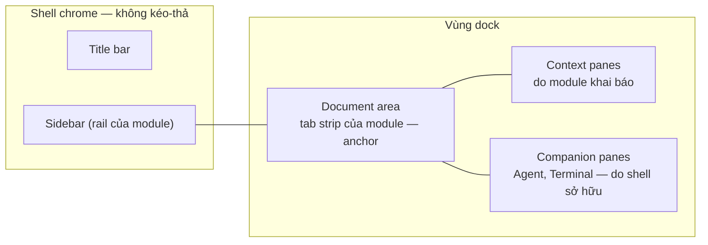

# Layout & panes

Trang này định nghĩa cách DevKit thay bố cục cố định hiện tại (sidebar, content,
split panel, companion, bottom slot) bằng **pane kéo-thả được**, và — quan
trọng hơn thư viện dùng để vẽ — **luật** để việc tự do sắp xếp đó vẫn liền mạch
khi người dùng đi qua Code Graph, Database, Notes, Kafka, Agent Hub, API Client.

import { Callout } from 'fumadocs-ui/components/callout';

<Callout type="warn" title="Design only">
Chưa có runtime. Shell hiện tại mô tả ở [Shell primitives](/dev-kit/shell-primitives),
[Sidebar](/dev-kit/sidebar) và [Module tabs](/dev-kit/module-tabs) vẫn là sự thật
đang chạy. Thiết kế UI:
[Figma · Shell / Dockable panes](https://www.figma.com/design/3dOzSZBYY7QtzANFTCfEe8/DevKit?node-id=1204-2397).
Renderer dự kiến là [dockview](https://dockview.dev) — **chưa chốt**, xem
[Spike](#spike-dockview--những-gì-phải-chứng-minh).
</Callout>

## DevKit không phải Claude Desktop

Claude Desktop cho kéo-thả pane tự do, và đó là nguồn cảm hứng. Nhưng **trung
tâm** của hai app khác nhau, nên không thể chép luật của họ:

| | Claude Desktop | DevKit |
|---|---|---|
| Trung tâm | **Một cuộc hội thoại** | **Document của module**: canvas Code Graph, một note, SQL console, topic Kafka, một request API |
| Pane xung quanh phục vụ | Cuộc hội thoại đó (diff, terminal, preview của chính session) | Document đang mở (inspector, code, data flow, kết quả query) — **và** thứ đi xuyên module (agent, terminal) |
| Đổi "trung tâm" | Chọn hội thoại khác ⇒ cả bộ pane đổi theo | Đổi **module** ⇒ pane của module đổi, pane xuyên module **đứng yên** |
| Agent | Là trung tâm | Là **một pane**, cạnh document — không bao giờ chiếm chỗ document |

Hệ quả thiết kế: DevKit cần **hai tầng layout** (một tầng đi theo module, một
tầng đi theo người dùng), còn Claude chỉ cần một. Mọi luật bên dưới xuất phát từ
chỗ này.

## Mô hình: document ở giữa, context quanh nó, companion bên cạnh



### Ba loại vùng

| Vùng | Là gì | Ai sở hữu | Kéo-thả? |
|---|---|---|---|
| **Chrome** | Title bar, sidebar | Shell (sidebar: nội dung của module) | Không. Sidebar chỉ đóng/mở/resize như hôm nay |
| **Document area** | Một hoặc nhiều **document group**, mỗi group một tab strip (`openTab`) — xem [Document group](#document-group--nhiều-document-cạnh-nhau) | Module của từng group | **Anchor**: không đóng, không float, không gộp làm tab của pane. Luôn có bề rộng tối thiểu |
| **Pane** | Mọi bề mặt phụ còn lại | Module *hoặc* shell (bên dưới) | Có |

Sidebar **không** là pane: nó là điều hướng, và điều hướng phải luôn ở một chỗ.
Đây là điểm DevKit giữ lại từ bố cục cố định — người dùng tự do với thứ mình
*đọc*, không phải với thứ mình dùng để *đi lại*.

### Hai loại pane

| | **Context pane** | **Companion pane** |
|---|---|---|
| Ví dụ | Code Graph: Code, Data flow, Inspector, Plan comments · Database: Results, Cell inspector · Notes: Metadata, History · Kafka: Message · API Client: Response | Agent, Terminal |
| Khai báo bởi | Module (manifest) | Shell |
| Sống bao lâu | Khi module **đang hiện**. Rời module ⇒ pane được **cất** (không phá), quay lại ⇒ về đúng chỗ | Xuyên mọi module, suốt phiên |
| Vị trí nhớ theo | **Từng module** | **Toàn cục** |
| Thay cho hôm nay | `openPanel` (slot `panel`), `useBottomContent` | `openCompanion`, bottom slot (terminal) |

### Context pane là gì

Context pane là **bề mặt phụ thuộc về một document**: nó cho xem hoặc sửa thứ
*xung quanh* document, không phải chính document.

| Document | Context pane của nó |
|---|---|
| Canvas flow `POST /refunds` | Code của node đang chọn, Data flow, Plan comments |
| Một note | Metadata (tag, folder), History |
| SQL console | Results, Cell inspector |
| Topic Kafka | Message đang chọn |
| Request API | Response |

Ba dấu hiệu nhận ra một context pane, và cũng là ba luật của nó:

1. **Nội dung đi theo document** — chọn node khác thì Code đổi; focus sang note
   khác thì Metadata đổi. Mặc định nó phục vụ **document đang focus** của module
   nó thuộc về.
2. **Không có document thì vô nghĩa** — Metadata không đứng một mình được. Agent
   và Terminal thì có ích ở bất kỳ đâu; đó là lý do chúng là companion.
3. **Module khai báo** — chỉ Notes biết note có History, chỉ Code Graph biết node
   có Data flow.

**Ghim.** Header của context pane có nút ghim: pane đã ghim khoá vào document
hiện tại và không đổi theo focus nữa (vd sửa note B trong khi xem History của
note A). Pane đã ghim hiện tên document trong title ("History · Refund notes").

Hôm nay chúng chính là những gì module mở qua `openPanel`: inspector của Code
Graph, Message của Kafka, Metadata/History của Notes.

### Vị trí nhớ

Luật vị trí nhớ là thứ làm trải nghiệm liền mạch:

- Đổi từ Code Graph sang Database: Code/Data flow biến mất, Results của Database
  hiện ở chỗ bạn đã đặt nó **lần trước ở Database**. Agent và Terminal **không
  nhúc nhích một pixel**.
- Bạn kéo Agent sang trái ở Notes ⇒ ở mọi module Agent đều ở bên trái.

Đây cũng là lời giải cho lỗi đang có hôm nay: panel của module đã rời vẫn có thể
còn trên màn hình vì view module vẫn mount (`MAX_MOUNTED_MODULES`) còn effect
`openPanel` không nhìn visibility. Trong mô hình mới, việc cất context pane là
của **layout**, không phải của cleanup effect trong từng module.

## Hai tầng layout

```
LayoutState
├── global                      ← companion panes: vị trí, kích thước, float, ẩn/hiện
├── documents                   ← cây document group, mỗi group một moduleId + tab của nó
└── perModule[moduleId]         ← context panes của module đó + vị trí tương đối với group của nó
```

Cái người dùng thấy = **ghép** tầng global, cây document group, và tầng
`perModule` của **mọi module đang có ít nhất một group trên màn hình** (không
chỉ module đang focus — xem [Document group](#document-group--nhiều-document-cạnh-nhau)).
Đổi module trong một group chỉ thay tầng của module đó. Hệ quả cần giữ khi
implement:

- **Nguồn sự thật là `LayoutState` của DevKit**, không phải JSON của renderer.
  dockview có `toJSON`/`fromJSON` cho *toàn bộ* layout, nhưng không có khái niệm
  "hai tầng"; DevKit tự dựng layout cho renderer từ hai tầng, và đọc ngược thay
  đổi của người dùng vào đúng tầng.
- Một pane companion được thả vào **giữa** hai context pane của Code Graph: vị trí
  của nó tính theo cột/nhóm, và khi sang module khác không có hai pane đó, nó rơi
  về cột gần nhất còn tồn tại — **không** biến mất, **không** tự float.

## Document group — nhiều document cạnh nhau

Document area chia được thành nhiều **document group**, mỗi group có tab strip
riêng — hai note song song, console `dev` cạnh console `prod`, hay một note cạnh
canvas Code Graph.

```
┌ Sidebar ┬─ Code Graph ────┬─ Notes ──────────┬─ Context ───┐
│ (theo   │ [POST /refunds] │ [Refund notes]   │ Code        │
│  group  │                 │                  │ (Code Graph)│
│  focus) │   canvas        │   editor         ├─────────────┤
│         │                 │                  │ Metadata    │
│         │                 │                  │ (Notes)     │
└─────────┴─────────────────┴──────────────────┴─────────────┘
```

### Luật

| Luật | Vì sao |
|---|---|
| **Mỗi group gắn với đúng một module.** Tab chỉ đi giữa các group *cùng module*; kéo tab note vào group Code Graph bị từ chối | Tab vẫn là của module như [Module tabs](/dev-kit/module-tabs) — không có tab strip trộn nhiều module |
| **Module active = module của group đang focus.** Sidebar, title-bar actions, preset `⌃1`–`⌃4` đi theo group đó | Giữ nguyên giả định "một module active" mà mọi phần khác đang dựa vào |
| **Focus chỉ đổi khi click hoặc dùng phím vào group**, không theo hover. Rail của module đã mount sẵn nên sidebar đổi trong cùng frame ([Smoothness](/dev-kit/smoothness)) | Sidebar không được nhảy khi chuột lướt qua |
| **Context pane của mọi module đang hiện đều ở lại.** Chỉ header đổi trạng thái Focused/Idle | Nếu chỉ hiện pane của module focus, click qua lại hai group sẽ làm pane nhảy liên tục |
| **Mỗi document chỉ ở một group.** Mở document đã mở ở group khác ⇒ focus group đó; *Split right* trên tab ⇒ **chuyển** tab sang group mới | Hai editor Plate cùng sửa một note là nguồn xung đột; view thứ hai trên cùng model để sau |
| **Tối đa 3 group**, mỗi group rộng ≥ 360px | Đủ cho so sánh; hơn nữa thì document nào cũng hẹp tới mức không đọc được |
| Group trống ⇒ tự đóng; group cuối cùng không bao giờ đóng | Document area là anchor |

Mỗi group hiện **icon + tên module** ở đầu tab strip khi có hơn một module trên
màn hình — người dùng luôn biết sidebar đang nói về group nào.

### Mở một group

- `⌘\` hoặc *Split right* trên tab: group mới cùng module, tab chuyển sang đó.
- `⌘`-click một mục trong sidebar: mở "bên cạnh" (group khác cùng module, tạo nếu chưa có).
- Kéo tab ra mép document area: group mới ở mép đó.
- *Open beside* trên module switcher: mở module khác thành group mới cạnh group đang focus.
- **Intent liên module** ([Liên module](/dev-kit/cross-module)) có tham số
  `placement: "replace" | "beside"`. Ví dụ *Try in API Client* từ Code Graph mở
  request **bên cạnh** canvas mặc định — bạn thấy flow và response cùng lúc thay
  vì bị đưa sang module khác.

`openTab({ moduleId, viewId, params, side?: boolean })`: không có `side` ⇒ mở vào
group đang focus của module đó (hoặc group đang focus nếu cùng module); `side` ⇒
group bên cạnh.

### Agent Hub

Agent Hub là một module có document là **phiên agent**. Nếu một group Agent Hub
đang hiện đúng phiên mà companion *Agent* đang hiện, companion tự ẩn — cùng một
hội thoại không vẽ hai lần. Phiên khác nhau thì cả hai cùng hiện.

## Pane: một primitive, một cái header

Mọi pane dùng chung `Shell / Pane Header` (Figma):

| Phần tử | Hành vi |
|---|---|
| Grip | Kéo pane. Cả header kéo được; grip là gợi ý nhìn thấy |
| Icon + title | Title do pane cung cấp, có thể động ("Data flow · amount") |
| Hành động riêng của pane | Module thêm vào bên trái nhóm nút chuẩn (vd Code: *Open in editor*) |
| Split | Tách pane hiện tại, mở một pane cùng loại bên cạnh |
| Float | Chuyển sang nổi (xem [Float](#float-là-một-chế-độ-không-phải-mặc-định)) |
| Maximize | Phóng pane chiếm cả vùng dock; `Esc` hoặc bấm lại để trả |
| More | Move to…, Reset position, và menu riêng của pane |
| Close | Đóng. Companion đóng = ẩn (mở lại bằng phím tắt), không huỷ phiên agent/terminal |

Trạng thái **Focused / Idle** của header là tín hiệu duy nhất cho biết phím tắt
và `⌘C` đang tác động lên pane nào.

## Kéo-thả có cấu trúc

Không có vị trí tự do theo toạ độ. Khi kéo, vùng thả dưới con trỏ nói trước điều
sẽ xảy ra (`Shell / Drop Target`):

| Thả vào | Kết quả |
|---|---|
| Nửa trên / dưới của một pane | Chia pane đó theo chiều dọc |
| Nửa trái / phải của một pane | Chia theo chiều ngang (tạo cột) |
| Mép ngoài vùng dock | Cột mới ở mép đó |
| Giữa một pane | Gộp làm **tab** trong cùng nhóm |
| Document area (kéo một **pane**) | **Chỉ** chia cạnh document. Không bao giờ thành tab trong tab strip của document |
| Mép document area (kéo một **tab**) | Document group mới ở mép đó |
| Group của module khác (kéo một **tab**) | Từ chối — overlay không hiện |
| Vùng pane (kéo một **tab**) | Từ chối — document không trở thành pane |

Luật cuối giữ ranh giới "document vs pane": tab strip là của document (note,
console, request…), pane không lẫn vào đó. Trong dockview đây là `locked` trên
nhóm document và một handler `onWillShowOverlay` chặn vùng center.

**Kéo không bắt buộc.** Mọi thao tác kéo có đường tương đương bằng bàn phím và
menu: *More → Move to → Right / Below / New column / Float / Into group…*.

## Float là một chế độ, không phải mặc định

- Pane chỉ nổi khi người dùng chọn Float (hoặc kéo ra ngoài mọi vùng thả).
- Pane nổi bị giữ trong viewport (`floatingGroupBounds: 'boundedWithinViewport'`),
  có bóng đổ, luôn dưới dialog và shell float (toast permission ở z-60).
- Bấm *Dock* trên header đưa pane về **chỗ nó rời đi**, không phải chỗ mặc định.

**Pop-out ra cửa sổ riêng: chưa làm.** dockview mở popout bằng `window.open`,
thứ WKWebView của Wails không cho như trình duyệt; DevKit hôm nay chỉ có đúng một
cửa sổ (`main.go`). Pop-out cần Wails multi-window + đồng bộ state giữa hai
webview — một dự án riêng.

## Preset thay cho luật tự thu gọn

Thay vì DevKit đoán nên đóng pane nào khi thiếu chỗ, người dùng chọn bố cục cho
việc đang làm:

- Mỗi module ship **tối đa 4 preset**, gọi bằng `⌃1`–`⌃4` khi module đó đang hiện
  (menu *Layouts* trên title bar, `Shell / Layout Menu`).
- Preset chỉ sắp **tầng module** + bật/tắt companion; không đụng vị trí companion
  mà người dùng đã chỉnh, trừ khi preset nói rõ (vd *Focus* ẩn mọi thứ).
- *Save current layout…* lưu thành preset của người dùng cho module đó.
  *Reset to default* về preset số 1 của module.

| Module | Preset gợi ý |
|---|---|
| Code Graph | Focus · Review code (Code trên Data flow, bên phải) · Pair with agent · Terminal below |
| Database | Console + Results below · Results right · Focus |
| Notes | Focus · With metadata · With history |
| Kafka | Topic + Message right · Focus |
| API Client | Request/Response stacked · Side by side · Focus |
| Agent Hub | Session (companion Agent tự ẩn — module đã là agent) |

## Khi cửa sổ nhỏ lại

Preset là lựa chọn chủ động; resize cửa sổ thì không. Luật khi không đủ chỗ, theo
thứ tự:

1. Mọi pane co về `minimumWidth` của nó, document co về sàn **480px**
   (`CONTENT_MIN_WIDTH` hiện có). Kích thước lưu là số tuyệt đối, clamp lúc render
   — một lần mở ở cửa sổ nhỏ không làm teo vĩnh viễn layout ở cửa sổ lớn (luật đã
   có ở [Shell primitives](/dev-kit/shell-primitives)).
2. Vẫn thiếu: **sidebar đóng** (nó mở lại được bằng `⌘B`, không mất gì).
3. Vẫn thiếu: cột context pane ngoài cùng **gộp làm tab** vào cột bên cạnh. Không
   đóng, không float.
4. Vẫn thiếu: document group **không** focus co về dải hẹp (icon module + tên tab
   đang mở), bấm vào là bung lại. Group đang focus không bao giờ co.
5. Companion **không bao giờ** bị tự đóng.

Nới cửa sổ ra thì chạy ngược lại, trả về đúng layout đã lưu. Cửa sổ tối thiểu
vẫn là 1080×700.

## Sống sót khi bị ẩn hay bị di chuyển

Kéo pane trong dockview là **đổi cha của DOM node**. Thứ có state trong DOM phải
được khai báo rõ:

| Nội dung | Luật |
|---|---|
| Terminal (xterm), phiên agent | `renderer: 'always'` — không bao giờ gỡ khỏi DOM khi bị che |
| Canvas React Flow (Code Graph, ERD) | `always`, và fit/đo lại khi pane đổi kích thước — React Flow đo pane ẩn ra 0 (ghi chú ERD ở [Smoothness](/dev-kit/smoothness)) |
| CodeMirror | `always` khi có thay đổi chưa lưu; ngoài ra `onlyWhenVisible` |
| Danh sách, bảng, inspector | `onlyWhenVisible` (mặc định) — state nằm trong store, không trong DOM |

Đây là chỗ policy `keep-alive / suspend-when-hidden / unmount-when-hidden` của
[Frontend performance](/dev-kit/frontend-performance) (đang là design) trở thành
thật: mỗi pane khai một policy, layout thực thi nó.

## Những thứ không được phụ thuộc vào layout

- **Permission request của agent** vẫn đến qua toast shell float
  (`lib/shellFloat.ts`, z-60) khi pane Agent đóng, bị che hay đang ở module khác.
  Gate fail closed sau 60s — một yêu cầu không có chỗ hiện là một lần từ chối
  không ai thấy.
- **Xác nhận env prod** (Database, API Client) là dialog modal trên cả layout.
- **Vault lock** phủ toàn bộ cửa sổ, kể cả pane đang float.

## Khai báo pane trong manifest

```ts
type PaneContribution = {
  id: string;                         // "codegraph.code"
  title: string;
  icon: IconName;
  kind: "context" | "companion";      // companion chỉ shell khai
  defaultPlacement: "right" | "below" | "left" | "float";
  group?: string;                     // pane cùng group mặc định chung cột: "codegraph.detail"
  minimumWidth?: number;              // mặc định 280
  keepAlive?: "always" | "whenDirty" | "never";
  component: ComponentType<PaneProps>;
};

// ModuleManifest
panes?: PaneContribution[];
layouts?: LayoutPreset[];             // ≤ 4
```

Module **mở** pane bằng `openPane("codegraph.code", params)` thay cho
`openPanel(node)`: layout quyết định nó hiện ở đâu (chỗ cũ, hoặc
`defaultPlacement` lần đầu). Module không bao giờ chọn toạ độ.

## Lưu trữ

- `LayoutState` đi qua `bridge/uistate.ts` → bảng `ui_state` như mọi UI state
  khác ([UI state](/dev-kit/ui-state)): local, không sync, không vault, debounce.
  Không dùng `localStorage`.
- Schema có `version`. Không đọc được / renderer từ chối (`fromJSON` throw) ⇒ về
  preset 1 của module, **không** crash, ghi một dòng log.
- Pane id không còn tồn tại (module gỡ pane) ⇒ bỏ qua khi dựng layout.

## Chuyển từ primitive hiện tại

| Hôm nay | Sau |
|---|---|
| Sidebar (`useSidebarContent`, `manifest.sidebar`) | Giữ nguyên, là chrome |
| Tab strip + views (`openTab`) | Document area — `openTab` giữ nguyên, thêm `side`. `workbenchTabs` thêm `groupId` cho tab, `activeTabId` theo group, và cây group trong state lưu |
| `openPanel` (slot `panel`): Code Graph inspector, Kafka message, Notes meta/history | Context pane qua `openPane` |
| `openCompanion` / `AgentCompanionSlot` | Companion pane *Agent* |
| Bottom slot + `TerminalWorkspace` | Companion pane *Terminal* (mặc định `below`) |
| `useBottomContent` (chưa ai gọi) | Bỏ |
| `moduleActions` | Giữ, nhưng **key theo module** — chỉ render action của module đang hiện |
| `splitColumn.ts`, `useResizableSize.ts`, `panelWidths.ts` | Thay bằng layout; `splitColumn`'s luật clamp chuyển vào tầng dựng layout |

Chuyển dần được: bước đầu chỉ vùng bên phải (panel + companion) đi qua layout
mới, sidebar và document chưa đổi.

## Phím tắt

| Phím | Hành động |
|---|---|
| `⌘B` | Sidebar |
| `⌘J` | Context pane của module (mở/đóng cả nhóm) |
| `⌘L` | Agent (và đưa thực thể đang chọn vào composer — xem [Liên module](/dev-kit/cross-module)) |
| `` ⌃` `` | Terminal |
| `⌃1`–`⌃4` | Preset của module |
| `⌘\` | Split document group (chuyển tab đang mở sang group mới) |
| `⌘1` / `⌘2` / `⌘3` | Focus document group 1 / 2 / 3 |
| `⌘K` `←` / `→` | Chuyển tab đang mở sang group bên trái / phải (cùng module) |
| `⌃Tab` / `⌃⇧Tab` | Chuyển focus giữa các pane |
| `⌘⇧↩` | Maximize / restore pane đang focus |
| `Esc` | Thoát maximize; từ pane float trả focus về document |

## Spike dockview — những gì phải chứng minh

Chốt dockview chỉ khi branch thử nghiệm trả lời "có" cho cả danh sách:

1. **Theme**: header, tab, sash, drop overlay vẽ được bằng token hiện có (glass,
   `surface/base`, `glass/border`, motion) — không để lộ style mặc định.
2. **Đổi cha DOM**: kéo pane Terminal (xterm) và canvas Code Graph qua lại không
   mất phiên, không trắng canvas.
3. **Hai tầng**: đổi module thay context pane mà companion đứng yên, trong một
   frame (luật first-frame của [Smoothness](/dev-kit/smoothness)).
4. **Khoá document**: không thả được pane thành tab của document.
5. **WKWebView**: kéo-thả HTML5 chạy trong Wails trên macOS (và Windows WebView2).
6. **Bàn phím**: *Move to…* làm được mọi thứ kéo làm được.
7. **Ngân sách**: bundle vẫn trong budget ([Frontend performance](/dev-kit/frontend-performance)),
   hoặc lazy-load được.
8. **Hỏng thì hồi**: layout hỏng ⇒ về preset, không crash.
9. **Document group**: phân biệt được group document và group pane (và module
   của group document) để chặn thả chéo bằng `onWillShowOverlay`; kéo tab giữa
   hai group cùng module chạy như native.
10. **Hai canvas**: hai React Flow (hai flow Code Graph, hoặc canvas + ERD) cùng
    hiện không vượt ngân sách frame khi pan/zoom.

Trượt một trong 2, 3, 5, 9 thì không dùng dockview; tự viết trên `useResizableSize`
hiện có với phạm vi nhỏ hơn (không float, không tab trong pane).

### Kết quả spike (2026-09-18)

Spike ở `frontend/src/dev/dockSpike/` (route `?dock-spike`, thêm `&pointer` để
dùng DnD bằng pointer events), dockview-react **8.3.1**, đo trong Chromium ở
1440×900 bằng bảng probe có sẵn trong trang. Luật thả nằm trong
`layoutRules.ts` (thuần, có test).

| # | Hạng mục | Kết quả | Ghi chú |
|---|---|---|---|
| 1 | Theme | ✅ | `dockSpike.css` chỉ dùng token (surface, glass-border, radius, motion); group là card bo góc có gutter như shell hôm nay |
| 2 | Đổi cha DOM | ✅ | Kéo/float/dock Terminal, Agent, canvas: **0 panel re-mount**, đúng 1 xterm, cùng DOM node, draft trong composer còn nguyên, canvas refit qua `ResizeObserver` |
| 3 | Hai tầng | ✅ *sau khi sửa* | Xem [Phát hiện 1](#phát-hiện-từ-spike). Đổi module 14–21 ms (dev build); companion đứng yên đến từng pixel qua 6 lần đổi liên tiếp |
| 4 | Khoá document | ✅ | `onWillShowOverlay` + `canDrop` — không cần `locked`. Pane vào giữa document, document vào pane: đều bị từ chối |
| 5 | WKWebView / WebView2 | ⚠️ chưa kiểm | Chưa chạy trong app Wails. Kéo HTML5 giả lập không kích hoạt trong Chromium automation; chế độ `dndStrategy: "pointer"` chạy đúng — ứng viên cho Wails |
| 6 | Bàn phím | ◐ | *Move to…* trong header chạy (Right / Below / Left). Chưa có điều hướng bàn phím đầy đủ — dockview không có sẵn, phải tự làm |
| 7 | Ngân sách | ❌ với v8 | Xem [Phát hiện 2](#phát-hiện-từ-spike) |
| 8 | Hỏng thì hồi | ✅ | `fromJSON` ném lỗi với layout hỏng ⇒ về preset; `reuseExistingPanels` khôi phục mà không tạo xterm mới |
| 9 | Document group | ✅ | Note cạnh Code Graph; sidebar theo group focus; tab note vào group Code Graph bị từ chối |
| 10 | Hai canvas | ✅ | Hai React Flow cùng hiện; ~4.8 ms mỗi lần đổi kích thước split (gồm một tick `setTimeout`) |

### Phát hiện từ spike

1. **dockview chia lại chỗ theo tỷ lệ.** Thêm/bớt cột context khi đổi module
   làm *mọi* cột co giãn, nên companion nhỏ dần sau mỗi lần đổi (332 → 284 →
   232 px). Sửa: trước khi đổi, đọc kích thước companion bằng `group.api.width`
   / `height` và `setSize` lại sau khi đổi — document hấp thụ phần chênh. Phải
   dùng kích thước của grid, **không** phải `getBoundingClientRect`: padding
   gutter của theme nằm giữa hai số đó và làm lệch 8 px mỗi lần.
2. **Kích thước.** dockview 8 ≈ **408 KB min / 93 KB gzip** JS + 150 KB CSS
   (12.5 KB gzip, gồm mọi theme). Initial JS hôm nay 876 KiB, trần của
   `check-performance-budget.mjs` là 1024 KiB ⇒ vượt. So sánh: **dockview 4.13
   ≈ 211 KB / 47 KB gzip**, CSS 42 KB, có đủ mọi API spike dùng (overlay, float,
   popout, `setSize`) **trừ** `dndStrategy: "pointer"`.
3. **v8 là open-core.** Lõi (grid, tab, float, maximize, popout, serialize,
   overlay, `dropPositionResolver`) là MIT. Auto-hide edge group, pinned tabs,
   smart guides, layout history, multi-row tabs cần `dockview-enterprise` + key.
   Thiết kế này không cần chúng; riêng bước "group không focus co về dải hẹp"
   phải tự làm.
4. **Document bị gỡ khi đổi module.** Spike gỡ panel document của module cũ, nên
   quay lại thì canvas mount lại (mất viewport/zoom). Luật hiện có — module đã
   thăm vẫn mount (`MAX_MOUNTED_MODULES`) — không tự đúng với dockview; cần chọn
   (xem Quyết định còn mở).
5. **Group float nằm đè vùng thả.** Thả vào vùng có group float phía trên thì
   pane gộp vào group float, không vào grid bên dưới. Hợp luật nhưng dễ bất
   ngờ — cân nhắc làm mờ/khoá group float khi đang kéo.

### Quyết định còn mở

- **Phiên bản.** v8 + tự cắt CSS theme (≈ 408 KB) để có DnD pointer, hay v4.13
  (≈ 211 KB) và tự lo DnD trong WKWebView nếu HTML5 trục trặc. Mục 5 trả lời
  câu này: chạy spike trong app Wails trước.
- **Document là gì trong dockview.** (a) Mỗi document là một panel — kéo tab
  giữa group là native, nhưng đổi module phải gỡ/thêm panel (phát hiện 4). (b)
  Mỗi *document group* là **một** panel "document host" tự vẽ tab strip của
  module bằng `workbenchTabs` hiện có — giữ nguyên mount cache và tab strip đang
  chạy, nhưng kéo tab giữa hai group phải tự làm. Nghiêng về (b): nó giữ nguyên
  thứ đang chạy tốt, và dockview chỉ còn lo pane.
- **Tải chậm.** Shell cần layout ở frame đầu, nên không lazy-load dockview đơn
  giản được; có thể vẽ layout tĩnh từ `LayoutState` trước rồi hydrate dockview.

**Kiểm tay trong app** (mục 5): `task dev`, mở Web Inspector của cửa sổ, chạy
`location.search = "?dock-spike"`, thử kéo tab ở cả chế độ mặc định và
`?dock-spike&pointer`, trên macOS (WKWebView) và Windows (WebView2).

## Out of scope (v1)

- Pop-out ra cửa sổ riêng (cần Wails multi-window).
- Cùng một document trong hai group (hai view trên một model, kiểu VS Code).
- Chia group theo chiều dọc (group chồng trên–dưới) — v1 chỉ xếp ngang.
- Tab trộn nhiều module trong một group.
- Đồng bộ layout giữa thiết bị — kích thước màn hình khác nhau, sync chỉ gây hại.
