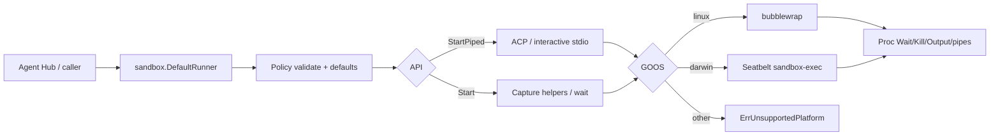

# Agent sandbox

`internal/sandbox` chạy subprocess dưới isolation OS-level để Agent Hub có thể
spawn Claude Code / Codex / … mà không để agent CLI đụng full home directory.
Linux dùng **bubblewrap**; macOS dùng **Seatbelt** (`sandbox-exec`).

import { Callout } from 'fumadocs-ui/components/callout';
import { Cards, Card } from 'fumadocs-ui/components/card';

<Callout type="info" title="Implemented — Start + StartPiped">
Package đã merge vào desktop `main` (PR #22); **`StartPiped`** thêm trên Agent
Hub branch cho ACP interactive stdio. Agent Hub Claude adapter gọi
`sandbox.DefaultRunner().StartPiped(...)` và fail-closed khi thiếu backend —
xem [Agent Hub](/dev-kit/agent-hub) (Implemented — Claude-only) và
[Implementation status](/dev-kit/implementation-status). Stack:
[ADR-009](/dev-kit/architecture-decisions#adr-009-os-primitive-sandbox-for-agent-hub-vendor-processes).
</Callout>



Capability Gateway và dialog permission chỉ mediate hành động đi qua DevKit /
ACP. Agent CLI vẫn có bash/fs trong process của nó — cùng user với DevKit — nên
cần OS jail riêng. Sandbox **không thay** consent Gateway/UI; hai lớp bổ sung
nhau. Claude Code (`/sandbox`) và Codex có sandbox first-party nhưng không đủ
cho Hub multi-vendor — và **không lồng được** với jail DevKit trên macOS:
`sandbox-exec` trong jail fail `sandbox_apply: Operation not permitted` (đo
2026-09-05, không có SBPL operation nào mở). Sandbox vendor là lựa chọn *thay
thế*, không phải lớp *bổ sung*; adapter phải đảm bảo nó tắt khi spawn qua
DevKit, nếu không mọi lệnh bash của agent fail ngầm. Chi tiết và lý do chọn
lớp DevKit: [ADR-009](/dev-kit/architecture-decisions#adr-009-os-primitive-sandbox-for-agent-hub-vendor-processes).

## Principles

- Fail closed: thiếu `bwrap` / platform không hỗ trợ → `ErrUnavailable` /
  `ErrUnsupportedPlatform`.
- Allowlist: chỉ `WorkDir` (và path khai báo) được ghi; private home mặc định.
- Default deny: luôn phủ `~/.ssh`, `~/.gnupg`, `~/.aws`, `~/.config/gcloud` trên
  **host HOME** (và policy `HOME` nếu khác).
- Leaf package: không import `devkit/internal/*` (ép bởi `go test ./internal/arch`).
- Không nhúng `@anthropic-ai/sandbox-runtime` (TypeScript) vào core Go.

## Surface API

Vào bằng `sandbox.DefaultRunner()`. `Available(ctx)` kiểm tra trước — lỗi
nghĩa là thiếu `bwrap` hoặc OS không hỗ trợ.

Hai cách chạy, cùng nhận `Policy` + `Cmd`:

- **`Start`** — capture-and-wait, stdout/stderr buffered. Dùng cho helper và
  lệnh one-shot; thường đi với `NetworkNone`.
- **`StartPiped`** — stdio tương tác cho ACP / vendor agent. Trả về handle có
  `StdinWriter()` / `StdoutReader()` cho JSON-RPC line-delimited. Thường cần
  `NetworkHost` vì agent phải gọi model API.

| Type / func | Role |
|---|---|
| `Policy` | WorkDir (abs), RO/RW binds, DenyReadPaths, Env, Network, PrivateHome, `AllowUnixSockets`, `AllowKeychain` |
| `Cmd` | Path + Args; optional Dir under WorkDir |
| `Runner.Start` | Validate → defaults → Backend.Start — **capture helpers** |
| `Runner.StartPiped` | Same policy path → Backend.StartPiped — **ACP / interactive stdio** |
| `DefaultRunner` | Linux → bwrap; Darwin → Seatbelt; else unavailable |
| `Proc` | Wait / Kill / PID / Output; StdinWriter / StdoutReader after StartPiped |
| `LandlockAvailable` / `RestrictSelf` | Linux helper; not wired into bwrap Start/StartPiped (v1) |

### Defaults

| Field | Default |
|---|---|
| Empty `Network` | `none` |
| `PrivateHome` nil | `true` — force `HOME` + `TMPDIR=/tmp`; **Linux** thêm `--tmpfs $HOME`. **macOS không có tmpfs**: `HOME` vẫn trỏ home thật, home không đọc được chỉ nhờ `(deny default)`. Không tuyệt đối: caller vẫn khoan được lỗ vào home qua `ReadWritePaths` — Claude adapter làm vậy cho `~/.claude*` (xem [Agent Hub](/dev-kit/agent-hub)) |
| `PrivateHome` false | Linux `--bind $HOME $HOME`, macOS `(subpath $HOME)` read-write; `/tmp` riêng và `HOME`/`TMPDIR` vẫn được đặt. Agent Hub dùng mặc định này — xem "Agent Hub's jail" bên dưới |
| Sensitive denies | Always on; off only with `DangerousAllowSensitive` (tests) |

### Errors

| Sentinel | When |
|---|---|
| `ErrInvalidPolicy` | Non-abs WorkDir, unknown network, bind/symlink into deny |
| `ErrUnavailable` | Nil backend / `bwrap` not on PATH |
| `ErrUnsupportedPlatform` | Not linux/darwin |
| `ErrLandlockSkipped` | Landlock could not apply (best-effort) |

## Linux (bubblewrap)

Host: `apt install bubblewrap` (or equivalent).

1. `--unshare-user --unshare-pid --unshare-ipc --die-with-parent`
2. `--unshare-net` when `NetworkNone`
3. RO bind `/usr`, `/bin`, `/lib`, `/lib64`, `/etc` (skip missing)
4. `--bind WorkDir WorkDir` (+ RO/RW extras)
5. Deny: `--tmpfs` on sensitive dirs / null-bind files
6. Private home: `--tmpfs $HOME`, then **re-bind WorkDir** if it sits under home
7. `--clearenv` + allowlisted env; `--chdir` → exec

Bind paths are `EvalSymlinks`'d; resolve into a deny path → `ErrInvalidPolicy`.

## macOS (Seatbelt)

`buildSeatbeltProfile` emits SBPL (unit-tested on Linux CI). Runtime:
`sandbox-exec -p <profile> -- <cmd>…` (`//go:build darwin`) — profile đi trên
argv, **không** qua temp file: `sandbox-exec` đọc file sau `exec`, nên unlink
ngay sau `Start` từng race với child. Read surface rộng hơn bwrap (dyld/system
needs). Integration tests chạy trên Darwin only.

Bốn điểm Seatbelt **khác** bwrap, đều đã đo trên máy thật và có test. Đối
chiếu chéo với `codex-rs/sandboxing/src/seatbelt.rs` + `seatbelt_tests.rs` của
Codex CLI (cùng bài toán, cùng OS): test của họ cũng cấm dòng
`(allow network-outbound)` trần và cũng chặn rename tổ tiên.

- **Rule sau thắng rule trước.** SBPL không có "deny luôn thắng"; rule khớp
  cuối cùng quyết định. Vì vậy block `(deny …)` cho sensitive path luôn được
  phát **sau** mọi `(allow …)` — `seatbelt_profile_test.go` khoá thứ tự này.
- **`file-read*` và `file-write*` là hai lớp operation độc lập.** Deny một lớp
  không đụng lớp kia. Khi `WorkDir` (hoặc một RW path) là *tổ tiên* của
  `~/.ssh` — ví dụ `cwd=$HOME` — deny read-only để `~/.ssh/authorized_keys`
  **ghi được**. Block deny vì thế phủ cả `file-read* file-write*`
  (`TestSeatbeltDeniesWriteToDenyPathUnderRWAncestor`). bwrap không có vấn đề
  này vì `--tmpfs` che cả hai chiều.
- **`network-outbound` trần bao gồm cả AF_UNIX.** `(allow network-outbound)`
  không filter cho process với tới *mọi* unix socket trên host —
  `/var/run/docker.sock` (= host root qua container privileged), listener của
  ssh-agent, v.v. bwrap không dính vì không bind `/var/run`. `NetworkHost` vì
  thế chỉ allow `(remote ip "*:*")` cộng đúng một unix socket theo literal path
  là `/private/var/run/mDNSResponder` (getaddrinfo đi qua nó) — cùng cách các
  profile trong `/System/Library/Sandbox/Profiles/*.sb` của Apple làm
  (`TestSeatbeltNetworkHostDeniesUnixSockets`, smoke test HTTPS vẫn 200).

- **`(subpath X)` mất tác dụng khi tổ tiên của X bị đổi tên.** Với
  `WorkDir=/Users`, `mv /Users/me /Users/x` rồi ghi `/Users/x/.ssh/…` — deny
  không còn khớp (đo được: `authorized_keys` nhận "pwned"). Vì vậy mỗi tổ tiên
  của một deny path (trừ `/`) nhận thêm
  `(deny file-write-unlink (require-all (vnode-type DIRECTORY) (literal …)))`
  — cùng rule Codex dùng cho protected path
  (`TestSeatbeltDeniesAncestorRenameBypass`). Rename bình thường trong WorkDir
  không bị ảnh hưởng.

Ngoài ra profile allow `/dev/null` (read+write, guard `vnode-type
CHARACTER-DEVICE` như Codex): thiếu nó thì `2>/dev/null` — có trong gần như
mọi lệnh shell agent chạy — và `ssh-add` fail với `Operation not permitted`.

**Còn mở, có chủ đích:** loopback TCP (`127.0.0.1:5432`, dev server) vẫn với
tới được dưới `NetworkHost` — agent có thể nói chuyện thẳng với DB local, bỏ
qua gate của `db.query`. Đóng cái này cần egress proxy (mục Out of scope), không
phải một rule profile.

### `AllowUnixSockets` (Implemented)

Đã triển khai trong `internal/sandbox/policy.go`, `internal/sandbox/seatbelt_profile.go`, `internal/sandbox/backend_bwrap.go` và kiểm chứng qua `internal/sandbox/backend_seatbelt_test.go` (`TestSeatbeltAllowUnixSocketsConnects`). Sau khi `NetworkHost` chỉ còn IP, agent **không nối được** socket MCP của DevKit nữa — đúng ý cho `mcp.sock` chung, nhưng agent cần một đường về DevKit. Field `Policy.AllowUnixSockets` (đường dẫn tuyệt đối, đi qua `validateBindPaths`) mở đúng socket của session đó, và đó cũng chính là cách identity được cưỡng chế ở kernel (xem [Agent Hub § Agent identity](/dev-kit/agent-hub#agent-identity--ranh-giới-giữa-các-session-implemented)).

- **Seatbelt:** mỗi entry phát đúng **một** dòng
  `(allow network-outbound (literal <path đã resolve>))`, **sau** block network
  và **độc lập `NetworkMode`** — đây là IPC cục bộ, agent `NetworkNone` vẫn
  phải gọi được DevKit; vì rule sau thắng, đặt sau `(deny network-outbound)` là
  đủ. Đo được: chỉ cần quyền connect, **không** cần `file-read*` trên socket
  lẫn quyền metadata trên thư mục cha (câu hỏi để mở trước đây đã có đáp án).
  Nhưng path **phải** đã resolve symlink — xem mục dưới.
- **bubblewrap:** socket nằm dưới `$HOME` mà `PrivateHome` phủ tmpfs → phát
  `--bind <path> <path>` sau tmpfs home, cùng slot re-bind WorkDir. Chưa đo trên
  Linux — cùng trạng thái với thứ tự RO/RW ghi ở [Workspace](/dev-kit/workspace).
- Proxy `devkit-mcp` vào `ReadOnlyPaths` theo đường dẫn tuyệt đối từ
  `install.ResolveCommand()`; không tìm thấy → `CreateSession` fail rõ
  (`ErrProxyNotFound`) thay vì spawn một agent không gọi được DevKit.

### Grant khi Agent Hub khởi chạy agent (Implemented)

Adapter Claude chạy bằng **node tuyệt đối + entry tuyệt đối** từ runtime DevKit
cài (xem [Agent Hub § Runtime do DevKit quản lý](/dev-kit/agent-hub#runtime-do-devkit-quản-lý-implemented)),
không còn qua `npx` hay shebang tìm node trên PATH. `agentruntime.Resolved.ReadOnlyPaths`
(`internal/agentruntime`) liệt kê tường minh thứ jail phải đọc được, tất cả đã
`EvalSymlinks` và dùng **cùng một cách viết** cho command, argument lẫn grant —
bwrap bind đúng chuỗi được đưa, một symlink trong đường dẫn runtime sẽ để command
trỏ ra ngoài jail:

| Grant | Vì sao |
|---|---|
| `<UserConfigDir>/DevKit/runtimes/claude-acp/<version>` | entry, cây `node_modules` (entry import SDK từ đây — thiếu là `ERR_MODULE_NOT_FOUND`), binary Claude đi kèm |
| Prefix cài node (`<prefix>` của `<prefix>/bin/node`, hoặc thư mục chứa `node.exe`) | chính node và thư viện của nó; adapter thêm cả file node |
| Root Homebrew (`/opt/homebrew`, hoặc phần trước `/Cellar/`) — chỉ khi node là bản Homebrew | node Homebrew link `icu4c`, `openssl`, `libuv`… nằm chỗ khác dưới root, nên cấp cả root, read-only (`ponytail:` trong `nodeReadPaths`: thu hẹp theo `otool -L` nếu grant này thành vấn đề) |
| Thư mục chứa `claude` trên máy, đã resolve — chỉ khi chọn file chạy `machine` | `~/.local/bin/claude` là symlink vào `~/.local/share/claude/versions/<v>` |

Tất cả chỉ đọc: agent không sửa được adapter của chính nó. Quyền ghi vẫn chỉ
`~/.claude` + `~/.claude.json`. Env của runtime (`PATH` = thư mục node + PATH
của host, `CLAUDE_CODE_EXECUTABLE` khi chọn `machine`) merge đè lên allowlist.

**Linux: gần như mọi grant nằm dưới `$HOME`.** `~/.config/DevKit/runtimes` và
node của nvm/Volta/fnm đều ở trong home, mà `PrivateHome` phủ `--tmpfs $HOME`.
`bwrap_args.go` bind lại những `ReadOnlyPaths` nằm trong home **sau** tmpfs
(`appendHomeAllowlist`, cùng slot re-bind WorkDir), nên chỉ path có trong danh
sách mới hiện ra; thứ node cần dưới home mà thiếu grant thì trong jail đơn giản
là không tồn tại. Đó là lý do cấp tường minh là bắt buộc, không phải phòng xa.

Override `DEVKIT_CLAUDE_ACP_COMMAND` (dev/CI) giữ hành vi cũ: grant là chính
file đó + `node_modules` ngoài cùng chứa nó (`nodeModulesRoot`), và node do
shebang tìm qua PATH phải tự đọc được trong jail.

### Symlink: allow và deny đều phải resolve (Implemented)

Seatbelt so khớp **path đã resolve**, còn generator từng emit **nguyên văn**.
Hệ quả là một grant trên symlink không bao giờ khớp: thời Agent Hub còn chạy qua
`npx`, `nvm` cài `bin/npx -> ../lib/node_modules/npm/bin/npx-cli.js`, và trong jail node chết
với `Cannot find module '.../bin/npx'`; project nằm dưới thư mục cha là symlink
thì âm thầm thành read-only.

Nguy hiểm hơn là **chiều ngược lại**: block `deny` cũng không resolve. Trước
đây cả hai phía đều không khớp nên không ai đọc được gì — `TestSeatbeltDeniesDotSSH`
pass **do vô tình**. Sửa xong phía allow là `~/.ssh/id_rsa` đọc được ngay, và
chính test đó bắt được. Giờ `writeSBPLPath` phát **cả hai** cách viết cho mọi
allow *và* deny; `validateBindPaths` vẫn resolve rồi từ chối bind nào rơi vào
deny path, nên việc resolve không nới thêm phạm vi.

**Quyền lookup tổ tiên.** `(subpath X)` không cho process `stat` thư mục cha
của X, mà resolve một path thì phải đi qua từng cấp: node thoát với
`EPERM: lstat '/Users'` trước khi đọc nổi file nó đã được cấp. Mỗi tổ tiên của
mọi path được grant vì thế nhận `(allow file-read-metadata (literal …))` —
chỉ metadata, không bao giờ mở/đọc thư mục.

Tests: `TestSeatbeltProfileEmitsResolvedFormOfSymlinkedPaths`,
`TestSeatbeltProfileDenyIsResolvedToo`,
`TestSeatbeltExecutesThroughSymlinkedReadOnlyPath`,
`TestSeatbeltProfileDoesNotDuplicatePlainPaths`.

### `AllowKeychain` (Implemented)

Agent xác thực bằng subscription giữ OAuth token trong **macOS Keychain**
(service `Claude Code-credentials-*`), không phải file lẫn env var —
`~/.claude.json` chỉ chứa metadata `oauthAccount`. `Policy.AllowKeychain` phát
đúng tập tối thiểu **đã đo**: `(allow mach-lookup (global-name
"com.apple.SecurityServer"))` cộng `file-read*` trên `~/Library/Keychains`.
Thử riêng từng cái đều fail; phải có cả hai. No-op ngoài darwin.

Read-only là đủ: agent tra token của chính nó, không phải ghi lại.

### Agent Hub's jail: home and Docker by default (Implemented)

`sandbox.Policy` stays default-deny — `PrivateHome` nil means private, no unix
socket but the ones listed. What changed is what **Agent Hub** asks it for.
A jail an agent cannot run `docker compose up` or `kubectl` in is a jail
people turn off, so a session now gets, by default:

- **The real `$HOME`, read-write** (`ShareHome`, was the opt-in `RelaxedHome`).
- **The Docker socket**, found on its own (`AllowDocker`).

Both are switches in Settings → Agents → Sandbox, and both are `*bool` in
`preferences.AgentSandboxSettings` so that unset — a machine that never
opened Settings, or a value from before the field — reads as on. A stored
value that does not parse reads as `StrictAgentSandbox()` (both off), and so
does a preferences read that errors in `main.go`: the default is the
permissive one now, so failing closed means failing to the other end.

**What stays hidden whatever the switches say:**

- The built-in deny list, `~/.ssh`, `~/.gnupg`, `~/.aws`, `~/.config/gcloud`
  — a tmpfs/`/dev/null` bind in bwrap and a `(deny file-read* file-write*)`
  emitted last in Seatbelt, on top of the shared home.
- **DevKit's own data directory**, every entry of it except `runtimes/`
  (`agenthub.ProtectDataDir`, wired as `Service.ProtectedPaths` in
  `main.go`): the vault database and its WAL, the shared `mcp.sock`,
  `agents/` (every other session's MCP socket — on Linux a visible socket
  file is a connectable one), `checkpoints/`, `consoles/`. `runtimes/` stays
  because the agent binary DevKit installs lives there. Passed as
  `Policy.DenyReadPaths`; a session's own socket inside `agents/` is granted
  back — `validateBindPaths` checks sockets against the built-in deny list
  only, bwrap binds sockets after the deny mounts, and Seatbelt's connect is
  a network rule the file deny does not cover.

**Sharing home, per backend.** bwrap starts from an empty mount namespace,
so "not private" has to be a `--bind $HOME $HOME` — without it (what
`RelaxedHome` used to produce) home simply was not there, and neither was
`/tmp` nor `$HOME` in the environment. Seatbelt grants `(subpath $HOME)`
read-write. Both now always give a private `/tmp` and always set `HOME` and
`TMPDIR` (`withHomeEnv`).

**Finding Docker** (`agenthub.DetectDocker`), in the CLI's own order:

1. `DOCKER_HOST` — a `unix://` path; `tcp://`/`ssh://` needs no socket.
2. The current context — `DOCKER_CONTEXT`, else `currentContext` in
   `~/.docker/config.json` (or `$DOCKER_CONFIG`), whose endpoint is in
   `contexts/meta/<sha256(name)>/meta.json`. This is what picks the right
   daemon when **OrbStack** (context `orbstack`) and **Docker Desktop**
   (`desktop-linux`) are both installed.
3. `/var/run/docker.sock`, then OrbStack `~/.orbstack/run/docker.sock`,
   Docker Desktop `~/.docker/run/docker.sock` (macOS) and
   `~/.docker/desktop/docker.sock` (Linux), Colima, Rancher Desktop,
   rootless Docker and Podman under `$XDG_RUNTIME_DIR`.

The socket is granted by its **resolved** path — Docker Desktop's
`/var/run/docker.sock` is a symlink into `~/.docker/run`, and Seatbelt
matches what the kernel connects to — and `DOCKER_HOST` points there.
Settings' socket field overrides detection.

The **CLI** needs more than the socket on macOS: Docker Desktop and OrbStack
install `docker` (and the compose/buildx plugins, and the credential helper)
as symlinks into `/Applications/<App>.app`, which no jail grants. The
bundle is added read-only, and the directory `docker` was found in is
appended to `PATH` when missing — an app opened from the Dock inherits
launchd's `PATH`, which has neither `/usr/local/bin` nor `~/.orbstack/bin`.

`ExtraReadOnlyPaths` is still there, for paths outside both the project and
home (a library under `/opt`). All of it goes through
`sandbox.Policy.Validate` like any other grant, is read fresh on every open,
resume and fork (`Service.applySandboxExtras`), and does not apply to a
session already running.

Real widening, and the point of it: an agent can read shell history, cookie
stores and every other project under `$HOME`, and the Docker socket is root
on the host in practice. `SandboxExtras` nil (tests) keeps the adapter's own
jail — private home, no Docker.

## Ops / tests

```bash
go test ./internal/sandbox/ ./internal/arch/ -count=1

go test ./internal/sandbox/ \
  -run 'TestSmokeAgentShapedProcess|TestBwrapCanWriteWorkDirUnderHome|TestStartPiped' -v

# macOS: live Seatbelt invariants (unix socket, write-deny, ancestor rename) + DNS smoke
DEVKIT_SANDBOX_SMOKE=1 go test ./internal/sandbox/ -run 'Seatbelt|Smoke' -v
```

| Host package | Platform |
|---|---|
| `bubblewrap` | Linux (required for `DefaultRunner`) |
| `sandbox-exec` | macOS (system) |
| Landlock LSM | Linux best-effort; EPERM/ENOSYS → skip |

## Out of scope (v1)

- Domain-allowlist HTTP/SOCKS egress proxy
- Windows backend
- Firejail / gVisor / Firecracker / Docker-as-default
- Auto-install `bwrap` for end users

Landlock helper exists but is **not** attached to `BwrapBackend.Start` /
`StartPiped` in v1. Agent Hub Claude path already uses `StartPiped`; Codex/Gemini
adapters still Design.

<Cards>
  <Card title="ADR-009" href="/dev-kit/architecture-decisions#adr-009-os-primitive-sandbox-for-agent-hub-vendor-processes" description="Locked stack: bwrap + Landlock / Seatbelt" />
  <Card title="Agent Hub" href="/dev-kit/agent-hub" description="Implemented (Claude-only) — vendor spawn uses StartPiped" />
  <Card title="MCP / Agent" href="/dev-kit/mcp-agent" description="Gateway consent layer — complementary, not a substitute" />
  <Card title="Security model" href="/dev-kit/security" description="Threat model and security gates" />
  <Card title="Implementation status" href="/dev-kit/implementation-status" description="Checkout vocabulary: Implemented / Partial / Design only" />
</Cards>
