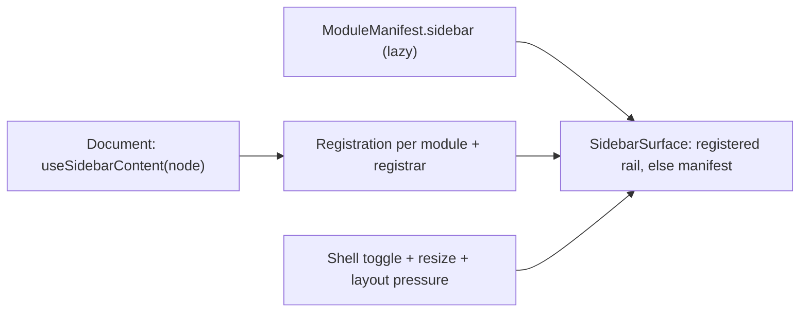

# Sidebar

Cột cố định bên trái content area (320px mặc định), nội dung đổi theo module
đang active. Đóng/mở qua **sidebar toggle** — nút cố định trong title bar,
ngay sau traffic lights, xem [Title bar](/dev-kit/title-bar).

import { Callout } from 'fumadocs-ui/components/callout';
import { Cards, Card } from 'fumadocs-ui/components/card';

<Callout type="info" title="Hợp đồng tích hợp hiện tại">
App shell sở hữu cột sidebar. Module không tự dựng `aside`, chiều rộng, toggle,
resize handle, nền hoặc border riêng bên trong workspace. Hướng dẫn cho
contributor: [Sidebar và tab strip](../design/module-shell-integration.md);
đọc trước khi sửa module. Các mô tả thiết kế/số liệu lịch sử dưới đây cần đối
chiếu API runtime; hướng dẫn tích hợp là contract hiện tại.
</Callout>

## Rail của module và rail của document

- `ModuleManifest.sidebar`: lazy component cho danh sách thuộc module, kể cả
  khi chưa mở hoặc đã đóng mọi document. Đây là lựa chọn cho SSH connections.
- `useSidebarContent(node)`: rail phụ thuộc document, đăng ký theo module ID
  và registrar của hook. Shell ưu tiên rail được đăng ký, rồi fallback về
  manifest; không clear slot của document khác.
- Không điều kiện hóa đăng ký theo sidebar đang mở hay document đang visible.
  Shell quyết định toggle và module nào được hiển thị.
- Dùng `SidebarHeader/Search/Section/Row/Inset`, tree và shadcn primitives
  chung. Root rail không có fill/border/shadow riêng; nó hòa trực tiếp vào
  nền opaque của app shell ở dark/light, kể cả giảm transparency.
- Không render rail lần nữa trong view, không giữ một sidebar riêng chỉ để
  danh sách còn tồn tại khi đóng tab. Khai báo manifest giải quyết việc đó.

Runtime: `frontend/src/components/ui/sidebar-shell.tsx`,
`frontend/src/stores/sidebarContent.ts`, `frontend/src/modules/registry.ts`.
Ví dụ đầy đủ: `frontend/src/modules/ssh/SSHSidebar.tsx` và `manifest.ts`.



## Primitive: `useSidebarContent`

Cùng hợp đồng với `SplitPanel`
([Shell primitives](/dev-kit/shell-primitives)) — nhận `ReactNode` bất kỳ,
primitive không quan tâm hình dạng nội dung bên trong:

`useSidebarContent(content)` nhận `ReactNode` hoặc `null`.

**Khác `SplitPanel` ở 1 điểm quan trọng:** với `SplitPanel`, "có nội dung" và
"đang mở" là cùng 1 hành động (`openPanel()`). Với Sidebar, **đăng ký nội
dung** (module luôn làm, chạy nền) và **hiển thị/ẩn** (toggle global, user
bấm) là **hai việc tách biệt** — xem mục Toggle bên dưới.

## Phân chia padding và vùng cuộn

Shell quản lý **chiều rộng, resize, nền app chung, ẩn/hiện và clipping**. Shell không đặt
padding ngang quanh nội dung module: padding ở đây sẽ đẩy cả scrollbar vào trong
và làm tên file bị cắt sớm do cộng thêm với padding row và độ thụt cấp.

| Lớp | Trách nhiệm | Quy tắc |
|---|---|---|
| `SidebarSurface` | Khung sidebar | Không `px-*`; không tự tạo vùng cuộn nội dung. |
| Root của module | Chia header và body bằng flex | `min-h-0`, không padding ngang bao cả sidebar. |
| Header, search, tabs, filter, action/footer cố định | Khoảng đệm nội dung | Dùng `SidebarInset`: **6px mỗi bên**. `SidebarHeader` đã dùng inset này, không bọc thêm. |
| Scroll viewport | Cuộn list/tree | Chiếm toàn bộ chiều rộng, không bọc trong `SidebarInset`; scrollbar ở mép trong của rail, ngay trước resize handle. |
| Tree/list row | Hit target, selection, icon, chữ | Primitive row tự quản lý padding và indentation; module không cộng thêm inset quanh tree. |
| Nội dung thông thường bên trong scroller | Form/card/empty state | Có thể dùng inset **bên trong** viewport, không đặt ngoài viewport. |

`SidebarInset` được export từ `frontend/src/components/ui/sidebar-shell.tsx`.
Giữ con số 6px ở primitive này; không sao chép một giá trị riêng cho mỗi module.
Nó chỉ sở hữu padding ngang, không sở hữu chiều cao, gap dọc hoặc overflow.

```tsx
<div className="flex h-full min-h-0 flex-col gap-3">
  <SidebarInset><ProjectHeader /></SidebarInset>
  <SidebarHeader><SidebarSearch {...searchProps} /></SidebarHeader>
  <SidebarInset><Filters /></SidebarInset>
  <TreeView nodes={nodes} className="min-h-0 flex-1" />
</div>
```

`TreeView` đã có scroll viewport và virtualization; không bọc nó bằng một
`overflow-y-auto` khác. Với danh sách thông thường, viewport có thể chứa
`SidebarInset` bọc các card, nhưng scrollbar vẫn thuộc viewport ngoài cùng.
Giữ phần dành cho scrollbar của hệ điều hành khi cần; không bù bằng negative
margin hay `calc(100% + …)` để thoát padding của một ancestor.

**Khi sửa module khác:** bỏ padding ngang ở root/wrapper bao scroller, chuyển
inset xuống các khối chrome, giữ padding sẵn có của row và tránh bọc
`SidebarHeader` hai lần. Kiểm tra sidebar ở 240px và 480px, cây nhiều cấp,
selection/focus, scrollbar luôn hiện và overlay scrollbar. Tên dài được truncate
kèm tooltip; không thu nhỏ chữ hoặc giảm hit target để che lỗi bố cục.

## Toggle: global, cần vault unlocked

- **1 flag toàn app** (không phải per-module) — đóng ở module này thì mọi
  module khác cũng đóng cho tới khi user tự mở lại.
- **Cần nhớ qua lần khởi động lại app** — qua
  [UI state persistence](/dev-kit/ui-state) (bảng `ui_state` chung, ngoài
  vault), không phải cơ chế lưu riêng của Sidebar.
- **Chỉ hoạt động sau khi vault `unlocked`.** Trước đó `VaultGate` chặn toàn
  bộ Workbench ([Vault](/dev-kit/vault)) — chưa có module nào mount, sidebar
  không có ý nghĩa. Nút toggle **không xuất hiện/không hoạt động** trong các
  màn hình Vault pre-unlock (setup/unlock/recovery) — chỉ tồn tại trong
  context Workbench sau unlock, đúng phạm vi 3-vùng title bar đã định nghĩa ở
  [Title bar](/dev-kit/title-bar).

## Resize

Dùng lại đúng hook resize mà `SplitPanel` dùng — `useResizableSize`
(`frontend/src/workbench/useResizableSize.ts`): `pointerdown` trên gutter +
`pointermove`/`pointerup` global, clamp qua `frontend/src/workbench/panelLayout.ts`,
width persist ở `stores/panelWidths.ts`. Không thêm dependency mới. (`react-resizable-panels`
có trong `frontend/package.json` nhưng không được shell dùng — chỉ còn wrapper
shadcn `components/ui/resizable.tsx` không ai import.)

- **`MIN_SIDEBAR_WIDTH`–`MAX_SIDEBAR_WIDTH`: 240–480px**, default 320px.
  Trần thấp hơn `SplitPanel` (320–720px) vì nội dung sidebar chủ yếu
  nav/list/tree, không cần rộng bằng use case của `SplitPanel` (note
  diff/merge).
- **`MIN_CONTENT_WIDTH`: 480px** — sàn cứng cho content area ở giữa, áp dụng
  bất kể Sidebar/SplitPanel đang ở width nào.

**Clamp động khi cả hai cùng mở** — không phải 2 range tĩnh độc lập, trần
thực tế của mỗi panel co theo panel còn lại và theo width cửa sổ thật:

Trần thật của sidebar là **480px hoặc phần còn lại của cửa sổ sau khi trừ
width split panel và sàn content 480px** — lấy giá trị nhỏ hơn. Trần của split
panel tính đối xứng, với trần tĩnh 720px.

<Callout type="info" title="Open question">
Số liệu trên giả định window min-width thực tế của DevKit ~1024px (chưa xác
nhận được cấu hình cửa sổ thật trong `main.go`). Ở mốc đó, cả hai panel cùng
mở ở min (240 + 320 = 560) vẫn còn 464px content — sát sàn 480px nhưng chạy
được. **Cần xác nhận lại window min-width thật trước khi coi range này là
chốt cuối cùng.**
</Callout>

## Hiệu năng khi nội dung sidebar lớn

Áp dụng cho mọi module đăng ký nội dung, không riêng gì dataset lớn:

1. **Lazy — chỉ đăng ký khi module đã mở ít nhất 1 lần**, không mount sẵn nội
   dung sidebar của module chưa từng mở. Cùng pattern `lazyModuleView()` đã
   dùng cho content chính (xem [Module tabs](/dev-kit/module-tabs)).
2. **Ẩn chứ không huỷ sau lần mở đầu** (`hidden`, không unmount) — khớp
   nguyên tắc "state giữ nguyên khi rời module" đã chốt. Đánh đổi cố ý: tốn
   RAM theo số module đã mở trong phiên, không phải bug.
3. **Virtualize là trách nhiệm của module**, primitive Sidebar không ép hình
   dạng nội dung. Hai helper dùng chung, **opt-in**, sống ở `components/ui/`:
   - **`VirtualList`** — dữ liệu phẳng (vd Agent Hub: list session). Module
     đưa `items[]` + hàm render 1 dòng.
   - **`VirtualTree`** — dữ liệu cây (vd Database: schema/table tree). Build
     **trên `VirtualList`**, không phải 1 engine riêng: tự giữ state
     expand/collapse, mỗi render flatten cây thành mảng phẳng rồi đưa cho
     `VirtualList` windowing — không viết lại logic tính offset lần 2. Module
     chỉ đưa data cây + `getChildren` + hàm render 1 node, không đụng
     virtualization/expand-state.
   - Cả hai dựng trên **`@tanstack/react-virtual`** (dependency mới —
     `frontend/package.json` hiện chưa có lib virtualization nào; chọn lib
     này vì headless, khớp gu "headless kit + tự style shadcn" đang dùng
     — `radix-ui`/`@base-ui/react`/`@ariakit/react` — khác `react-arborist`
     vốn bundle sẵn UI cây riêng).
   - Module có sidebar không phải list/tree (form, filter, …) **không cần
     quan tâm 2 helper này** — không có collection dài thì không có gì để
     virtualize. Hình dạng mới phát sinh sau này (nếu có) thêm helper thứ 3
     khi thật sự cần, không thiết kế trước (YAGNI).
4. **Cô lập re-render** — khung Sidebar (chrome: resize, toggle) là 1
   component `memo` riêng, tách khỏi cây nội dung module đang host bên
   trong, cùng nguyên tắc `WorkbenchViews` đã tách khỏi `TabStrip`
   ([Module tabs § Tab strip UI](/dev-kit/module-tabs#tab-strip-ui)).

## Quan hệ với các trang khác

- **Kế thừa hợp đồng**: [Shell primitives](/dev-kit/shell-primitives) —
  `SplitPanel` là nguồn pattern (`ReactNode` content) và nguồn lib resize
  (`react-resizable-panels`).
- **Điều kiện tiên quyết**: [Vault](/dev-kit/vault) — sidebar chỉ tồn tại
  sau `unlocked`.
- **Nút toggle**: [Title bar](/dev-kit/title-bar) — vị trí cố định ngoài 3
  vùng, luôn hiển thị (trong phạm vi Workbench post-unlock).
- **Không phải tab**: [Module tabs](/dev-kit/module-tabs) — tab (nhiều item
  mở cùng lúc trong content area) và sidebar (1 nội dung phụ trợ bên trái)
  là hai khái niệm độc lập, cùng do module đăng ký nhưng vào hai slot khác
  nhau.
- **Toggle state persist qua**: [UI state persistence](/dev-kit/ui-state) —
  Sidebar là consumer đầu tiên của bảng `ui_state` chung.

<Cards>
  <Card title="UI state persistence" href="/dev-kit/ui-state" description="Bảng ui_state chung — nơi toggle global được lưu" />
  <Card title="Title bar" href="/dev-kit/title-bar" description="Sidebar toggle — vị trí cố định ngoài 3 vùng" />
  <Card title="Shell primitives" href="/dev-kit/shell-primitives" description="SplitPanel — nguồn pattern ReactNode + resize lib" />
  <Card title="Module tabs" href="/dev-kit/module-tabs" description="Tab trong content area — khái niệm độc lập với sidebar" />
  <Card title="Vault" href="/dev-kit/vault" description="VaultGate — điều kiện tiên quyết để sidebar tồn tại" />
</Cards>
