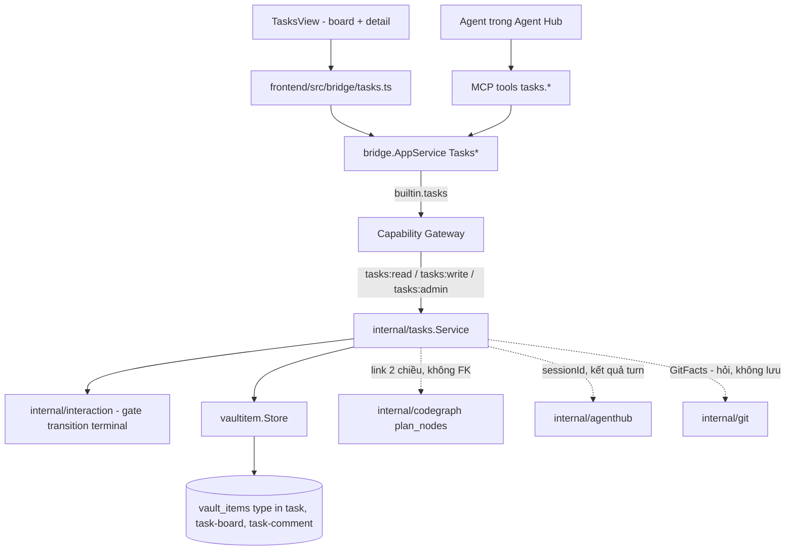
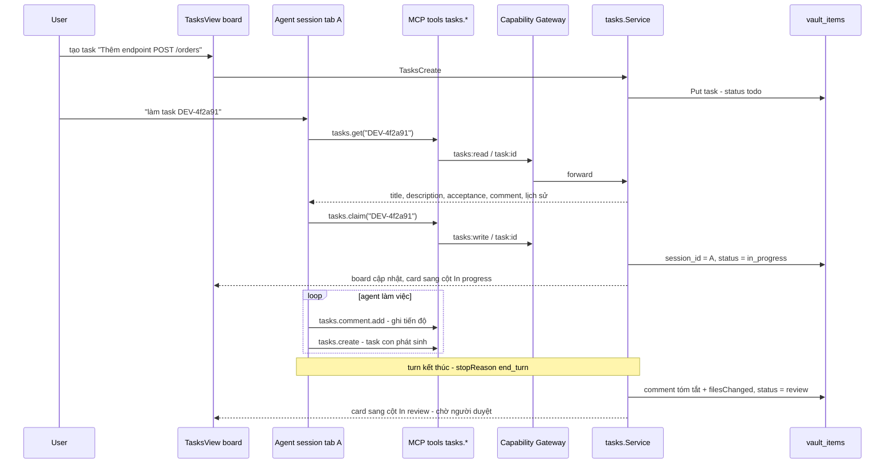
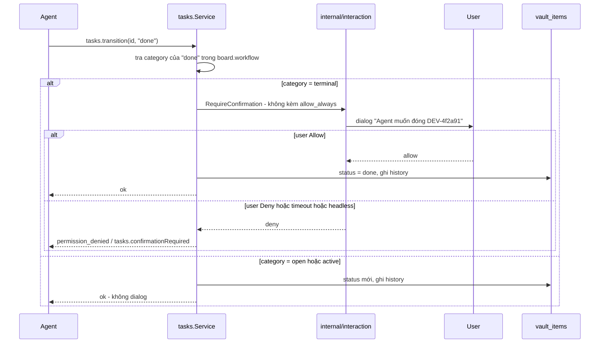
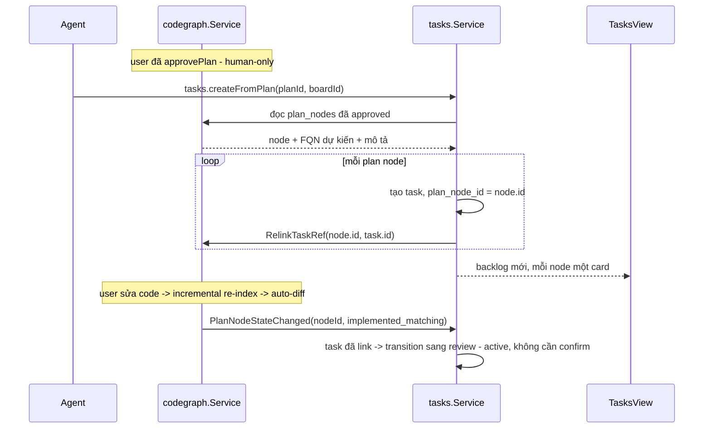

# Tasks

Tasks là built-in module quản lý công việc dạng **board + workflow tuỳ biến**
(kiểu Jira/Linear thu gọn), thiết kế để **agent là actor hạng nhất**: agent
trong [Agent Hub](/dev-kit/agent-hub) tự tạo task, tự nhận (`claim`), tự chuyển
trạng thái và tự comment tiến độ qua MCP — người dùng chỉ còn phải làm hai
việc: **duyệt bước đóng task** và **xoá**. Task lưu trên substrate
`vault_items` chung nên được sync đa thiết bị và mã hoá phần nội dung như mọi
item khác.

import { Callout } from 'fumadocs-ui/components/callout';
import { Cards, Card } from 'fumadocs-ui/components/card';

<Callout type="warn" title="Partial">
Đã có runtime cho phần lõi: `internal/tasks` trên ba record type, bridge
`Tasks*`, MCP `tasks.*` (không delete, không board write), optimistic
transition, claim/takeover khi phiên chết, cửa duyệt đóng task với `verify`
chạy nền + hàng đợi `task_verify_runs` + notification, link plan node +
`ReconcilePlan`, trailer `Task:` ở `git.commitTurn`, quyền push theo
`task.branch`. Workspace scoping agent (chỉ thấy board của workspace nó đang làm),
tree sidebar với Workspace → Board → Status → Task, binding local không sync,
event `tasks:changed` để tự cập nhật UI. Trạng thái chi tiết ở
[Implementation status](/dev-kit/implementation-status).

**Chưa có**: FR-12 (turn kết thúc → review), FR-19/20 (commit của task, dữ
kiện git ở cửa duyệt), kéo-thả / virtualize theo cột / editor workflow. Phần
dưới vẫn là thiết kế đầy đủ; chỗ nào code đi khác thiết kế thì trang này ghi
ngay tại chỗ.
</Callout>



Module đăng ký qua `ModuleManifest` như `notes`/`database`/`ssh`/`kafka`/`codegraph`/`agenthub`
hiện có — không tạo registry riêng. Mọi call, từ UI lẫn từ agent qua MCP, đi qua
cùng `AppService.call` + Capability Gateway, không có đường tắt (invariant #1,
[ADR-003](/dev-kit/architecture-decisions#adr-003-capability-gateway-as-sensitive-call-choke-point)).

## BRD — Business requirement

### Vấn đề

Agent Hub đã chạy được nhiều agent song song, và Code Graph đã có plan-first
flow để agent implement theo một flow đã duyệt. Nhưng **không có nơi nào giữ
"việc gì đang làm, ai làm, tới đâu rồi"** ở mức dự án: user phải tự nhớ mình đã
giao gì cho tab nào, agent mất context giữa các phiên thì không có chỗ đọc lại
để biết đã làm tới đâu, và không có cách nào nhìn một màn hình để biết toàn
bộ công việc đang ở trạng thái nào. Dùng Jira/Linear thật thì agent không chạm
được (phải qua network + credential ngoài vault), và thông tin dự án
proprietary rời khỏi máy — trái nguyên tắc local-first.

### Mục tiêu (goals)

- Một board local-first để quản lý công việc, **agent đọc/ghi được trực tiếp
  qua MCP** chứ không phải nhờ người dùng thao tác hộ.
- Agent tự đẩy công việc đi hết vòng đời **tới cửa "chờ duyệt"** — người dùng
  chỉ ra quyết định ở bước cuối, không phải quản lý từng bước trung gian.
- Task **sống lâu hơn phiên agent**: agent mất context / mở phiên mới vẫn đọc
  lại được trạng thái, không cần user thuật lại.
- Nối được với plan-first flow của [Code Graph](/dev-kit/codegraph): plan đã
  duyệt sinh ra backlog, và tiến độ code thật tự phản ánh lên board.
- Không phát minh cơ chế permission/audit/sync riêng — tái dùng nguyên
  Capability Gateway, `internal/interaction` và `vault_items` đã có.

### Actors

| Actor | Nhu cầu |
|---|---|
| Developer dùng DevKit | Nhìn một board biết toàn bộ việc đang ở đâu; giao việc cho agent; duyệt bước cuối |
| Agent trong Agent Hub | Tự nhận việc, ghi tiến độ, đọc lại ngữ cảnh khi mất context, tạo task con khi phát hiện việc phát sinh |
| Agent ngoài (Claude Code/Codex qua MCP) | Cùng quyền như trên, không cần biết mình đang chạy trong hay ngoài Agent Hub |
| Người triển khai module | Biết rõ ranh giới nào agent tự làm được, ranh giới nào bắt buộc con người |

### Functional requirements

| ID | Requirement |
|---|---|
| FR-1 | User tạo được **board** (tên, `key_prefix`, danh sách status tuỳ biến). Nhiều board cùng lúc; task luôn thuộc đúng một board. |
| FR-2 | Mỗi status trong board khai một **`category`** ∈ `open` \| `active` \| `terminal`. Tên status tuỳ ý, nhưng mọi logic (kể cả gate ở FR-8) chỉ dựa vào `category` — xem [Workflow model](#workflow-model--category-mới-là-thứ-logic-dựa-vào). |
| FR-3 | Task có: `title`, `description` (markdown), `status`, `priority`, `labels[]`, `assignee`, `parent_id` (subtask một cấp), `blocked_by[]`. Không có epic/sprint/estimate ở v1. |
| FR-4 | Mỗi task có `key` con người đọc được (vd `DEV-4f2a91`), ổn định suốt vòng đời, dùng làm định danh khi nói chuyện với agent. |
| FR-5 | Agent tạo task được qua MCP (`tasks.create`), kể cả task con của task nó đang làm — không cần user thao tác. |
| FR-6 | Agent **nhận** một task (`tasks.claim`): service ghi `session_id` = phiên agent đang gọi và chuyển task sang status `active` đầu tiên của board. Task đã có `session_id` khác **đang sống** → reject. |
| FR-6b | Phiên agent chết ⇒ `session_id` **giữ nguyên**, không tự clear: agent mở lại phiên và nhận lại đúng việc. Task hiện "phiên đã đóng" kèm nút Release thủ công, và một `claim` mới **được phép chiếm** khi phiên đang giữ không còn sống — giữ không có nghĩa là khoá vĩnh viễn. |
| FR-7 | Agent chuyển trạng thái task (`tasks.transition`) sang bất kỳ status nào có `category` ∈ `open` \| `active` **không cần xác nhận**. |
| FR-8 | Chuyển sang status `category = terminal` (Done, Won't do, …) qua MCP đi qua **cửa duyệt**, và board quyết định cửa đó là gì — xem [Cửa duyệt đóng task](#cửa-duyệt-đóng-task--người-hoặc-một-lệnh-verify). Board **không** khai `verify` ⇒ xác nhận tương tác mỗi lần, **không** có `allow_always` (`internal/interaction`). Board **có** khai `verify` ⇒ DevKit tự chạy lệnh đó; exit 0 đóng thẳng, exit khác reject. |
| FR-8b | Lệnh `verify` do **người** khai trên board (`tasks:admin`, UI-only — agent không sửa được, cùng loại trừ cứng với `workflow`). Kết quả mỗi lần chạy thành một comment `kind=system`: lệnh, exit code, thời gian, phần đuôi output. |
| FR-8c | `verify` **chạy nền**: `tasks.transition` trả về ngay với `verifying`, task **giữ nguyên status** và mang một cờ tạm thời; kết quả tới sau thì mới chuyển hoặc từ chối. Agent không phải giữ call mở suốt một suite dài. |
| FR-8d | Một `verify` chạy tại một thời điểm **cho mỗi project** — chúng dùng chung work tree. Yêu cầu thứ hai xếp hàng; huỷ được từ UI. |
| FR-8e | **Hàng đợi lưu xuống SQLite**, sống qua restart. DevKit thoát giữa chừng ⇒ lượt đang chạy **quay lại hàng đợi**, không bao giờ được suy ra kết quả: task chỉ đóng bằng một lượt chạy **đã kết thúc**, và chạy lại là một lượt mới chứ không phải nối tiếp lượt cũ. |
| FR-8f | Một yêu cầu chờ quá lâu (mặc định 24h) hoặc thuộc project chưa mở lại ⇒ đánh dấu `stale` kèm comment `kind=system`, **không** tự chạy. Chấm một cây code hôm nay bằng một yêu cầu của hôm kia là trả lời sai câu hỏi. |
| FR-8g | Lượt `verify` kết thúc ⇒ **notification hệ điều hành** khi người dùng không nhìn vào app, mở ra đúng task đó. Dùng lại đường notification của Agent Hub — xem [Notification](#notification--tách-leaf-trước-đã). |
| FR-9 | `tasks.transition` nhận `expectedStatus` optional; lệch trạng thái hiện tại → reject `validation_failed`, không ghi đè — chống hai agent giẫm chân nhau (xem [Optimistic transition](#optimistic-transition--chống-hai-agent-giẫm-chân)). |
| FR-10 | Agent comment được vào task (`tasks.comment.add`); comment ghi rõ tác giả là `agent:<sessionId>` hay `user`, không trộn lẫn. |
| FR-11 | Mỗi task giữ **lịch sử chuyển trạng thái bounded** (từ → sang, bởi ai, lúc nào), đọc được cả khi phiên agent đã đóng. |
| FR-12 | Khi một turn của agent kết thúc trên task nó đang giữ, service tự post comment tóm tắt (`summary` + `filesChanged` từ [`invokeAgent`](/dev-kit/agent-hub#invokeagent--agent-master-gọi-agent-khác)) và chuyển task sang status `active` cuối cùng của board (thường là *In review*) — **không** tự đóng task. |
| FR-13 | Task link được tới một **plan node** của [Code Graph](/dev-kit/codegraph) (`plan_node_id`) và ngược lại; hai chiều, không copy trạng thái của nhau — xem [Tích hợp Code Graph](#tích-hợp-code-graph--hai-chiều-không-gộp-storage). |
| FR-14 | Tạo hàng loạt task từ một plan **đã được người duyệt** (`tasks.createFromPlan`) — mỗi plan node thành một task, link sẵn. |
| FR-15 | Board view kiểu kanban: cột theo status, kéo-thả card giữa cột; task detail mở trong panel hoặc tab riêng. Comment `kind=system` **tách** sang tab *Activity* riêng, không trộn vào dòng hội thoại người/agent. |
| FR-15b | **Subtask có UI riêng**: task detail hiện checklist các task con (`key`, title, status), thêm task con ngay tại chỗ, bỏ liên kết ngay tại chỗ. Card ở board hiện bộ đếm `2/5` khi task có con. Gán cha bằng kéo-thả một card lên một card khác. Vẫn **một cấp**, vẫn `parent_id`, vẫn `tasks.create` — không đổi data model, không thêm tool. |
| FR-16 | Xoá task (`tasks:admin`) và mọi thao tác trên board/workflow là **UI-only**, không expose MCP. Task không dùng nữa thì **archive**, không xoá. |
| FR-17 | **Branch cho task**: tạo/checkout một branch đặt tên từ `key` (mẫu khai ở board, mặc định `<key>-<slug(title)>`). Là **hành động tường minh trong UI**; `tasks.claim` không bao giờ đụng vào work tree — xem [Tích hợp Git](#tích-hợp-git--hỏi-không-lưu). |
| FR-17b | Branch mà agent tạo được **ghi vào task** (`task.branch`) ngay bằng `tasks.setFields`: `git.branch.create` trả tên branch, agent ghi lại. Đây là chỗ duy nhất DevKit nhớ "branch này thuộc việc này", và là thứ [Git NFR-4](/dev-kit/git) dựa vào để biết agent được push lên branch nào sau khi phiên đã restart. |
| FR-18 | **Commit mang `key`**: khi phiên agent đang giữ một task, `git.commitTurn` seed thêm trailer `Task: <key>` vào message. Git ghi, Tasks không ghi gì. |
| FR-19 | **Task detail hiện việc đã commit**: danh sách commit mang `key` của task (bounded), mỗi dòng mở diff. Không có repo / chưa fetch ⇒ danh sách rỗng, không phải lỗi. |
| FR-20 | **Cửa duyệt `terminal` đọc thêm trạng thái git**: dialog xác nhận của FR-8 hiện thêm ba dữ kiện chỉ git trả lời được — còn thay đổi chưa commit không, commit mang `key` đã push chưa, branch của task đã vào default chưa. **Hiển thị, không chặn** — cùng luật đã áp cho `blocked_by`. |

### Non-functional requirements

| ID | Requirement |
|---|---|
| NFR-1 | Mọi call — UI lẫn MCP — đi qua `AppService.call` + Capability Gateway; không có đường tắt cho agent (đúng NFR-3 của [Agent Hub](/dev-kit/agent-hub) và FR-2 của [MCP / Agent](/dev-kit/mcp-agent)). |
| NFR-2 | Mọi write từ agent audit kèm `origin = "mcp"` **và** `session_id` — truy được "agent nào, phiên nào đổi gì", không chỉ "có một agent nào đó". |
| NFR-3 | Không có auto-approve cho transition `terminal`: gate không phản hồi kịp / DevKit chạy headless → **reject** (fail closed), giống NFR-6 của Agent Hub. |
| NFR-4 | `description` và nội dung comment là **payload mã hoá** (envelope V2, AAD binding theo [ADR-005](/dev-kit/architecture-decisions#adr-005-v2-only-envelope-with-aad-binding)); không log plaintext. |
| NFR-5 | `TasksList` bounded: bắt buộc `boardId`, có `limit` + cursor, trả **summary** (không kèm `description`) — detail lấy theo ID. Đúng §4 của [Frontend performance](/dev-kit/frontend-performance). |
| NFR-6 | Board có nhiều task: mỗi cột virtualize riêng (ngưỡng "card/list > 200 item" của Frontend performance), không render cả board bằng DOM tuyến tính. |
| NFR-7 | Transition là **metadata-only write** — không reseal `description`, cùng đường với `NotesSetOrganization`. Agent cập nhật tiến độ không phải giải mã lại nội dung task. |
| NFR-8 | Task sync như mọi `vault_items` record; không có pipeline riêng, không auto-winner khi conflict (xem [Sync & conflict](#sync--conflict)). |
| NFR-9 | Thêm 3 record type mới không được làm vỡ validate của module khác — xem Blast radius ở [Vaultitem contract](#vaultitem-contract). |
| NFR-10 | `internal/tasks` **không import `internal/git`**. Dữ kiện git vào qua một interface hẹp do `internal/app` tiêm, đúng cách `environments` nhận `ProfileEnvUsage` và `mcp` khai `NotesAPI` — không thêm cạnh mới vào đồ thị `internal/arch`. Interface `nil` ⇒ mọi thứ git im lặng biến mất. |
| NFR-11 | **Không lưu SHA.** Tên branch thì có (`task.branch`, FR-17b): một SHA mục ruỗng sau rebase/amend/squash, một tên branch thì không — nó ổn định qua đúng những thao tác làm SHA đổi. Mọi dữ kiện còn lại (commit, trạng thái push, đã merge chưa) được **hỏi lúc hiển thị**, bounded — xem [Tích hợp Git](#tích-hợp-git--hỏi-không-lưu). |
| NFR-12 | Lệnh `verify` (FR-8) chạy trong thư mục project với timeout và giới hạn output; nó là lệnh **người dùng đã khai**, agent chỉ kích hoạt được chứ không đổi được. Audit ghi lệnh + exit code; không ghi output. |
| NFR-13 | Hàng đợi `verify` theo **project**, không theo board hay theo task (FR-8d): work tree mới là thứ bị tranh chấp. Hàng đợi bounded; yêu cầu thứ N khi đã có N-1 đang chờ bị từ chối chứ không xếp vô hạn. |
| NFR-14 | Notification là **nudge**: không ai được chờ nó. Hàng đợi có chặn trên và thả bớt khi đầy, gửi trên goroutine riêng, im lặng khi cửa sổ đang được nhìn — hành vi của `agenthub.Notifier` giữ nguyên qua lần tách leaf, không thiết kế lại. |
| NFR-15 | `task_verify_runs` là derived/operational: **không** vào `vault_items`, không sync. Nó mô tả máy này đang làm gì, không phải dữ liệu dự án. |

### Out of scope (v1)

- **Epic / sprint / iteration / story point / estimate / burndown** — bỏ có chủ
  đích; đây là phần Jira phục vụ quy trình đội người, không phục vụ agent.
- **Transition graph** (luật "từ status X chỉ đi được sang Y") — v1 mọi status
  đi được sang mọi status; ép graph chỉ làm agent kẹt và phải học luật riêng
  của từng board. Chưa có nhu cầu thật thì chưa thiết kế (YAGNI).
- **Multi-user / assignee là người thật khác** — DevKit là app cá nhân;
  `assignee` v1 chỉ là `user` hoặc một `agentType`.
- **Sync board sang Jira/Linear thật** — cần credential + network ngoài vault,
  thuộc một module integration riêng nếu sau này cần.
- **Task template / recurring task / automation rule** kiểu Jira Automation.
- **Trash + purge tự động** — task là bản ghi lịch sử dự án, xoá tự động sau
  N ngày là sai; dùng archive (xem FR-16).
- **Đóng task tự động khi branch được merge.** Cám dỗ rõ ràng, và sai: merge
  là một dữ kiện của repo, còn "việc đã xong đúng ý" là phán xét của người —
  cùng lý do `implemented_matching` chỉ đẩy task sang `review` chứ không sang
  `done`. Git chỉ đưa dữ kiện vào cửa duyệt (FR-20), không tự mở cửa.
- **Tạo PR / MR từ task.** Đó là API của GitHub/GitLab, không phải git; thuộc
  [API Client](/dev-kit/api-client) cộng [Tài khoản](/dev-kit/accounts).

### Acceptance criteria

- Agent trong một tab Agent Hub gọi `tasks.create` → task xuất hiện ngay trên
  board của UI, không cần user refresh.
- Agent gọi `tasks.claim` trên task đang free → task chuyển `in_progress`,
  `session_id` trỏ đúng phiên đó; agent thứ hai claim cùng task → reject rõ ràng.
- Agent gọi `tasks.transition` sang `in_progress`/`review` → chạy thẳng, không
  hiện dialog nào.
- Board **không** khai `verify`, agent gọi `tasks.transition` sang `done` →
  **luôn** hiện dialog Allow/Deny, kể cả sau khi user đã Allow always cho tool
  khác; Deny → `permission_denied`, task giữ nguyên trạng thái cũ.
- Board **không** khai `verify`, DevKit chạy headless, agent gọi transition
  sang `done` → fail ngay (`tasks.confirmationRequired`), không treo chờ dialog
  không tồn tại.
- Board **có** khai `verify`, test đang xanh → `tasks.transition` trả
  `verifying` **ngay** (không chờ suite); khi chạy xong task sang `done`, không
  dialog nào hiện, comment `kind=system` ghi lệnh + exit 0.
- Trong lúc đang chạy, task vẫn ở status cũ trên board — **không** nhảy sang
  `done` rồi lùi lại.
- Board **có** khai `verify`, test đang đỏ → task ở nguyên chỗ cũ, comment
  `kind=system` ghi exit code + đuôi output; **không** rơi về hỏi người; user
  vẫn đóng tay được từ UI.
- Hai task cùng project cùng gọi transition → hai lượt chạy **nối tiếp**,
  không song song; cái thứ hai hiện "đang chờ".
- Kill DevKit giữa lượt chạy → mở lại, task ở nguyên chỗ cũ; yêu cầu đó quay
  về `queued` và chạy **lại từ đầu** khi project mở, không task nào đóng bằng
  một lượt chưa kết thúc.
- Kill DevKit, mở lại sau hai ngày → yêu cầu thành `stale` kèm comment, **không**
  tự chạy trên code đã khác.
- Lượt chạy xong khi người dùng đang ở module khác → có notification, click mở
  đúng task đó; đang nhìn thẳng vào app → không có toast nào.
- Kiểm tra ledger sync: không có operation nào mang `task_verify_runs`.
- Agent gọi `tasks.board.update` để sửa hoặc gỡ `verify` → không có tool đó.
- Phiên agent chết → `session_id` còn nguyên, task hiện "phiên đã đóng"; agent
  mở phiên mới `claim` lại chính task đó → thành công.
- Hai agent cùng gọi `transition(id, "review", expectedStatus: "in_progress")`
  → đúng một cái thành công, cái còn lại `validation_failed`, không có ghi đè
  im lặng.
- Turn của agent kết thúc trên task nó giữ → task tự sang `review` kèm comment
  tóm tắt, **không** tự sang `done`.
- Duyệt một plan ở Code Graph rồi gọi `tasks.createFromPlan` → mỗi plan node
  thành một task đã link sẵn; sửa code đúng FQN → sau incremental re-index,
  task tương ứng tự chuyển sang `review`.
- Agent gọi `tasks.claim` → work tree **không đổi**: branch hiện tại giữ
  nguyên, không file nào bị checkout.
- Agent commit trong lượt nó giữ task `DEV-4f2a91` → message có trailer
  `Task: DEV-4f2a91`; mở task detail thấy đúng commit đó.
- Task còn thay đổi chưa commit → dialog `done` hiện dòng cảnh báo đó nhưng
  nút Allow **vẫn bấm được**; Allow → task sang `done` bình thường.
- Đóng module Git / mở một folder không phải repo → task detail không còn mục
  commit, dialog `done` không còn phần git, mọi thứ khác không đổi.
- Rebase/squash đổi hết SHA của branch → task detail vẫn liệt kê đúng commit,
  vì nó grep theo `key` chứ không giữ SHA.
- Vault đang locked → `tasks.get` (cần `description`) trả `vault_locked`
  structured, không phải task rỗng.
- Board có 2.000 task → mở board không có Long Task > 50 ms, DOM bounded.

## Flow

### Agent tự nhận việc và đẩy tới cửa duyệt



Điểm quan trọng: agent **không bao giờ** tự đưa card qua cột cuối. Nó đẩy được
tới đúng cửa, và dừng ở đó.

### Transition terminal — gate của con người



Cơ chế gate là **đúng `internal/interaction` đã Implemented** cho env
confirmation của [Environments](/dev-kit/environments) — khác ở chỗ điều kiện
kích hoạt là `category` của status đích, không phải env tag của profile. Không
thêm cơ chế xác nhận thứ hai vào DevKit.

### Từ plan đã duyệt sang backlog



`tasks.createFromPlan` cho agent gọi được vì plan **đã** qua `approvePlan` của
con người — task sinh ra chỉ là hình chiếu của thứ đã được duyệt, không phải
quyền mới.

## Technical design

### Components

- **`internal/tasks`** (Go, mới) — thin adapter trên `vaultitem.Store` giống
  `internal/notes`: không có bảng/repository/crypto riêng. Giữ workflow
  validation (`category`), optimistic transition, sinh `key`, và gọi
  `internal/interaction` cho transition terminal.
- **`internal/vaultitem`** — substrate dùng chung, thêm 3 record type.
- **`internal/interaction`** — gate xác nhận đã Implemented, dùng lại nguyên.
- **`internal/notify`** (leaf, **tách ra từ `agenthub`**) — `Notifier` +
  `NotificationGate` đổi khoá từ `SessionID` sang target chung. Tách **trước**
  Tasks thành một bước thuần refactor ([Liên module § Thứ tự](/dev-kit/cross-module#thứ-tự-triển-khai-gợi-ý)),
  khi `agenthub` còn là consumer duy nhất; Tasks là consumer thứ hai (FR-8g).
- **Bảng local `task_verify_runs`** — hàng đợi `verify` bền qua restart
  (FR-8e), derived/operational, không sync.
- **Bridge + MCP adapter** — cùng gọi `tasks.Service`, cùng qua Capability
  Gateway, đúng pattern Notes/Code Graph/Agent Hub.
- **Frontend `frontend/src/modules/tasks/`** — `TasksBoard`, `TaskDetail`,
  `TaskCard`, manifest; bridge adapter `frontend/src/bridge/tasks.ts`.

### Vaultitem contract

Ba record type mới trên `vault_items` ([ADR-008](/dev-kit/architecture-decisions#adr-008-unified-vault_items-store-for-built-in-item-types)):

#### Board — `type = "task-board"`

| Field | At rest | Notes |
|---|---|---|
| `type` | `"task-board"` | Schema-validated |
| `metadata` | `{"name":"DevKit","key_prefix":"DEV","color":"blue","workflow":{...},"verify":{"command":"…","timeout_sec":600,"service":""},"branch_template":"","project_path":""}` plaintext | `workflow` là danh sách status + `category`, xem dưới. `verify` (FR-8), `branch_template` (FR-17) và `project_path` đều **optional**, thêm field vào type đã có — không phải record type thứ tư. `project_path` là **deprecated** — một path tuyệt đối không đúng trên máy khác; thay bằng binding local + `verify.service`, xem [Tích hợp Workspace](#tích-hợp-workspace--liên-kết-nằm-ở-máy-tên-đi-theo-sync) |
| `payload` | Envelope V2 rỗng `{}` | `key_id` phải = `task-board` — board không có secret, envelope chỉ để record hợp lệ với sync validation (cùng cách `note-folder` đang làm) |

#### Task — `type = "task"`

| Field | At rest | Notes |
|---|---|---|
| `type` | `"task"` | Schema-validated |
| `metadata` | `{"board_id","key","title","status","priority","labels":[],"assignee","parent_id","blocked_by":[],"plan_node_id","session_id","branch","archived_at","history":[…]}` plaintext | Đủ để render board + filter + sort mà **không** cần decrypt gì |
| `payload` | Envelope V2 của `description` markdown | AAD `(task, <id>, task-body)`; `key_id` phải = `task-body` |
| `history` | tối đa **50** entry `{from,to,by,at}` gần nhất | `by` = `"user"` hoặc `"agent:<sessionId>"` |

`title`/`status` là plaintext metadata — cùng đánh đổi đã chốt cho note title
([ADR-004](/dev-kit/architecture-decisions#adr-004-application-layer-encrypted-records-instead-of-sqlcipher)):
list/filter/board chạy được khi vault locked, chỉ `description` mới cần DEK.

#### Comment — `type = "task-comment"`

| Field | At rest | Notes |
|---|---|---|
| `type` | `"task-comment"` | Schema-validated |
| `metadata` | `{"task_id":"<24hex>","author":"user"\|"agent:<sessionId>","kind":"human"\|"agent"\|"system"}` plaintext | `kind = system` cho comment do service tự post (FR-12) |
| `payload` | Envelope V2 của body markdown | AAD `(task-comment, <id>, task-comment-body)` |

Query comment của một task dùng `ListByTypeAndMetaField("task-comment", "task_id", id)`
— **đúng method đã thiết kế** cho [Notes § Version history](/dev-kit/notes#version-history)
và tái dùng ở [Database § Query history](/dev-kit/database#query-history-và-saved-query),
không thêm cơ chế lookup thứ ba.

<Callout type="warn" title="Blast radius: internal/vaultitem/schema.go">
Thêm **ba** type (`task`, `task-board`, `task-comment`) đụng 2 switch hardcode
dùng chung cho mọi record type — `IsSupportedItemType()` và
`ValidateRecordSchema()` (whitelist `key_id` mong đợi mỗi type). Đây là lần
thêm nhiều type nhất từ trước tới nay trong một module; sửa sai ảnh hưởng
validate của **mọi** module đang dùng `vaultitem`, cần review kỹ hơn hẳn một
thay đổi cục bộ trong `internal/tasks`.
</Callout>

**Vì sao lịch sử transition nằm trong `metadata` chứ không phải type thứ tư:**
history vô nghĩa nếu tách khỏi task (không ai query "mọi transition trong
vault"), nó nhỏ và bounded, và giữ chung một record nghĩa là khi sync về máy
khác thì task và lịch sử của nó **luôn tới cùng lúc**, không có trạng thái
nửa vời. Đổi lại: mỗi transition tạo một version mới của record task, kể cả
khi không đổi gì khác — chấp nhận, vì transition vốn đã là một thay đổi cần
sync.

### Workflow model — `category` mới là thứ logic dựa vào

```json
{
  "statuses": [
    { "id": "todo",        "name": "To do",      "category": "open" },
    { "id": "in_progress", "name": "In progress","category": "active" },
    { "id": "review",      "name": "In review",  "category": "active" },
    { "id": "done",        "name": "Done",       "category": "terminal" },
    { "id": "wont_do",     "name": "Won't do",   "category": "terminal" }
  ]
}
```

- **Không hardcode `"done"` ở bất kỳ đâu trong code.** User đổi tên status,
  thêm `Cancelled`, `Duplicate`, hay dùng board tiếng Việt — gate FR-8 vẫn
  đúng vì nó hỏi `category`, không hỏi tên. Đây là lý do `category` là field
  bắt buộc chứ không phải metadata trang trí.
- **Ràng buộc board:** ít nhất 1 status mỗi category; `category` không sửa
  được sau khi board đã có task ở status đó (đổi `active` → `terminal` sẽ
  hồi tố biến các transition agent đã làm hợp lệ thành lẽ ra phải xin phép).
  Muốn đổi thì tạo status mới và chuyển task sang.
- `active` **cuối cùng** trong danh sách là đích của FR-12 (auto sang review
  khi agent xong turn) — theo thứ tự khai báo, không cần field riêng.

### Task key — sinh từ ID, không dùng counter

`key = <board.key_prefix>-<6 hex đầu của task id>` (vd `DEV-4f2a91`).

Cách Jira làm (counter tăng dần mỗi board) **không dùng được ở đây**: mỗi lần
tạo task phải bump `board.next_seq`, tức mỗi lần tạo task là một write vào
record board. Hai thiết bị (hoặc hai agent offline) cùng tạo task sẽ tạo
conflict trên chính record board — conflict liên tục ở đúng record nóng nhất,
và cần transaction xuyên hai record mà `vaultitem.Store` không có.

Đánh đổi: key không đẹp và không cho biết thứ tự tạo. Chấp nhận — `key` chỉ
để con người và agent gọi tên một task, `created_at` mới là thứ dùng để sắp
xếp.

### Optimistic transition — chống hai agent giẫm chân

Hai agent chạy song song trong cùng một máy **không** tạo sync conflict (cùng
một SQLite local), nên guard phải nằm ở tầng service:

```go
func (s *Service) Transition(ctx context.Context, id, toStatus string, expected *string) (Task, error)
```

- `expected == nil` → ghi đè bình thường (đường của UI: user nhìn thấy trạng
  thái hiện tại trên màn hình rồi mới kéo card).
- `expected != nil` và khác `status` hiện tại → `validation_failed` kèm status
  thật, **không** ghi. Đây là đường **khuyến nghị cho agent**: `tasks.get` trả
  `status` hiện tại, agent truyền lại chính giá trị đó khi transition.
- `tasks.claim` luôn chạy compare-and-set: task đã có `session_id` trỏ tới một
  phiên chưa kết thúc → reject `tasks.alreadyClaimed`, không cướp việc.

### Bridge & capability

Subject luôn `builtin.tasks`. Record ID là 24 lowercase hex (`vaultitem.NewID`),
opaque qua `recordID()` như mọi module khác.

| Method | Capability | Scope | Ghi chú |
|---|---|---|---|
| `TasksBoardList` | `tasks:read` | `board:list` | |
| `TasksBoardCreate` | `tasks:admin` | `board:new` | |
| `TasksBoardUpdate` | `tasks:admin` | `board:<id>` | Gồm sửa workflow |
| `TasksBoardDelete` | `tasks:admin` | `board:<id>` | Reject nếu board còn task chưa archive |
| `TasksList` | `tasks:read` | `task:list` | Bắt buộc `boardId`; `limit` + cursor; trả summary, không kèm `description` |
| `TasksSearch` | `tasks:read` | `task:search` | Title/label/key luôn match; `description` chỉ khi vault unlocked |
| `TasksGet` | `tasks:read` | `task:<id>` | Decrypt `description` |
| `TasksCreate` | `tasks:write` | `task:new` | |
| `TasksUpdate` | `tasks:write` | `task:<id>` | `title` + `description`, **giữ nguyên** status/labels/assignee |
| `TasksSetFields` | `tasks:write` | `task:<id>` | Metadata-only: `priority`, `labels`, `assignee`, `parent_id`, `blocked_by`, `board_id`, `branch` — không reseal payload |
| `TasksTransition` | `tasks:write` | `task:<id>` | Gate theo `category` (FR-8); nhận `expectedStatus` |
| `TasksClaim` | `tasks:write` | `task:<id>` | Compare-and-set `session_id` |
| `TasksRelease` | `tasks:write` | `task:<id>` | Nhả `session_id`, không đổi status |
| `TasksArchive` / `TasksUnarchive` | `tasks:write` | `task:<id>` | `archived_at`, không purge |
| `TasksDelete` | `tasks:admin` | `task:<id>` | **Hard delete**, cascade comment; UI-only |
| `TasksCommentAdd` | `tasks:write` | `task:<id>` | |
| `TasksCommentList` | `tasks:read` | `task:<id>` | |
| `TasksLinkPlanNode` | `tasks:write` | `task:<id>` | Set/clear `plan_node_id`, đồng bộ ngược sang `plan_nodes` |
| `TasksCreateFromPlan` | `tasks:write` | `task:new` | Chỉ chạy trên plan đã `approved` |
| `TasksGitActivity` | `tasks:read` | `task:<id>` | Commit + branch + trạng thái push của một task. Không đọc vault; trả rỗng khi không có Git (FR-19, NFR-10/11) |
| `TasksBoardBind` / `TasksBoardUnbind` | `tasks:admin` | `board:<id>` | Gắn / gỡ board khỏi một workspace **trên máy này**; ghi bảng local, không đụng record board. UI-only — xem [Tích hợp Workspace](#tích-hợp-workspace--liên-kết-nằm-ở-máy-tên-đi-theo-sync) |

Ba capability tách theo bản chất hành động, cùng lý do đã áp cho
`kafka:connect` / `kafka:produce` / `kafka:admin`:

- **`tasks:read`** — đọc board/task/comment.
- **`tasks:write`** — mọi thay đổi trên **task** (tạo, sửa, transition, claim,
  comment, archive). Đây là capability duy nhất agent cần.
- **`tasks:admin`** — thay đổi **cấu trúc** (board, workflow) và hard delete.
  Tách riêng để có thể cấp `tasks:read` + `tasks:write` cho agent mà không bao
  giờ cấp `tasks:admin`.

Grants thật nằm ở `internal/app/container.go`; `capabilities` trong
`ModuleManifest` chỉ là declaration metadata ([ADR-002](/dev-kit/architecture-decisions#adr-002-internal-modules-before-external-plugins)).

### MCP tool surface

Xem cơ chế chung + rationale ở [MCP / Agent](/dev-kit/mcp-agent).

| MCP tool | Effect | Map sang | Ghi chú |
|---|---|---|---|
| `tasks.board.list` | `read` | `builtin.tasks` / `tasks:read` / `board:list` | Kèm `workflow` để agent biết status nào tồn tại và `category` của nó |
| `tasks.list` | `read` | `builtin.tasks` / `tasks:read` / `task:list` | Summary, filter theo status/assignee/label; không kèm `description` |
| `tasks.search` | `read` | `builtin.tasks` / `tasks:read` / `task:search` | |
| `tasks.get` | `read` | `builtin.tasks` / `tasks:read` / `task:<id>` | Kèm `description`, comment và `history` — đây là nguồn ngữ cảnh agent đọc khi mở phiên mới |
| `tasks.create` | `execute` | `builtin.tasks` / `tasks:write` / `task:new` | |
| `tasks.update` | `execute` | `builtin.tasks` / `tasks:write` / `task:<id>` | title + description |
| `tasks.setFields` | `execute` | `builtin.tasks` / `tasks:write` / `task:<id>` | priority/labels/assignee/parent/blocked_by/**branch** (FR-17b) |
| `tasks.claim` | `execute` | `builtin.tasks` / `tasks:write` / `task:<id>` | Compare-and-set, reject nếu đã có phiên khác giữ |
| `tasks.release` | `execute` | `builtin.tasks` / `tasks:write` / `task:<id>` | |
| `tasks.transition` | `execute` | `builtin.tasks` / `tasks:write` / `task:<id>` | **Gate theo `category`** — `terminal` đi qua cửa duyệt của board: có `verify` thì trả `verifying` ngay và chạy nền, không thì xác nhận mỗi lần ([chi tiết](#cửa-duyệt-đóng-task--người-hoặc-một-lệnh-verify)) |
| `tasks.comment.add` | `execute` | `builtin.tasks` / `tasks:write` / `task:<id>` | `author` do service gán, agent **không** tự khai được |
| `tasks.comment.list` | `read` | `builtin.tasks` / `tasks:read` / `task:<id>` | |
| `tasks.archive` | `execute` (`destructiveHint`) | `builtin.tasks` / `tasks:write` / `task:<id>` | Hồi phục được, nên không cần gate |
| `tasks.createFromPlan` | `execute` | `builtin.tasks` / `tasks:write` / `task:new` | Chỉ trên plan đã `approved`; reject plan còn `draft` |

**Không expose qua MCP, bất kể grant** — cùng nhóm hard exclusion đã áp cho
`SetupVault` / `SSHTrustHostKey` / `KafkaConnect` / `CodeGraphApprovePlan`:

- `TasksDelete` — xoá vĩnh viễn, không hồi phục; agent chỉ được `archive`.
- `TasksBoardCreate` / `TasksBoardUpdate` / `TasksBoardDelete` — **đổi
  workflow là đổi chính luật đang ràng buộc agent**. Cho agent sửa `category`
  của một status đồng nghĩa cho nó tự tháo gate FR-8; đây là loại trừ cứng,
  không phải thứ nới ra được bằng cách sửa policy.
- `TasksBoardBind` / `TasksBoardUnbind` — binding quyết định **agent thấy
  board nào**. Cho agent gắn một board vào workspace của nó là cho nó tự nới
  phạm vi của chính nó.

`author` của comment và `by` trong `history` **do service gán từ ngữ cảnh
call** (`origin` + `session_id`), không lấy từ tham số tool — agent không tự
khai mình là `user` được.

**Không thêm tool nào cho phần git.** Agent lấy `key` từ `tasks.get` rồi dùng
`git.*` của [Git](/dev-kit/git); một `tasks.git.*` chỉ là cửa thứ hai tới cùng
một fact. Xem [Tích hợp Git](#tích-hợp-git--hỏi-không-lưu).

### Cửa duyệt đóng task — người, hoặc một lệnh `verify`

Đóng task là điểm kiểm soát cuối cùng còn lại của con người, nên nó không mở
ra được bằng một lời khai. **Một agent nói "test đã pass" là một câu, không
phải một bằng chứng** — nó có thể sai, có thể là kết quả của lần chạy trước,
và DevKit không nhìn thấy gì để đối chiếu, vì agent chạy test bằng công cụ
riêng của nó ngoài tầm quan sát của DevKit.

Nên điều kiện được đảo chiều: **DevKit tự chạy, tự đọc exit code.** Bản báo
cáo do DevKit sinh ra, không do agent nộp lên.

Board khai một lệnh `verify` (optional):

```json
{ "verify": { "command": "go test ./internal/...", "timeout_sec": 600 } }
```

| Board | `tasks.transition` → `terminal` từ MCP |
|---|---|
| Không khai `verify` | Xác nhận tương tác **mỗi lần**, không `allow_always` — y như trước |
| Có khai `verify` | DevKit chạy lệnh trong thư mục project. **Exit 0** ⇒ đóng thẳng, không hỏi ai. **Exit khác 0** ⇒ reject kèm đuôi output |

Exit khác 0 **không** rơi về hỏi người: một lần đóng mà test đang đỏ thì câu
trả lời đã có rồi, hỏi thêm chỉ là bắt người dùng đọc hộ output. Người dùng
vẫn đóng tay được từ UI bất cứ lúc nào — `verify` chỉ chặn đường **MCP**.

#### Chạy nền, và cái giá của nó

`tasks.transition` **không đứng chờ** suite chạy xong. Nó trả về ngay:

```json
{ "result": "verifying", "run_id": "…" }
```

Task **giữ nguyên status** trong lúc chờ — nó chỉ mang một cờ tạm. Chuyển nó
sang `done` trước rồi rút lại khi test đỏ là để board nói dối trong vài phút,
và một board nói dối vài phút là một board không tin được.

Ba thứ phải có, vì chạy nền đẻ ra đúng ba vấn đề:

- **Một lượt một project.** Hai task cùng đóng là hai lần `go test` trên **cùng
  một work tree** — chúng giẫm lên nhau và cả hai kết quả đều vô nghĩa. Yêu cầu
  thứ hai xếp hàng. Đây là ràng buộc của work tree, không phải của board: hai
  board trỏ cùng `project_path` vẫn chung một hàng.
- **Huỷ được.** Một suite mười phút mà người dùng vừa nhận ra mình sai thì
  phải dừng được, và hàng đợi phải chạy tiếp.
- **Không có kết quả nửa chừng.** DevKit thoát khi đang chạy ⇒ lượt đó **trở
  lại hàng đợi**, không bao giờ được đoán là đã pass. Một task không đóng thì
  người ta bấm lại; một task đóng nhầm thì không ai biết để mở lại.

##### Hàng đợi nằm trong SQLite

Bảng `task_verify_runs` (`run_id`, `task_id`, `board_id`, `project_path`,
`target_status`, `requested_by`, `requested_at`, `started_at`, `finished_at`,
`state`, `exit_code`) — derived/operational, **không** sync, cùng loại với
session của Agent Hub và query history của Database.

Vòng đời: `queued` → `running` → `passed` \| `failed` \| `cancelled` \| `stale`.

Hai luật giữ cho nó an toàn:

- **Khởi động lại: mọi dòng `running` quay về `queued`.** Không bao giờ suy ra
  kết quả từ một lượt không thấy kết thúc. Chạy lại là một lượt **mới** và
  hoàn chỉnh, nên bất biến của FR-8d không bị hàng đợi bền làm hỏng — nó chỉ
  đổi chỗ "bỏ luôn" thành "làm lại".
- **Hàng đợi chỉ rút khi project đang mở**, vì `verify` cần work tree. Yêu cầu
  của project khác nằm chờ, không chạy lén.

Và đây là chỗ tính bền tự đẻ ra rủi ro của nó: nếu "chấm work tree lúc nó
chạy" đã đúng trong một phiên, thì qua một lần restart khoảng cách đó có thể
là **nhiều ngày**. Nên FR-8f: quá hạn thì thành `stale` và đợi người bấm lại,
chứ không âm thầm chạy một yêu cầu đã cũ trên code đã khác.

##### Notification — tách leaf trước đã

Lượt chạy xong khi người dùng đang ở module khác thì một comment là không đủ:
họ đã bỏ đi rồi. Nên nó bắn notification hệ điều hành, mở ra đúng task.

Đường đó **đã tồn tại** — `internal/agenthub/notifier.go` và
`notification_gate.go` — và đã giải đúng những vấn đề khó: gửi trên goroutine
riêng để không ai phải chờ OS, hàng đợi có chặn trên và **thả bớt** khi đầy
(*"a notification is a nudge, and nothing that raises one may wait for room"*),
không xin quyền trong lúc người dùng đang có prompt phải trả lời, im lặng khi
cửa sổ đang được nhìn, và gộp thông báo của cùng một chủ thể thay vì chồng
toast.

Nhưng nó ở trong `agenthub` và khoá theo `SessionID`. Tasks import vào là vỡ
layering. Nên đây là **tách leaf, không phải viết lại**:

- `internal/notify` — `Notifier`, `DesktopNotifications`, `NotificationGate`
  chuyển nguyên sang, đổi `SessionID` thành một **target** chung.
- `agenthub` thành consumer đầu tiên (hành vi không đổi), Tasks là thứ hai.

Target là **kiểu của riêng `notify`**, ba chuỗi, không phải `EntityRef`:

```go
// Package notify raises OS notifications. It is a leaf: it must not import
// any devkit/internal package.
type Target struct{ Module, Kind, ID string }

type Notification struct {
    Target Target
    Title  string
    Body   string
}
```

`EntityRef` là khái niệm của **workbench ở frontend**
(`frontend/src/workbench/intents.ts`): nó mang `label`, `project`, và cả một
registry resolver/intent đi kèm. Bắt một leaf Go biết tới nó là kéo ngược tầng
— cùng luật `internal/identity` đã tự ghi cho mình: *"It is a leaf: it must not
import any devkit/internal package"*, và `internal/arch` sẽ bắt nếu ai đó quên.

Bridge dịch `Target` sang `EntityRef` khi đẩy ra UI, nên cú click vẫn mở bằng
intent registry đã có. Hai kiểu trông giống nhau vì chúng mô tả cùng một thứ
từ hai phía; đó là bình thường, không phải trùng lặp cần gộp.

Một cái lợi rơi ra: `Target` là struct so sánh được, nên `NotificationGate`
chuyển thẳng từ `map[string]struct{}` sang `map[Target]struct{}` — không phải
bịa ra khoá dạng `"tasks:task:abc"` và không phải lo hai module đụng ID nhau.

| Consumer | Target |
|---|---|
| Agent Hub | `{Module: "agenthub", Kind: "session", ID: sessionID}` |
| Tasks | `{Module: "tasks", Kind: "task", ID: taskID}` |

Cùng hình dạng với `internal/gitparse` ở [Git](/dev-kit/git): thứ đã đúng rồi
thì kéo xuống leaf cho người thứ hai dùng, không viết bản thứ hai.

Agent đi mất giữa chừng cũng không sao — và đó chính là lý do chọn chạy nền:
kết quả rơi vào **task**, không rơi vào call. Comment `kind=system` ghi lại
lượt chạy, task chuyển hoặc không, và phiên sau đọc `tasks.get` là thấy đủ.
Đổi lại, agent muốn biết ngay thì phải hỏi lại — `tasks.get` trả
`verify: {state, run_id, started_at}`.

Hệ quả cần nói thẳng: **kết quả mô tả work tree lúc nó CHẠY, không phải lúc
yêu cầu.** Xếp hàng sau một lượt khác trong lúc agent vẫn đang sửa file thì
`verify` chấm một cây code đã khác. Không có cách nào tránh mà không khoá work
tree lại, và khoá work tree của người dùng thì tệ hơn.

Ba thứ giữ cho đây không thành một lỗ thực thi lệnh:

- Lệnh do **người** khai, `tasks:admin`, UI-only. `TasksBoardUpdate` vốn đã
  nằm trong nhóm loại trừ cứng của MCP vì "đổi workflow là đổi chính luật
  đang ràng buộc agent" — `verify` rơi vào đúng nhóm đó, vì lý do đúng như
  thế.
- Agent chỉ **kích hoạt** được lệnh người dùng đã chọn, không truyền được
  tham số nào vào.
- Bounded: timeout của board, output cắt, audit ghi lệnh + exit code.

Một hệ quả phụ đáng kể: nhánh `verify` **chạy được khi headless**. Nó không
cần ai trả lời, nên board có `verify` là board mà agent đóng task được trong
một phiên không có UI — điều mà NFR-3 (fail closed) cố ý không cho phép ở
nhánh hỏi người.

### Tích hợp Agent Hub

| Điểm nối | Chiều | Cơ chế |
|---|---|---|
| Task ↔ phiên agent | Tasks giữ | `task.session_id`, set bởi `tasks.claim`, clear bởi `tasks.release` hoặc khi phiên chuyển `error`/`done` |
| Kết quả turn → task | Agent Hub → Tasks | Turn kết thúc trên task đang giữ: post comment `kind=system` (`summary`, `filesChanged`) + transition sang `active` cuối (FR-12) |
| Trạng thái phiên → tab task | Agent Hub → Workbench | `agenthub:sessionUpdate` → `setTabStatus(tabOfTask, running\|success\|error)` |
| Task → prompt agent | Tasks → Agent Hub | `tasks.get` là nguồn ngữ cảnh; agent tự đọc, không cần Agent Hub prepend gì |

<Callout type="info" title="Phụ thuộc chưa implement">
Cột "Trạng thái phiên → tab task" dựa vào việc nối `agenthub:sessionUpdate`
vào `setTabStatus` — [Module tabs § Scope](/dev-kit/module-tabs) ghi rõ đây là
**follow-up chưa làm** (`setTabStatus` tồn tại nhưng chưa module nào gọi).
Tasks sẽ là consumer thứ hai của primitive đó, không phải consumer đầu tiên;
nếu Tasks ship trước, board vẫn chạy đủ, chỉ thiếu chấm màu trên tab.
</Callout>

Task **không** chết theo phiên: agent crash / user đóng tab → `session_id`
được clear, task ở nguyên status hiện tại kèm history. Đây chính là lý do
module này tồn tại — [Agent Hub](/dev-kit/agent-hub) lưu session/turn trong
SQLite riêng của nó (derived/operational data, không sync), còn task là **dữ
liệu dự án** nên sống trên `vault_items` và sync đi cùng người dùng.

### Tích hợp Code Graph — hai chiều, không gộp storage

Hai module giữ hai loại sự thật khác nhau, **không copy của nhau**:

| Sự thật | Sở hữu bởi | Nguồn |
|---|---|---|
| Code đã tồn tại chưa, có khớp plan không (`not_implemented` / `implemented_matching` / `implemented_diverged`) | Code Graph | Auto-diff sau incremental re-index — dữ liệu **suy ra từ index**, không ai ghi tay |
| Việc này đang ở bước nào trong quy trình (`todo` / `in_progress` / `review` / `done`) | Tasks | Người hoặc agent chuyển tường minh |

Liên kết **chỉ lưu một phía** — trên task. Thiết kế ban đầu chốt hai ID trỏ
nhau; khi implement thì vế thứ hai hoá ra không giữ được:

```
task.metadata.plan_node_id  ─────►  plan_nodes.plan_node_id
```

<Callout type="warn" title="Vì sao bỏ `plan_nodes.task_id`">
`SavePlan` **xoá sạch bảng `plan_nodes` rồi insert lại** ở mỗi lần đề xuất
plan, chỉ giữ comment thread của node có `(id, fqn)` không đổi. Một cột
`task_id` ở đó sẽ bị xoá **mỗi lần agent đề xuất lại plan** — việc hoàn toàn
bình thường — trong khi `plan_node_id` phía task vẫn còn: hai bản sao của một
sự thật, một bản bị huỷ định kỳ. Canvas hỏi ngược bằng `TasksByPlanNode`, một
truy vấn bounded. Luật "Tasks không bao giờ ghi vào `plan_nodes`" nhờ thế còn
chặt hơn: giờ Tasks **không ghi gì** vào đó cả.
</Callout>

Hai đường tự động chạy qua cầu này:

1. **Plan → backlog** (`tasks.createFromPlan`): plan đã duyệt sinh ra task cho
   từng node, link sẵn cả hai chiều. Biến một flow đã được người duyệt thành
   việc theo dõi được, thay vì để plan nằm im trên canvas.
2. **Code thật → board**: sau mỗi incremental re-index, plan node đổi trạng
   thái ⇒ Tasks transition task đã link:
   - `not_implemented` → `implemented_matching`: task sang **`review`**
     (`category = active` ⇒ không cần xác nhận). **Không** sang `done` —
     "code đã tồn tại và khớp tên" không có nghĩa là "việc đã xong đúng ý".
   - `→ implemented_diverged`: task quay lại status `active` đầu tiên + comment
     `kind=system` giải thích.
   - Task không link plan node thì không có gì tự động xảy ra.
   - **Task đã đóng thì không bị mở lại.** Ai đó đã quyết định nó xong; một
     diff của index không có thẩm quyền lật quyết định đó.

   Chạy sau mỗi lần re-index có thay đổi, qua `OnIndexUpdated` — nối chuỗi chứ
   không thay thế listener đang có, và chạy trên goroutine riêng vì hợp đồng
   của field đó là non-blocking. Board nào khai `project_path` trùng project
   đang mở thì reconcile; còn lại không.

Chiều ngược lại (task → plan) chỉ là **điều hướng**: mở task detail có nút
nhảy tới đúng node trên canvas Code Graph. Tasks không bao giờ ghi vào
`plan_nodes` ngoài field `task_id` của chính liên kết đó.

<Callout type="warn" title="Ranh giới dễ vi phạm">
Cám dỗ lớn nhất là để Tasks đọc `plan_nodes` rồi tự tính lại trạng thái
implement, hoặc để Code Graph hiển thị cột kanban của riêng nó. Cả hai đều tạo
nguồn sự thật thứ hai cho cùng một fact — đúng loại drift đã có sẵn trong bộ
docs này. Nếu cần thêm dữ liệu, thêm field vào **bên đang sở hữu fact đó**,
không nhân bản sang bên kia.
</Callout>

### Tích hợp Git — hỏi, không lưu

[Git](/dev-kit/git) giữ một loại sự thật nữa, và lần này cách nối **khác** với
Code Graph:

| Sự thật | Sở hữu bởi | Nguồn |
|---|---|---|
| Việc này đang ở bước nào trong quy trình | Tasks | Người hoặc agent chuyển tường minh |
| Code của việc này đã commit chưa, đã push chưa, trên branch nào | Git | `.git` của project — DevKit không ghi lại bản sao |

Code Graph nối bằng **hai ID trỏ nhau** vì `plan_nodes.id` là một ID ổn định do
Code Graph cấp. Git không có thứ tương đương: SHA **đổi** sau rebase, amend hay
squash-merge. Một danh sách SHA lưu trong task sẽ mục ruỗng trong im lặng —
đúng kiểu hỏng mà `plan_node_id` tránh được nhờ trỏ vào một ID bất biến.

Nên liên kết nằm ở chỗ khác: **trong chính message của commit.**

```
Task: DEV-4f2a91
```

Một trailer, và nó tốt hơn một bảng trong DevKit ở đúng những chỗ quan trọng:
nó sống sót qua rebase, qua việc archive task, qua việc gỡ DevKit, và người
đồng nghiệp chưa từng cài DevKit vẫn đọc được nó bằng `git log`. Một cặp ID
trong SQLite local thì không làm được điều nào trong số đó.

Hệ quả, và đây là luật của mục này: **Git được hỏi, không được lưu — trừ một
tên branch.**

- **Không SHA.** Danh sách commit của một task là `git log --grep` theo `key`,
  bounded, chạy lúc hiển thị; trạng thái push và đã-merge-chưa cũng hỏi tại chỗ.
- **Một ngoại lệ: `task.branch`** (FR-17b). Tên branch ổn định qua đúng những
  thao tác làm SHA đổi, nên nó không mang cái hỏng mà SHA mang. Và nó phải
  được lưu, vì nó trả lời một câu mà phiên agent không trả lời nổi: sau khi
  phiên restart, agent được push lên branch nào ([Git NFR-4](/dev-kit/git)).
  Task là bản ghi bền và sync được, nên nó là chỗ đúng để nhớ — không phải một
  phiên sẽ chết.
- Task là `vault_items` và **sync**; SHA từ máy A vô nghĩa trên máy B cho tới
  khi máy B fetch. Một task mang SHA chết trên thiết bị khác tệ hơn một task
  không mang gì.

Cùng kỷ luật đã viết cho Code Graph ("Tasks không bao giờ ghi vào `plan_nodes`"),
áp cho một quan hệ mà lần này DevKit thậm chí không sở hữu storage.

#### Ba điểm nối

| Điểm nối | Chiều | Cơ chế |
|---|---|---|
| Branch cho task | UI → Git | Nút tường minh trong task detail; gọi `git.branch.create` theo `branch_template` của board (FR-17) |
| Commit mang `key` | Git → (đọc được bởi Tasks) | Phiên agent đang giữ task ⇒ `git.commitTurn` seed trailer `Task: <key>` (FR-18). Và **mọi commit** trên branch khớp `task.branch` của một task chưa đóng ⇒ Git **đề nghị** trailer trong ô message; người dùng xoá đi được |
| Branch agent tạo | Git → Tasks | `git.branch.create` trả tên branch, agent ghi ngay vào `task.branch` bằng `tasks.setFields` (FR-17b) |
| Việc đã commit | Tasks → Git | Task detail hỏi `git.log --grep`, mỗi dòng mở diff bằng viewer của Git (FR-19) |

`tasks.claim` **không** tạo hay checkout branch. Claim là tool MCP agent gọi tự
do, không qua xác nhận; để nó đổi branch của work tree là để agent thay đổi
những file đang mở trên màn hình người dùng mà không ai hỏi ai. Agent muốn một
branch thì gọi `git.branch.create` — `git:write`, và `git.checkout` vốn đã từ
chối khi còn thay đổi chưa commit.

#### Cửa duyệt `terminal` đọc thêm ba dữ kiện

Đây là phần đáng giá nhất của cả mục. FR-8 đã bắt xác nhận **mỗi lần** khi
chuyển sang `terminal`; đó là điểm kiểm soát duy nhất còn lại của con người.
Nhưng hôm nay cửa đó không biết code đã đi tới đâu, mà "Done" trên một work
tree còn thay đổi chưa commit là một trạng thái **nói dối**.

Dialog của FR-8 hiện thêm ba dòng, và chỉ git trả lời được:

- còn thay đổi chưa commit trên các path commit của task đã đụng tới;
- commit mang `key` này đã push chưa;
- branch của task đã vào branch mặc định chưa.

**Hiển thị, không chặn.** Cùng luật đã chốt cho `blocked_by` — "chỉ để hiển thị
và cho agent đọc; **không** chặn transition, DevKit không tự quyết định thay
người dùng". Việc chưa push vẫn đóng được: có thể người dùng cố ý. Cái thay
đổi là họ **biết** trước khi bấm, thay vì phát hiện ba ngày sau.

Nó cũng không thêm chế độ hỏng nào mới: nó bơm thông tin vào một gate đã tồn
tại, không dựng gate thứ hai.

#### Không thêm tool MCP nào

Agent đã có đủ: `tasks.get` trả `key`, và [Git](/dev-kit/git) đã có
`git.log` / `git.status` / `git.diff`. Thêm một `tasks.git.*` là mở **cửa thứ
hai tới cùng một fact** — trái luật "một cửa cho agent" của
[Liên module](/dev-kit/cross-module#nguyên-tắc). Phần Go cũng vậy:
`internal/tasks` nhận dữ kiện git qua một interface hẹp do `internal/app` tiêm
(NFR-10), không import `internal/git`, nên `go test ./internal/arch/` không có
cạnh mới nào để phàn nàn.

#### Khi không có gì cả

Không có module Git, folder không phải work tree, chưa mở project nào, hoặc
interface tiêm vào là `nil`: mục commit biến mất khỏi task detail, phần git
biến mất khỏi dialog `terminal`, nút branch ẩn đi. Board, workflow, gate và
mọi thứ khác **không đổi một dòng**. Tasks đứng trước Git trong thứ tự triển
khai ([Liên module § Thứ tự](/dev-kit/cross-module#thứ-tự-triển-khai-gợi-ý)),
nên đây là trạng thái mặc định khi Tasks v1 ship, không phải một trường hợp lạ.

### Tích hợp Workspace — liên kết nằm ở máy, tên đi theo sync

<Callout type="info" title="Implemented">
Thiết kế v1 ở trên viết trước khi có [Workspace](/dev-kit/workspace): board là
toàn cục, và `project_path` là mối nối duy nhất với code. Mục này thay mối nối
đó. Runtime đã implement xong ở branch `claude/tasks-workspace`.
</Callout>

#### Vấn đề

Hai loại dữ liệu nằm ở hai phía ngược nhau của ranh giới sync:

| | Ở đâu | Sync |
|---|---|---|
| Board, task, comment | `vault_items` | **Có** |
| Workspace, service | `workspaces` / `workspace_services` | **Không** — machine-local ([Workspace § Data model](/dev-kit/workspace)) |

Nên **không ghi được `workspace_id` lên board**: id đó chỉ có nghĩa trên máy
đã tạo nó, sang máy khác là một con trỏ vào hư không. Đây đúng là lỗi
`accounts` đã tránh bằng `scope_owner` thay vì `account_id`, và cũng là lỗi
`project_path` đang mắc — một path tuyệt đối sync sang máy khác thì hoặc không
tồn tại, hoặc trỏ nhầm chỗ.

Hệ quả hôm nay: agent của workspace A đọc, claim và comment được task của
workspace B (`tasks.board.list` trả mọi board, trong khi `workspace.list` đã
thu hẹp theo session); một board chỉ trỏ được một path trong khi workspace có
nhiều service; và reconcile/verify lệch ngay trên máy thứ hai.

Luật của mục này: **liên kết nằm ở phía local, phần sync chỉ mang tên.**

#### Dữ liệu

**Bảng local mới** — cùng loại derived/operational với `task_verify_runs`,
**không** sync:

```sql
task_board_bindings(
  board_id     TEXT PRIMARY KEY,   -- id vault item của board
  workspace_id TEXT REFERENCES workspaces(id) ON DELETE SET NULL,
  bound_at     TEXT NOT NULL
)
```

- Mỗi board gắn **tối đa một** workspace trên mỗi máy; một workspace có nhiều
  board.
- Xoá workspace ⇒ `workspace_id` thành `NULL` (chỉ ngắt liên kết, không xoá
  hàng), board vẫn ở nhóm "Chưa gắn". Task là bản ghi của dự án, workspace chỉ
  là cách máy này nhìn thấy dự án.
- **Distinguish never-considered từ deliberately unbound:** Sự hiện diện của hàng
  (dù `workspace_id` là `NULL` hay không) có nghĩa "máy này đã cân nhắc board này".
  `Migration` chỉ gắn board chưa bao giờ được xem xét (`Considered` trả `false`),
  nên một board đã được người dùng gỡ liên kết có thể không dự dính lại sau khi
  khởi động lại.
- Bảng thuộc `internal/tasks` — gate đã giữ sẵn `*sql.DB`.

**Metadata board (sync):**

- Thêm `verify.service` — **tên** service mà `verify` chạy trong đó; rỗng =
  primary. Tên đi được qua máy khác vì nó đến từ `spring.application.name`
  hoặc tên thư mục ([Workspace § Discovery](/dev-kit/workspace)); path thì không.
- `project_path` deprecated: chỉ còn **đọc** làm fallback cho board cũ, không
  ghi nữa.

**Metadata task (sync), pha sau:** `services []string` — những service task
này đụng tới. Đây là chỗ nối với [Workspace § Worktree](/dev-kit/workspace):
workspace `acme @ task-123` trỏ đúng các service trong danh sách này về
worktree riêng, phần còn lại giữ repo chính.

#### Resolve lúc dùng

```
board ──binding (local)──► workspace ──ListServices──► service theo tên ──► path
```

`internal/tasks` **không** import `internal/workspace`. Nó nhận một interface
hẹp do `internal/app` tiêm — cùng cách `SessionLiveness` đang làm, nên
`internal/arch` không có cạnh mới:

```go
// WorkspaceScope is what tasks needs from the workspace registry and Agent Hub.
type WorkspaceScope interface {
    // ServicePath resolves a service name in a workspace to its path on this machine.
    ServicePath(workspaceID, service string) (string, bool)
    // SessionWorkspaces lists the workspaces an agent session belongs to.
    SessionWorkspaces(sessionID string) []string
}
```

Interface `nil` ⇒ hành vi như hôm nay (mọi board thấy được, `project_path`
làm thư mục), để test và bản build thiếu workspace không vỡ.

#### Ai thấy board nào

| Caller | Thấy |
|---|---|
| UI | Board gắn vào `workspaceSwitcher.currentId`, cộng một nhóm **"Chưa gắn workspace"** với nút "Gắn vào workspace này" — board sync về từ máy khác nằm ở đó |
| Phiên Agent Hub | Chỉ board gắn vào workspace chứa `cwd` / `granted` của phiên — đúng logic `workspace.list` đang dùng, tách thành `app.WorkspacesForSession` để hai chỗ không lệch nhau |
| CLI terminal trên socket chung | Tất cả — nhất quán với `workspace.list` |

- Kiểm tra nằm ở **tầng Service**, qua một helper duy nhất
  `boardFor(caller, id)`. Mọi đường vào — `get`, `claim`, `transition`,
  `comment`, `setFields`, `createFromPlan` — đi qua nó, thay vì mỗi MCP tool tự
  lọc rồi có một tool quên.
- Task ngoài phạm vi ⇒ `tasks.notFound`, **không** `permission_denied`: câu trả
  lời không được lộ ra rằng task đó tồn tại.
- Board chưa gắn ⇒ **không agent nào thấy** (fail closed). Người dùng gắn tay
  từ UI; binding là `tasks:admin`, UI-only, vì cho agent gắn board là cho nó
  tự nới phạm vi của chính nó.

#### Những chỗ đang đọc `project_path`

- **`verify`** chạy trong `resolve(binding, verify.service)`. Không resolve
  được — board chưa gắn, hoặc máy này không có service đó — ⇒ `tasks.transition`
  trả `tasks.boardUnbound` ngay và **không** rơi về hỏi người: board đã khai
  `verify` nghĩa là luật đóng là exit code, tự đổi sang hỏi người là đổi luật
  mà không ai biết.
  - Khoá hàng đợi vẫn là **path đã resolve** (NFR-13): hai board cùng một
    service vẫn chung một hàng, vì work tree mới là thứ bị tranh chấp.
  - Khi task có worktree riêng, path đó **là** worktree — `verify` của hai task
    khác nhau khi ấy chạy song song được, vì chúng không còn chung work tree.
- **Drain lúc mở**, không chỉ sau enqueue: khi DevKit khởi động và khi một
  workspace được mở, gate rút hàng đợi của mọi path đã resolve. Hôm nay
  `drain` chỉ được gọi sau `enqueue`, nên một lượt `Recover` trả về `queued`
  nằm im tới khi có yêu cầu mới trên cùng project. Path không còn trên máy ⇒
  `stale` (FR-8f).
- **Reconcile plan**: `board.ProjectPath == ProjectRoot()` thành "board gắn
  vào workspace có service chứa `ProjectRoot()`" — cùng hướng tách
  `codegraph.Service` theo project ở [Workspace](/dev-kit/workspace).
- **`BranchesForSession`** (quyền push của agent, [Git NFR-4](/dev-kit/git))
  chỉ quét board trong phạm vi của phiên. Lọc theo `session_id` đã đúng; đây
  là để quét đúng chỗ, không phải quét cả vault.

#### Migration

Không ghi gì vào metadata sync — hai máy cùng migrate là hai lần ghi vào cùng
một board, và task chỉ có `use-ours` / `use-theirs` ([Sync & conflict](#sync--conflict)).

- Khởi động, idempotent: board có `project_path`, chưa bao giờ được xem xét
  (không có hàng trong `task_board_bindings`) ⇒ tìm workspace có service trùng
  path đó ⇒ gắn. Nếu board đã được cân nhắc trước đó (có hàng với `workspace_id`
  bất kỳ, kể cả `NULL`), migration **không** động tới nó — cho dù người dùng đã
  gỡ liên kết thủ công.
- `verify.service` rỗng mà `project_path` trùng một service của workspace đã
  gắn ⇒ dùng service đó, tính **lúc chạy**, không ghi lại.
- Không khớp gì ⇒ board nằm ở nhóm "Chưa gắn".

Khi `MigrateBoardBindings` gắn một board, cũng là lúc MCP `tasks.createFromPlan`
chuyển ngữ cảnh caller từ `app.CreateTasksFromPlan` (user cứng) thành caller thật
(người gọi qua MCP), để agent không thể tạo task vào board mà nó không nắm vì
qua khe hổng indirect này.

#### Thứ tự triển khai

1. Bảng binding + `WorkspaceScope` + UI lọc theo workspace hiện tại / nhóm
   "Chưa gắn" + migration.
2. Phạm vi MCP qua `boardFor`; thu hẹp `BranchesForSession`.
3. `verify.service` + resolve path + drain lúc khởi động / mở workspace +
   reconcile.
4. `task.services` + worktree `acme @ task-123`.

#### Không làm

- **Sync binding.** Nó mô tả máy này nhìn dự án ra sao, không phải dữ liệu dự án.
- **Một board thuộc nhiều workspace.** Hai workspace cần chung việc thì chung
  service, không chung board.
- **Nhóm task theo service trên board.** Đó là việc của filter/label; board
  vẫn là cột theo status.

### UI

Module `tasks` với hai view trong cùng workbench pane:

1. **Board** (`tasks.board`, mặc định) — cột theo `workflow.statuses` theo
   đúng thứ tự khai báo; card hiển thị `key`, title, label chip, assignee, và
   một chấm trạng thái phiên nếu task đang được agent giữ.
2. **Detail** (`tasks.detail`) — mở dưới dạng **tab riêng theo task**
   (`openTab({moduleId:"tasks", viewId:"tasks.detail", params:{taskId}, preview:true})`),
   đúng pattern per-item tab mà Notes đã tiêu thụ thật
   ([Module tabs](/dev-kit/module-tabs)). Single-click card = preview tab,
   bắt đầu sửa = pin.

**Sidebar tree:** Sidebar trái (`useSidebarContent`, xem [Sidebar](/dev-kit/sidebar))
là cây Workspace → Board → Status → Task (một cấp subtask dưới cha). Workspace
hiện tại luôn ở đầu và mở sẵn; board chưa gắn vào workspace nào nằm ở nhóm riêng
"Chưa gắn workspace" với nút gắn nhanh. Tree cập nhật tự động khi agent đổi task
qua MCP thông qua event `tasks:changed` — không cần user refresh. Tìm kiếm
(key/title/label) mở ép cây để hiện match và tất cả ancestor của nó.

**Hiện trạng (2026-09-30).** Mọi field sửa được ngay trong UI, mọi write đều
optimistic (`modules/tasks/taskActions.ts`): board là dữ liệu cục bộ nên thay
đổi hiện trong frame của cú click, câu trả lời của bridge chỉ xác nhận; bị từ
chối thì đọc lại sự thật thay vì chạy một phép đảo ngược có thể sai.

- **Board** — kéo-thả card giữa cột bằng `@dnd-kit/core` (pointer phải đi 4px
  mới thành drag, nên click vẫn là click); menu `…` trên card có "Move to" cho
  bàn phím. Move mang theo status card đang vẽ: ai đó đã chuyển trước thì
  bridge trả `task_status_changed` và board đọc lại, không ghi đè. Card vẽ
  priority, số dependency còn đang chờ (⌛), tiến độ subtask, label, branch.
  Trong cột, sắp theo priority rồi tới tuổi. Task có status mà workflow không
  còn thì vào cột "No column" thay vì biến mất. Filter (key/title/label,
  priority, label, agent đang giữ) lọc local trên summary đã tải, đọc bản
  `useDeferredValue` nên gõ không chờ cột render. "New task" mở dialog đặt tên.
- **Bố cục board** — mỗi cột là một lane có nền (`bg-surface-well`, thẻ
  `bg-surface-raised`) kéo hết chiều cao, nên cột ngắn vẫn đọc ra là cột chứ
  không phải vài thẻ trôi trên nền trống. Cuối mỗi lane có **"Add task"** tạo
  thẳng vào cột đó (`createIn`: tạo ở cột open đầu tiên rồi chuyển sang, Enter
  thêm tiếp, Esc dừng); lane rỗng vẽ một ô gạch (“No tasks”, “Drop here” khi
  đang kéo) cùng một kích thước. Thẻ luôn có footer: tiến độ subtask, thời gian
  cập nhật, avatar chữ tắt của assignee — mọi thẻ kết thúc trên cùng một dòng.
- **Header** có tổng quan đếm theo `category` (`boardSummary`): progress
  done/total, đang làm, đang chờ dependency, agent đang giữ — số bằng 0 thì
  không hiện. Lệnh verify là dòng phụ dưới tên board.
- **Board | List** — chuyển trong header, nhớ theo từng board (`boardViews`,
  persist qua `ui_state`). List nhóm theo cột, hàng cao cố định `h-9`, nhóm
  terminal gập sẵn (dài nhất và ít đọc nhất; nhóm gập không tốn hàng nào).
- **Bảng thuộc tính** — nhãn trái, giá trị phải; control không viền tới khi
  hover/focus, nên cột đọc như dữ kiện thay vì một form phải điền.
- **Bấm card = xem trong pane phải của module** (`useSplitPanel`, rộng 460,
  co board lại chứ không đè, kéo được bề rộng); bấm lại chính card đó hoặc `X`
  thì đóng, double-click hoặc "Open as tab" mới mở tab `tasks.detail`. Pane một
  module chỉ có một, nên **chỉ board tab đang hiển thị được lấp nó**
  (`useModuleVisibility`) — board bị che giữ lựa chọn của nó và trả lại khi hiện
  lại. Nội dung pane chỉ khoá theo task id: `TaskDetail` tự đọc và tự
  subscribe, nên một lần sửa trong pane không đẩy lại nội dung pane.
- **Detail** (`detail/TaskDetail.tsx`, cùng một component cho tab và pane —
  `layout="page" | "panel"`; pane là một cột, thuộc tính nằm dưới phần chữ) —
  title sửa tại chỗ; description là textarea (plain text — renderer
  markdown nằm ở chunk Agent Hub, kéo vào đây thì mọi tab task đều phải trả);
  panel thuộc tính: status, priority, assignee, labels, parent, **Depends on /
  Blocks**, branch, plan node; checklist subtask (bấm chấm = done/reopen theo
  `category`); verify runs có Cancel và output; tab Conversation (có composer,
  ⌘↵) / Activity / History. Đọc bằng TanStack Query (stale-while-revalidate),
  `tasks:changed` của chính task là thứ đọc lại.
- **Dependency** là `blocked_by` đọc từ hai đầu: "Depends on" (task này chờ gì)
  và "Blocks" (cái gì chờ task này). Service kiểm khi ghi (`checkBlockers`):
  không tự phụ thuộc chính nó, blocker phải cùng board và trong scope của
  caller, và **không được tạo vòng** (`tasks.dependencyCycle`) — A chờ B trong
  khi B (hoặc thứ B chờ) chờ A là việc không bao giờ bắt đầu được. Picker ở UI
  đã loại sẵn các lựa chọn tạo vòng. Blocker đã terminal không còn tính là
  đang chờ; blocker không còn trên board hiện là "Unavailable task" để gỡ được.
- `TasksSetFields` nhận một patch (`TaskFieldsPatch`): field vắng = giữ nguyên,
  field có mặt = ghi đúng giá trị, kể cả `""`/`[]` — đó là cách xoá priority,
  assignee hay dependency. Bản positional cũ đọc `""` là "không đổi" nên thứ đã
  đặt từ UI không gỡ được. `TasksUnarchive` đứng cạnh `TasksArchive`.
- **Chưa làm** so với thiết kế ban đầu: description bằng Plate editor, virtualize
  từng cột (hiện render thẳng; ngưỡng review là ~200 card/cột), kéo card lên
  card khác để gán cha, và thứ tự tay trong cột (cần field `rank`).

<Callout type="warn" title="Gotcha: kéo-thả giữa hai cột không phải Reorder">
`TabStrip` dùng framer-motion `Reorder` cho kéo-thả — nhưng `Reorder` chỉ sắp
xếp **trong một list**, không có khái niệm thả sang list khác. Board cần
cross-list drag (card đi từ cột To do sang In progress), tức phải có drop
target riêng cho từng cột. Đây là **dependency mới** (`dnd-kit`, hoặc tự viết
pointer + drop zone), không phải "dùng lại `Reorder` như tab" — nhầm chỗ này
sẽ tốn một lượt implement rồi phải làm lại. Đã chọn `@dnd-kit/core` (có sẵn
từ result grid của Database): mỗi cột là một `useDroppable`, card là
`useDraggable`, thả xuống là `DragOverlay` không có drop animation vì card đã
nằm ở cột mới (optimistic) và auto-animate đưa nó vào.
</Callout>

### Sync & conflict

Task/board/comment sync như mọi `vault_items` record
(`record_type IN (task, task-board, task-comment)`), không có pipeline riêng —
xem [Data & sync](/dev-kit/data-sync).

| Strategy | Áp dụng cho task |
|---|---|
| `use-ours` / `use-theirs` | Có |
| `merge` | **Không** — `merge` hiện chỉ dành cho `note-body`; task rơi vào `ErrNotMergeable` |

Hệ quả cần biết trước: hai thiết bị cùng chuyển trạng thái một task khi offline
sẽ tạo conflict phải giải quyết tay, dù về mặt nghiệp vụ "cả hai đều chỉ đổi
`status`". Không có auto-winner — đây là quyết định đã chốt ở
[Data & sync](/dev-kit/data-sync), không phải giới hạn riêng của module này.
Cách giảm tần suất trong thực tế: transition là metadata-only write nhỏ và
nhanh, và `session_id` giúp thấy rõ máy nào đang giữ task.

### Error handling

- Toàn bộ lỗi đi qua `internal/apperrors.AppError` (`code`/`message`/`recoverable`)
  — không tạo bộ error code riêng, đúng [Error contract](/dev-kit/technical-contracts#error-contract).
- `tasks.transition` sang status không tồn tại trong board → `validation_failed`
  kèm danh sách status hợp lệ, để agent tự sửa mà không phải đoán.
- `expectedStatus` lệch → `validation_failed` kèm status thật (FR-9).
- `tasks.claim` trên task đã có phiên khác giữ → `tasks.alreadyClaimed`.
- Transition `terminal` bị Deny → `permission_denied`; headless không có UI để
  hiện dialog → `tasks.confirmationRequired` **ngay lập tức**, không chờ
  (cùng hành vi headless đã chốt cho popup chọn cluster của
  [Kafka](/dev-kit/kafka) và [ADR-006](/dev-kit/architecture-decisions#adr-006-loopback-only-server-mode)).
- `tasks.get` khi vault locked → `vault_locked` structured (FR-6 của
  [MCP / Agent](/dev-kit/mcp-agent)), không trả task thiếu `description` ngầm.
- `tasks.createFromPlan` trên plan còn `draft` → `validation_failed`, không
  tạo task nào (all-or-nothing, không tạo nửa chừng).

## Known ceiling (v1)

- Không có epic/sprint/estimate — board này quản lý **việc**, không quản lý
  **kế hoạch theo thời gian**.
- Không có transition graph: agent chuyển từ `todo` thẳng sang `review` là
  hợp lệ. Nếu cần siết thì đó là thiết kế v2.
- Subtask **một cấp** (`parent_id`), không cây nhiều tầng — cùng giới hạn đã
  áp cho folder của [Notes](/dev-kit/notes). Checklist và bộ đếm của FR-15b là
  lớp hiển thị trên đúng field đó, không nới giới hạn.
- Bộ đếm subtask đếm trạng thái, **không chặn**: đóng task cha khi con chưa
  xong vẫn được — cùng luật đã áp cho `blocked_by` và cho dữ kiện git (FR-20).
- `blocked_by` chỉ để hiển thị và cho agent đọc; **không** chặn transition —
  DevKit không tự quyết định thay người dùng rằng một việc chưa được làm. Nó
  được **kiểm khi ghi** (cùng board, không tự trỏ, không vòng), không phải khi
  chuyển trạng thái.
- Conflict trên task chỉ ours/theirs, không merge field-level (xem trên).
- `key` không phản ánh thứ tự tạo (xem [Task key](#task-key--sinh-từ-id-không-dùng-counter)).
- Lịch sử transition bounded 50 entry/task, chưa cấu hình được.
- Auto-transition từ Code Graph chỉ chạy cho task **đã link** plan node; task
  thường không có gì tự động.
- Chấm trạng thái phiên trên tab task phụ thuộc follow-up
  `agenthub:sessionUpdate` → `setTabStatus` chưa implement.
- Dữ kiện git chỉ đúng với **project đang mở** trong Code Graph/Git. Board khai
  `project_path` khác project đang mở ⇒ task detail nói "board này gắn với
  project khác" thay vì trả lời sai; board không khai gì thì lấy project đang
  mở. Nhiều repo cùng lúc chưa nằm trong phạm vi — cùng giới hạn "một project
  active per session" của Code Graph. Hướng gỡ: [Tích hợp Workspace](#tích-hợp-workspace--liên-kết-nằm-ở-máy-tên-đi-theo-sync).
- Board chưa có phạm vi: hôm nay mọi agent thấy mọi board, và `project_path`
  là path tuyệt đối sync sang máy khác. Thiết kế thay thế ở
  [Tích hợp Workspace](#tích-hợp-workspace--liên-kết-nằm-ở-máy-tên-đi-theo-sync).
- Commit không mang trailer `Task:` thì không có cách nào tìm ra. Trailer được
  seed ở `git.commitTurn` và được **đề nghị** cho commit trên branch khớp
  `task.branch`; người gõ `git commit` thẳng trong terminal vẫn phải tự thêm.
- `verify` là **một** lệnh cho cả board, không phải per-task và không theo
  label. Board trộn nhiều loại việc (backend + docs) thì hoặc tách board, hoặc
  bỏ `verify` và quay về cửa duyệt người.
- `verify` chấm work tree **lúc nó chạy**, không phải lúc yêu cầu: xếp hàng
  sau một lượt khác trong khi code vẫn đang đổi thì kết quả nói về một cây code
  đã khác.
- Hàng đợi bền nhưng **không** sync: yêu cầu đặt trên máy này không chạy ở máy
  khác. Đúng ý — `verify` cần work tree của máy này.
- Máy không có dịch vụ notification (Linux thiếu session D-Bus, macOS build
  trần không bundle id) ⇒ không có toast; comment `kind=system` vẫn là bản ghi
  đầy đủ. `DesktopNotifications.Start` đã phân biệt được hai ca này.
- Không có lịch sử các lượt `verify` ngoài comment `kind=system` trên từng
  task — không có chỗ xem "board này pass bao nhiêu phần trăm".
- `git log --grep` quét lịch sử theo giới hạn số commit, không quét toàn bộ
  repo — task rất cũ trên repo rất dài có thể không thấy commit của nó nữa.

## Quyết định đã chốt

Những câu từng để mở, và câu trả lời — ghi lại để khỏi mở lại lần sau:

| Câu hỏi | Chốt |
|---|---|
| `allow_always` theo board cho transition `terminal`? | **Không.** Thay vào đó board khai `verify` và **DevKit tự chạy** — exit code mở cửa, không phải một lời khai (FR-8, [chi tiết](#cửa-duyệt-đóng-task--người-hoặc-một-lệnh-verify)) |
| Cho agent ghi metadata khi vault đang khoá? | **Không.** Nhất quán với mọi module thắng phần tiện lợi; module vẫn gate sau vault unlocked |
| Phiên agent chết thì task tự `release`? | **Không, giữ `session_id`** để agent mở phiên mới nhận lại đúng việc; một `claim` khác chiếm được khi phiên cũ đã chết (FR-6b) |
| Gộp `assignee` và `session_id`? | **Không.** `assignee` là *ý định* và có thể sai — chính người dùng cũng gán nhầm task; `session_id` là *thực tế* ai đang cầm. Gộp lại là mất đường phân biệt "giao nhầm" với "đang làm" |
| Comment `kind=system` trộn chung dòng hội thoại? | **Tách** sang tab *Activity* (FR-15) |
| Git đề nghị trailer `Task:` cho mọi commit? | **Có**, khi branch khớp `task.branch` của một task chưa đóng — đề nghị trong ô message, xoá được |
| `verify` chạy đồng bộ hay chạy nền? | **Chạy nền** (FR-8c). Kết quả rơi vào **task** chứ không vào call, nên agent bỏ đi giữa chừng cũng không mất gì. Đổi lại: một lượt một project (FR-8d), vì work tree là thứ bị tranh chấp |
| Lượt `verify` xong thì báo thế nào? | **Notification hệ điều hành** khi người dùng không nhìn app (FR-8g) — nhưng phải **tách `internal/notify`** ra leaf trước, vì `Notifier` đang khoá theo `SessionID` của Agent Hub |
| Target của `notify` có phải `EntityRef` không? | **Không** — `Target{Module, Kind, ID}`, ba chuỗi, của riêng leaf. `EntityRef` là khái niệm của workbench ở frontend; bridge dịch giữa hai bên |
| Tách `internal/notify` cùng lúc với Tasks hay trước? | **Trước, thành một thay đổi thuần refactor** ([Liên module § Thứ tự](/dev-kit/cross-module#thứ-tự-triển-khai-gợi-ý), bước 3). Lúc tách, `agenthub` vẫn là consumer duy nhất và hành vi không đổi — nên CI đỏ ở bước đó chỉ có thể là do lần tách |
| Hàng đợi `verify` có lưu không? | **Có, SQLite** (FR-8e). Lượt đang chạy khi thoát thì **quay lại hàng đợi**, không bao giờ suy ra kết quả; quá hạn thì `stale` chứ không chạy lén (FR-8f) |
| "Thêm sub task" nghĩa là gì? | **Lớp UI**: checklist trong detail, bộ đếm trên card, kéo-thả gán cha (FR-15b). Giữ một cấp, giữ `parent_id`, không thêm tool MCP nào |
| Cho board khai luật chặn transition theo trạng thái git? | **Không cần.** Dữ kiện git ở cửa duyệt vẫn là hiển thị, không chặn (FR-20). Việc chặn thuộc về [Git](/dev-kit/git) qua env gate trên branch, không phải thuộc về workflow của board |

## Open questions

- Một `claim` mới chiếm được task của phiên đã chết (FR-6b). "Đã chết" lấy
  thẳng từ trạng thái phiên của Agent Hub, hay cần thêm một khoảng chờ để
  tránh cướp nhầm một agent đang reconnect?
- Ngưỡng `stale` mặc định 24h (FR-8f). Nên cho board khai lại, hay một con số
  cứng là đủ và khai được chỉ thêm một nút để chỉnh sai?
- Board chưa gắn workspace thì agent không thấy (fail closed). Sau khi nâng
  cấp, board cũ không migrate được sẽ biến khỏi agent tới khi người dùng gắn
  tay — chấp nhận, hay cho một thời gian chuyển tiếp?
- Tạo workspace có tự tạo một board không, hay giữ N:1 và tạo tay?
- `verify` một lệnh mỗi board hay mỗi service? Workspace nhiều service có thể
  cần `go test` ở service này và `bun test` ở service kia. Đề xuất v1: một lệnh
  mỗi board, cần khác thì tách board.
<Cards>
  <Card title="Agent Hub" href="/dev-kit/agent-hub" description="Nguồn actor chính — agent claim task, kết quả turn đẩy task sang review" />
  <Card title="Code Graph" href="/dev-kit/codegraph" description="Plan-first flow — plan đã duyệt sinh backlog, auto-diff đẩy task sang review" />
  <Card title="Git" href="/dev-kit/git" description="Commit mang key của task; cửa duyệt đóng task đọc trạng thái commit/push" />
  <Card title="Vault" href="/dev-kit/vault" description="Substrate vaultitem mà task/board/comment adapter vào" />
  <Card title="MCP / Agent" href="/dev-kit/mcp-agent" description="Cơ chế tool surface + confirmation gate được tái dùng nguyên" />
  <Card title="Module tabs" href="/dev-kit/module-tabs" description="Per-item tab cho task detail + setTabStatus theo phiên agent" />
  <Card title="Data & sync" href="/dev-kit/data-sync" description="Task sync như mọi vault_items record, conflict ours/theirs" />
  <Card title="Workspace" href="/dev-kit/workspace" description="Board gắn workspace qua binding local; verify chạy theo tên service" />
</Cards>
