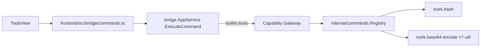

# Tools

import { Callout } from 'fumadocs-ui/components/callout';

Tools là built-in module mỏng bọc quanh `internal/commands.Registry` — mỗi
"tool" là 1 command đăng ký sẵn, chạy pure function, **không** đụng vaultitem
(không lưu gì, không có secret). Đây là điểm khác biệt lớn nhất so với
Vault/Notes/SSH/Database: Tools không có state, không cần vault unlocked.

## Principles

- Tool không tự ý đọc vault nếu chưa có capability.
- Ưu tiên built-in trước khi mở SDK ngoài.
- Mỗi tool có entry rõ trong registry để search/palette dùng được.

## Hiện trạng: 8 command

Subject luôn `builtin.tools`. Cả 7 command đều đăng ký thật; nguồn duy nhất là
bảng `tools.Commands` trong `internal/tools/commands.go`, và manifest, grant,
registry cùng tra cứu capability ở bridge đều đọc từ đó — để không xảy ra cảnh
một command chạy được mà grant viết cho thứ khác.

| Command ID | Input | Output | Capability |
|---|---|---|---|
| `tools.hash` | text + algorithm (`sha256`/`sha512`/`md5`) | hex digest | `tools:hash` |
| `tools.base64-encode` | text | base64 chuẩn có padding | `tools:util` |
| `tools.base64-decode` | base64 | text | `tools:util` |
| `tools.url-encode` | text | query-escaped | `tools:util` |
| `tools.url-decode` | query-escaped | text | `tools:util` |
| `tools.json-format` | JSON text | JSON đã indent | `tools:util` |
| `tools.uuid-generate` | version (`v4` mặc định, `v7`) | UUID string | `tools:util` |
| `tools.jwt-decode` | JWT (chấp nhận cả tiền tố `Bearer `) | header + payload + thời hạn, dạng text | `tools:util` |

Tất cả pure function — không network, không mutate state, không cần vault
unlocked. Scope vẫn `command:<id>` opaque.

<Callout type="warn" title="ID là kebab-case, không phải camelCase">
Bản design đầu đề xuất `tools.base64-encode`. Không dùng được: module registry
validate id theo `^[a-z][a-z0-9]*(?:[._-][a-z0-9]+)*$`
(`internal/modules/registry.go`) — không có chỗ cho chữ hoa, và manifest sai
thì app chết ngay lúc khởi động. Mọi id sẵn có trong app đều lowercase
(`tools.hash`, `notes.create`, `database.query`), nên kebab-case là dạng khớp
cả luật lẫn tiền lệ.
</Callout>

### Chi tiết đáng lưu ý

- **`base64-decode` nhận mọi biến thể** — standard và URL-safe, có padding hay
  không. Người dùng không phải tự đoán mình đang cầm dạng nào. Bytes giải ra
  không phải UTF-8 hợp lệ thì báo lỗi thay vì trả về chuỗi đầy ký tự thay thế.
- **`json-format` dùng `json.Indent`**, không unmarshal rồi marshal lại: cách
  sau sẽ sắp xếp lại key theo alphabet và biến số nguyên lớn thành float dạng
  mũ, khiến file sau format không còn diff được với bản gốc.
- **`url-encode` dùng `QueryEscape`** — space thành `+`, đúng nghĩa "URL
  encode" mà mọi công cụ khác đưa ra.
- **`jwt-decode` chỉ giải mã, KHÔNG xác thực.** Đây là điểm quan trọng nhất
  của tool này. Header và payload của JWT là base64 chứ không phải mã hoá — ai
  cũng đọc được, và ai cũng **viết** được. Kiểm chữ ký cần signing key mà tool
  không có và không hỏi. Nên output luôn kèm dòng `SIGNATURE — NOT VERIFIED`
  và một đoạn nói rõ đừng tin claim chỉ vì thấy nó hiện ra. Ngoài ra:
  - Cảnh báo riêng khi header ghi `alg: "none"` — token không có chữ ký nào cả,
    server nào chấp nhận nó thì chấp nhận mọi thứ.
  - `iat`/`nbf`/`exp` được đổi sang ngày giờ đọc được kèm khoảng cách tới hiện
    tại (`EXPIRED 2 days ago`, `NOT VALID YET`) — đó là câu hỏi người ta mở
    decoder ra để trả lời.
  - Token 5 phần (JWE) báo lỗi riêng: nó đúng định dạng, chỉ là không đọc được
    nếu không có khoá — khác hẳn "token hỏng".

### Capability mới, không đổi grant cũ

Thêm 1 capability `tools:util` dùng chung cho toàn bộ nhóm command pure-function
mới, **tách khỏi `tools:hash` hiện có** — theo đúng "Compatibility rules" đã
chốt ở [Technical contracts](/dev-kit/technical-contracts#compatibility-rules):
thêm capability mới không đổi grant cũ được coi là backward-compatible. Không
dùng 1 capability riêng cho từng command (`tools:base64`, `tools:uuid`...) vì
risk profile của cả nhóm giống nhau (không network, không mutate) — khác hẳn
lý do SSH/DB tách `ssh:connect` / `ssh:forward` (risk khác nhau rõ rệt).

Scope vẫn `command:<id>` opaque như hiện tại, không cần đổi.

### NFR: input size limit

Đã có: `tools.MaxInputBytes` = 1 MiB, áp cho mọi command có nhận input
(`tools.uuid-generate` không nhận nên không áp). Lý do: command chạy trên
goroutine của UI và mỗi phép biến đổi cấp phát output bằng hoặc lớn hơn input,
nên một chuỗi 200 MB dán vào là một cú DoS cục bộ không cần kẻ tấn công nào.
1 MiB vượt xa mức người ta gõ hay dán, và còn xa mức gây đau.

## MCP tool surface (design)

Xem cơ chế chung + rationale ở [MCP / Agent](/dev-kit/mcp-agent).

Khác với các module khác — **mỗi command nên là 1 MCP tool riêng** (`tools.base64-encode`,
`tools.uuid-generate`...), không dùng 1 tool `tools.executeCommand` generic
duy nhất. Lý do: MCP tool cần `inputSchema` rõ ràng để agent gọi đúng; 1 tool
generic với input schema "tuỳ command" thì agent khó biết truyền gì. Mỗi MCP
tool vẫn map xuống cùng 1 bridge method `ExecuteCommand` với `command:<id>`
tương ứng ở tầng dưới — không nhân bản logic.

| MCP tool | Effect | Map sang |
|---|---|---|
| `tools.hash` | `read` | `builtin.tools` / `tools:hash` / `command:tools.hash` |
| `tools.base64-encode` / `tools.base64-decode` | `read` | `builtin.tools` / `tools:util` / `command:tools.base64-encode` (tương tự) |
| `tools.uuid-generate` | `read` | `builtin.tools` / `tools:util` / `command:tools.uuid-generate` |
| `tools.url-encode` / `tools.url-decode` | `read` | `builtin.tools` / `tools:util` / `command:tools.url-encode` (tương tự) |
| `tools.json-format` | `read` | `builtin.tools` / `tools:util` / `command:tools.json-format` |
| `tools.jwt-decode` | `read` | `builtin.tools` / `tools:util` / `command:tools.jwt-decode` |

Tất cả `readOnlyHint = true` — pure function không có side effect, kể cả command
generate UUID (không mutate state nào, chỉ sinh giá trị mới).

## Known ceiling

- Chỉ pure-function utility — Tools không phải nơi cho business logic phức
  tạp hay bất cứ thứ gì cần I/O ngoài.
- Chưa có input size limit thật, chỉ mới nêu như NFR cần làm khi thêm command
  mới.

import { Cards, Card } from 'fumadocs-ui/components/card';

<Cards>
  <Card title="MCP / Agent" href="/dev-kit/mcp-agent" />
  <Card title="Technical contracts" href="/dev-kit/technical-contracts" description="Bridge Tools family + capability contract" />
  <Card title="Implementation status" href="/dev-kit/implementation-status" description="Built-in registry và capability boundaries" />
  <Card title="Runtime & process" href="/dev-kit/runtime" />
</Cards>
