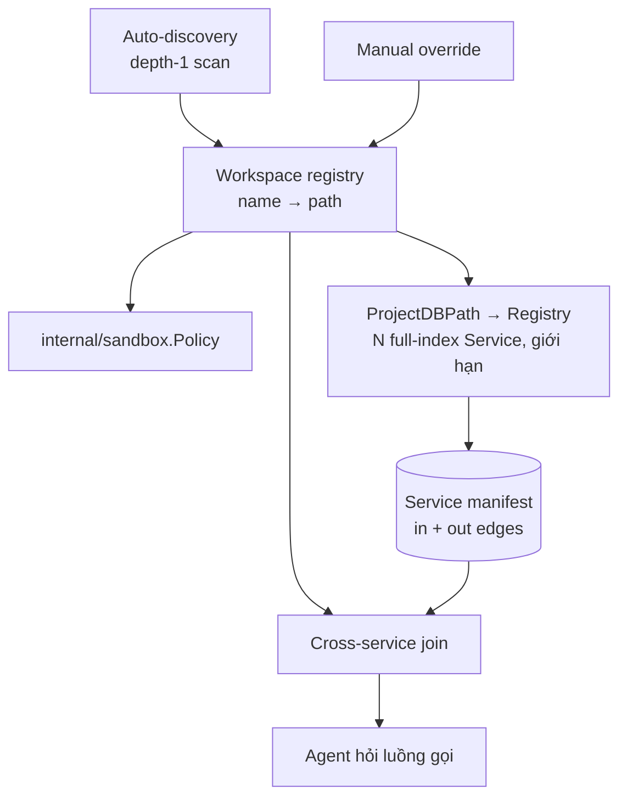

# Workspace

Workspace là một **danh sách có tên gồm các cặp `(service name → path trên đĩa)`**.
Chỉ vậy. Nó nhỏ vì nó phải phục vụ ba consumer không liên quan nhau, và mỗi
consumer chỉ cần một nửa của cặp đó:

| Consumer | Cần gì | Dùng làm gì |
|---|---|---|
| Sandbox | **path** | Dựng `WorkDir` / `ReadWritePaths` / `ReadOnlyPaths` cho từng agent |
| CodeGraph | **path** | `ProjectDBPath` hash path → index riêng cho từng service |
| Cross-service flow | **name** | Join outbound call của service A với inbound endpoint của service B |

Không có khái niệm nào khác giải được cả ba. Đó là lý do workspace tồn tại
như một registry riêng thay vì nhét vào Agent Hub hay CodeGraph.

import { Callout } from 'fumadocs-ui/components/callout';

<Callout type="warn" title="Implement một phần">
**Đã có:** registry (`internal/workspace`, bảng `workspaces` /
`workspace_services`, migration 28 + 30), bước 1–2 của auto-discovery
(quét tới độ sâu 2, tên từ `spring.application.name`), trích outbound call
trong analyzer Java và resolve target về service
(§ [Outbound edge](#outbound-edge)), title bar switcher, project picker của Code Graph / Git trỏ vào workspace, và grant cả
workspace cho một session Agent Hub (§ [Agent liên service](#agent-liên-service-grant-cả-workspace)).
Bind lồng RO/RW trên Linux đã đúng thứ tự (§ [Worktree](#worktree-dùng-chung-registry)).

**Chưa có:** bước 3 của auto-discovery (sửa tay), Rescan, trạng thái index
(§ [Trạng thái index](#trạng-thái-index-của-một-service)), manifest tier
(mode chạy riêng của analyzer), lưu outbound call vào index phía Go, join,
Registry N slot, và tier worktree.
`internal/codegraph/service.go` vẫn giữ **một** project active
(`activeProject`, `SetProjectPath`), đúng FR-1 gốc của
[CodeGraph](/dev-kit/codegraph) — § [Registry](#registry-từ-1-project-active-sang-n-có-giới-hạn)
là phần thay nó.
</Callout>



## Vì sao không dùng lại "cluster"

Từ `cluster` đã thuộc về Kafka trong toàn bộ doc (`kafka.mdx`,
`active_kafka.go`, popup chọn cluster ở MCP). Dùng lại sẽ gây nhầm ở đúng chỗ
nguy hiểm: cả hai đều là "một tập thứ được chọn active". Workspace là từ mới,
không đụng.

## Data model

Bảng `workspaces` và `workspace_services` trong `internal/storage`, **machine-local,
không sync**. Lý do giống NFR-4 của CodeGraph: path là thứ chỉ đúng trên một
máy. Sync một danh sách path sang máy khác thì mọi entry đều sai.

| Field | Value |
|---|---|
| `workspace.id` | 24 lowercase hex (`vaultitem.NewID`) |
| `workspace.name` | Tên do người đặt, hoặc tên thư mục cha |
| `workspace.root` | Thư mục cha chứa các service (nguồn cho auto-discovery) |
| `service.name` | Tên logic — thứ xuất hiện trong URL giữa các service |
| `service.path` | Path tuyệt đối tới repo |
| `service.name_source` | `config` \| `folder` \| `manual` — xem phần dưới |

Một service **không** cần nằm dưới `root`. `root` chỉ là gợi ý cho lần quét
đầu; thêm tay một repo ở chỗ khác vẫn hợp lệ.

Ràng buộc (migration 30 — m28 ban đầu không có cái nào):

- `workspace_services.workspace_id` là foreign key tới `workspaces(id)` với
  `ON DELETE CASCADE`. Xoá workspace thì service đi theo, không để lại orphan.
- `UNIQUE (workspace_id, path)`. **`path` là khoá định danh của một service
  trong workspace.** Rescan khớp service vừa quét được với dòng đã lưu theo
  `path`, nhờ vậy tên `manual` sống qua rescan. Tên thì có thể đổi, nhưng path
  thì không: đổi path tức là một service khác.
- `name` **không** unique, có chủ ý. Hai repo cùng khai
  `spring.application.name` là chuyện có thật (bản fork, bản v1/v2 chạy song
  song). Chặn ở DB thì auto-discovery fail cả lần thêm workspace chỉ vì một
  cặp trùng. Chỗ đúng để xử lý là join: tên trỏ tới hơn một service thì cạnh
  mang trạng thái `ambiguous-service` (§ [Join](#join-tính-khi-hỏi)), UI chỉ
  ra cặp trùng để người sửa tay.

## Auto-discovery

Yêu cầu: tự động hết mức có thể, và **không được lag khi mở nhiều project**.
Ba bước, xếp theo giá tăng dần, dừng ở bước rẻ nhất còn đúng.

**Bước 1 — tìm service** (`discover.go`). Quét `root` **đi xuống cho tới khi
gặp repo, tối đa 2 tầng**. Một thư mục có `.git` (thư mục, hoặc file của
linked worktree) là service, và việc tìm dừng ở đó: không bao giờ đi vào bên
trong một repo, nên submodule hay checkout vendored không thành service thứ
hai. Thư mục không phải repo ở tầng 1 thì được mở thêm một tầng, nhờ vậy
layout nhóm `root/backend/billing`, `root/frontend/web` ra đúng. Thư mục ẩn và
`node_modules` / `target` / `build` / `dist` / `out` / `vendor` không được
tìm vào (một repo tên `build` vẫn được nhận, vì nó được nhận ra trước khi
danh sách này áp dụng). Chi phí vẫn là một `readdir` cho mỗi thư mục thường ở
tầng 1, không phải một lượt walk cây.

Khi chính `root` là repo thì chỉ xét tầng 1, như trước. Một repo đơn là
trường hợp phổ biến, và tìm sâu 2 tầng vào nó thì biến `third_party/lib` thành
service và làm mất chính repo người dùng đã chọn.

**Bước 2 — đặt tên service** (`springconfig.go`). Tên trong URL
(`http://billing-service/refunds`) **không** suy được chắc chắn từ tên thư
mục. Nguồn đúng là `spring.application.name`. Đọc vài file nhỏ ở đường dẫn cố
định `src/main/resources`, theo đúng thứ tự Spring áp dụng (file sau đè file
trước): `bootstrap.{yml,yaml,properties}` (Spring Cloud hay đặt tên ở đây),
rồi `application.{yml,yaml,properties}`. Chỉ đọc **default profile**: document
YAML có `spring.config.activate.on-profile` (hoặc `spring.profiles` kiểu cũ)
bị bỏ qua, vì profile nào chạy ở đâu là chuyện của deployment mà máy này
không biết. Placeholder trong tên (`${APP_NAME:billing}`) được fold. Miss,
không fold được, hoặc file hỏng thì fallback tên thư mục, không fail cả
workspace. Nguồn được ghi vào `name_source` (`config` / `folder`) để UI nói
được tên này chắc hay đoán.

Cùng bộ config đó là nguồn property để fold URL của outbound call
(§ [Outbound edge](#outbound-edge)), và `server.port` (mặc định 8080) để khớp
URL `localhost` theo port.

**Bước 3 — người sửa.** Sửa tay luôn thắng và `name_source` thành `manual`;
lần rescan sau không ghi đè lên nó.

Một `root` không có repo con nào **không** phải lỗi. Nó là
workspace một service, và service đó chính là `root`. Nhờ vậy "thêm
workspace" luôn là một thao tác, dù thư mục chứa một project hay mười.

Rescan chạy khi mở workspace và khi người bấm **Rescan** — không có watcher
trên `root`. Watcher ở đây sẽ nổ mỗi lần một agent đụng file trong bất kỳ
service nào, đổi lấy thông tin gần như không bao giờ đổi (danh sách repo).

## Agent liên service: grant cả workspace

Project picker của Agent Hub có một mục riêng cho cả workspace ("acme — tất
cả N thư mục"), đặt trên các service lẻ. Chọn nó thì session có
`Cwd` = service đầu tiên (một `WorkDir` cụ thể để sandbox bind), còn mọi
service khác đi vào `ExtraReadWritePaths`. Tất cả đều **RW**.

**Đây là chủ ý, không phải lỗ hổng.** Nó ngược với đường mặc định ở
§ [Worktree](#worktree-dùng-chung-registry) ("RW đúng service của mình, phần
còn lại RO"), và ngược một cách có lý do: có những việc về bản chất là liên
project. Đổi một contract giữa hai service, đổi tên một field chạy qua
producer lẫn consumer, sửa một lib chung rồi cập nhật chỗ gọi. Ép những việc
đó qua mô hình "một service RW" thì hoặc phải mở N session rồi tự điều phối,
hoặc agent đọc được B mà không sửa được B, đúng lúc việc cần làm là sửa B.

Đánh đổi, và cách nó bị chặn:

- **Chỉ người mới cấp được.** `ExtraReadWritePaths` chỉ đi qua bridge (UI).
  Input struct của MCP tool không có field này, và `CreateSession` còn loại bỏ
  nó tường minh khi caller là agent. Vì vậy một agent không thể tự mở rộng
  jail cho chính nó hay cho sub-agent nó spawn.
- **Vẫn là jail.** Mỗi path được làm sạch như `Cwd` (tuyệt đối, không `/`,
  không `$HOME` trần). Ngoài danh sách service thì sandbox vẫn đóng như cũ.
- **Grant sống theo session, không theo process.** Nó được lưu ở
  `agent_sessions.extra_rw_paths` (migration 29) và dựng lại mỗi lần resume
  hoặc rewind (`sessionOpenSpec`). Trước đó grant chỉ nằm trong `OpenSpec` đầu
  tiên, nên session resume sau khi restart chỉ còn RW trên service đầu tiên.
- **Snapshot lúc tạo.** Service thêm vào workspace sau khi session đã tạo thì
  không tự vào jail của session đó. Muốn có thì tạo session mới. Session không
  âm thầm rộng ra theo registry.
- Chọn một service lẻ (hoặc "New project…") thì thu về đúng mô hình mặc định.
  Trigger của picker ghi tên workspace chứ không ghi tên một thư mục trong lúc
  đang giữ grant cả workspace, vì "billing-service" không nói hết được session
  chạm tới đâu.

## Hai tầng index — chỗ quyết định chuyện lag

Đây là phần quan trọng nhất của trang. Chi phí index **không** tỉ lệ với kích
thước project; nó bị chi phối bởi symbol solver.

`analyzer/src/main/java/com/devkit/codegraph/TypeSolverFactory.java` walk toàn
bộ `~/.m2/repository` và `~/.gradle/caches`, rồi mở **mọi** jar tìm được thành
một `JarTypeSolver`. Trên máy này đếm được 554 jar; trên một máy Java thật con
số là hàng nghìn. Và `internal/codegraph/service.go` re-index bằng cách chạy
lại **toàn bộ** analyze (`s.analyzer.Analyze`), debounce 750ms — không phải
incremental. Nhân chi phí đó với N service trong một workspace là công thức
chắc chắn lag.

Lối thoát nằm ở một quan sát đo được:
`analyzer/.../EndpointExtractor.java` **thuần AST** — nó chỉ đọc annotation
name, không gọi `resolve()`, không chạm solver. Nghĩa là thứ mà cross-service
cần có thể lấy được mà **không trả một đồng nào cho solver**.

| | Manifest tier | Full index tier |
|---|---|---|
| Cần symbol solver | Không | Có (walk `~/.m2`) |
| Phạm vi | Mọi service trong workspace | Tối đa `limit` service, mở tay (§ Registry) |
| Nội dung | Inbound endpoint + outbound HTTP call | Node, edge, call site, field access |
| Kích hoạt | Khi mở workspace, khi rescan | Bấm vào service trong panel → `Registry.Open` |
| Đơn vị cache | Từng file, theo `mtime` + `size` | Cả project |

Manifest chạy như một mode phụ của chính analyzer jar (cờ dòng lệnh), bỏ qua
`TypeSolverFactory` hoàn toàn. Trong mode đó, trước khi parse là một lượt quét
byte tìm các chuỗi mốc (`@RestController`, `@RequestMapping`, `@FeignClient`,
`RestTemplate`, `WebClient`); chỉ file trúng mới được parse. Ở một service
điển hình đó là vài phần trăm số file.

Manifest tier không phải index, bất kể full index giờ mở được cho nhiều
service hay không (§ dưới) — nó không có node, không tra cứu được, không hiện
trong graph. Nó chỉ là hai danh sách cạnh biên, và luôn chạy cho **mọi**
service trong workspace bất kể service đó có đang mở full index hay không —
đây là phần rẻ, không đổi.

## Registry: từ 1 project active sang N có giới hạn

FR-1 gốc của [CodeGraph](/dev-kit/codegraph) — đúng một `Store`/`lease`/
`analyzer` sống trong `Service`, `beginOpen` cancel bản trước khi mở bản sau —
giải đúng bài toán CodeGraph được thiết kế ban đầu cho: một cửa sổ, một
project. Nó không giải bài toán workspace: sửa service A mà cần xem blast
radius, go-to-definition hay data flow trong service B mà A gọi nghĩa là full
index cho **cả hai cùng lúc**, không phải manifest tier — manifest chỉ đủ cho
join (§ trên), không tra được implementation hay lần theo một field bên trong
B.

`Service` không đổi bên trong. Nó đã tự dọn sạch vòng đời của chính nó —
`beginOpen` cancel `projectCtx`, dừng watcher, reset index trước khi mở bản
kế; `Close()` làm y hệt cộng `CancelAnalyzerBuild` và đóng mọi analyzer đang
giữ. Đó chính xác là thao tác cần để evict một service khỏi cache mà không rò
process — Registry chỉ gọi lại nó cho N instance thay vì 1.

```go
// internal/codegraph
type Registry struct {
    mu       sync.Mutex
    limit    int                 // JVM/tsgo đồng thời — mặc định nhỏ, xem dưới
    services map[string]*Service // key = workspace_services.path
    lru      []string            // most-recently-used ở cuối
}

func (r *Registry) Open(ctx context.Context, servicePath string) (*Service, error)
func (r *Registry) Close(servicePath string) error
func (r *Registry) evictLRU() error // gọi Service.Close() sẵn có, không đổi gì trong nó
```

**Lazy, không eager.** Mở một workspace không mở full index cho mọi
`workspace_services` — chỉ manifest tier chạy ngay, đúng bảng ở § trên. Full
index của một service chỉ mở khi người dùng thật sự bấm vào nó trong Workspace
panel, đúng cách `OpenProject` hoạt động hôm nay; khác duy nhất là không còn
cancel bản đang mở nếu Registry vẫn còn slot trong `limit`.

**`limit` là câu trả lời trực tiếp cho một ceiling trang này đã nêu từ trước**
("`analyzer_subprocess.go` cũng chưa giới hạn số JVM chạy song song" — mục
Known ceiling): trước đây đúng vì chỉ có 1 slot nên câu hỏi chưa từng đặt ra.
Có N slot thì bắt buộc có trần. Mỗi Java service full-index là một JVM walk
trọn `~/.m2`/`~/.gradle` (554 jar đo được ở máy này) — N=2–3 là mức hợp lý
trước khi RAM/CPU máy dev bắt đầu đau; đầy `limit` thì UI phải nói rõ đang
evict service nào, không âm thầm.

**Watcher không còn nghĩa "chỉ project active mới có freshness".** Mỗi
`Service` trong Registry giữ watcher riêng — service bị evict mất watcher
(đúng ý, nó không còn mở), service còn nằm trong `limit` vẫn tự re-index khi
file đổi như hôm nay, không còn phân biệt "active" hay không theo nghĩa cũ.

Bridge (`internal/bridge/codegraph.go`, 23 method) và `codegraphStore.ts` phía
frontend hiện đều ngầm định "project đang active" — không method nào nhận id.
Thread `servicePath` — đúng field `workspace_services.path` đã có ở data model
trên, không phải khái niệm mới — qua từng method là phần cơ học của việc này,
không phải thiết kế lại; frontend rekey state hiện có (documents, plan, flow
docs) theo `servicePath` thay vì global.

## Thêm service: index một lần, không chờ ai bấm

Java và Lua không cần điều này. Java có manifest tier riêng chạy mỗi lần mở
workspace (§ trên); Lua thì full index của nó đã rẻ sẵn (native, không
solver) nên tự nó đã chạy được y như manifest. Chỉ TypeScript cần: full index
của nó không rẻ được (đo trên dự án thật ngoài repo — xem § Known ceiling)
nên không thể chạy lại mỗi lần mở workspace như manifest của Java.

Giải: khi một service được thêm vào workspace (auto-discovery ở lần rescan
kế tiếp, hoặc thêm tay), nó được **xếp hàng index một lần ngay tại đó**,
không đợi người dùng bấm vào service trong panel. Đây là chi phí một lần,
không phải chi phí lặp lại mỗi lần mở workspace. Sau đó service có
`ProjectDBPath` như thể đã từng được mở, và join dùng ngay dữ liệu đó qua flow
reuse đã có (`OpenProjectAt`, § Registry): mở lại chỉ đọc dữ liệu cũ, rồi
re-index nền phần đã đổi.

**Hàng đợi, không phải chờ.** Thêm một workspace 89 thư mục không được biến
thành 89 lần index nối nhau trong khi người dùng nhìn loading. Việc thêm trả
về ngay, và index chạy nền, dùng chung trần `limit` với Registry (mỗi job là
một JVM/`tsgo` như full index). Nhờ vậy thêm workspace lớn không vượt trần
tiến trình mà § Registry đã đặt ra.

Vì vậy registry **không** hứa "có tên là đã có index". Giữa hai điểm đó có
những trạng thái thật (đang chờ, đang chạy, fail, không có analyzer), và
chúng được đặt tên thay vì bị giấu — xem § dưới.

## Trạng thái index của một service

Mỗi `workspace_services` mang một trạng thái index, machine-local như chính
bảng đó:

| Trạng thái | Nghĩa | Chuyển tiếp |
|---|---|---|
| `pending` | Đã vào registry, đang trong hàng đợi, chưa có dữ liệu | → `indexing` khi có slot |
| `indexing` | Job đang chạy (một slot trong `limit`) | → `indexed` / `failed` |
| `indexed` | Có dữ liệu, kèm `indexed_at` | → `indexing` khi re-index (vẫn phục vụ dữ liệu cũ trong lúc chạy) |
| `failed` | Job fail, kèm lý do (toolchain thiếu, parse fail, bị huỷ) | → `pending` khi bấm Retry hoặc khi Rescan |
| `unsupported` | Không analyzer nào nhận thư mục (`ErrUnsupportedProject`) | → `pending` khi Rescan, nếu từ lần trước đã có analyzer mới |

- `indexed` là trạng thái duy nhất có dữ liệu. Nhưng một service đang
  `indexing` *sau* một lần `indexed` vẫn giữ `indexed_at` cũ và vẫn phục vụ
  join. Re-index không làm dữ liệu biến mất trong lúc chạy.
- `failed` do thiếu toolchain (JDK chưa có, `tsgo` chưa build) tách khỏi fail
  thật, cùng cách phân biệt `HasArtifact` / `Ready` của setup panel. Hai lỗi
  này chỉ ra hai hành động khác nhau cho người dùng.
- App restart giữa chừng: `indexing` quay về `pending`, không bao giờ được
  suy ra thành `indexed`. Cùng quy tắc `Recover` của `task_verify_runs`.
- Service ngôn ngữ chưa có analyzer vẫn nằm trong registry (sandbox và
  worktree vẫn dùng được), chỉ mang `unsupported`.

Join đọc trạng thái này cho đầu B của mỗi cạnh (§ [Join](#join-tính-khi-hỏi)).
Đó là lý do nó phải là cột, không phải suy ra từ việc "có file index hay
không".

## Outbound edge

Trước đây analyzer **không** nhận diện `RestTemplate`, `WebClient` hay
`@FeignClient`. Lời gọi xuyên service chỉ để lại dấu vết trong `call_sites`,
dưới dạng hai bức tường đã có tên: `library` (callee nằm trong jar Spring)
và `interface` (implementation của Feign sinh lúc runtime). Cross-service
**không phải bức tường thứ tư**: đầu bên kia nằm trong workspace của bạn,
nên vượt được. Việc cần làm là trích `(http method, path, target)` từ đúng
những lời gọi đó, rồi resolve target về một service.

Việc chia làm hai nửa, mỗi nửa ở đúng chỗ có dữ liệu nó cần.

### Analyzer: trích, không resolve

`OutboundCallExtractor.java` ghi `outboundCalls` vào kết quả analyze, mỗi
call gắn với method gọi nó (`from`), file và dòng. Nó **thuần AST** như
`EndpointExtractor`, nên manifest tier chạy được nó mà không cần solver.
Receiver có phải `RestTemplate` hay không thì không hỏi type system: receiver
là một cái tên, và khai báo của tên đó (field, parameter, local) ghi type
ngay trong source.

| Client | Đọc gì |
|---|---|
| `@FeignClient` | `name` / `value` / `serviceId` là tên service, `url` và `path` là prefix. Mỗi method có mapping annotation là một call, đọc bằng chính logic của `EndpointExtractor` nhưng theo nghĩa route được **gọi** |
| `RestTemplate` / `RestOperations` | Tham số đầu của `getForObject` / `postForEntity` / `exchange` / … là URL. `exchange` / `execute` lấy HTTP method từ tham số thứ hai |
| `WebClient` / `RestClient` | `client.get().uri(x)`, hoặc `.method(HttpMethod.X).uri(x)` |

URL được fold bằng `ConstantResolver`, giờ đã đi theo được những thứ một
method body chứa:

- Literal và hằng của project (như trước).
- Local được gán **đúng một lần**. Local bị gán lại thì thành lỗ `{url}`.
- Parameter thành lỗ mang tên nó (`{id}`), đúng hình dạng của route variable.
- Field Spring inject bằng `@Value("${key}")`, trên field hoặc trên parameter
  của constructor gán vào field đó, trả về **nguyên placeholder**
  (`${billing.url}`). Analyzer không đọc config.
- Base URL của client được lấy từ chuỗi builder nơi client được tạo:
  `builder.baseUrl(x).build()`, `WebClient.create(x)`, `rootUri(x)` của
  `RestTemplateBuilder`. `URI.create(x)` được nhìn xuyên qua.

Kết quả là `billingUrl + "/invoices/" + id` ra
`${clients.billing.url}/invoices/{id}`, một chuỗi mà phía có config fold tiếp
được.

### Go: resolve theo config của caller

`workspace.ResolveTarget` nhận target thô, config của **service gọi**
(placeholder là của caller, không phải của callee) và danh sách service. Thứ
tự bằng chứng, mạnh trước:

1. **URL fold ra host** thắng tên Feign, vì chính Feign cho `url` đè `name`.
   `${KEY:default}` dùng default khi config không có key. Cả hai dạng property
   đều được fold.
2. **Tên Feign** khớp thẳng tên service. Đây là trường hợp rẻ nhất và phổ biến
   nhất trong code Spring Cloud, không cần URL.
3. **Host khớp tên service**: khớp chính xác, hoặc khớp nhãn DNS đầu tiên, nên
   `billing-service.payments.svc.cluster.local` và `billing-service:8080` đều
   về `billing-service`.
4. **Host loopback khớp theo port** (`localhost:8081` → service có
   `server.port` = 8081), để bắt cấu hình dev.

Mỗi kết quả `resolved` mang `provenance`: `feign-name` / `literal` /
`property` / `port`. Người đọc nhờ đó cân được độ chắc: code nói, config trên
máy này nói, hay đoán từ setup dev. Không `resolved` thì mang một trạng thái:

| Trạng thái | Khi nào |
|---|---|
| `dynamic-url` | Phần host không fold được: lỗ `{…}`, placeholder không có trong config và không có default, hoặc URL tương đối vì client được inject sẵn từ một `@Bean` ở chỗ khác |
| `unknown-service` | Host trông như tên nội bộ (không có dấu chấm, `.svc`, `.cluster.local`, `.internal`, `.local`, `.consul`, loopback) nhưng không có trong registry. Tên Feign không khớp service nào cũng rơi vào đây, vì nó luôn là tên service-discovery |
| `ambiguous-service` | Hơn một service mang tên đó (§ [Data model](#data-model)) |
| `external` | Host công khai (`api.stripe.com`) |

Resolve chỉ dừng ở mức **service**. Ghép `path` với endpoint của service đó
(`linked` / `endpoint-gone`) là phần của join.

## Join — tính khi hỏi

Chốt: cạnh cross-service tính **lúc agent hỏi**, cộng một hành động rescan tay.
Không có background job nào duy trì chúng. Cùng triết lý với `traceDataFlow`
vốn đã "bounded, theo yêu cầu, không cache".

Join là ghép outbound của A với inbound của B theo `(method, path)` sau khi
resolve `target service` qua registry. Không phải cạnh nào cũng nối được, và
cái không nối được **không bị nuốt** — nó mang trạng thái:

| Trạng thái | Nghĩa |
|---|---|
| `linked` | Nối được tới một endpoint cụ thể |
| `dynamic-url` | URL ghép từ biến, không fold được thành literal |
| `unknown-service` | Tên host không có trong registry |
| `endpoint-gone` | Tên service khớp, route thì không |
| `ambiguous-service` | Tên host khớp hơn một service trong registry (§ [Data model](#data-model)) |
| `not-indexed` | Service B có trong registry nhưng chưa có dữ liệu: `pending` / `indexing` lần đầu / `failed` / `unsupported`. Cạnh kèm trạng thái đó của B |
| `external` | Host ngoài, không thuộc workspace |

`dynamic-url` là giới hạn thật, không phải bug. Đoán bừa một endpoint còn tệ
hơn nói thẳng là không biết — đúng nguyên tắc `unresolved` sẵn có: không im
lặng bỏ qua, cũng không bịa.

`endpoint-gone` xuất hiện vì manifest của A và của B quét ở hai thời điểm khác
nhau. Vì re-index là full analyze chứ không incremental, không có cách nào giữ
hai bên luôn đồng bộ mà không trả giá lag. Hiển thị drift đúng như nó là, rẻ
hơn và trung thực hơn.

**Dữ liệu ngoài `limit` không tự làm mới — và có thể sai mà không báo.** Một
service bị evict khỏi Registry (hoặc chưa từng được đưa vào N slot đang sống)
mất watcher; sửa file trong nó — kể cả agent sửa qua Bash, không qua Edit —
không có gì bắt được. Cạnh join trỏ vào service đó vẫn báo `linked` bình
thường, không phải `endpoint-gone` (đó là "đã quét, không thấy" — có tín hiệu
để nghi ngờ) mà là dữ liệu trông hợp lệ nhưng có thể đã lệch thực tế, không
có gì phân biệt được với dữ liệu tươi. Không giải bằng cách canh mọi service
(phá lý do có `limit`); giải bằng cách hiện timestamp "index lúc X" trên mỗi
service và trên cạnh join dùng nó — trung thực về độ cũ thay vì giả vờ luôn
tươi, đúng tinh thần `endpoint-gone` ở trên.

## Worktree dùng chung registry

Worktree không cần khái niệm mới. Nó là **cùng workspace đó, khác ánh xạ path**.

Workspace `acme` ở trạng thái thường trỏ mỗi service về repo chính. Workspace
`acme @ task-123` trỏ những service mà agent được phép sửa về worktree riêng,
còn lại giữ nguyên repo chính. Sandbox đọc đúng bảng đó ra policy: service
đang sửa vào `ReadWritePaths`, phần còn lại vào `ReadOnlyPaths`.

Lồng "thư mục cha read-only, một service bên trong read-write" **chạy được trên
macOS** vì rule `allow` của Seatbelt cộng dồn theo từng operation (đo live).
**Trên Linux thì cần đúng thứ tự**: bubblewrap mount theo thứ tự argv, mount
sau đè mount trước. `internal/sandbox/bwrap_args.go` từng phát mọi RW bind
trước mọi RO bind, nên `--ro-bind` của cha phát sau **đè lên** bind RW của con,
và con thành read-only. Giờ bind được phát theo độ sâu path, nông trước
(`appendNestedBinds`), nên bind lồng bên trong luôn nằm trên bind chứa nó, bất
kể mode. Cùng một path được khai cả RW lẫn RO thì vẫn thành RO như trước.
Đo trên Linux bằng bwrap thật: `TestBwrapNestedBindsKeepEachModeAtRuntime`
(service ghi được, sibling dưới cha RO thì không) fail với thứ tự cũ và pass
với thứ tự mới.

Một ràng buộc git làm tier worktree phức tạp hơn dự tính: worktree liên kết có
`.git` là *file* trỏ vào `<primary>/.git/worktrees/<name>/`, nơi chứa index và
HEAD. Primary repo read-only → `git add` / `commit` trong worktree fail
(`index.lock: Permission denied`, đo live). Vậy "service khác → RO" phải chừa
`<primary>/.git/worktrees/<name>` là RW cho đúng agent đó.

Từ đó ra hai tier, khớp với cách bạn làm việc thật (thường sửa khác service,
nhưng không phải luôn):

**Khác service — không cần worktree.** Mỗi agent RW đúng service của mình, cả
thư mục cha RO. Không tạo worktree nào, không tốn đĩa, không có bước dọn. Đây
là đường mặc định vì nó phủ đa số. Khi việc cần sửa nhiều service cùng lúc thì
dùng grant cả workspace (§ [Agent liên service](#agent-liên-service-grant-cả-workspace)),
thay vì nới mô hình này.

**Cùng service — mới bật worktree.** Chỉ service bị tranh chấp mới có worktree
riêng cho từng agent; các service khác vẫn RO trỏ về repo chính.

Vì `internal/codegraph/paths.go` đã hash project path để ra file index, mỗi
worktree tự có *file* index riêng — nhưng là index **nguội**: mỗi worktree mới
trả trọn một lần dựng solver (walk `~/.m2`). Worktree nhân chi phí full index
theo số agent; chỉ manifest tier là rẻ. Join vẫn chạy qua chúng vì làm việc
trên tên service chứ không trên path.

## Known ceiling

- **URL động** không fold được thành literal → `dynamic-url`. Không có kế hoạch
  giải triệt để; constant-folding liên thủ tục đắt hơn giá trị nó mang lại.
- **Manifest và full index có thể lệch nhau** về thời điểm. Manifest rẻ nên
  quét lại thường xuyên hơn; đây là đánh đổi có chủ ý.
- **Join hiện chỉ nối cho Java/Spring** — đây là ceiling của workspace, không
  phải của CodeGraph: CodeGraph tự nó đã hỗ trợ thêm TypeScript và Lua (xem
  [CodeGraph](/dev-kit/codegraph)), và cả hai đều đã có endpoint extraction
  riêng (`tsFramework.Endpoints` cho Nest/Next/Express family,
  `analyzer_lua_kong.go` cho Kong route table + Lapis) — chỉ là workspace
  join chưa có code path đọc chúng. Hai ngôn ngữ đó cũng không đối xứng với
  nhau: Lua native, không có bước solver để né, nên full index của nó đã rẻ
  sẵn — khái niệm "manifest tier riêng" gần như thừa. TypeScript thì
  `Endpoints()` đọc trên `*tsProject`/`*tsFile` đã dựng qua `tsgo`/LSP, tức ăn
  theo chi phí full index — đo trực tiếp trên một dự án NestJS thật ngoài repo
  này (1933 file TS): `documentSymbol` một mình đã 9.0s, `callHierarchy` thêm
  1.6s, tổng 10.64s — quá đắt để chạy lại mỗi lần mở workspace như manifest
  của Java.

  Đo thêm để chắc đây không phải "Go chậm hơn Rust": compiler API của chính
  `tsgo` (`tsgo --api --async`, bỏ `callHierarchy`) trên **cùng** dự án —
  619ms, ngang hai parser Rust đo trên cùng dự án qua napi binding
  (`oxc-parser` 165-530ms tuỳ có walk cây hay không, `@swc/core` 640-735ms).
  Go không hề thua; `documentSymbol` của LSP đắt vì nó bind + tra type từng
  file (semantic), không phải vì runtime chậm. Nhưng compiler API nhanh đó
  không lộ được decorator/call argument — cách duy nhất là `getSourceFile`,
  trả **binary AST nội bộ** mà chính `analyzer-ts/README.md` gọi là "thứ
  nhiều khả năng đổi nhất trong cả repo": rủi ro không phải sai ngay, mà là
  **âm thầm sai sau một lần nâng pin version** — bị loại vì rủi ro đó, không
  vì tốc độ. Một binary Rust riêng gọi `oxc_parser` (AST ổn định qua crate
  công khai, tốc độ tương đương) là phương án thay thế khả thi cho việc này.

  **Nhưng không cần tới phương án đó.** §
  [Thêm service: index một lần](#thêm-service-index-một-lần-không-chờ-ai-bấm)
  giải đúng bài toán "có dữ liệu cho mọi service" bằng cách index TS một lần
  duy nhất lúc thêm vào workspace — dùng lại nguyên `tsgo`/LSP đã có, trả giá
  một lần thay vì mỗi lần mở, không cần AST-only pass hay toolchain mới. Đổi
  lại là staleness cho service ngoài `limit` của Registry (§
  [Join](#join-tính-khi-hỏi)) — chấp nhận được vì đã có cách hiển thị trung
  thực (timestamp) thay vì che giấu. Service ngôn ngữ khác (kể cả chưa có
  analyzer) vẫn vào registry được — sandbox và worktree dùng bình thường —
  chỉ là chưa join được, nên vẫn xuất hiện ở đầu `external` của một cạnh.
- **Monorepo là một service.** Discovery dừng ở `.git`, nên một repo chứa
  nhiều service ra đúng một service. Tách nó ra cần một bước khác (dựa trên
  build marker: module của `pom.xml`, `settings.gradle`, `package.json`
  workspaces). Nhưng các service đó dùng chung một `.git`, nên "RW một
  service" vẫn phải cho RW cả `.git`, tức cô lập yếu hơn multi-repo. Thêm tay
  từng thư mục vẫn đi được.
- **Config chỉ ở `src/main/resources` của service, chỉ default profile.**
  Maven multi-module có config ở module con thì không đọc được. Config
  server, biến môi trường và profile đang chạy là chuyện của deployment:
  placeholder chỉ trỏ vào những thứ đó thì ra `dynamic-url`, trừ khi có default.
- **Client inject sẵn từ `@Bean`** (`@Qualifier("billing") WebClient`) giữ
  URL tương đối, thành `dynamic-url`. Lần theo bean method trong
  `@Configuration` là bước kế tiếp nếu tỉ lệ `dynamic-url` thực tế còn cao.
  `@HttpExchange` client của Spring 6 và `String.format` / `UriComponentsBuilder`
  cũng chưa được đọc.
- **Solver setup vẫn walk toàn bộ `~/.m2` mỗi lần analyze.** Manifest tier né
  được nó, full index thì không — và worktree **nhân** nó lên theo số agent.
  `analyzer_subprocess.go` tự nó chưa giới hạn số JVM một service worktree có
  thể mở; § [Registry](#registry-từ-1-project-active-sang-n-có-giới-hạn) chặn
  trần ở tầng service (giữa các service khác nhau trong workspace) qua
  `limit`, nhưng chưa chặn trần ở tầng worktree (N agent cùng service, N
  worktree, N JVM) — hai trần khác nhau, chỉ cái đầu có thiết kế.

## Non-goals (v1)

- Tự động mở full index cho mọi service **mỗi lần mở workspace** — vẫn phải
  bấm tay từng service để có full index sống trong `limit`; mở hết ngay lập
  tức trả giá JVM/tsgo cho service chưa ai nhìn tới. Khác với index **một
  lần lúc thêm service** (§
  [Thêm service](#thêm-service-index-một-lần-không-chờ-ai-bấm)) — đó là chi
  phí một lần tại thời điểm thêm, không lặp lại mỗi lần mở workspace sau đó
- Registry không giới hạn — `limit` luôn có trần, đầy thì evict LRU chứ không
  cho mở thêm âm thầm
- Sync workspace giữa các máy — path là machine-local
- Watcher trên thư mục `root`
- Suy ra topology từ service mesh / discovery server đang chạy
- Message queue như một cạnh cross-service (chỉ HTTP ở v1)

import { Cards, Card } from 'fumadocs-ui/components/card';

<Cards>
  <Card title="CodeGraph" href="/dev-kit/codegraph" description="FR-1, ba bức tường, call_sites" />
  <Card title="Agent Hub" href="/dev-kit/agent-hub" description="Consumer của workspace path" />
  <Card title="Sandbox" href="/dev-kit/sandbox" description="Policy dựng từ workspace" />
  <Card title="Tasks" href="/dev-kit/tasks" description="Task liên kết mềm tới worktree" />
</Cards>
