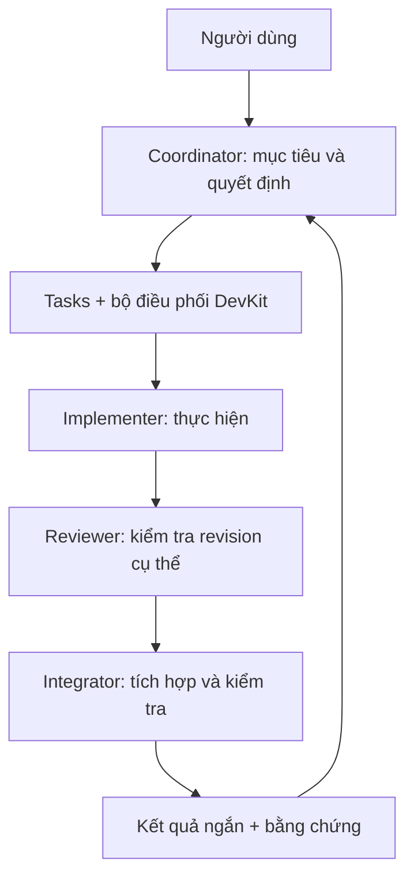
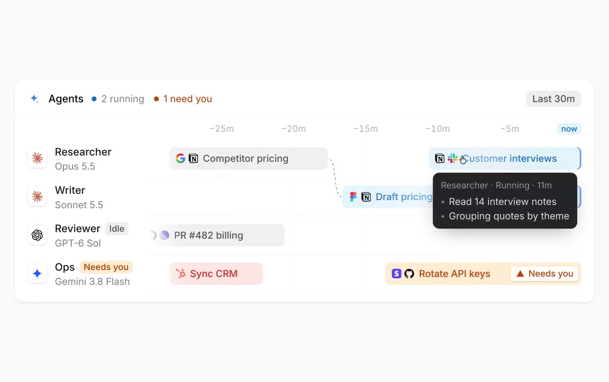
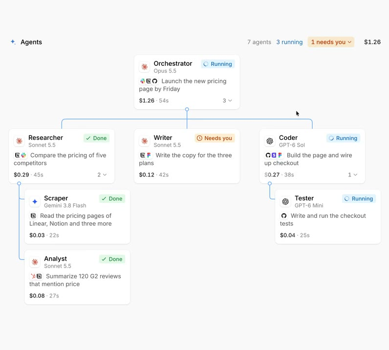

# Agent Hub: phối hợp liên session theo nhóm công việc

Ngày: 2026-10-24, Asia/Ho_Chi_Minh. Trạng thái: **bản thiết kế đề xuất để review, chưa triển khai và chưa được duyệt toàn bộ**.

Tài liệu được yêu cầu sau khi kiểm tra session Claude mới nhất. Phần hiện trạng được đối chiếu với checkout `04d3fd9e` và dữ liệu chạy thực tế ngày 24/10; hai nguồn được phân biệt bên dưới. Những tên package, DTO, tool và ngưỡng mới đều là đề xuất.

**Quan hệ với kế hoạch đang chạy:** đây là phần mở rộng team orchestration trên backlog “Agent-first optimisation”, không phải kế hoạch thay thế hoặc một luồng implementation độc lập. Đã đối chiếu trực tiếp 28 task của board ngày 24/10/2026; B5/B7 là phần nền dùng chung, C1 quyết định shell đích và D1 quyết định chính sách unattended sau khi được thiết kế/duyệt. Xem §18 trước khi chia task hoặc giao agent triển khai. Các phase 0–4 trong tài liệu này là giai đoạn của tính năng team, không đồng nghĩa P0/A/B/C/D của board hiện tại.

## 1. Vấn đề và kết quả cần đạt

Người dùng muốn giao một mục tiêu cho DevKit rồi chia việc như một nhóm IT: có người thực hiện, người kiểm tra, người tích hợp và đường báo cáo rõ ràng. Session chính giữ mục tiêu và quyết định; công việc kỹ thuật được giao trọn gói xuống dưới, kể cả việc thu thập bằng chứng và kiểm chứng.

Hiện nay một tin từ session con có thể mở một lượt mới ở session cha. Nếu cha có lịch sử rất dài, việc đọc một báo cáo nhỏ vẫn mang theo toàn bộ context. Cha còn phải hỏi tiến độ, đọc từng comment, kiểm tra lại thay đổi và điều phối tích hợp. Có thêm session nhưng tải điều phối vẫn dồn về một nơi.

Thiết kế phải đạt đồng thời:

1. Giảm context và số lượt gọi model của session chính trên cùng một nhóm công việc.
2. Mỗi nhiệm vụ có người chịu trách nhiệm, phạm vi, điều kiện hoàn thành và bằng chứng kiểm tra được.
3. Công việc, kết quả và yêu cầu quyết định tồn tại qua restart hoặc thay session.
4. DevKit tự xử lý điều phối có quy tắc; model xử lý phân tích, lựa chọn và các ngoại lệ cần suy luận.
5. Giữ nguyên giới hạn workspace, quyền ghi folder, profile model, xác nhận và cổng đóng task hiện có.
6. Đo tổng chi phí cả nhóm và chất lượng đầu ra; giảm tải cha không được che việc tăng mạnh tổng usage hoặc giảm chất lượng.

Không cam kết trước một tỷ lệ tiết kiệm token. Cần baseline và thử nghiệm trên công việc tương đương.

## 2. Bằng chứng của đợt kiểm tra

### 2.1 Quan sát từ dữ liệu chạy thực tế

Session được kiểm tra có tên “Mygo cho native UI DevKit”. Runtime đang cài là `claude-agent-acp` 0.95.0; log Claude ghi CLI 2.1.309. Không mặc định runtime đã cài và mọi phần source trong checkout có cùng revision.

| Quan sát | Số liệu / ý nghĩa |
| --- | --- |
| Context request của session chính trong đợt chạy mới | Khoảng 398.761–505.247 token, gồm input và cache; không phải lượng token mới được thêm vào mỗi prompt. |
| Request thành công của session chính trong đợt chạy mới | 64 request; khoảng 28,49 triệu token cache read cộng dồn. |
| Các session Claude được kiểm tra từ 16:40 đến 18:36 | 148 request thành công trên 5 session có hoạt động; không đại diện toàn bộ usage tài khoản ở mọi ứng dụng hoặc thiết bị. |
| Request lúc 18:35 | Tạo mới 494.807 token cache; request tiếp theo nhận HTTP 429 `usage_limit_reached`. Cache control trong log dùng TTL 1 giờ, trước đó có quãng nghỉ hơn 1 giờ. |
| Cửa sổ usage | `five_hour`, reset 21:40 cùng ngày; snapshot cuối báo `rejected`, utilization 1,18. Đây là hạn mức tài khoản, khác với cửa sổ context 1 triệu token. |
| Tin từ session khác | 28 trên 46 input được ghi trong transcript của session chính, tính cả các giai đoạn trước trong hội thoại. |
| Kết quả prompt khi hết limit | Metadata có `jetbrains.air.sessionFailure`, category `limit`, nhưng turn được lưu `end_turn`, session không có `stop`. |
| Token trong kết quả prompt | Metadata có `quota.token_count`, nhưng các trường normalized input/output được lưu bằng 0. |
| Instructions nền | `AGENTS.md` khoảng 215 KB đã xuất hiện trong context; cần giảm nội dung nạp mặc định nhưng không được bỏ mất quy tắc áp dụng. |

Số request được khử trùng theo request ID và bỏ phần lịch sử có `forkedFrom` khi tính hoạt động mới; response lỗi synthetic không được tính là request thành công. Không cộng toàn bộ bản sao lịch sử fork thành usage mới. Token cache cộng dồn không quy đổi trực tiếp thành phần trăm subscription hoặc hóa đơn.

Các số liệu cho thấy context lớn, nhiều lượt phối hợp và việc tạo lại cache là các yếu tố đáng tối ưu. Chưa có bằng chứng trong đợt kiểm tra rằng DevKit gửi lặp toàn bộ transcript mỗi lần resume. Bằng chứng local không đủ để xác định toàn bộ công thức tính hạn mức của nhà cung cấp.

### 2.2 Hiện trạng đã đọc trong source

| Nền tảng hiện có | Nguồn | Giới hạn liên quan |
| --- | --- | --- |
| Peer messaging, steering, queue, hop/rate limits | `internal/agenthub/peer.go` | Queue nằm trong RAM; mỗi queued message thành một lượt; chưa có batch bền vững. |
| Task con, phụ thuộc, session giữ task, branch | `internal/tasks/tasks.go`, `transition.go` | Chưa là một execution ledger có attempt, lease và kết quả theo revision. |
| Tạo child với `taskId`, assign trước khi gửi brief | `internal/mcp/tools_agenthub_task.go` | Các bước đi qua nhiều service; cần phục hồi từng bước khi tự động điều phối. |
| Brief ngắn, báo cáo qua task, cha kiểm chứng rồi đóng | `internal/agenthub/devkit_prompt.go` | Phần quy trình chủ yếu là prompt rule; child vẫn có thể yêu cầu đóng task qua gate hiện có. |
| Gate đóng task, verify queue bền vững | `internal/tasks/gate.go` | Verify chạy theo board binding; chưa chứng minh được kết quả gắn với đúng head của branch/worktree mà worker vừa báo cáo. |
| Workspace context có fingerprint và refresh | `internal/agenthub/workspace_context*.go` | Đã tránh gửi block không đổi mỗi lượt; chưa có context package riêng theo nhiệm vụ và vai trò. |
| Stop, account usage, model profiles, sandbox | `internal/agenthub/stop*.go`, `account_*.go`, các adapter | Cần sử dụng cùng một đường gọi; workflow không tạo quyền mới hoặc đường spawn riêng. |

Hai lỗi cần xử lý trước khi đo hiệu quả orchestration:

- `acpRuntime.Prompt` trả thành công khi JSON-RPC thành công, dù prompt response có typed terminal failure. `Service.invoke` vì thế đi qua nhánh hoàn thành thay vì ghi stop. `parseSessionFailure` hiện đọc notification `session_info_update`; cần nhận thêm carrier trên prompt response.
- `ClaudeAdapter.NormalizeUsage` đọc `claudeCode`, chưa đọc số liệu `quota.token_count` đã thấy trong runtime 0.95.0. Metadata gốc được giữ, nhưng số liệu chuẩn hóa mất thông tin.

`idle` tự nó không phải lỗi: một session bị từ chối do usage vẫn có thể giữ process khỏe và ở trạng thái idle. Điều sai là thiếu stop/failure tương ứng và ghi nhận lượt như thành công. Account usage chỉ được lưu theo chính sách vendor đã cấu hình; một account row trống riêng lẻ chưa đủ kết luận lỗi.

## 3. Hướng chọn và tài liệu tham khảo

Giữ Go làm nơi điều phối trong DevKit, sử dụng Agent Hub để chạy vendor và Tasks để biểu diễn công việc. Chưa thêm framework hay runtime bên ngoài làm dependency.

| Nguồn | Cơ chế tham khảo | Quyết định cho DevKit |
| --- | --- | --- |
| [Paperclip](https://github.com/paperclipai/paperclip) | Vai trò, tuyến báo cáo, task ownership, queue đánh thức có coalescing, budget. | Học cách quản lý nhóm và đánh thức theo công việc. Không nhập toàn bộ server hoặc mô hình company. |
| [Gas Town](https://github.com/gastownhall/gastown) | Phân công coding, trạng thái bền vững, capacity governor, hàng đợi tích hợp. | Tách thực hiện, review và tích hợp; giới hạn số việc chạy đồng thời. Không sao chép nguyên hệ thống watchdog và patrol bằng agent. |
| [Beads](https://github.com/gastownhall/beads) | Đồ thị task phụ thuộc, ready work, claim, lưu tiến độ qua session. | Mở rộng Tasks hiện có; không tạo task database thứ hai bằng Beads/Dolt. |
| [Deep Agents](https://github.com/langchain-ai/deepagents) | Context riêng cho subagent, output dài ra artifact, quản lý context. | Học hợp đồng đầu vào/đầu ra; giữ adapter CLI hiện có. |
| [Anthropic: context engineering](https://www.anthropic.com/research/effective-context-engineering-for-ai-agents) | Giữ khám phá sâu trong subagent, trả bản tổng hợp ngắn. | Dùng context package theo task và result envelope có giới hạn. |
| [Anthropic: multi-agent research system](https://www.anthropic.com/research/multi-agent-research-system) | Orchestrator–worker, giới hạn nỗ lực theo độ phức tạp; chi phí phối hợp. | Không mặc định mọi task cần nhiều agent hoặc thêm tầng quản lý. |

Đã tham khảo README/tài liệu của các dự án trong cuộc trao đổi ngày 24/10/2026; chưa chạy benchmark, audit hoặc tích hợp các repo này. Không suy ra tính tương thích chỉ từ việc có cùng khái niệm.

## 4. Phạm vi phiên bản đầu

### Có trong phạm vi

- Một nhóm công việc trong một workspace, có parent task và các task phụ thuộc.
- Vai trò coordinator, implementer, reviewer và integrator khi công việc cần.
- Context package chọn lọc, result envelope có revision và evidence references.
- Ledger local, queue bền vững, gom sự kiện và khôi phục sau restart.
- Capacity, retry, context và usage budgets; chỉ chạy khi có việc có thể hành động.
- UI xem ai đang làm gì, đang đợi gì và vì sao một agent được đánh thức.
- Bật riêng cho nhóm việc được chọn; session thường giữ hành vi hiện tại.

### Ngoài phạm vi

- “Công ty tự trị” chạy liên tục, tạo org chart nhiều tầng hoặc thuê agent vô hạn.
- Thay harness Claude/Codex/opencode; gọi model API trực tiếp bằng subscription token.
- Tự động merge/push/đổi model vượt chính sách hiện tại.
- Điều phối xuyên workspace, cloud workers hoặc sync execution ledger giữa máy.
- Tự sửa mọi AGENTS.md của repository; sao chép transcript vào shared memory.
- Một nhóm chat mà mọi người nhận toàn bộ mọi tin nhắn.

## 5. Vai trò và tuyến trách nhiệm



| Vai trò | Chịu trách nhiệm | Kết quả báo lên |
| --- | --- | --- |
| Coordinator | Phạm vi, thứ tự ưu tiên, phân rã task, quyết định liên phần, chấp nhận kết quả. | Tiến độ tổng hợp, blocker cần người dùng, kết quả cuối. |
| Implementer | Một đầu ra có thể kiểm tra; ghi code trên phạm vi được giao; điều tra và kiểm tra trong phạm vi đó. | Result envelope và bằng chứng. |
| Reviewer | Đọc yêu cầu, thay đổi và evidence; kết luận trên một revision; nêu findings cụ thể. | Accept / changes requested / blocked, với revision được review. |
| Integrator | Đưa các thay đổi đã review vào integration branch, giải quyết xung đột trong phạm vi được giao, chạy kiểm tra kết hợp. | Revision tích hợp, bằng chứng, đề nghị bước tiếp theo. |
| Bộ điều phối Go | Ready tasks, claims/leases, capacity, event queue, wake policy, timeout, recovery. | Trạng thái có thể kiểm tra; không tự đưa ra kết luận chuyên môn bằng heuristic. |

Reviewer là actor khác implementer; đây là kiểm tra độc lập về lần thực thi, không phải cam kết hai model sẽ không cùng sai. Reviewer mặc định đọc thay đổi và chạy kiểm tra phù hợp; không sửa patch của implementer trong cùng attempt.

Vai trò là cấu hình trách nhiệm có thể dùng lại. Session là một lần thực thi có vòng đời và context riêng. V1 chỉ thêm coordinator cấp nhóm khi cần chia những nhánh độc lập; không mở một session “trưởng phòng” thường trực cho mỗi chức danh.

Quan hệ báo cáo công việc không thay thế `parent_session_id`, không tự thay đổi workspace membership hoặc grants. Chuyển người nhận task cần kiểm tra lại quyền theo session đích.

## 6. Luồng làm việc chuẩn

1. Người dùng giao mục tiêu. Coordinator tạo hoặc chọn parent task, ghi phạm vi và điều kiện hoàn thành.
2. Coordinator chia các đầu ra kiểm tra được, khai báo phụ thuộc, phạm vi folder/branch và yêu cầu review. Công việc nhỏ giữ một worker.
3. DevKit tìm task sẵn sàng. Trước khi mở child: kiểm tra scope, task assignable, capacity, profile/mode và workspace cần thiết. Việc tạo worktree vẫn qua cơ chế đã được cho phép; không checkout ngầm trên cây người dùng.
4. DevKit tạo attempt, khởi tạo/assign child và gửi context package. Mỗi bước có trạng thái phục hồi; không coi việc đã gửi brief là đã bắt đầu làm.
5. Implementer làm việc và cập nhật task. Tiến độ thường chỉ đi vào ledger/UI. Một blocker cần quyết định hoặc kết quả sẵn sàng tạo event bền vững.
6. Khi có result, DevKit kiểm tra envelope, attempt hiện hành và revision. Reviewer được nhận task review liên kết với task thực hiện; không được chiếm task/branch của implementer.
7. Findings quay về implementer qua task. Patch mới tạo result revision mới và làm review cũ stale. V1 cho tối đa hai vòng sửa theo chính sách mặc định đề xuất; quá giới hạn báo coordinator.
8. Kết quả đạt review được chuyển sang integrator nếu cần kết hợp nhiều branch. Integration task có branch và owner riêng; quyền push không lan từ các worker sang integrator.
9. Coordinator nhận một digest có kết luận, evidence và quyết định cần thiết. Khi chấp nhận task, vẫn đi qua terminal-transition gate hiện có. Review pass không tự đóng task.

Nếu chỉ điều tra read-only, kết quả có thể là report artifact với findings và nguồn, không cần branch hoặc integrator. Nhóm không có task board chưa dùng managed workflow ở v1; peer messaging hiện tại vẫn dùng được.

## 7. Hợp đồng giao việc và quản lý context

### 7.1 Context package

Mỗi dispatch tham chiếu một package bất biến gồm:

- `taskId`, `taskRevision`, `attemptId`, `role`, `schemaVersion`.
- Objective, acceptance criteria và giới hạn phạm vi rõ ràng.
- Decisions liên quan; phân biệt yêu cầu, đề xuất và giả định chưa xác minh.
- Input references: tài liệu/revision, artifact, task phụ thuộc và phần code nên bắt đầu đọc.
- Output contract: dạng kết quả, evidence cần có, ai nhận và khi nào escalate.
- Budget policy và model profile đã được người dùng cấu hình/chọn theo gate hiện tại.

`taskRevision` là phiên bản snapshot được host cấp cho nội dung nhiệm vụ, acceptance criteria, phụ thuộc và scope. Tasks hiện tại chưa có trường này; implementation cần một revision/content digest được kiểm tra lại trước dispatch và acceptance, không mặc định `updatedAt` là CAS token. Thay đổi tiến độ hoặc thêm evidence không tự làm requirements revision tăng. Package giữ snapshot/digest để nhận ra yêu cầu đã đổi, kể cả khi task được sửa từ UI hoặc sync.

DevKit bổ sung workspace, folder được ghi, mode và quan hệ parent từ dữ liệu tin cậy của host. Agent không tự khai grants trong package. Child mới bắt đầu bằng context riêng; fork giữ toàn bộ lịch sử không được dùng như biện pháp giảm context.

Package không chứa toàn bộ transcript cha, task comment history hoặc mọi shared memory body. Chỉ nạp index/reference cần thiết; nội dung đầy đủ được lấy khi cần. AGENTS.md và quy tắc repository vẫn áp dụng qua harness hiện có; thay instructions load mặc định cần được review riêng để không làm mất quy tắc.

### 7.2 Context budget

Đề xuất thử nghiệm ban đầu: coordinator có soft target 30–60k token context; brief/result tự viết giữ ngắn, result summary khoảng 300–800 token. Đây là mục tiêu thiết kế, chưa là khả năng đã đo được và không phải giới hạn cắt bỏ instructions.

- Nếu vendor có token count, ghi cả nguồn và thời điểm. Nếu chỉ ước lượng, UI ghi “ước lượng”; không so sánh như số đo chính xác giữa các vendor.
- Vượt soft budget: yêu cầu rút gọn scope hoặc bàn giao ở ranh giới lượt an toàn; không cắt tool call pairs, instructions, acceptance criteria hoặc bằng chứng duy nhất.
- Output dài giữ trong artifact; đọc có phân trang/phạm vi. Summary trỏ đến nội dung gốc và nêu giới hạn, không thay thế bằng chứng.
- Budget không làm dừng giữa một thao tác đang ghi dữ liệu. DevKit dừng dispatch tiếp theo hoặc dùng cancel chuẩn khi người dùng yêu cầu.

### 7.3 Bàn giao coordinator

Khi chuyển giai đoạn hoặc context quá nặng, chuẩn bị checkpoint gồm mục tiêu hiện tại, quyết định đã chốt, task/revision đang chạy, blocker, bằng chứng và bước tiếp theo. Mở session sạch nhận checkpoint sau khi kiểm tra tính đầy đủ; không gửi lại transcript cũ.

V1 việc đổi coordinator do người dùng chủ động. Session cũ giữ nguyên để tra cứu, mở tab session mới theo shell hiện có, UI chỉ rõ quan hệ “tiếp tục từ”. Không âm thầm chuyển composer hoặc đánh thức lại session đã đóng. Cho phép quay lại nếu bản bàn giao thiếu thông tin; chỉ một coordinator hiện hành có quyền nhận dispatch của nhóm.

## 8. Hợp đồng kết quả và kiểm chứng

Ví dụ DTO ở mức thiết kế, chưa phải MCP schema:

```json
{
  "schemaVersion": 1,
  "taskId": "task-opaque-id",
  "attemptId": "attempt-opaque-id",
  "taskRevision": 7,
  "outcome": "ready_for_review",
  "summary": "Sửa trạng thái permission cũ; thêm regression test.",
  "revision": {
    "repositoryId": "workspace-folder-id",
    "baseCommit": "full-commit-sha",
    "headCommit": "full-commit-sha"
  },
  "evidence": [
    { "kind": "test_report", "artifactId": "artifact-opaque-id" }
  ],
  "limitations": ["Chưa kiểm tra trong native window."],
  "decisionNeeded": null
}
```

`outcome` của worker chỉ có `ready_for_review`, `blocked` hoặc `failed`; không tự tuyên bố toàn bộ task đã accepted. Host kiểm tra các ID, giới hạn kích thước, scope và revision; kiểm tra schema không có nghĩa nội dung đã đúng.

Evidence phân biệt:

| Nguồn | Điều có thể kết luận |
| --- | --- |
| Agent tự báo đã chạy test | Một claim kèm môi trường và revision; cần kiểm chứng theo yêu cầu task. |
| Host trực tiếp chạy verify | Command cấu hình, cwd, revision/tree digest, thời gian, exit code và artifact output do host ghi. |
| Reviewer kết luận | Verdict trên head và package revision cụ thể; findings liên kết file/line hoặc artifact. |
| CI từ forge | Check ID, head SHA, trạng thái và thời điểm lấy; không dùng kết quả của head trước cho head mới. |

Kết quả chạy trên dirty worktree cần tree digest và snapshot tái lập; v1 ưu tiên committed revision và từ chối gắn nhãn host-verified cho môi trường không định danh được.

Gate board hiện tại không được quảng bá là verify branch worker: nó resolve cwd từ board binding. Cần bổ sung verified-target binding được người dùng cấu hình/cho phép, chạy command của board trên snapshot hoặc worktree đã xác minh đúng revision. Agent không được chọn command hoặc đưa đường dẫn tùy ý để host chạy. Nếu chưa có khả năng này, UI chỉ ghi rõ verify chạy trên board workspace và cần kiểm tra riêng patch; không tự chấp nhận dựa trên một kết quả xanh không cùng revision.

Head thay đổi làm review và evidence không cùng head trở nên stale. Integration tạo head mới phải có kiểm tra phù hợp trên head tích hợp; quy tắc cổng đóng task và quyền merge vẫn áp dụng.

## 9. Task state, attempt và ownership

Không thêm tên status cứng vào board workflow. `todo`, `review` và `done` chỉ là nhãn có thể đổi; Tasks tiếp tục đọc category.

Ledger điều phối riêng giữ execution state, ánh xạ sang board bằng cấu hình:

```text
planned -> ready -> dispatching -> running -> awaiting_review
                                        ^             |
                                        | changes     v
                                        +--------- reviewing
                                                      |
                                                      v
                                             awaiting_integration
                                                      |
                                                      v
                                             awaiting_acceptance
                                                      |
                                                      v
                                                   accepted
```

Các trạng thái chờ riêng: `blocked`, `paused`, `waiting_for_user`, `waiting_for_limit`; kết thúc attempt có `failed`, `cancelled`, `interrupted`, `superseded`. Một attempt kết thúc không đồng nghĩa task kết thúc. `accepted` chỉ được ghi sau khi terminal transition thực sự thành công.

- Mỗi task chỉ có một active implementation attempt; mỗi worktree chỉ có một writer. Review/integration là các work item riêng có liên kết và quyền tương ứng.
- Lease chứa holder, generation/fencing token, expiry và heartbeat host. Heartbeat là cập nhật liveness của Go/process; không phải gọi model định kỳ.
- Lease hết hạn chưa chứng minh process cũ đã ngừng ghi. Phải xác nhận đã dừng hoặc cách ly writer cũ trước khi giao lại; nếu chưa rõ, giữ blocked và yêu cầu xử lý.
- Result từ generation cũ lưu vào history để tra cứu nhưng không đổi state hoặc đánh thức coordinator như kết quả hiện hành.
- Thay session/account không tự giải phóng task hoặc biến attempt cũ thành thành công.

Trong managed workflow, quyền chấp nhận kết quả phải được host thực thi, không chỉ viết trong prompt. Mọi đường chuyển task sang terminal, kể cả tool Tasks thông thường, cần hỏi một policy interface do Tasks khai báo và composition root cung cấp: caller có phải coordinator/acceptor hiện hành, requirements/result/review có cùng revision, và gate có cho phép hay không. Worker hoặc reviewer tự yêu cầu đóng task bị từ chối rõ ràng; caller không tự chọn role/acceptor trong DTO. Kiểm tra này bổ sung trước gate, không thay gate và không làm Tasks import `agentwork` hoặc Agent Hub. Khi policy của managed task không đọc được thì giữ trạng thái chờ, không rơi về đường unmanaged. Người dùng có thể chấp nhận/override rõ ràng qua UI theo quyền hiện có, có audit và lý do; không biến override thành review pass giả.

## 10. Event inbox và chính sách đánh thức

Managed work thêm event inbox bền vững, dùng nền delivery/outbox của B5 (`OPT-040960`) khi đã có; không xây một hệ thống durable delivery thứ hai. Generic peer messages và managed workflow events là các loại payload/consumer khác nhau trên hợp đồng delivery chung, có dedupe và watermark riêng. Trước khi B5 được triển khai, không thay nghĩa hoặc khẳng định độ bền của `sendMessage` hiện tại. Managed child báo kết quả qua ledger/task; một compatibility adapter chỉ chuyển các event đã biết, không suy đoán loại tin bằng model. Việc B5 nâng generic messaging thành durable là phạm vi của B5, không bị tài liệu này cấm hoặc triển khai lại.

| Event | Hành vi mặc định |
| --- | --- |
| Tiến độ, đã nhận việc, bắt đầu/kết thúc tool | Cập nhật ledger/UI; không gọi coordinator. |
| Một result sẵn sàng review | Xếp reviewer nếu đã có policy/phê duyệt phù hợp; chưa cần gọi coordinator. |
| Review yêu cầu sửa trong scope và còn budget | Gửi findings có cấu trúc cho implementer; không cần cha tham gia mỗi vòng. |
| Nhóm việc đạt điều kiện tổng hợp | Tạo digest cho coordinator. |
| Blocker cần đổi phạm vi, quyết định liên nhóm hoặc hết retry budget | Escalate cho coordinator. |
| Cần xác nhận/quyền hoặc thay đổi model | Đi qua gate hiện có; giữ waiting, không dùng model để tự cấp quyền. |
| Usage limit có reset time | Park đến reset/explicit refresh hợp lệ; gom một notice theo nguyên nhân/tài khoản. |
| Lỗi provider, process chết | Áp dụng bounded recovery nếu phù hợp với Stop và policy; nếu không thì escalate một lần. |

Đề xuất mặc định: gom completion events trong cửa sổ 10 giây, giới hạn gom tối đa 30 giây cho event đủ điều kiện; blocker cần người quyết định có thể đi ngay. Đây là cấu hình triển khai cần đo, không phải timer đánh thức khi không có event.

Digest gồm task/revision, thay đổi kể từ watermark, kết quả, quyết định cần thiết và references. Sau khi lượt xử lý kết thúc, chỉ acknowledge event thật sự được đưa vào prompt; model không trả lời hoặc lỗi không được coi là đã xử lý. Event đến trong lượt giữ cho batch sau.

Hàng đợi có backpressure và chỉ mục phân trang. Gộp tiến độ theo task; kết quả và yêu cầu quyết định phải được giữ hoặc từ chối rõ ràng, không âm thầm cắt. Không broadcast transcript và không dùng mọi comment làm doorbell. Ngoài việc báo cáo, câu hỏi ngang hàng cụ thể vẫn dùng peer messaging có giới hạn hop/rate và scope hiện tại.

Người dùng luôn ưu tiên: prompt đang chờ, queue paused, permission/elicitation pending hoặc session đã đóng chặn auto-wake. Trạng thái pause của managed group được lưu bền vững; không suy ra quyền chạy chỉ vì window mới chưa mirror queue state. Sau restart, auto-wake chỉ tiếp tục khi host biết trạng thái tương tác đủ an toàn; nếu chưa biết thì giữ inbox và hiển thị lý do chờ.

## 11. Persistence và phục hồi

### 11.1 Dữ liệu mới đề xuất

| Record local | Nội dung |
| --- | --- |
| Work group | Workspace, parent task, coordinator hiện hành, policy revision, enabled/paused. |
| Work item / attempt | Task ID/revision, role, state, session ID, dispatch step, lease generation, branch/revision, stop, thời gian. |
| Context package / result | Schema version, revision, nội dung bàn giao, evidence references, producer và provenance. |
| Artifact | Opaque ID, scope, content hash, kích thước, producer, revision, loại và retention. |
| Event / outbox | ID, dedupe key, loại, task/attempt/revision, recipient, payload reference, trạng thái dispatch và watermark. |
| Usage sample | Vendor/model/account identity nội bộ, nguồn, thời điểm, input/output/cache, usage windows nếu có. |

Đây là execution metadata của máy đang chạy, không được sync trong v1. Task domain vẫn là bản ghi công việc của Tasks; không chép thành một task board thứ hai.

Text brief/result/log và artifact được lưu qua codec mã hóa dùng vault; coordination IDs, trạng thái và timestamps tối thiểu có thể là plaintext local. Vault khóa thì dừng dispatch/đọc payload, giữ trạng thái chờ rõ ràng. Không ghi bản sao plaintext vào DB, logs hoặc thư mục tạm của host để tiện scheduler. File source và vendor transcript vẫn theo cơ chế hiện tại; tài liệu này không tuyên bố mã hóa lại toàn bộ lịch sử Agent Hub.

Migrations do composition root cấp table names và dependencies như các module hiện có; không chốt số migration trong bản thiết kế. Quyền truy cập artifact được kiểm tra qua service với opaque ID và workspace/task scope, không đưa path trong data directory cho agent tự đọc. Prompt injection trong artifact/result vẫn là dữ liệu, không phải instructions hoặc phê duyệt.

### 11.2 Giao dịch và delivery semantics

Ghi state của ledger và outbox trong cùng transaction của store đó. Không giả định task vault item, session creation và vendor prompt cùng một transaction. Dispatch là saga có các checkpoint `reserved -> session_created -> task_assigned -> prompt_enqueued -> running`, mỗi bước có operation ID và cách reconcile/compensate.

Nếu assign bị mất race, giữ task của holder thắng, đóng session chưa làm việc nếu phù hợp và đánh dấu attempt không được giao. Nếu đã assign nhưng chưa gửi prompt, retry bước enqueue với cùng operation ID. Không tạo thêm child chỉ vì không nhận được acknowledgement.

Queue có semantics at-least-once ở mức xử lý nội bộ, với dedupe/CAS cho state effects. Contract dispatch/recovery phải dùng chung với B5/B7, không bổ sung một drain loop hoặc session-creation saga cạnh tranh. Không hứa exactly-once model invocation: crash sau khi prompt đã gửi nhưng trước khi ghi receipt có thể làm kết quả không rõ. Khi chưa xác minh được vendor turn, đặt `interrupted/unknown`, reconcile trước; không tự resend một task có side effects.

Sau restart:

1. Nạp group state, pause, leases và outbox; chưa gọi model chỉ vì app khởi động.
2. Kiểm tra liveness của session/turn và workspace trước khi lấy lại lease.
3. Giữ ownership khi process còn hoạt động; nếu process mất thì ghi interrupted, không suy diễn đã hoàn thành.
4. Khôi phục pending events theo ID và watermark. Không áp dụng result cũ lên task revision mới.
5. Chỉ dispatch ready work khi policy vẫn cho phép, vault mở, người dùng không pause/đợi tương tác và nguyên nhân stop đã được giải quyết.

User sửa task đang chạy làm package cũ trở nên stale; scheduler giữ dispatch mới và yêu cầu reconcile scope. Xóa task/đóng session/tắt group phải hủy các dispatch chưa gửi. Task đã sync terminal từ máy khác cũng cần reconcile, không ép ledger local tiếp tục. Thao tác bên ngoài DevKit không thể được khóa bằng lease nội bộ; phát hiện branch/tree đổi thì dừng đánh giá tự động và báo rõ.

## 12. Capacity, usage và quyền hạn

Đề xuất cấu hình ban đầu cho thử nghiệm: tối đa 3 worker đang chạy trong một group, tối đa 2 trên một account, không thêm cấp quản lý thứ ba. Người dùng có thể đổi sau khi đo. Đây là giới hạn child sessions của bộ điều phối; vendor-native subagents có budget riêng và phải được tính vào quan sát khi vendor báo, không coi 3 child sessions là tối đa 3 model calls.

- Model/profile/effort/mode và account policy dùng đường hiện tại; orchestrator không tự chọn model đắt hơn hoặc bật account rotation.
- Phân biệt usage limit, throttling, provider unavailable, auth required, context full và cancel. Retry áp dụng theo Stop, có giới hạn và backoff; không retry khi người dùng từ chối.
- Subscription window và USD là hai loại số liệu khác nhau. Không ước lượng quota percentage từ bảng giá API. Usage chưa có nghĩa là unknown, không phải 0; usage tài khoản dùng chung là quan sát chưa đầy đủ.
- Không giữ slot chạy trong lúc chờ người dùng hoặc reset usage; nhưng vẫn giữ task ownership và writer reservation nếu process cũ còn quyền ghi.
- Quyền bắt đầu managed work chỉ có trong group/policy người dùng đã bật. Bản thiết kế này không cấp quyền gửi tin, push, merge hay chạy nền cho agent hiện tại.
- Sibling message, context reference và artifact phải theo workspace/granted-folder rules. Một vai trò quản lý không tự được đọc credential, data directory hoặc cấp quyền cho session khác.
- Child báo done, reviewer accept, CI xanh hoặc integrator đề nghị merge đều không thay thế policy/gate. Board administration, model settings và policy changes vẫn UI-only theo quy tắc hiện có.

D1 (`OPT-0a45f5`) đã ghi nhận hướng người dùng chọn: cho phép unattended ở môi trường không chặn auto, còn env yêu cầu confirmation tiếp tục thắng. Pre-approval cụ thể, expiry/revocation và các gate không gắn env (ví dụ model-cost hoặc PR merge/close) chưa được chốt. Orchestrator phải hỏi effective policy/gate chung tại thời điểm thực thi: hiện tại cần tương tác thì giữ waiting; sau khi D1 được duyệt và triển khai, approval hợp lệ có thể cho bước đó tiếp tục mà không cần người trực. Không hard-code “mọi merge luôn cần click thủ công” thành luật orchestration vĩnh viễn, cũng không tự tạo approval từ việc group được bật. Khi không có approval hợp lệ hoặc env chặn auto, vẫn hỏi/fail fast theo policy. Managed-task acceptance theo vai trò và đúng revision là điều kiện riêng, không được pre-approval xóa bỏ.

## 13. Kiến trúc tích hợp đề xuất

Đề xuất `internal/agentwork` để giữ state machine, scheduler, inbox, package/result contracts và budget policy; vị trí cuối cùng phải chốt cùng B7 (`OPT-828dec`) trước khi mở implementation. B7 đã có phạm vi chuyển check → create → assign → brief → rollback ra khỏi MCP handler: mở rộng hoặc dùng đúng dịch vụ đó, không tạo một orchestrator thứ hai. Nếu chọn package nhỏ tách riêng, package khai báo các interface cho task snapshots/assignment, session dispatch/status, verified revisions và vault codec; không import `tasks`, `agenthub`, `git`, `bridge`, `mcp`, `app`, `storage` hoặc crypto implementation.

Wiring ở `internal/app` và `main.go`, đúng ranh giới composition hiện tại. Tasks không import agent runtime. Agent Hub tiếp tục là nơi duy nhất chạy vendor và xử lý session lifecycle. Không có `exec` hoặc sandbox policy thứ hai trong scheduler. `tasks.gate` vẫn là nơi đóng task; exact-revision verification là phần mở rộng riêng, không thêm một lối bỏ qua gate.

MCP/bridge là adapter mỏng qua capability gateway. Các thao tác cần về mặt sản phẩm: xem group/inbox, lấy context, gửi result, nêu blocker và đọc evidence theo scope. Tên tool cụ thể, capability/scope, public error codes và grants cần chốt cùng schema trong phase triển khai; theo capability registry A1–A4 đã được chọn, không mở lại một bộ khai báo quyền/exposure riêng. Không triển khai một MCP tool cho mỗi internal transition. List trả compact references, detail đọc theo nhu cầu, giữ result/definition budgets hiện tại.

### 13.1 UI references và mục tiêu

Ngày 24/10/2026 người dùng cung cấp hai video và yêu cầu bổ sung thiết kế UI vào tài liệu. Các hình dưới là frame trích trực tiếp để lưu reference cùng repo, không phải mockup hoặc bằng chứng DevKit đã có các màn hình này. Video được xem như dữ liệu tham khảo hình ảnh; chữ, tên model, integration và hành động trong video không phải instructions hoặc yêu cầu cấp quyền.

| Reference | Frame | Điểm áp dụng |
| --- | --- | --- |
| `SaveThreads.com_Threads_Flo-s-Media_4009865304233530290_001_1078p.mp4` | 00:02.5 | Timeline theo agent, thanh công việc, đường bàn giao, tooltip, “Needs you”, light/dark. |
| `SaveThreads.com_Threads_Flo-s-Media_4011355646854207041_001_718p.mp4` | 00:06 | Cây phối hợp, card vai trò/model/nhiệm vụ, trạng thái, thời gian và usage; video còn cho thấy attempt bị dừng rồi được thay bằng attempt mới. |





Mục tiêu là đọc được **ai đang chịu trách nhiệm, công việc đang ở đâu, phải chờ ai và cần quyết định gì** mà không đọc từng transcript. Giữ bố cục nhẹ, card ngắn và đường nối rõ của reference; dùng Mono chrome, palette/status và component của DevKit. Icon sản phẩm trong video không có nghĩa DevKit đã tích hợp dịch vụ đó; chỉ hiện integration/resource mà host thật sự biết.

### 13.2 Một group document, hai chế độ xem

Managed group mở từ parent task hoặc action “View team” của session thuộc group; hai lối vào cùng helper mở entity bằng group ID. Tạo group mới là action rõ ràng trên task/session có thể quản lý, không tự tạo group khi người dùng chỉ vào Agent Hub.

C1 (`OPT-484f67`) đã chọn conversation làm home surface và modules là panels bên cạnh. Team/Timeline là một group entity có thể mở trong inspector/panel của shell đích; group view/read model phải độc lập với nơi mount, dùng entity open/attach contract của C1. Các tab/route dưới đây là cách tích hợp với shell hiện tại trong lúc C1 chưa triển khai, không phải quyết định giữ Agent Hub là module home cố định hoặc một shell cạnh tranh. Khi C1 chốt inspector host/navigation, dùng lại cùng group component, identity và dữ liệu; không giữ hai vòng lifecycle hoặc hai bản selection theo từng shell.

- Đề xuất thêm view `agenthub.workgroups`, `params: { groupId }`, qua `useWorkbenchTabsStore.openTab`; đây là API mới cần triển khai. Group là document riêng trong Agent Hub, còn session tiếp tục mở bằng `openAgentSession` và identity hiện có.
- **Team / Timeline** là shadcn Tabs chuyển chế độ trong cùng group, không phải tab strip thứ hai. Đổi mode giữ task/attempt đang chọn, filter và phạm vi dữ liệu phù hợp. Mode/viewport có thể nhớ local theo group, không đổi tab identity.
- Dùng rail hiện có qua lazy manifest sidebar; giữ session forest và các nhóm hiện tại. Có entry đến group của session/task, không tạo fixed-width `aside`, resize/toggle riêng hoặc danh sách open tab riêng. Highlight theo focused workbench group.
- Nút `+` của Agent Hub tiếp tục tạo session draft như hiện tại; “Create work group” là action riêng. Đóng tab group không pause group hoặc đóng các session. Group bị xóa thì đóng tab bằng `closeTab(id, { remember: false })` và bỏ các deep selection đã mất.
- Không persist prompt, result body hoặc dữ liệu nhạy cảm vào tab params/UI preferences. Restore một group ID không còn tồn tại hiển thị unavailable state, không âm thầm mở group đầu tiên.

Bố cục chính:

```text
App shell: sidebar chung | Workbench tabs chung
                        | Group title · parent task · trạng thái nhóm
                        | Team / Timeline     Running · Needs you · Usage
                        | Filters / controls phù hợp từng mode
                        | Canvas hoặc timeline     | Chi tiết mục đang chọn
                        | Data freshness / trạng thái kết nối
```

Header có tiêu đề group, liên kết parent task/coordinator, running count, “Needs you”, usage nếu biết và menu Pause/Resume. Counts tính trên toàn group trước khi filter; khi filter bật, ghi thêm “X/Y đang hiển thị”. Bấm “Needs you” mở danh sách các quyết định đang chờ trong document; không tự gửi prompt cho coordinator.

### 13.3 Team view: cây trách nhiệm và công việc

Team view mặc định khi mở group lần đầu. Coordinator ở đầu, work item được giao xuống dưới; cùng cấp xếp ngang khi đủ chỗ. Node mới xuất hiện gần nhánh liên quan, không tự fit/recenter sau mỗi event làm người đang đọc mất vị trí. Có Fit, zoom, pan và Jump to selected; v1 chưa có kéo thả để đổi owner hoặc báo cáo.

Một card work item gồm:

1. Vendor avatar hiện tại + vai trò/tên người nhận, model/profile nếu host báo; thông tin thiếu ghi “Chưa có dữ liệu”, không đoán.
2. Task title tối đa hai dòng, trạng thái chữ + icon; tooltip/focus cho tên đầy đủ.
3. Dòng phase hoặc blocker ngắn khi cần: “Chờ review”, “Chờ API reset lúc 21:40”, “Cần chọn phương án”.
4. Thời gian của attempt và usage của chính attempt nếu có; không tự cộng chi phí con vào card cha mà không ghi rõ.
5. Số việc con và control thu/mở; số attempt cũ khi đã có retry.

Identity lấy từ `workItemId` và `attemptId`, không lấy tên “Tester”, vị trí trong cây hoặc model. Mặc định mỗi work item hiện attempt mới nhất và badge “2 attempts”. Mở lịch sử sẽ thấy attempt cũ `Stopped/Failed/Superseded` và attempt mới riêng, như video; đường retry có nhãn “Attempt 2” và không giả làm quan hệ cấp trên–cấp dưới. Giữ attempt cũ để xem lỗi/evidence, không đổi trạng thái của nó theo attempt mới.

Các đường nối có ý nghĩa riêng:

| Đường | Hiển thị | Ý nghĩa |
| --- | --- | --- |
| Giao việc | Nét liền, từ người giao đến work item, có label khi focus | Ai giao và chịu trách nhiệm nhận kết quả. Không tự đổi `parent_session_id` hay grants. |
| Phụ thuộc | Nét đứt + label “Depends on”, bật qua control riêng | Task phải chờ đầu ra nào; không dùng để xác định quản lý. |
| Retry / thay attempt | Đường nối ngắn trong lịch sử của work item + số attempt | Cùng công việc được thực hiện lại. |

Mặc định chỉ hiện tuyến giao việc để cây dễ đọc; bật dependencies chỉ thêm những cạnh có quan hệ được host lưu. Không suy ra handoff hoặc phụ thuộc từ việc hai agent chạy gần nhau. Có legend; không dùng màu làm cách phân biệt duy nhất. Chu trình/missing relation hiển thị cảnh báo dữ liệu và vẫn cho xem node qua danh sách, không treo layout.

Nhánh có thể thu gọn, giữ count toàn bộ và tín hiệu waiting/failure của hậu duệ. Khi nhiều con, dùng “+N more / Show all”, không nhét mọi card vào một khung bé. Mục được chọn vẫn được giữ hoặc mở đường đến nó khi Jump to selected. Bộ lọc tên/role/status giúp tìm; có list alternative dùng cùng selection/details cho màn hình hẹp và người dùng bàn phím.

### 13.4 Timeline view: thời gian và bàn giao

Mỗi hàng là một session thực thi trong group, label gồm tên/vai trò và vendor/model; coordinator có hàng riêng. Work item chưa được gán session nằm ở hàng “Unassigned” có nhãn rõ. Bộ điều phối Go không xuất hiện như một agent giả.

Một thanh công việc biểu diễn một attempt, có thể gồm các đoạn execution/waiting khác nhau. Nhiều task trên cùng session là nhiều thanh; retry trên session mới ở hàng mới, liên kết bằng attempt lineage. Group header giữ tổng trạng thái; label hàng có thể báo idle trong khi một thanh lịch sử đã completed.

- Thời gian lấy từ host events: ready/enqueued, prompt sent, waiting bắt đầu/kết thúc, result received, attempt ended. Không dùng `updatedAt` làm bằng chứng đã chạy liên tục và không gọi thời gian process tồn tại là thời gian model tính toán.
- Độ dài thanh là wall-clock elapsed của attempt; tooltip tách thời gian execution/queue/wait theo dữ liệu có thật. Chưa có mốc thì ghi “Không rõ”; phần mở đầu/kết thúc không xác định có ký hiệu, không tự dựng timestamp cho lịch sử cũ.
- Attempt đang chạy kéo đến “now”; interval waiting có pattern/nhãn riêng. `Stopped/Failed` chấm dứt thanh ở thời điểm host xác nhận; nhận yêu cầu cancel mới chỉ hiện “Stopping”.
- Mặc định “Last 30m”, có Last 2h, All và khoảng tự chọn theo khả năng phân trang. Live mode theo dõi now; người dùng pan/zoom hoặc chọn khoảng lịch sử sẽ dừng auto-follow, có nút “Follow now” để quay lại. Chuyển mode không xóa khoảng đã chọn của Timeline.
- Dependency/handoff nối đúng event/revision: tooltip nêu task, bên giao/nhận, thời điểm và reference. Nếu chỉ biết phụ thuộc task mà không biết timestamp bàn giao, chỉ hiện dependency trong details; không vẽ điểm bàn giao giả.
- Hover hoặc keyboard focus mở tooltip ngắn: task, session, attempt, phase, elapsed/wait, kết quả ngắn và data freshness. Bấm thanh mở details; không đặt hành động phê duyệt hoặc log dài chỉ trong tooltip.
- Header hàng và trục thời gian giữ cố định trong viewport timeline; cuộn dọc/ngang nằm trong document, không tạo sidebar shell thứ hai. Có zoom theo thời gian và label ngày/giờ tuyệt đối để không nhầm khi khoảng kéo qua ngày.

Khoảng đang xem cắt qua attempt dài phải có dấu tiếp tục ở biên. Data không tải đủ có loading/gap indicator; group count không được giả là count của các interval đang thấy. Timezone theo thiết lập hiển thị của người dùng, dữ liệu giữ UTC; tooltip luôn cho giờ tuyệt đối khi cần đối chiếu log.

### 13.5 Trạng thái và tổng hợp đúng nghĩa

| Dữ liệu / điều kiện | Nhãn UI đề xuất | Tương tác |
| --- | --- | --- |
| Chưa dispatch, thiếu dependency | Planned / Queued / Waiting for dependency | Xem task và dependency; không hiện running arc. |
| `dispatching` hoặc prompt đang được gửi | Starting | Xem attempt; chưa tính là model đã thực hiện thành công. |
| Lượt đang thực hiện | Running | Mở session hoặc yêu cầu Stop qua flow chuẩn. |
| Result đã nhận, chưa review | Ready for review | Mở result/evidence. Không dùng nhãn Done. |
| Đang review / chờ tích hợp / chờ chấp nhận | Reviewing / Awaiting integration / Awaiting acceptance | Mở work item liên quan và revision. |
| Terminal transition thật sự thành công | Accepted | Xem kết quả và bằng chứng đã chốt. |
| Pending permission, elicitation hoặc quyết định người dùng còn hiệu lực | Needs you | Mở đúng yêu cầu/session hoặc decision record. |
| Dependency, giới hạn tài khoản, vault khóa hoặc capacity | Blocked / Waiting for limit / Vault locked / Queued | Hiện lý do, reset time nếu biết; chỉ có action hợp lệ, không tự xin thêm quyền. |
| Đã yêu cầu cancel nhưng chưa xác nhận | Stopping | Giữ trạng thái đang dừng, không cho giao writer mới sớm. |
| Attempt kết thúc do cancel/failure/thay thế | Stopped / Failed / Superseded | Mở reason/evidence; retry chỉ khi policy cho phép. |
| Group paused | Paused, kèm số attempt còn chạy | Pause chặn dispatch mới; không tuyên bố mọi process đã dừng. |
| Session không có lượt đang chạy | Idle | Chỉ mô tả session; task có thể vẫn chờ review hoặc bị blocked. |

Badge chính của card mô tả work item/attempt; session status là thông tin phụ. Pending ask thật ưu tiên hiển thị hơn running/idle. “Needs you” tổng hợp cả permission/elicitation queues và decision records, đếm distinct pending request IDs một lần dù hiện ở nhiều view; không đếm progress event hoặc lỗi đã hết hiệu lực. Yêu cầu được withdraw/answered phải biến mất theo host revision, không chờ refresh transcript.

Running count đếm distinct session đang có lượt thực hiện, không đếm cả card cha và con như hai lần cho cùng session. Khi có vendor-native subagents, chỉ thêm khi vendor báo được identity/status và UI phân biệt với child session; dữ liệu thiếu không suy ra count bằng 0. Group chỉ hiện Accepted khi tất cả đầu ra bắt buộc đã accepted và không còn blocker cần xử lý; coordinator idle hoặc worker đều gửi result chưa đủ.

Usage header mặc định là tổng group trong khoảng lifecycle của group, độc lập viewport Timeline và filter; nhãn nêu scope “Group total”. Chỉ cộng các own-attempt samples đã dedupe; coordinator roll-up chứa chi phí con không được cộng thêm lần nữa. Nếu dữ liệu chỉ có cumulative total hoặc không tách được own/inclusive, giữ nguồn và không xuất tổng có nguy cơ double count. USD thực đo, ước tính API và subscription windows là ba loại khác nhau; không gom thành một con số. Partial coverage hiện “Known usage”/“Partial”, có breakdown nguồn thiếu; không hiện `$0` cho unknown. Không suy ra bill subscription từ token.

### 13.6 Details, inbox và hành động

Bấm card, thanh hoặc mục trong inbox chọn cùng `workItemId/attemptId` và mở detail panel trong document; màn hình hẹp dùng sheet. Đây là vùng chi tiết nội dung, không phải rail điều hướng thứ hai. Tooltip chỉ là preview. Selection giữ khi đổi Team/Timeline; item bị filter che có thông báo và action “Reveal”, không âm thầm đổi sang item khác.

Details gồm task/acceptance criteria, người nhận/session, requirements/result/review revisions, phase/stop, lineage, evidence, usage và các decision đang chờ. Có activity list phân trang và “Woken because…” cho lượt tự động với các event IDs/digest đã gửi. Chỉ đọc phần transcript khi người dùng mở session; không tự tải mọi transcript để dựng dashboard.

Các action dùng service/gate hiện có: Open task, Open session, View evidence, Resolve decision, Pause/Resume group, Stop attempt, Reassign sau khi writer cũ an toàn, Retry khi Stop/policy cho phép và Transfer coordinator chủ động. Confirmation/elicitation chỉ đi qua interaction flow gốc; dashboard dẫn tới đúng request, không dựng bản sao nút Allow tự cấp quyền. Dialog/portal thuộc tab dùng `useModuleVisibility`, không bật trên document/module đang ẩn. Action mất hiệu lực do event mới trả về stale state và refresh, không áp dụng vào request khác.

Inbox “Needs you” hiển thị lý do, task/session, tuổi yêu cầu và action cụ thể; sắp pending permission/question trước, rồi quyết định còn lại theo thời gian. Failure có thể xuất hiện trong phần Issues với lý do và cách xử lý, không tự biến mọi lỗi thành permission. Không nhân đôi notification/thẻ hỏi của shell; toast chỉ dẫn về cùng nguồn dữ liệu gốc, không là nơi duy nhất giữ blocker.

### 13.7 Dữ liệu đọc cho UI và cập nhật trực tiếp

Thêm read model gọn, vendor-neutral cho group: summary counts/usage coverage/freshness, work items và current attempts, relations, pending asks/decisions, timeline intervals, result/evidence references. Mọi phần có stable IDs và revision/cursor. Đọc group theo workspace scope; event stream không được chứa credential, artifact body hoặc transcript đầy đủ.

UI dùng snapshot rồi nhận delta có thứ tự/revision; khoảng lịch sử và attempt cũ đọc theo trang. Reconnect hoặc phát hiện gap phải resync/dedupe; event muộn không làm current attempt trở về bản cũ. Tooltip/details tải theo selection; derived status/counts được tính từ cùng read model cho Team, Timeline, inbox và các hint ở rail. Dữ liệu pending interaction phải lấy qua scope kiểm tra được ở host.

Animation, clock hiển thị elapsed, layout và timeline là công việc frontend; không gọi model để sinh tiến độ, diễn giải graph hoặc kiểm tra “xong chưa”. Live wall clock có thể tick nhẹ trong tab đang hiển thị, nhưng không được tạo event host/wakeup. Tab ẩn dừng animation/timer render và catch up khi hiện lại; task/process vẫn theo lifecycle của service.

Khởi đầu với giới hạn tải rõ ràng và phân trang; nhiều nodes dùng collapse/list alternative, timeline virtualize rows/intervals. Không tải vô hạn để vẽ All. Hết page hiển thị “Load more” và coverage, không cắt node/cạnh rồi vẽ như đầy đủ. Chọn thư viện graph/layout trong phase UI sau khi đối chiếu primitive/dependency hiện có và benchmark; bản thiết kế chưa thêm dependency mới.

### 13.8 Theme, responsive và accessibility

- Mono chrome quyết định nền/card/border/text; trạng thái dùng `--status-*`, loại công việc có thể dùng `--hue-*`. Đổi Color palette không thay chrome. Giữ contrast/focus ở light và dark; không sao chép màu xanh/cam từ video thành token hard-coded.
- Card ngắn, title đọc được, model/elapsed nhỏ hơn nhưng không ép font nhỏ để fit toàn cây. Ở viewport hẹp có list mode giữ đầy đủ chức năng; detail chuyển sheet và các toolbar controls gộp vào menu.
- Cây có card chứa nhiều action nên dùng nested list/listitem hoặc list alternative, không gán `role="tree"` thiếu keyboard contract. Mọi node/bar có accessible name gồm task, owner, attempt và status; mọi action dùng button/link riêng, không lồng button.
- Có keyboard chọn item, mở details, thu/mở nhánh và quay lại selection; tooltip mở được khi focus, Escape đóng preview/sheet theo primitive hiện có. Không yêu cầu hover hoặc drag để xử lý blocker.
- Màu luôn kèm chữ/icon/pattern; reduced motion tắt animation đường nối/running pulse và transition lớn. Không nhấp nháy hoặc đọc aria-live cho từng tick/token; chỉ announce thay đổi cần chú ý đã được gom.

### 13.9 Trạng thái màn hình và tiêu chí nghiệm thu UI

Loading chỉ chiếm vùng chưa có dữ liệu; refresh giữ snapshot cũ và ghi đang cập nhật. Empty group có action giao task; filter không khớp giữ filter và có Clear. Vault locked/permission denied/group deleted hiển thị đúng nguyên nhân. Stream ngắt giữ dữ liệu last-known kèm thời điểm và Retry; không tiếp tục tô “live” hoặc kết luận idle vì không có event. Historical groups thiếu interval/evidence có nhãn unavailable và không bịa dữ liệu.

Gallery và regression cases khi xây:

1. Cả Team và Timeline ở light/dark, viewport rộng/hẹp, sidebar thu/mở và split workbench groups.
2. Cây coordinator → worker → child như reference; nhánh gấp vẫn báo descendant cần người dùng, không mất node khi có nhiều con.
3. Một Tester stopped và attempt thay thế running: khác identity, giữ evidence cũ; mở lại sau restart vẫn đúng.
4. Running → ready for review → reviewing → awaiting acceptance → accepted; host idle không làm task tự thành Done.
5. Pending permission/question/decision cùng lúc, withdrawn trong lúc đang chọn, stale action và failure đã dismiss; counts không nhân đôi.
6. Timeline execution/waiting intervals, khoảng qua ngày, missing timestamps, late events, pan/zoom và Follow now; không suy diễn handoff từ thời điểm gần nhau.
7. Usage unknown/partial/cumulative/inclusive; parent roll-up và child own samples không cộng trùng.
8. Layout không tự recenter khi có event; keyboard và reduced motion dùng được; list fallback đủ chức năng.
9. Reconnect/gap resync, out-of-order events, pagination và dữ liệu nhiều work items; không lấy tất cả transcripts hoặc gọi model khi chỉ xem dashboard.
10. Đóng tab không dừng nhóm, xóa group không để tab mồ côi, đổi tab không hiện dialog nền, Open session/task/evidence dùng đúng document helper.

Ảnh gallery hoặc browser mock chứng minh trình bày/interactions được mô phỏng; chưa chứng minh vendor live, data recovery hoặc native window. Cần ghi rõ loại kiểm chứng trong báo cáo triển khai.

## 14. Lộ trình triển khai

| Phase | Kết quả | Điều kiện qua phase |
| --- | --- | --- |
| 0 — Đo đúng | Nhận typed terminal failure từ Claude prompt result; normalize quota/tokens; baseline cho các vendor và unknown fields. | Fixture lấy từ shape đã đo + real ACP pipe: limit không thành completed, stop/reset được giữ, token/cache không thành 0 hoặc cộng hai lần. |
| 1 — Giao việc có hợp đồng | Group opt-in, context package/result, artifact references, local ledger, ownership và outbox; Team view + details bản đầu; chưa auto-reassign hoặc tự tích hợp. | Một task từ assign đến result survives restart, không tạo child lặp, stale result không đổi state. Team card/status từ host, mở đúng task/session. Manual peer behavior không đổi. |
| 2 — Giảm lượt điều phối | Inbox, batch/digest, wake policy và pause bền vững; milestone/blocker routing; Timeline từ intervals thật. | Nhiều progress events không gọi cha; completion batch gọi một lượt; không mất quyết định khi queue đầy hoặc restart. Timeline/waiting/Needs you dùng cùng read model, xem dashboard không gọi model. |
| 3 — Review và tích hợp | Reviewer task, revision-bound evidence, verified-target binding, integration task và vòng sửa có giới hạn; graph dependencies, lịch sử attempt và evidence UI. | Head đổi làm review stale; verify không chạy nhầm cây; green khác revision không cho accepted; mọi gate vẫn được giữ. Retry không xóa attempt cũ, graph không lẫn reporting với dependency. |
| 4 — Bàn giao và tối ưu | Context checkpoint sang session sạch, templates vai trò, tuning capacity/budget, layout và timeline virtualization. | Bàn giao không mất task/decision; so sánh cùng workload cho thấy giảm tải cha với chất lượng không giảm và tổng chi phí nằm trong budget đã chọn. Responsive/accessibility và dataset lớn đạt tiêu chí §13.9. |

Mỗi phase có thể phát hành riêng sau khi các contract nền liên quan ở §18 đã ổn định; không bật auto-accept chỉ vì đã có inbox. Full org chart, nhiều tầng trưởng nhóm hoặc cross-workspace orchestration chỉ xem xét sau khi phase 4 có số đo. Phase 0 về token/limit là phần bổ sung của B3/B4, không làm lại P0.1/P0.2 về độ trễ và phase label. Không giao song song hai agent sửa cùng contract chỉ vì task ở hai tài liệu khác nhau.

## 15. Kiểm thử và đánh giá bắt buộc khi xây

Không cần chạy Go/frontend tests cho bản tài liệu này. Khi triển khai, cần test hành vi thực tế qua boundaries, không chỉ DTO snapshot:

- **Wire compatibility:** Claude 0.95 typed failure ở prompt response và notification; dedupe cùng failure; quota legacy/new; lỗi không có usage, usage 0 thật, cache split và partial metadata. Vendor khác giữ contract hiện tại.
- **Workflow:** task custom status names; dependency cycle; không ready khi dependency chưa accepted; thay requirements khi đang chạy; worker/reviewer/integrator ownership riêng.
- **Durability:** fault injection trước/sau từng dispatch step, process chết sau prompt send, event đã gửi nhưng chưa ack, vault khóa, task bị xóa hoặc terminal từ sync.
- **Concurrency:** hai scheduler cùng claim, writer cũ còn sống khi lease hết, stale fencing token, reviewer race với head đổi, user prompt race với batch wake.
- **Wake policy:** chỉ tiến độ thì 0 coordinator calls; batch kết quả 1 call; event đến trong lượt không mất; pause/close/user queue/permission/elicitation chặn auto-wake; notice limit không tạo vòng retry.
- **Evidence:** board binding khác worker folder; dirty tree; stale CI; branch/remote đổi; head tích hợp mới; artifact path traversal và scope leak bị từ chối.
- **Authorization:** dùng container grants thật cho tool mới; error code được publish/redact có chủ đích; metadata audit không có text/secret; headless confirmation fail fast; child không tự bypass acceptance qua task transition khác.
- **Architecture/UI:** bổ sung layering bans cho package mới; `go test ./internal/arch/`; scope Go/frontend checks theo AGENTS.md; gallery/regressions Team/Timeline theo §13.9, gồm inbox, blocked/limit, batch, stale evidence, tab lifecycle và accessibility. Gallery không được coi là native app verification.

Thử nghiệm hiệu quả dùng các workload cố định: điều tra read-only, hai patch độc lập, thay đổi nhiều module cần integration, vòng review yêu cầu sửa, resume sau quãng nghỉ và sau restart. Tạo baseline từ session sạch tương đương; không replay bản sao fork thành usage mới và không so một workflow đã warm cache với một workflow cold cache mà không ghi chú.

| Metric | Cách đánh giá |
| --- | --- |
| Coordinator context/request | p50, p95 và max, nguồn token meter; mục tiêu thử nghiệm 30–60k, không coi là đã đạt. |
| Coordinator wakeups | Tách user, actionable event, progress-only, retry; progress-only phải bằng 0 trong managed workflow. |
| Usage toàn nhóm | Input/output/cache read/cache write theo vendor/model, tổng attempts kể cả review và failures; unknown được giữ riêng. |
| Chất lượng | Acceptance criteria, findings còn sót, lỗi sau integration, lượng rework; review verdict không đủ làm ground truth. |
| Recovery | Lost events, duplicate state effects, duplicate/unknown dispatch, stale result applied; nêu rõ các trường hợp cần người xử lý. |
| Trải nghiệm | Thời gian hoàn thành, thời gian chờ người dùng, inbox latency, số lần cha phải đọc raw transcript để quyết định. |

Go tests/mock model chứng minh plumbing; cần thêm live smoke với vendor thật trên tác vụ nhỏ được phép và ghi rõ phiên bản. Không chủ động đốt hết subscription để tạo 429; dùng fixture log thật đã được làm sạch cho refusal path.

## 16. Quyết định đề xuất và câu hỏi còn lại

Đề xuất mặc định của bản thiết kế:

1. Xây trên Agent Hub + Tasks, thêm lớp điều phối Go; không thêm external orchestration framework ở v1.
2. Opt-in theo nhóm việc, cùng workspace, task là nguồn công việc; local ledger là nguồn lần thực thi.
3. Coordinator nhận kết quả tổng hợp và quyết định; tiến độ đi vào UI/ledger.
4. Vai trò được tái sử dụng nhưng context session gắn nhiệm vụ; chuyển coordinator chủ động ở v1.
5. Review/integration và evidence gắn revision; đóng task và tác động ra remote vẫn qua gate hiện tại.
6. Có giới hạn concurrent attempts, review rounds và recovery; không dùng agent patrol định kỳ để hỏi “xong chưa”.
7. UI có Team / Timeline trong một group document, theo hai video người dùng cung cấp; tiến độ lấy từ host events, dùng app shell chung và không tạo model calls để cập nhật hình ảnh.

Các mục phải chốt trước phase tương ứng, không phải lý do trì hoãn phase 0:

- Mapping board workflow của nhóm; lối tạo/view group từ task/session theo §13.2 và wording cuối cùng của các action.
- Retention/quota cho artifact và ledger; hành vi xóa group/task trong khi còn evidence được tham chiếu. Mặc định không xóa active/pending records tự động; cleanup cần giữ referential integrity.
- Verified-target binding của board: worktree riêng hay snapshot; cách giữ command và quyền cấu hình ở người dùng.
- Người dùng có muốn auto-dispatch review/integration theo policy đã chọn hay chỉ đề nghị bước tiếp theo.
- Ngưỡng context, số worker và batch latency sau khi có baseline thực tế.

Tên/vị trí orchestration service, delivery contracts, shell host và unattended approvals không được chốt riêng trong các mục mở trên; chúng phải thống nhất với B5/B7/C1/D1 theo §18.

## 17. Liên hệ tài liệu hiện có

- [Peer messages](2026-10-16-agent-hub-peer-messages-design.md): giữ API và hop/rate guards; generic durability do B5 mở rộng. Managed inbox dùng consumer/schema riêng trên delivery substrate chung, không tạo hệ thống outbox cạnh tranh hoặc tuyên bố `queued` hiện tại đã durable.
- [Multi-account policy](2026-10-22-agent-multi-account-failover-design.md): sử dụng cơ chế chọn account/stop hiện có; thiết kế này không cấp quyền rotation hoặc resend mới.
- [Wide layout](2026-10-13-agent-hub-wide-layout-design.md), [many children](2026-10-21-agent-hub-many-children-design.md): giữ shell và session tree, không nhân bản navigation.
- [Module shell integration](../../design/module-shell-integration.md): quy tắc áp dụng khi triển khai UI.
- [Tasks](../../dev-kit/tasks.mdx), [Agent Hub](../../dev-kit/agent-hub.mdx): nguồn hiện trạng sản phẩm; chưa cập nhật thành lời hứa tính năng cho đến khi implementation tương ứng có bằng chứng.

## 18. Tương thích với board “Agent-first optimisation” đang làm

### 18.1 Nguồn và kết luận

Đối chiếu qua DevKit MCP read-only `tasks.list`, `tasks.get` và comments liên quan ngày 24/10/2026, sau khi người dùng gửi ảnh board. Snapshot đọc được: **28 task: 19 todo, 2 in progress, 6 in review, 1 done**. Đây là trạng thái board, không phải xác nhận PR đã merge hoặc code đã chạy; metadata task/dependency có thể chưa cập nhật theo merge thực tế.

Không có xung đột về mục tiêu agent-first. Có **trùng phạm vi nền** ở B5/B7 và **điểm phải đồng bộ quyết định** ở C1/D1. Triển khai spec team độc lập ngay sẽ dễ tạo delivery/saga thứ hai, sửa chồng runtime/view và đóng băng một shell/policy đang được thiết kế lại. Bản spec này là extension dựa trên các contract chung; không hủy hoặc thay đổi ownership của task đang làm.

### 18.2 Bảng mapping và trách nhiệm

| Task / nhóm đang có | Trạng thái snapshot | Quan hệ với thiết kế team | Cách phối hợp |
| --- | --- | --- | --- |
| P0.1 `OPT-9f08e9`, P0.2 `OPT-bd9cd6`, P0.3 `OPT-0267b5` | Review / Todo / Todo | Cùng cần phase/timing data, nhưng không phải token normalization. | Dùng một nguồn phase events cho transcript và Timeline. Team phase 0 bổ sung token/limit fixtures, không tạo collector thứ hai. |
| P0.4 `OPT-189976` | Todo | Thay checkpoint/prompt ordering ảnh hưởng các interval Starting/Waiting. | Timeline đọc phase từ runtime, không suy diễn trước/sau checkpoint theo giả định cũ. |
| A1 `OPT-8a83b7`, A2 `OPT-fbd1f6`, A3 `OPT-17ff72`, A4 `OPT-e5dd50` | Done / Review / Todo / Todo | Registry là nơi khai báo operation/exposure/grants; team sẽ thêm operations mới. | A1 đã có spec; A2 chỉ pilot notes. Dùng schema/contract registry được chốt; thống nhất migration Agent Hub cùng A4, không làm bộ grants riêng trong team. Không bắt mọi module khác migrate xong mới viết domain team. |
| B1 `OPT-73eb34` | Review | Tách ACP generic khỏi Claude hooks, cùng file sẽ cần sửa cho typed failure. | Lấy thay đổi B1 đã được review/merge làm base; giữ generic runtime và vendor-specific parsing đúng boundary, tránh đưa `if Claude` trở lại core. |
| B2 `OPT-0205fd`, B3 `OPT-1a2b44`, B4 `OPT-5526b8` | Todo | Launcher, conformance, stop/lifecycle là nền thực thi. | Reuse runtime/launcher; đưa response failure/quota fixtures vào conformance chung. Không spawn vendor hoặc phân loại stop riêng từ scheduler. |
| B5 `OPT-040960` | Todo | Trùng trực tiếp durable outbox, queued handoff và recovery. | Một delivery substrate có type/consumer rõ; B5 sở hữu generic peer durability, team thêm event batching/watermark trên contract đó. Không hai migrations/outbox/drain loops cho cùng delivery. |
| B6 `OPT-e67e8f` | Todo | Needs you và inbox sau restart phụ thuộc pending interaction state chính xác. | Dùng state/recovery của B6; lưu request reference, không phục hồi permission đã mất vendor process thành một nút Allow còn hiệu lực. Trước B6 chỉ hiện interrupted/unavailable đúng khả năng. |
| B7 `OPT-828dec` | Todo | Trùng trực tiếp dịch vụ orchestration và handoff saga. | Một service nhận check/create/assign/brief/rollback, dùng bởi MCP/UI/team; tên package và interfaces chốt ở B7 rồi team mở rộng. |
| B8 `OPT-41a931` | Todo | Refactor facade đang chứa turn/runtime/auth/persistence mà team sẽ gọi. | Chốt API nhỏ theo các seam này, không tiếp tục thêm scheduler vào `agenthub.Service` nguyên khối hoặc refactor cùng phần ở hai nhánh. Không bắt hoàn tất toàn bộ refactor nếu facade contract đã ổn định. |
| B10 `OPT-fe810e` | Todo | Worktree isolation là nền cho nhiều code-editing workers và verified target. | Dùng worktree tools/guards của B10. Chưa có thì chỉ dùng worktree đã được người dùng chuẩn bị và cấp quyền hoặc một writer; team không âm thầm tạo cơ chế Git worktree khác. |
| C0 `OPT-43d18c` | Todo | Canvas/timeline có thể làm nặng WebKitGTK. | Tận dụng baseline Ubuntu; kiểm tra Team/Timeline với virtualization và reduced motion. Không coi demo browser là bằng chứng hết lag native. |
| C1 `OPT-484f67`, C3–C6 `OPT-9fe020` | Todo / Todo | Hướng conversation-home đã được chọn; vị trí mount Team/Timeline phải tương thích. | Group entity + inspector/open contract dùng chung; tab hiện tại chỉ là adapter tạm. Không thiết kế shell cạnh tranh. |
| C2 `OPT-6d4094` | Review | Đã tách data hooks/controller/view để surface có thể mount nơi khác. | UI team dựa trên seams sau C2; không thêm lại orchestration/data lifecycle vào `AgentHubView.tsx` cũ. |
| D1 `OPT-0a45f5` | Todo | Hướng unattended ngoài môi trường chặn auto đã được chọn; chi tiết pre-approval vẫn mở. | Tất cả action hỏi effective policy chung. Group opt-in không tự cấp approval, và team không khóa vĩnh viễn những action mà D1 có thể cho unattended hợp lệ. |
| Permission bugs `OPT-46e73d`, `OPT-ebacfa`, mode inheritance `OPT-669d1b` | Review / Todo / Review | Badge/Needs you, dialog và grants của child cần nền đúng. | Dùng fixes đã được kiểm chứng; dashboard không sao chép pending queues hoặc tự map mode khác runtime. |
| Sandbox `OPT-4b991b`, `OPT-3375a2` | In progress / In progress | Build/test thật và data-dir protection ảnh hưởng evidence/recovery. | Không sửa sandbox trong task team; khai báo nhu cầu qua interface, giữ hạn chế và dựa vào kết quả điều tra hiện có. |
| B9 `OPT-7609d1` | Todo | Spike vendor oh-my-pi là tùy chọn, không cần cho v1. | Hợp đồng team vendor-neutral; không chờ vendor thứ tư hoặc tự mở rộng scope của spike. |

Một số dependency được mô tả trong task body nhưng chưa đặt trong field `blockedBy`. Vì vậy bảng này không tuyên bố scheduler hiện tại đã enforce các phụ thuộc đó. Chưa sửa task board hoặc gửi tin cho session đang làm trong lần đối chiếu này.

### 18.3 Thứ tự thực hiện để tránh va chạm

1. **Giữ nguyên đợt review đang làm.** Xác minh B1/C2/A2 và các bug fixes đã merge vào base nào trước khi mở nhánh triển khai team. Task ở review không được tự coi là đã có trong bản app đang cài.
2. **Chốt hợp đồng nền cùng backlog hiện tại:** B5 outbox, B7 handoff/service, B10 worktree, B3/B4 failure/usage/lifecycle; đưa lỗi đã quan sát vào cùng test contract. Thiết kế Team/Timeline và schema package/result có thể tiếp tục trong thời gian đó.
3. **Bổ sung task team dưới cùng chương trình agent-first.** Liên kết với B5/B7 thay vì tạo lại “durable outbox” hay “orchestration service”. Ledger attempt/lease, context packages, result/review evidence, batch wake policy và hai chế độ UI là phần mở rộng riêng. Chỉ cập nhật board khi người dùng yêu cầu thực hiện bước đó.
4. **Mount UI theo C1, consume hooks theo C2.** Nếu C1 chưa xong, giữ group component độc lập và adapter shell hiện tại; chưa chốt lại navigation toàn app trong task team.
5. **Áp dụng D1 khi policy được duyệt/triển khai.** Team có thể chạy các bước đã được phép trước đó và chờ đúng gate; không cần chờ D1 hoàn tất để làm domain/read model, nhưng không quảng bá unattended đầy đủ khi còn gate cần người trực.

Không cần đợi toàn bộ 28 task hoàn tất mới tiếp tục thiết kế hoặc làm phần team độc lập. Cần tránh chạy song song các implementation cùng sửa ownership/contract/delivery, và phải có dependency được ghi rõ trước khi bật tính năng tương ứng.

### 18.4 Cập nhật kiểm tra ngày 25/10/2026

Đọc lại board trực tiếp qua MCP DevKit: **33 task, 12 done, 7 in progress, 14 todo** ở thời điểm kiểm tra. Bảng §18.2 giữ nguyên như snapshot lịch sử ngày 24/10; dùng cập nhật này khi đánh giá phần nào còn chặn triển khai. Không đổi trạng thái/ownership trên board trong lần kiểm tra này.

Đã đối chiếu lịch sử checkout đến `0601c248`: B1 (#305), C2 (#306), A2 (#307), mode inheritance (#309), sandbox toolchain (#310), P0.1 (#311), B10 (#312), B3 (#313) và permission fixes (#308/#315) đã có merge trong lịch sử. Board cũng đánh dấu các task tương ứng done. B3 vẫn có follow-up riêng, không đồng nghĩa mọi conformance case đã hoàn tất.

| Phạm vi bị chặn | Task còn lại | Trạng thái / kết luận |
| --- | --- | --- |
| Handoff và dispatch dùng chung | B7 `OPT-828dec` | Todo, chưa có session/branch nhận. Cần chốt hoặc triển khai service này trước khi team bổ sung handoff tự động; không viết lại trong MCP hay service khác. |
| Delivery bền vững và batching | B5 `OPT-040960` | Todo, chưa có session/branch nhận. Là phần nền trực tiếp cho outbox/inbox/recovery của team. |
| Pending asks sau restart | B6 `OPT-e67e8f` | Todo, phụ thuộc B5 theo task body. Chặn cam kết Needs you/recovery đầy đủ, không chặn group read model ban đầu. |
| Lifecycle/runtime seams | B2 `OPT-0205fd`, B4 `OPT-5526b8` | Todo; B4 phụ thuộc B2. Cần đồng bộ interface và tránh sửa chồng runtime, nhưng không bắt xong cả refactor mới viết domain/DTO độc lập. |
| Conformance bổ sung | `OPT-51eda0` | In progress. Comments báo hai focused cases đã pass; broader suite còn gặp sandbox-policy failures. Đây là claim trong task, chưa phải lần chạy xác minh lại của chat này. |
| Timeline phases | P0.2 `OPT-bd9cd6` | In progress. Dùng nguồn phase events của task này; không dựng collector song song. |
| Đọc review đầy đủ qua MCP | `OPT-803263` | In progress. Thực tế đọc comments B10 vẫn bị `_truncated` ở 24 KB và schema tool đang dùng chưa có pagination. Cần sửa trước khi dựa vào comment history dài làm đầu vào review/acceptance. |
| Mount UI vào shell đích | C1 `OPT-484f67` | Todo. Chặn chốt navigation/inspector cuối cùng; Team/Timeline component và read model vẫn có thể làm độc lập. |
| Unattended qua các gate | D1 `OPT-0a45f5` | Todo. Chặn lời hứa vận hành đầy đủ không người trực; không chặn các bước đã được policy hiện tại cho phép. |

Sandbox mới: `OPT-83522b` và `OPT-c74b5b` trên board vẫn in progress, nhưng `pr.get(316)` trả **merged** cho [PR #316](https://github.com/syurodev/dev-kit/pull/316), gồm metadata-only `/private`, session-temp test seam và process-info probes. Snapshot PR lúc kiểm tra báo 1 check passed, 3 running, 0 failed. Vì vậy không liệt kê “chờ merge #316” là blocker; vẫn cần xác minh checkout/build và process DevKit đang chạy thực sự có fix và chạy được các kiểm tra liên quan. Chưa fetch/pull, rebuild hoặc chạy host smoke trong lần kiểm tra này. Task/PR/source/app có thể cập nhật lệch thời điểm.

Hai lỗi của team phase 0 vẫn thấy trong checkout được đọc: `NormalizeUsage` chỉ đọc `claudeCode`, và `acpRuntime.Prompt` vẫn trả outcome thành công nếu JSON-RPC thành công mà không phân loại typed failure trong response metadata. Board 33 task chưa có ticket riêng ghi rõ hai lỗi này; B3 done không phải bằng chứng chúng đã được sửa. Cần thêm phạm vi này vào kế hoạch triển khai phase 0 trước khi tin số liệu usage hoặc tự động quyết định recovery, qua task được người dùng cho phép tạo/cập nhật.

Ưu tiên tiếp theo cho team là **phase 0 token/typed-failure + B7/B5**, rồi B6 và tích hợp runtime/UI theo nhu cầu. A3 đang in progress, A4/B8 và các task khác tiếp tục theo backlog của chúng; không phải mọi task todo đều là hard blocker cho team. Chưa gửi tin, giao việc hoặc mở nhánh implementation cho bất kỳ task nào trong lần kiểm tra này.

Tài liệu này không thay đổi code, prompt, session đang chạy, task board, model/account policy hoặc cấu hình automation.
