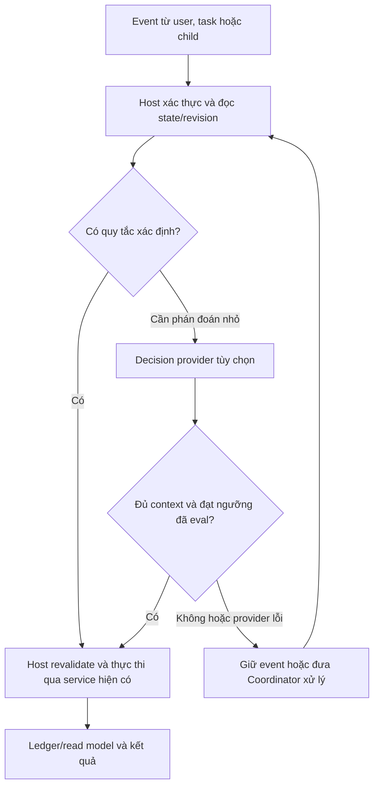

# DevKit harness: team sessions và lớp quyết định Jev

Ngày: 2026-10-30, Asia/Ho_Chi_Minh. Trạng thái: **thiết kế đề xuất để review; tài liệu này không triển khai hoặc kích hoạt tính năng**.

Người dùng yêu cầu viết doc trước, giao implementation cho agent khác; agent hiện tại chỉ lập plan và review. Phạm vi đã thống nhất về hướng sản phẩm: DevKit là harness, team dùng các sub-session đang được DevKit quản lý, bổ sung role và cách cha lập team; cha chọn nhóm tool DevKit cho con, con có thể xin thêm qua cha hoặc trực tiếp tới user. Jev là ứng viên hỗ trợ quyết định nhỏ, không thay Coordinator suy luận và không làm nơi cấp quyền. Chưa duyệt schema, ngưỡng, ngân sách, provider hoặc việc gửi dữ liệu thật tới Jev.

## 1. Mục tiêu và quan hệ với thiết kế cũ

DevKit phải giúp người dùng giao một mục tiêu, chia công việc thành các phần có context riêng, theo dõi các thành viên và kiểm chứng kết quả. Session cha giữ mục tiêu, phân tích và các quyết định quan trọng; không phải đọc mọi transcript hoặc thức dậy vì từng tin tiến độ.

Tài liệu này là phần bổ sung cho [team orchestration](2026-10-24-agent-hub-team-orchestration-design.md), [TEAM1 contracts](2026-10-25-team1-contracts.md) và [managed team contract](2026-10-25-managed-team-contract.md), không thay thế các hợp đồng ownership, acceptance, recovery, security đã có. Kế hoạch triển khai và prompt bàn giao ở [plan đi kèm](../plans/2026-10-30-devkit-harness-team-jev-plan.md).

Không xây lại agent loop của vendor, runner, task board, ledger, peer outbox hoặc approval gateway. Không thêm framework điều phối bên ngoài trong đợt này. Adapter Jev, nếu được chọn, chỉ đề xuất một quyết định cho host; nó không sở hữu workflow.

## 2. Hiện trạng được đối chiếu

Ảnh chụp source khi viết: HEAD `67b9164c`, nhánh `feat/child-tool-group-requests`, có thay đổi chưa commit do công việc khác. Đây không phải chứng nhận review hoặc trạng thái của mọi nhánh. Giữ nguyên các thay đổi đó; trước implementation phải đọc lại checkout thực tế.

| Phần | Bằng chứng trong source | Giới hạn cần giữ rõ |
| --- | --- | --- |
| Sub-session, identity, workspace, model/mode, sandbox | `internal/agenthub/service.go`, `adapter.go` | Tạo team phải dùng cùng service/gateway; không gọi CLI trực tiếp |
| Giao task và thông điệp giữa session | `internal/agentwork/handoff.go`, `internal/mcp/tools_agenthub_task.go`, `internal/agenthub/peer.go` | Delivery có trạng thái; transcript echo không chứng minh vendor đã nhận |
| Managed work và context package | `internal/agentwork/ledger.go`, `managed_service.go`, `managed_packages.go` | Các foundation không chứng minh dispatcher/team tự vận hành đã hoàn chỉnh |
| Role nền | `internal/app/managed_harness.go`, `managed_ownership.go` | Đã có `coordinator`, `implementer`, `reviewer`, `integrator`; chưa đồng nghĩa đã có role presets/team UX |
| Binding harness theo attempt | `internal/agentwork/managed_harness.go` và app adapter | Bind/preflight không tự tạo session, bật tool hoặc enqueue |
| Nhóm tool và live policy | `internal/harness/`, `internal/harnessconfig/`, `internal/agenthub/harness_runtime.go` | Quyền thực thi vẫn ở owning services; profile chỉ lọc tool |
| Xin thêm tool | [child tool groups design](2026-10-30-child-tool-group-requests-design.md), phần “As built” | Công việc khác đang triển khai; chưa review độc lập hoặc kiểm chứng vendor/native |

Đặc biệt: hợp đồng tool groups hiện tại dùng S để **bật thêm** nhóm. `toolGroups: []` được mô tả là không kế thừa thêm S; nó **không** loại các nhóm W đang bật. Lock hiện là no-grant rule, không phải deny filter với tool đã bật ở W. Vì vậy không được mô tả tính năng này là allowlist tuyệt đối hoặc chứng minh QC chỉ có một tập tool nhỏ. Nếu sản phẩm cần giới hạn thật, phải thiết kế narrowing riêng và review xuyên suốt lifecycle.

## 3. Ranh giới của DevKit harness

DevKit sở hữu identity, session lifecycle, scope, cấu hình harness, tool serving, quyền/gates, Tasks, work ownership, context/result packages, delivery/recovery và read model cho UI. Các vendor adapters sở hữu khác biệt giao thức và hành vi vendor. Runtime vendor tiếp tục sở hữu vòng gọi model/công cụ của nó theo adapter hiện hành.

Lớp điều phối có ba thành phần:

| Thành phần | Trách nhiệm | Không được làm |
| --- | --- | --- |
| Go host | Tính hành động hợp lệ, state transitions, dependencies, capacity, CAS, dispatch, gates và recovery | Dùng lời model làm bằng chứng authorization/verified |
| Coordinator model | Hiểu mục tiêu, chia task, xác định hợp đồng kỹ thuật, xử lý mâu thuẫn và ngoại lệ | Tự bỏ gate hoặc coi kết quả worker là accepted |
| Decision provider, Jev tùy chọn | Phân loại hoặc chọn trong các hành động host đã cho phép | Sinh quyền, tự tạo task graph, tự quyết acceptance, thay đổi runtime/model/account |



“Coordinator xử lý” ở đây không đồng nghĩa luôn gọi model ngay: pause, vault, queue, interaction và activation policy vẫn quyết định có được đánh thức hay không.

## 4. Role presets và team templates

### 4.1 Vai trò công việc tách khỏi quyền

Role mô tả trách nhiệm, hướng dẫn, đầu vào, đầu ra, tiêu chí kiểm tra và nhóm tool đề xuất. Role không cấp capability, quyền ghi, quyền phê duyệt hoặc quyền push/merge. Tên “QC” hoặc “Reviewer” không tạo ra approver identity.

Đề xuất giữ canonical role hiện có và thêm specialization có version, thay vì lập bộ enum thứ hai:

| Tên người dùng thấy | Canonical role đề xuất | Công việc |
| --- | --- | --- |
| Coordinator | `coordinator` | Phân tích, chia task, xử lý phụ thuộc và quyết định |
| Dev | `implementer` | Thực hiện một task trong scope được giao |
| QC | `reviewer` + specialization kiểm thử | Kiểm tra hành vi/acceptance, ghi lỗi và evidence |
| Code Reviewer | `reviewer` + specialization review code | Kiểm tra diff, thiết kế, regression và rủi ro |
| Integrator | `integrator` | Tích hợp phần được giao khi người có thẩm quyền cho phép |

QC là đề xuất mapping, chưa phải canonical role mới. Nếu cần QC viết/sửa code kiểm thử, phải chỉ rõ task, branch và writer ownership; không dùng nhãn reviewer để lách quy tắc một writer. Việc thêm canonical role chỉ làm sau khi chứng minh mapping này không đủ và review các role contracts, package schemas, binding và tests liên quan.

Một preset cần định danh/revision, canonical role, specialization, hướng dẫn ngắn, output contract và tool-group preferences. Vendor/model dùng các model profiles hiện có, không tạo hệ cấu hình model thứ hai. Quy tắc system/developer/AGENTS và policy host luôn có ưu tiên cao hơn nội dung preset/task.

Role tái sử dụng; session gắn với một work item/attempt. Không duy trì một session Dev duy nhất cho mọi việc. Chuyển role hoặc đổi hướng dẫn trên attempt đang chạy không được âm thầm thay package lịch sử; cách an toàn v1 là attempt/session mới qua đường reconciliation được hỗ trợ.

### 4.2 Team do cha đề xuất, host tạo theo policy

Team template mô tả các slot, role preset revisions, giới hạn số thành viên, dependency/handoff rules và review policy. Không bắt buộc tạo mọi slot cùng lúc. Coordinator phân tích để đề xuất task graph; host kiểm tra task IDs, scope, ownership, cycles/dependencies và capacity trước side effects.

Luồng ví dụ: người dùng giao mục tiêu → Coordinator lập các task → Dev thực hiện phần sẵn sàng → QC kiểm tra revision cụ thể → Dev nhận task sửa nếu cần → Code Reviewer nếu template yêu cầu → host/coordinator có thẩm quyền xử lý acceptance. Integration vẫn cần hành động cho phép theo hợp đồng hiện có.

Nhóm managed chỉ bật qua opt-in UI của parent task theo TEAM1. Sau opt-in, cha có thể đề xuất và lập team trong scope đã bật; một tool tạo con không tự bật managed group. Review/repair tự dispatch giữ opt-in theo group và giới hạn đã duyệt; integration không tự chạy. Role presets không có nghĩa mọi task phải qua mọi role.

## 5. Context và hợp đồng handoff

Mỗi worker nhận task description/acceptance, phạm vi code, constraints, đầu vào phụ thuộc có revision, role contract và output contract cần thiết. Không gửi toàn bộ hội thoại cha hoặc transcript của sibling theo mặc định. Dùng context packages và reference-scoped reads đã có; kết quả dài nằm trong artifact phù hợp, không nhét vào thông điệp báo tiến độ.

Worker trả outcome có kiểu, bản tóm tắt ngắn, thay đổi/revision, bằng chứng và blocker hoặc quyết định cần cha xử lý. Outcome/provenance tiếp tục theo package contract hiện có. “Tests pass” từ model chỉ là claim; evidence host/CI và review verdict phải gắn đúng revision.

Tiến độ cập nhật read model không cần gọi model. Coordinator nhận aggregate actionable events và reference, không toàn bộ lịch sử chạy. Có thêm mailbox không tự ngăn context tích tụ: cùng một context nhận nhiều task lâu dài vẫn có vấn đề. Theo dõi context/usage theo attempt và cả group, không chỉ session cha.

## 6. Chọn tool và xin thêm

Phần triển khai trực tiếp thuộc [child tool groups design](2026-10-30-child-tool-group-requests-design.md), không tạo API/ledger yêu cầu thứ hai trong tài liệu này.

- Cha chọn cấu hình tool ban đầu theo preset/task; Go xác thực quan hệ cha–con và phạm vi được cấp tiếp tại boundary áp dụng.
- Con chủ động xin thêm qua cha hoặc user; lỗi thiếu tool tự nó không tạo quyền hoặc tự bật nhóm.
- Cha có thể chấp thuận trong phạm vi host xác nhận được cấp tiếp. Vượt phạm vi đó chỉ được deny/forward tới user.
- Chuyển route giữ cùng request ID/revision. Peer message hoặc quyết định Jev không phải approval.
- User approve áp dụng đúng child/scope đã duyệt, không mở rộng cha, sibling hoặc W ngầm.
- Decline một request khác với durable block. Chỉ một hành động user rõ ràng mới tạo/lift block; cha không ghi đè block.
- Commit vào cấu hình khác với live endpoint acknowledged và vendor đã refresh. Báo đúng từng trạng thái; không báo usable chỉ vì lưu thành công.
- Restart không khôi phục approval cũ thành answerable. Yêu cầu mới đi qua gate hiện tại.

Giới hạn nhóm tool là availability, không phải sandbox hoặc capability boundary. Một role vẫn có thể có shell/file tools của vendor theo quyền đã cấp; ẩn `git.*` không chứng minh không thể dùng git qua đường khác được phép. Không bổ sung alternate runner để né owning service/gateway.

Điểm phải review trước khi quảng bá least-privilege team: narrowing dưới W, semantics empty/omitted, tạo con nhưng grant sau đó thất bại, lần gửi task đầu tiên, lock trên nhóm W đã bật, double user prompt và live refresh. Tài liệu này không coi các điểm đó đã giải quyết.

Một xung đột tích hợp phải giải quyết trước managed dispatch: C1 hiện resolve intended child từ W/V và từ chối actual child có S riêng (`HarnessOverridePresent`, kể cả S đã commit live). Luồng cấp/xin thêm tool mới lại ghi S của child. Vì vậy hai foundation không tự ghép được thành team dùng delegation. Cần một slice thiết kế binding/package revision cho cấu hình child được host chấp thuận, cả lúc tạo lẫn sau khi xin thêm; không xóa check C1, chấp nhận Desired như Applied hoặc sửa binding lịch sử tại chỗ để làm cho qua. Nếu chưa có hợp đồng thay thế đã review, managed attempt phải dừng với trạng thái configuration-needed/stale thích hợp.

## 7. Jev: quyết định nhỏ trong điều phối

### 7.1 Vai trò và giới hạn

Theo tài liệu TypeSafe, Jev nhận state cùng câu hỏi có kiểu. Choice/Score có probabilities/confidence; Noul trả xác suất và không có confidence riêng. Họ khuyến nghị câu hỏi nguyên tử, có phạm vi hẹp; câu hỏi cần extended reasoning phải tách ra. Đây không phải chứng minh Jev không có suy luận, cũng không phải bằng chứng có thể giao toàn bộ Coordinator cho Jev.

Confidence là thống kê của phân phối trả về, không phải bảo đảm độ chính xác thực nghiệm của DevKit. Không đặt một ngưỡng cố định cho mọi loại quyết định hoặc suy ra độ đúng từ tính hợp lệ của schema.

Jev tùy chọn và có thể thay thế. Hệ thống vẫn dùng được khi không cấu hình provider. Bản đầu chỉ xét phân loại/định tuyến event và wakeup; chưa chọn model, đánh giá chất lượng code, tự chia task hoặc approve tool bằng Jev.

### 7.2 Use cases

| Câu hỏi | Cách xử lý đề xuất |
| --- | --- |
| Event là progress, blocker, completion claim hay decision request? | Jev đề xuất nhãn; host vẫn giữ event gốc |
| Một thông điệp không rõ có cần cha chú ý ngay? | Jev hỗ trợ chọn defer/batch/coordinator trong các lựa chọn hợp lệ |
| Event có phải cập nhật ngữ nghĩa trùng? | Jev có thể đề xuất gom; không xóa event hoặc thay dedupe theo ID |
| Task phù hợp thành viên nào? | Phase sau: chọn trong candidate IDs host đã kiểm tra role/scope/capacity |
| Dependencies đã xong, queue paused, còn slot không? | Go quyết định, không cần inference |
| Con được cấp thêm tool nào, prod có cần confirm không? | Go và actor có thẩm quyền; Jev chỉ có thể gợi ý routing |
| Task đã accepted, có được replay/push/merge không? | Owning service và gate; không hỏi Jev để bỏ điều kiện |
| Phân tích yêu cầu lớn, thiết kế API, xử lý tradeoff? | Coordinator model |

### 7.3 Hợp đồng decision adapter đề xuất

Các tên sau là logical contract để implementation agent đối chiếu, không phải API đã duyệt:

```text
DecisionInput:
  schemaVersion, decisionId, questionKind, policyRevision
  groupId, workItemId?, attemptId?, generation?
  stateRevision, candidateSetDigest, sourceEventIds
  bounded admitted state + finite host-generated candidate IDs

DecisionOutput:
  decisionId, selectedCandidateId, questionKind
  distribution/confidence when supported by the question type
  provider/model version, status
```

Host tạo candidate set từ state hiện tại. Không để Jev sinh session IDs, command, path, tool args, grants, model names hoặc action ngoài danh sách. Luôn có abstain/escalate/defer khi phù hợp; thiếu candidate không được ép chọn một worker sai. Dữ liệu không đủ không thể sửa bằng confidence cao.

Decision adapter được inject qua interface; `internal/agentwork` giữ stdlib-only. HTTP/auth/provider mapping nằm ngoài leaf, wiring ở composition root. Không hardcode Jev trong generic ACP runtime hoặc thêm dependency vendor vào domain. Triển khai package cụ thể chỉ sau khi kiểm tra `internal/arch` và cấu trúc adapter hiện có.

Input chỉ có nội dung đã được host cho phép gửi tới provider. Bounded state không chỉ là IDs: nếu câu hỏi cần ngữ nghĩa, phải có tóm tắt tối thiểu phù hợp. Provider không được truy cập vault hoặc tự resolve artifact references.

Khi nhận output, host kiểm tra schema, candidate membership, status và ngưỡng riêng cho câu hỏi; re-read policy/state/capacity/scope và binding ở boundary side effect. Thay đổi revisions liên quan làm proposal stale; candidateSetDigest không thay thế CAS hoặc gateway checks.

Quyết định Jev không tự chuyển task state. Dispatch qua handoff, reservations, ownership và admission barriers hiện có. Retry inference, nếu được bật, chỉ retry việc hỏi model trong budget; không bao giờ ngầm retry action/session creation/enqueue.

### 7.4 Event, batching và fallback

Typed host progress/heartbeat thông thường đi thẳng read model, không cần Jev hoặc Coordinator. Typed blocker/permission/stop quan trọng đi route bắt buộc theo policy; Jev không được hạ cấp chúng thành progress. Jev chỉ xử lý phần mơ hồ còn lại.

Event được giữ bền vững theo substrate được chọn của TEAM; decision là kết quả phái sinh. Batching không xóa event hoặc làm giả đã xử lý. Watermark chỉ tiến khi các event thực sự được đưa vào prompt/consumer được định nghĩa và acknowledged theo hợp đồng. Nội dung peer chat và managed event không bị đồng nhất chỉ vì đều dùng delivery substrate hiện có.

Không gọi provider hoặc đánh thức cha khi vault locked, group disabled/paused, session closed, user queue/interaction chưa cho phép hoặc post-restart state chưa biết. Trước external call kiểm tra data-policy/cancellation, và kiểm tra lại khi nhận kết quả. Sau restart không tự gọi Jev/model để “khôi phục”.

Provider timeout, malformed response, abstain hoặc low confidence giữ event và đánh dấu cần Coordinator/review theo policy. Nếu hiện không được wake thì chờ, không lách qua session mới. Có deadline do host đặt để event mơ hồ không bị defer vô hạn, nhưng expiry chỉ tạo eligibility cho xử lý tiếp, không bỏ pause/approval. Không gọi Jev lỗi rồi mặc định chọn Dev hoặc cho phép action.

## 8. Dữ liệu, observability và recovery

Jev API thêm một nơi nhận dữ liệu. Provider phải được người dùng cấu hình/chấp thuận trước khi gửi task text hoặc tóm tắt ra ngoài. Không bật Jev như tác dụng phụ của tạo team. Khi chưa cấu hình hoặc mất mạng, fallback local vẫn hoạt động.

Theo TypeSafe, request/response khách hàng không dùng huấn luyện, nhưng retention tùy dữ liệu, hợp đồng và ZDR. Không mô tả tích hợp là offline, zero retention hoặc không rời máy. Không gửi secret, connection payload, log body, toàn transcript hoặc code mặc định; nội dung tối thiểu vẫn có thể nhạy cảm và cần data policy rõ.

API credential dùng cơ chế credential/vault hiện có, không đi vào prompt/audit. Chỉ lưu metadata quyết định như opaque IDs, revision, question kind, outcome, model version, latency và usage phù hợp. Payload task/result mới nếu cần lưu phải theo codec và associated-data binding hiện có, không ghi JSONL plaintext từ ví dụ SDK vào workspace.

Không dùng semantic dedupe để mất blocker, user request hoặc evidence. Không replay dispatch ambiguous, không thu hồi writer vì lease hết hạn, không restore question cũ thành answerable. Quyết định phái sinh có thể bị loại; execution facts và ownership không được suy ra lại từ model.

## 9. UI và khả năng giải thích

Team/Timeline là hai cách nhìn cùng group document, dùng stable `groupId` và shared workbench/sidebar theo [module shell integration](../../design/module-shell-integration.md). Không có sidebar/tab store thứ hai. Đóng view không dừng team.

Team view cho thấy role, task, trạng thái, quan hệ phối hợp và yêu cầu cần user. Timeline dùng execution intervals/events thật; không suy diễn thời gian chạy từ `updatedAt`. Progress/counts không gọi model để vẽ.

Chỉ hiện chi tiết điều phối khi giúp người dùng quyết định: queued vì dependency, đang chờ quyền, hoặc cần Coordinator xem. Provider/model version và routing metadata ở inspector kỹ thuật, không làm rối flow bình thường. QC findings không dùng màu/nhãn accepted trước gate. Chrome vẫn monochrome, status tokens biểu đạt trạng thái theo theme contract.

## 10. Đánh giá và rollout

Không tuyên bố giảm token hoặc tăng ổn định từ tài liệu/marketing. So sánh ít nhất ba cấu hình trên workload tương đương: Coordinator hiện tại; rules + batching không Jev; rules + batching + Jev. Nếu baseline không có managed dispatch hoàn chỉnh, bắt đầu bằng offline replay thay vì giả có production baseline.

Tập eval cần event tiếng Việt/Anh, báo cáo mơ hồ, completion claim sai, blocker lẫn tiến độ, prompt injection trong peer text, tool request, policy thay đổi, provider unavailable và stale decisions. Tách bộ tune ngưỡng khỏi holdout; dùng nhiều lần chạy khi kết quả có tính ngẫu nhiên.

Đo routing quality theo từng loại câu hỏi, blocker bỏ sót, false wake, thời gian tới xử lý, số lượt/context của cha, tổng usage/cost cả team gồm Jev, latency p50/p95 và completion quality. Ngưỡng chấp nhận/số mẫu phải được ghi trước rollout; không chọn chỉ tiêu sau khi thấy kết quả đẹp. Deterministic safety invariants phải luôn pass, không đánh đổi bằng confidence.

Rollout: offline fixtures → shadow không side effects → opt-in routing phạm vi hẹp → mở rộng nếu đạt gate. Shadow vẫn là gửi dữ liệu tới provider nếu dùng API thật, nên vẫn cần opt-in/data policy. Có thể dùng mock/offline trước mà chưa gửi gì. Pin model/question schema/policy revisions trong kết quả eval; đổi alias/model phải re-eval trước rollout.

## 11. Thứ tự triển khai và câu hỏi chưa chốt

1. Review/reconcile child tool groups đang làm; chốt khác biệt additive selection và narrowing thật.
2. Hoàn thiện role presets/team contracts trên foundation hiện có; không xây enum, model profile hoặc ledger trùng.
3. Hoàn thiện managed dispatch/recovery và rules-only event handling theo backlog TEAM hiện có; đo baseline.
4. Thêm decision interface, fixtures và shadow Jev cho event routing/wakeup, không side effects.
5. Chỉ sau eval mới opt-in áp routing; Team/Timeline lấy cùng read model và không phụ thuộc Jev.

Các mục chưa duyệt: role preset persistence/scope và cách sửa; narrowing thật; retry/expiry/batching budgets; giới hạn payload; provider/data policy; event consumer/ack boundary cụ thể; ngưỡng confidence và acceptance metrics; worker routing qua Jev ở phase sau. Không coi yêu cầu viết doc là duyệt hoặc kích hoạt các mục này.

## 12. Nguồn tham khảo và cách dùng

- [Harness Patterns](https://ashishpatel26.github.io/agent-harness-engineering-pattern/): dùng làm checklist thiết kế, nhất là Actor, Master–Worker, Proxy và Outbox; không phải runtime được tích hợp hoặc chứng nhận production cho DevKit.
- [TypeSafe introduction](https://docs.typesafe.ai/introduction): câu hỏi có kiểu và phạm vi phán đoán; tài liệu nhà cung cấp, không phải benchmark DevKit.
- [TypeSafe confidence](https://docs.typesafe.ai/confidence): confidence là hàm của distribution; threshold phụ thuộc use case.
- [TypeSafe patterns](https://docs.typesafe.ai/patterns): atomic decisions và confidence-gated routing.
- [TypeSafe API](https://api.typesafe.ai/redoc): tham khảo transport/schema khi viết adapter; xác minh lại version lúc triển khai.
- [Data usage/retention](https://help.typesafe.ai/articles/5974925716-how-is-submitted-data-used-or-retained): không training không đồng nghĩa zero retention.

Nguồn web đã được đọc trong cuộc trao đổi ngày 2026-10-30. Những mapping, boundaries và rollout ở trên là đề xuất cho DevKit, không phải tính năng hoặc bảo đảm của Jev.
